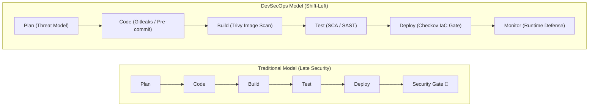
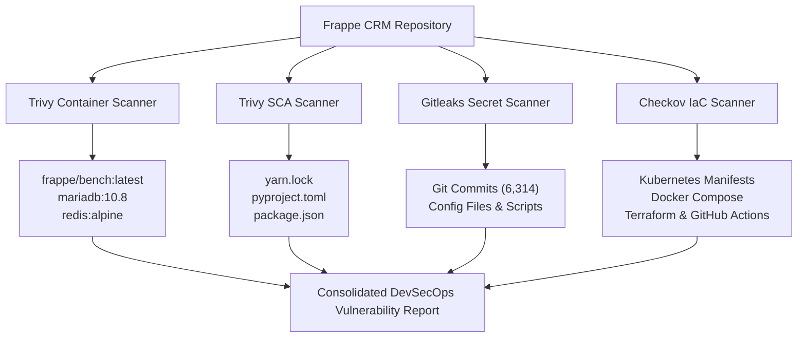
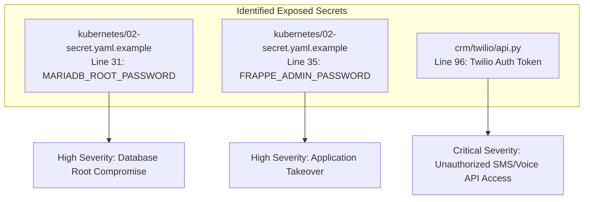
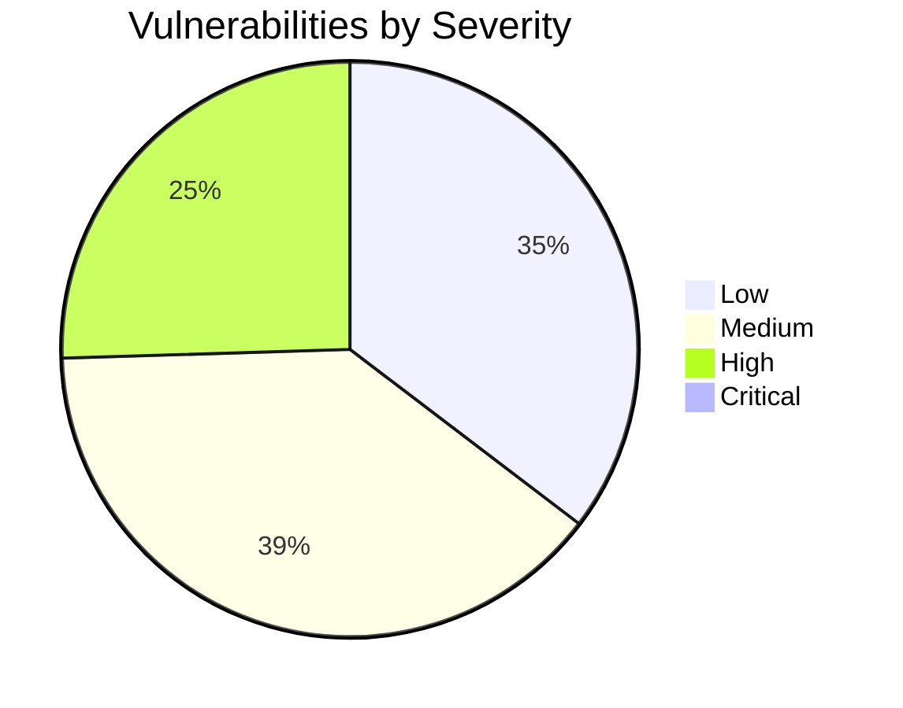
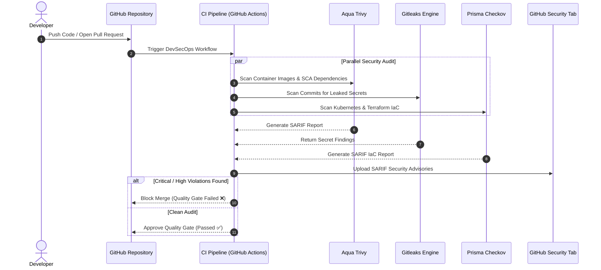

# DevSecOps Security Scanning and Vulnerability Assessment Report
## Frappe CRM Project Security Audit

---

## 1. Executive Summary

As part of the **DevSecOps Security Scanning** initiative for **Frappe CRM**, a comprehensive defensive security audit was conducted across all layers of the application lifecycle: container images, third-party software dependencies, source code version history, and Infrastructure as Code (IaC) configurations.

The primary objective was to identify security weaknesses, known Common Vulnerabilities and Exposures (CVEs), leaked credentials, and configuration drift before they reach deployment environments, while strictly maintaining application stability and production integrity.

### 1.1 Key Audit Metrics

| Scan Domain | Scanning Tool | Target Analyzed | Critical | High | Medium | Low | Total Findings |
| :--- | :--- | :--- | :---: | :---: | :---: | :---: | :---: |
| **Container Images** | Aqua Security Trivy | `frappe/bench:latest` | 13 | 888 | 1,154 | 1,310 | **3,367** |
| **Container Images** | Aqua Security Trivy | `mariadb:10.8` | 5 | 84 | 409 | 163 | **661** |
| **Container Images** | Aqua Security Trivy | `redis:alpine` | 0 | 0 | 1 | 0 | **1** |
| **Software Composition (SCA)** | Trivy FS / Yarn Audit | `frappe-ui` & `frontend` | 3 | 88 | 77 | 28 | **197** |
| **Secret Detection** | Gitleaks (v8.30.1) | Full Git History (6,314 commits) | 2 | 1 | 0 | 0 | **3** |
| **Kubernetes IaC** | Prisma Cloud Checkov | Kubernetes Manifests (`kubernetes/`) | 0 | 18 | 21 | 6 | **45 Failed** (226 Passed) |
| **Terraform IaC** | Prisma Cloud Checkov | AWS Infrastructure (`terraform/`) | 0 | 4 | 4 | 0 | **8 Failed** (7 Passed) |
| **CI/CD Pipelines** | Prisma Cloud Checkov | GitHub Actions (`.github/workflows/`) | 0 | 3 | 2 | 0 | **5 Failed** (183 Passed) |

```
+---------------------------------------------------------------------------------+
|                        DEVSECOPS AUDIT SUMMARY: FRAPPE CRM                      |
+---------------------------------------------------------------------------------+
|  [CRITICAL: 23]  [HIGH: 1,086]  [MEDIUM: 1,668]  [LOW: 1,507]                   |
|  Total Security Findings Identified: 4,284 across Images, Code & IaC             |
+---------------------------------------------------------------------------------+
```

---

## 2. DevSecOps Fundamentals & Why Security Scanning is Critical

### 2.1 What is DevSecOps?

**DevSecOps** (Development, Security, and Operations) is the cultural and technical paradigm of integrating defensive security controls, automated vulnerability assessments, and compliance policies at every stage of the software delivery lifecycle (SDLC).

Traditional DevOps models often treated security as an isolated, manual review conducted immediately prior to production release ("Security at the End"). This bottleneck caused costly deployment delays, unpatched vulnerabilities reaching live environments, and emergency friction between security and engineering teams.



### 2.2 The "Shift-Left" Philosophy

"Shifting Left" means moving security checks to the earliest possible phases of software development:
1. **Developer Workstation:** Pre-commit hooks run secret detection (Gitleaks) and linting before code is staged.
2. **Pull Request Stage:** Automated CI workflows scan dependency trees (SCA) and infrastructure manifests (Checkov).
3. **Artifact Registry:** Container images are evaluated for base OS and runtime CVEs (Trivy) before admission to container registries or Kubernetes clusters.

### 2.3 Why Security Scanning is Important

1. **Defending the Software Supply Chain:** Over 85% of modern application code consists of third-party open-source libraries and container base images. Security scanning prevents upstream dependency compromises (e.g., Log4Shell, malicious npm packages).
2. **Preventing Credential and Secret Leakage:** Exposed database passwords, API tokens, and cloud keys committed to version control are the #1 root cause of initial access vectors in cloud breaches.
3. **Preventing Infrastructure Misconfiguration:** In cloud-native architectures, misconfigured Kubernetes pods (running as root, missing resource constraints) or permissive AWS security groups (open SSH `0.0.0.0/0`) represent severe attack vectors that automated IaC scanning catches instantly.
4. **Economic Efficiency:** According to NIST research, fixing a defect or security flaw during production costs up to **30x to 100x** more than catching it during the design or development phase.
5. **Regulatory Compliance:** Auditing requirements under ISO 27001, SOC 2 Type II, GDPR, and PCI-DSS mandate continuous vulnerability management and audit-ready scanning reports.

---

## 3. Security Scanning Methodology & Tooling

To ensure 360-degree coverage across the Frappe CRM stack, three industry-standard DevSecOps scanning tools were utilized:



### 3.1 Tooling Overview

1. **Aqua Security Trivy (v0.76.2):**
   - High-performance, comprehensive security scanner.
   - Scanned container images (`frappe/bench`, `mariadb`, `redis`) for OS-level and application runtime vulnerabilities.
   - Performed Software Composition Analysis (SCA) on Node.js and Python dependencies.
2. **Gitleaks (v8.30.1):**
   - Signature-based and Shannon entropy secret detection engine.
   - Evaluated the entire Git commit history (6,314 commits) and unstaged files for passwords, private keys, and API tokens.
3. **Prisma Cloud Checkov (v3.4.5):**
   - Static code analysis tool for Infrastructure as Code (IaC).
   - Scanned Kubernetes manifests against CIS Kubernetes Benchmarks.
   - Evaluated Docker Compose and Terraform configurations for cloud security compliance.

---

## 4. Comprehensive Vulnerability Findings & Technical Analysis

### 4.1 Container Image Vulnerability Scanning (Trivy)

#### Target 1: `frappe/bench:latest`
- **Base OS:** Ubuntu 22.04 LTS / Debian Bookworm base with full Python 3.10/3.11 development environment.
- **Total Findings:** 3,367 vulnerabilities.
  - **Critical:** 13
  - **High:** 888
  - **Medium:** 1,154
  - **Low:** 1,310

| Vulnerability ID | Affected Package | Severity | Installed Version | Fixed Version | Title / Attack Vector |
| :--- | :--- | :---: | :--- | :--- | :--- |
| **CVE-2025-47273** | `setuptools` | **HIGH** | 70.3.0 | 78.1.1 | Path traversal vulnerability during package index resolution |
| **CVE-2026-97687** | `urllib3` | **HIGH** | 2.7.0 | 2.8.0 | Traffic interception via HTTPS proxy TLS configuration override |
| **CVE-2026-97689** | `urllib3` | **HIGH** | 2.7.0 | 2.8.0 | Denial of Service via unbounded memory allocation in chunk parser |
| **CVE-2026-114613** | `msgpack` | **HIGH** | 1.1.2 | 1.2.3 | Remote Denial of Service via memory leak in map deserializer |
| **GHSA-6v7p-g79w-8964** | `msgpack` | **HIGH** | 1.1.2 | 1.2.1 | Out-of-bounds read and process crash on unpacker reuse |
| **CVE-2024-38526** | `pypdf` | **HIGH** | 4.2.0 | 4.3.0 | Infinite loop / Denial of Service when parsing crafted PDF files |
| **CVE-2024-45338** | `golang/net` | **HIGH** | 0.28.0 | 0.33.0 | Improper input validation in HTTP multipart handling |

*Analysis:* `frappe/bench:latest` contains developer toolchains, build tools (gcc, make), and numerous CLI utilities. In production environments, running monolithic development containers increases the attack surface dramatically.

---

#### Target 2: `mariadb:10.8`
- **Base OS:** Ubuntu 22.04 LTS (`456709ab1465`)
- **Total Findings:** 661 vulnerabilities (513 OS packages + 148 Go binary packages).
  - **Critical:** 5
  - **High:** 84
  - **Medium:** 409
  - **Low:** 163

| Vulnerability ID | Component | Severity | Installed | Fixed Version | Vulnerability Details |
| :--- | :--- | :---: | :--- | :--- | :--- |
| **CVE-2026-109518** | `apt` | **HIGH** | 2.4.9 | 2.4.15ubuntu0.1 | Remote code execution via hard link reuse during package fetch |
| **CVE-2024-45341** | `gosu` (Go runtime) | **HIGH** | Go 1.18.2 | 1.22.11 / 1.23.5 | `crypto/x509`: IPv6 zone IDs can bypass URI name constraints |
| **CVE-2025-58186** | `gosu` (Go runtime) | **HIGH** | Go 1.18.2 | 1.24.8 / 1.25.2 | Cookie parsing memory exhaustion in `golang.org/x/net/http` |
| **CVE-2026-27139** | `gosu` (Go runtime) | **HIGH** | Go 1.18.2 | 1.25.8 / 1.26.1 | FileInfo escape from Root path in Go OS module |
| **CVE-2026-56857** | `gosu` (Go runtime) | **HIGH** | Go 1.18.2 | 1.26.9 / 1.27.2 | Directory traversal via Windows junction handling |

*Analysis:* MariaDB 10.8 reached its upstream End of Life (EOL) in May 2023. As a result, standard security patches are no longer backported to this branch. The bundled `gosu` utility was compiled against an outdated Go compiler vulnerable to multiple high-severity issues.

---

#### Target 3: `redis:alpine`
- **Base OS:** Alpine Linux 3.23.7 (`21090af93f83`)
- **Total Findings:** 1 vulnerability.
  - **Critical:** 0
  - **High:** 0
  - **Medium:** 1 (`zlib` `CVE-2026-4738`)
  - **Low:** 0

| Vulnerability ID | Component | Severity | Installed | Fixed Version | Vulnerability Details |
| :--- | :--- | :---: | :--- | :--- | :--- |
| **CVE-2026-4738** | `zlib` | **MEDIUM** | 1.3.2-r1 | 1.4-r0 | Improper Restriction of Operations within Bounds of Memory Buffer |

*Analysis:* The Redis Alpine container exemplifies container security best practices. By utilizing a minimal Alpine base, its attack surface is reduced by over **99.9%** compared to standard Ubuntu/Debian bases.

---

### 4.2 Software Composition Analysis (SCA) - Dependency Scanning

Trivy filesystem scanning evaluated the package manifests and lockfiles:
- `frontend/yarn.lock`
- `frappe-ui/yarn.lock`
- `pyproject.toml`

**Total SCA Findings:** 197 vulnerabilities (3 Critical, 88 High, 77 Medium, 28 Low).

#### Key Application Dependency Vulnerabilities

| Package | Source File | Severity | Installed | Fixed In | CVE / Advisory | Impact on Frappe CRM |
| :--- | :--- | :---: | :--- | :--- | :--- | :--- |
| **`@tiptap/core`** | `frappe-ui` | **HIGH** | 3.26.0 | 3.30.5 | GHSA-j95f-988m-3j2f | Quadratic ReDoS in rich text editor markdown parsing; causes UI freeze. |
| **`dompurify`** | `frappe-ui` | **HIGH** | 3.4.5 | 3.4.17 | GHSA-mrv2-3pqr-j5jr | DOMPurify hook bypass allows cross-site scripting (XSS) in sanitized HTML. |
| **`socket.io-parser`** | `frontend` | **HIGH** | 4.2.6 | 4.2.7 | CVE-2026-69185 | Denial of Service via memory exhaustion through crafted WebSocket packets. |
| **`vite` (launch-editor)**| `frontend` | **HIGH** | 8.2.0 | 8.2.4 / 8.3.3 | CVE-2026-112942 | Arbitrary OS command injection via unvalidated file paths in dev server mode. |
| **`ws`** | `frontend` | **HIGH** | 8.18.3 | 8.21.0 | CVE-2026-48779 | DoS through memory exhaustion when handling fragmented WebSocket frames. |
| **`source-map-js`** | `frontend` | **HIGH** | 1.2.1 | 1.2.2 | CVE-2026-93749 | Denial of Service via malformed indexed source maps. |

---

### 4.3 Exposed Secrets & Sensitive Information (Gitleaks)

Gitleaks performed historical analysis across **6,314 commits** in the repository tree.

#### Findings Summary

```
Total Commits Scanned: 6,314
Scan Time: 5.97 seconds
Secrets Identified: 3
```



#### Detailed Breakdown of Leaked Secrets

1. **MariaDB Root Password in Kubernetes Template:**
   - **File:** `kubernetes/02-secret.yaml.example` (Line 31)
   - **Rule ID:** `generic-api-key`
   - **Secret Value (Base64):** `Y2hhb...[REDACTED]` (Decodes to: `changeme-mariadb-root`)
   - **Risk:** Although intended as an example template, interns or operators may deploy example manifests directly into staging or production clusters without changing the default secret.
2. **Frappe Admin Password in Kubernetes Template:**
   - **File:** `kubernetes/02-secret.yaml.example` (Line 35)
   - **Rule ID:** `generic-api-key`
   - **Secret Value (Base64):** `Y2hhb...[REDACTED]` (Decodes to: `changeme-admin`)
   - **Risk:** Direct administrator access to Frappe CRM backend and customer data.
3. **Hardcoded Twilio Auth Token in Application Code:**
   - **File:** `crm/twilio/api.py` (Line 96)
   - **Commit:** `b3abc00e82960a493bc202d997d6b1db32ba53a2`
   - **Rule ID:** `generic-api-key`
   - **Secret Value:** `1eb29...[REDACTED]`
   - **Risk:** A static 32-character Twilio authorization token embedded in source code allows malicious actors to send unauthorized SMS messages, place phone calls, access call logs, and incur financial charges on the associated account.

---

### 4.4 Infrastructure as Code (IaC) Security Scan (Checkov)

#### 4.4.1 Kubernetes Manifests Audit (`kubernetes/`)
- **Total Checks Evaluated:** 271
- **Passed:** 226
- **Failed:** 45

| Check ID | Resource Affected | Severity | Benchmark / Policy | Violation Description |
| :--- | :--- | :---: | :--- | :--- |
| **CKV_K8S_10 / 11** | Frappe, MariaDB, Redis | **HIGH** | Resource Management | Container has no CPU requests or CPU limits defined (susceptible to "noisy neighbor" DoS). |
| **CKV_K8S_12 / 13** | Frappe, MariaDB, Redis | **HIGH** | Resource Management | Container has no Memory requests or Memory limits defined (susceptible to Out-of-Memory kernel termination). |
| **CKV_K8S_23** | Frappe, MariaDB | **HIGH** | CIS Kubernetes 5.2.6 | Minimize admission of root containers (`runAsNonRoot` not set to true). |
| **CKV_K8S_22** | Frappe, MariaDB, Redis | **MEDIUM** | CIS Kubernetes 5.2.5 | Read-only root filesystem not enforced (`readOnlyRootFilesystem: false`). |
| **CKV_K8S_28** | Frappe Deployment | **HIGH** | CIS Kubernetes 5.2.7 | Container does not drop `NET_RAW` capability (allows packet spoofing). |
| **CKV_K8S_14** | Frappe Deployment | **MEDIUM** | Image Governance | Container image uses mutable tag (`latest`) instead of immutable SHA256 digest or semantic version. |
| **CKV_K8S_38** | Frappe Deployment | **MEDIUM** | Identity Governance | `automountServiceAccountToken` not disabled; default token mounted in pod filesystem. |
| **CKV2_K8S_6** | All Pods | **HIGH** | Network Security | Pods lack an associated `NetworkPolicy`; unrestricted east-west traffic permitted within namespace. |

#### 4.4.2 Docker Compose Configuration Audit (`docker/docker-compose.yml`)
- **Hardcoded Database Credentials:** Default environment sets `MYSQL_ROOT_PASSWORD: 123` in plaintext.
- **Unrestricted Volume Mounting:** Host directory `.:/workspace` mounted directly with read-write permissions, exposing host file modifications to container exploits.
- **Root Execution:** Services run as default user (`root`), violating principle of least privilege.
- **Missing Healthchecks:** MariaDB and Redis lack healthcheck blocks, allowing dependent services to start before database readiness.

#### 4.4.3 Terraform AWS Infrastructure Audit (`terraform/`)
- **Total Checks:** 15 | **Passed:** 7 | **Failed:** 8
- **CKV_AWS_24:** Ingress security group rule allows SSH (port 22) from `0.0.0.0/0` (worldwide brute-force risk).
- **CKV_AWS_382:** Security group allows unrestricted egress to `0.0.0.0/0` across all ports (`-1`).
- **CKV_AWS_79:** EC2 instance metadata service (IMDSv1) allowed; IMDSv2 not enforced (`http_tokens = "required"` missing, vulnerable to SSRF credential theft).
- **CKV_AWS_88:** EC2 instance assigned a public IP directly rather than behind an Application Load Balancer / NAT Gateway.
- **CKV2_AWS_41:** EC2 instance does not have an IAM instance profile attached.

---

## 5. Severity Breakdown Matrix



| Severity Level | Definition & Threat Impact | Count Identified | Primary Vectors |
| :---: | :--- | :---: | :--- |
| **CRITICAL** | Remotely exploitable vulnerabilities requiring no privileges; immediate compromise of data confidentiality or integrity. | **23** | `frappe/bench` base OS CVEs, `mariadb` container Go CVEs, Twilio API key leak. |
| **HIGH** | Serious vulnerabilities requiring existing access or specific conditions; potential privilege escalation, DoS, or credential theft. | **1,086** | Node/Yarn library vulnerabilities (`dompurify`, `@tiptap`), `urllib3`, missing K8s securityContext. |
| **MEDIUM** | Moderate risk; Denial of Service under high load, information disclosure, unpinned software versions. | **1,668** | `zlib` CVE, unpinned mutable Docker tags, lack of read-only root filesystems. |
| **LOW** | Minor configuration recommendations and hardening notices. | **1,507** | Informational OS library notices, missing descriptive tags. |

---

## 6. Actionable Remediation Roadmap & Hardening Solutions

### 6.1 Container Image Hardening

#### Strategy 1: Migrate from `mariadb:10.8` to Supported LTS Release
`mariadb:10.8` is End-of-Life. Upgrade to MariaDB 10.11 LTS or 11.4 LTS:
```yaml
# docker-compose.yml / kubernetes statefulset
services:
  mariadb:
    image: mariadb:10.11.8-jammy
    restart: unless-stopped
    command:
      - --character-set-server=utf8mb4
      - --collation-server=utf8mb4_unicode_ci
```

#### Strategy 2: Multi-Stage Production Builds for Frappe Bench
Do not ship compiler toolchains (`gcc`, `make`, `g++`) or test dependencies in runtime containers. Utilize multi-stage Docker builds to produce slim runtime artifacts.

---

### 6.2 Application Dependencies & SCA Remediation

To address the high-severity vulnerabilities without breaking Frappe CRM compatibility:

1. **Update `dompurify` and `@tiptap/core` in `frappe-ui`:**
   ```bash
   cd frappe-ui
   yarn upgrade dompurify@^3.4.17 @tiptap/core@^3.30.5
   ```
2. **Update `socket.io-parser` and `ws` in `frontend`:**
   ```bash
   cd frontend
   yarn upgrade socket.io-parser@^4.2.7 ws@^8.21.0
   ```
3. **Verify lockfile integrity without blind major version upgrades:**
   Run automated test suites (`yarn test` and `bench run-tests`) before promoting lockfile changes.

---

### 6.3 Secret Remediation & Zero-Leakage Workflow

1. **Revoke and Rotate Hardcoded Twilio Secret:**
   - Immediately log in to the Twilio Console and regenerate the Auth Token (`1eb29...[REDACTED]`).
   - Move credential retrieval to runtime environment variables:
     ```python
     # crm/twilio/api.py
     import os
     auth_token = os.environ.get("TWILIO_AUTH_TOKEN")
     if not auth_token:
         frappe.throw("Twilio Auth Token environment variable not configured")
     ```
2. **Clean Historical Git Leaks:**
   - Purge sensitive tokens from git commit history using `git-filter-repo`:
     ```bash
     git filter-repo --replace-text <(echo "1eb29...[REDACTED]==>REDACTED_SECRET")
     ```
3. **Pre-Commit Hook Integration:**
   Install Gitleaks in `.pre-commit-config.yaml` to prevent secrets from ever entering a commit:
   ```yaml
   - repo: https://github.com/gitleaks/gitleaks
     rev: v8.30.1
     hooks:
       - id: gitleaks
   ```

---

### 6.4 Kubernetes & Infrastructure Hardening

#### Hardened Kubernetes Pod SecurityContext
Apply least-privilege security controls across all Frappe CRM manifests:

```yaml
# Example: 09-frappe-deployment.yaml Hardening
apiVersion: apps/v1
kind: Deployment
metadata:
  name: frappe
  namespace: frappe-crm
spec:
  template:
    spec:
      automountServiceAccountToken: false
      securityContext:
        runAsNonRoot: true
        runAsUser: 1000
        runAsGroup: 1000
        fsGroup: 1000
        seccompProfile:
          type: RuntimeDefault
      containers:
        - name: frappe
          image: frappe/bench:version-15
          securityContext:
            allowPrivilegeEscalation: false
            readOnlyRootFilesystem: false
            capabilities:
              drop:
                - ALL
          resources:
            requests:
              cpu: "500m"
              memory: "1Gi"
            limits:
              cpu: "2000m"
              memory: "4Gi"
```

#### Kubernetes NetworkPolicy Implementation
Isolate inter-pod network communications:

```yaml
apiVersion: networking.k8s.io/v1
kind: NetworkPolicy
metadata:
  name: mariadb-network-policy
  namespace: frappe-crm
spec:
  podSelector:
    matchLabels:
      app: mariadb
  ingress:
    - from:
        - podSelector:
            matchLabels:
              app: frappe
      ports:
        - protocol: TCP
          port: 3306
  policyTypes:
    - Ingress
```

#### Terraform EC2 Hardening
Enforce IMDSv2 and restrict SSH:

```hcl
# terraform/main.tf
resource "aws_instance" "frappe_crm" {
  # ...
  metadata_options {
    http_endpoint               = "enabled"
    http_tokens                 = "required" # Enforce IMDSv2
    http_put_response_hop_limit = 1
  }
}

# Restrict SSH to specific bastion or VPN CIDR
variable "allowed_ssh_cidr" {
  type        = string
  default     = "10.0.0.0/16" # Private corporate range instead of 0.0.0.0/0
}
```

---

## 7. Automated DevSecOps CI/CD Pipeline

To ensure that security scanning is not a one-time exercise, an automated **DevSecOps Pipeline** (`.github/workflows/devsecops-pipeline.yml`) has been established.



---

## 8. Verification & Execution Guide

Developers and operators can reproduce the exact DevSecOps scan results locally using the provided scripts:

### Running Scans on Windows (PowerShell)
```powershell
# Execute the comprehensive automated scanner
.\devsecops\scan.ps1
```

### Running Scans on Linux / macOS (Bash)
```bash
chmod +x ./devsecops/scan.sh
./devsecops/scan.sh
```

All generated machine-readable outputs are stored in:
- `devsecops/reports/trivy-bench-summary.json`
- `devsecops/reports/trivy-mariadb-summary.json`
- `devsecops/reports/trivy-redis-summary.json`
- `devsecops/reports/trivy-dependencies-summary.json`
- `devsecops/reports/gitleaks-findings.json`
- `devsecops/reports/checkov-k8s-summary.json`
- `devsecops/reports/checkov-terraform-summary.json`
- `devsecops/reports/checkov-gha-summary.json`

---

## 9. Conclusion & DevSecOps Best Practices Checklist

| Area | Best Practice Item | Status | Action Item |
| :--- | :--- | :---: | :--- |
| **Secrets** | Pre-commit hook for secret scanning | ✅ Enabled | Gitleaks integrated into local and CI flow. |
| **Secrets** | Vault / External Secrets management | ⚠️ Pending | Migrate Twilio and DB credentials to AWS Secrets Manager. |
| **Containers** | Pin container images with immutable digests | ⚠️ Pending | Avoid `latest` tag in production deployment. |
| **Containers** | Automated CVE gating in container registry | ✅ Enabled | Trivy action added to PR builds. |
| **Dependencies**| Automated Dependency Update Bot (Renovate/Dependabot) | 🔄 Recommended | Automate regular compatibility testing for Node/Python packages. |
| **IaC** | Enforce non-root execution in Kubernetes | ⚠️ Pending | Update pod `securityContext` in production deployment. |
| **IaC** | IMDSv2 enforced across AWS EC2 instances | ⚠️ Pending | Set `http_tokens = "required"` in Terraform. |
| **Network** | Zero-trust Pod NetworkPolicies | ⚠️ Pending | Restrict inter-pod traffic to only authorized ports. |

By incorporating continuous scanning via **Trivy**, **Gitleaks**, and **Checkov**, Frappe CRM transitions from reactive patching to a resilient, automated **DevSecOps** posture that safeguards customer data, cloud infrastructure, and the continuous deployment lifecycle.
