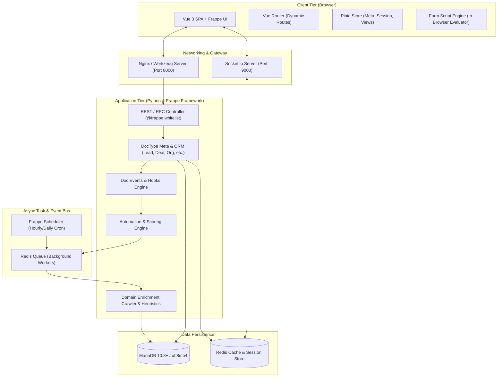

# Frappe CRM — Project Architecture, Technology Stack & System Analysis

## 1. Executive Summary

**Frappe CRM** is a modern, open-source Customer Relationship Management (CRM) platform developed by Frappe Technologies. It is engineered specifically for modern sales teams seeking an agile, customizable, and cost-effective alternative to monolithic, legacy CRM platforms like Salesforce or HubSpot.

Unlike traditional CRMs that impose artificial licensing limits or complex proprietary abstractions, Frappe CRM provides:
- **Unlimited Users & Open Extensibility**: Built on the open-source GPL-3.0 license.
- **Unified Lead & Deal Workflows**: Streamlined sales pipeline visualization with drag-and-drop Kanban boards, customizable views, activity timelines, and direct omni-channel interactions.
- **Native Telephony & Messaging**: Integrated out of the box with Twilio, Exotel, and WhatsApp.
- **Rule-Based Automated Domain Enrichment**: Automatic extraction of company metadata, contact information, logos, and social profiles directly from customer websites without third-party API fees.
- **Dynamic In-Browser Form Scripting Engine**: Extensible client-side scripting running with reactive proxies without requiring frontend build steps.
- **ERPNext Integration**: Native synchronization with ERPNext for quotes, sales orders, item catalogs, and billing.

---

## 2. Technology Stack & Architectural Overview

Frappe CRM follows a decoupled, full-stack architecture combining a robust Python backend with a high-performance Vue 3 Single Page Application (SPA) frontend.



### Detailed Stack Breakdown:

| Layer | Technology | Role & Purpose |
| :--- | :--- | :--- |
| **Backend Runtime** | **Python 3.10+** | Core execution environment for the server-side logic and background tasks. |
| **Backend Framework** | **Frappe Framework (v15 / v16)** | Full-stack Python web framework providing ORM (DocTypes), authentication, role-based access control (RBAC), database migrations, and REST/RPC endpoints. |
| **Relational Database** | **MariaDB 10.6 / 10.8** | Primary ACID-compliant relational database running `utf8mb4_unicode_ci` with row-level transaction safety. |
| **In-Memory Cache & Bus** | **Redis (Cache, Queue, SocketIO)** | Triple-role in-memory engine: caching metadata/sessions, managing asynchronous background jobs via Python RQ, and broadcasting real-time events over WebSockets. |
| **Realtime WebSockets** | **Socket.io + NodeJS** | Low-latency bi-directional communication pushing instant updates (document locks, notifications, live activity) to the frontend. |
| **Frontend Framework** | **Vue 3 (Composition API)** | Reactive Single Page Application utilizing `<script setup>` syntax for modern, modular components. |
| **UI Component Library** | **`frappe-ui`** | Tailwind CSS-based component framework tailored for Frappe apps (buttons, modals, dropdowns, form controls). |
| **Frontend Build Tool** | **Vite 8+** | Ultra-fast build tool and development server supporting Instant HMR (Hot Module Replacement). |
| **State Management** | **Pinia 2** | Centralized reactive stores for user sessions, doctype metadata, views, and app settings. |
| **Styling** | **Tailwind CSS 3.4** | Utility-first CSS framework delivering responsive desktop and mobile layouts. |
| **Containerization** | **Docker & Docker Compose** | Multi-container orchestration encapsulating MariaDB, Redis, and Frappe Bench. |
| **Testing Harness** | **Vitest & Playwright** | Fast unit testing for pure utilities and robust end-to-end (E2E) browser automation. |

---

## 3. Project Directory Structure & Key Modules

The repository is logically partitioned into the Python backend (`crm/`), the Vue 3 frontend (`frontend/`), container configurations (`docker/`), and automated testing suites:

```
frappe-crm-devops-internship/
├── .devcontainer/              # VS Code Dev Containers configuration
├── .github/                    # CI/CD Workflows (tests, builds, linters)
├── crm/                        # Frappe Backend Application (Python)
│   ├── api/                    # Whitelisted RPC/REST endpoints
│   ├── automation/             # Workflow triggers, actions, and lead scoring
│   ├── demo/                   # Demo dataset generator (leads, deals, tasks)
│   ├── domain_enrichment/      # Built-in crawler & rule-based metadata extractor
│   ├── extends/                # Document extensions (Notification Log)
│   ├── fcrm/doctype/           # Core Frappe DocType definitions
│   ├── integrations/           # Third-party integrations (ERPNext, Twilio, Exotel)
│   ├── lead_syncing/           # Background lead sync (e.g. Facebook Lead Ads)
│   ├── overrides/              # Standard Frappe class overrides
│   ├── permissions/            # Organizational hierarchy & role-based security
│   └── hooks.py                # Frappe app lifecycle hooks, routes & events
├── docker/                     # Docker Compose & container initialization
│   ├── docker-compose.yml      # Orchestration for MariaDB, Redis, and Bench
│   └── init.sh                 # Container entrypoint script
├── docs/                       # Architectural documentation (User Hierarchy, etc.)
├── e2e/                        # Playwright End-to-End integration test suite
├── frappe-ui/                  # Vendored frappe-ui source
├── frontend/                   # Vue 3 SPA Application
│   ├── src/
│   │   ├── components/         # Reusable Vue components & FieldLayout engine
│   │   ├── composables/        # Vue composables (attachments, settings, etc.)
│   │   ├── data/               # Reactive document layer & script evaluator
│   │   ├── doctypes/           # DocType client scripts
│   │   ├── pages/              # Primary route views (Leads, Deals, Contacts, etc.)
│   │   ├── stores/             # Pinia state stores (meta, session, views, users)
│   │   └── utils/              # Pure utilities & unit-tested business logic
│   ├── tests/unit/             # Vitest unit test suite (118+ tests)
│   └── package.json            # Frontend dependencies & Vite configuration
└── pyproject.toml              # Python dependencies & build metadata
```

---

## 4. Deep-Dive into Core Architectural Subsystems

### 4.1. The Dynamic Form Scripting Engine
One of Frappe CRM's most sophisticated architectural features is its **client-side Form Scripting Engine** (`frontend/src/data/script.js` and `frontend/src/data/document.js`).

- **No Build Step Required**: Unlike traditional Vue components, custom form scripts are stored as text records in the database (`CRM Form Script`) and evaluated dynamically in the browser using `new Function()`.
- **Live Reactive Proxies**: The engine constructs a reactive JavaScript proxy (`createDocProxy`) wrapping `this.doc`. Developers can read and mutate field values directly without `.value` boilerplate.
- **Lifecycle & Field Hooks**:
  ```javascript
  class CRMLead {
    async onLoad() {
      // Fires once when the document loads from the server
      if (this.doc.annual_revenue > 100000) {
        this.setFieldProperty('priority', 'value', 'High');
      }
    }

    status() {
      // Fires dynamically when the 'status' field changes
      if (this.value === 'Qualified') {
        this.setFieldProperty('qualification_notes', 'mandatory', true);
      }
    }
  }
  ```
- **Declarative Layout Manipulation**: Methods like `setFieldProperty(fieldName, property, value)` dynamically control visibility, read-only state, options, and mandatory validation for individual fields, sections, tabs, or child table columns.

---

### 4.2. Domain Enrichment Engine
Located at `crm/domain_enrichment/`, this module implements an **autonomous web crawler and rule-based metadata extractor** that enriches Lead, Deal, and Organization records using only a company domain URL:

- **Self-Contained & Free**: Operates without costly third-party enrichment APIs (Clearbit, ZoomInfo).
- **Architecture**:
  1. **Crawler (`crawler.py`)**: Executes an asynchronous Breadth-First Search (BFS) crawl over the target website with strict Server-Side Request Forgery (SSRF) protections and page caps.
  2. **Rule-Based Extractors (`extractors.py`)**: Uses Beautiful Soup, regex, JSON-LD, OpenGraph tags, and favicon algorithms to extract company descriptions, emails, phone numbers, industry tags, and social profiles.
  3. **Config as Data**: Keyword rules and patterns are configured as records (`CRM Enrichment Rule`) in the desk rather than hardcoded in Python.
  4. **Provenance & Auditability**: Stores `{ value, source_url, extraction_method }` for every piece of extracted data in `CRM Enrichment Run`.

---

### 4.3. Sales Hierarchy & Granular Visibility
Located at `crm/permissions/` and documented in `docs/user-hierarchy.md`:
- **Reporting Tree**: Sales teams are organized into an interactive visual hierarchy.
- **Permission Query Conditions**: Hooked directly into Frappe's database queries (`permission_query_conditions` in `hooks.py`).
  - **Sales Managers**: Automatically granted read and write visibility into leads and deals owned by themselves and any subordinate in their reporting subtree.
  - **Sales Users**: Restricted strictly to their own assigned records.
  - **Shared Visibility**: Handles assignments via `ToDo` and explicit shares via `DocShare`.

---

### 4.4. Telephony & Communication Hub
Integrated telephony enables seamless outbound and inbound calling directly inside the browser:
- **Twilio Integration (`crm/integrations/twilio/`)**: Uses `@twilio/voice-sdk` on the frontend and Twilio REST APIs on the backend to initiate calls, stream audio, record conversations, and log duration.
- **Exotel Integration (`crm/integrations/exotel/`)**: Bridges calls directly between sales agents' mobile phones and customer phone numbers.
- **Activity Timeline**: All calls, WhatsApp conversations, email threads, notes, and task assignments automatically aggregate into a unified chronological activity feed on the Lead or Deal view.

---

## 5. How the Application Runs

### 5.1. Multi-Container Docker Architecture
The containerized setup in `docker/docker-compose.yml` launches three coordinated microservices:

1. **`mariadb` (Port 3306)**:
   - Configured with `utf8mb4` character set, unicode collation, and InnoDB buffers.
   - Persists data in a Docker named volume (`mariadb-data`).
2. **`redis` (Port 6379)**:
   - Ultra-lightweight Alpine container handling cache, pub/sub queues, and socket events.
3. **`frappe` (Ports 8000 & 9000)**:
   - Base image: `frappe/bench:latest`.
   - Mounts the project folder to `/workspace`.
   - Executes `init.sh` to initialize the bench, configure database/redis hosts, install the `crm` app, apply site configurations (`developer_mode: 1`), and start the Procfile processes (`web`, `worker`, `schedule`, `socketio`).

### 5.2. DevOps Resolution: Line-Ending Normalization (CRLF → LF)
When cloning Git repositories on Windows systems configured with `core.autocrlf=true`, shell scripts (`*.sh`) often receive Windows-style Carriage Return / Line Feed (`\r\n`) line endings. When mounted inside Linux containers, bash encounters unexpected carriage return characters:
```
/workspace/init.sh: line 2: $'\r': command not found
/workspace/init.sh: line 41: syntax error: unexpected end of file
```
**Resolution**:
- Normalizing line endings of `docker/init.sh` and `scripts/init.sh` to strict Unix LF (`\n`) resolves the syntax error and allows Docker Compose to execute the container setup seamlessly across any operating system.

---
