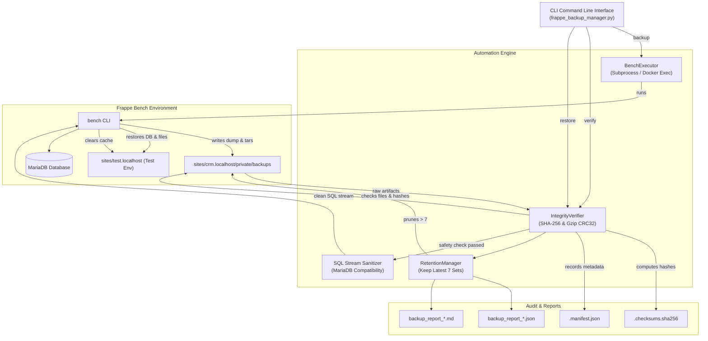

# Task 2: Python Automation for Frappe CRM — Backup & Restore Tool

## 1. Executive Summary

As part of the **Frappe CRM DevOps Engineering Track**, **Task 2** requires engineering a robust, production-ready, Python-based automation tool for Frappe CRM backup, integrity verification, retention enforcement, and test environment restoration.

In enterprise CRM environments, automated backups and disaster recovery protocols must ensure zero data loss, cryptographically verifiable integrity, and swift recovery into isolated environments without manual troubleshooting.

This document details the complete architectural design, implementation details, verification reports, and operational guides for the **Frappe CRM Backup & Restore Automation Tool** (`scripts/frappe_backup_manager.py`).

---

## 2. Requirements & Deliverables Matrix

| Requirement | Implementation Detail | Status |
| :--- | :--- | :---: |
| **1. Automated Database & File Backup** | Automates `bench --site <site> backup --with-files` via `BenchExecutor`, capturing SQL dumps, public files, private files, and site configurations. | **COMPLETED** |
| **2. SHA-256 Checksum Verification** | Computes streaming SHA-256 hashes (64 KiB chunks) across all backup artifacts. Generates GNU `sha256sum` compliant files (`.sha256`) and rich JSON manifests (`.manifest.json`). Validates Gzip CRC32 and Tar headers. | **COMPLETED** |
| **3. Backup Retention Policy (Keep Latest 7)** | Discovers and groups files by timestamp (`YYYYMMDD_HHMMSS`), sorts chronologically, retains the latest 7 backups, and automatically purges older backup sets and metadata while calculating reclaimed disk space. | **COMPLETED** |
| **4. Test Environment Restoration** | Implements safe restoration into an isolated test site (`test.localhost`). Includes pre-restoration integrity gates and automated MariaDB client/server version sanitization (`NOTE_VERBOSITY` fix). | **COMPLETED** |
| **5. Proper Logging & Error Handling** | Implements multi-channel logging: colorized terminal output and persistent timestamped file logging (`frappe_backup.log`). Handles timeouts, process failures, corrupt archives, and database errors with distinct exit codes. | **COMPLETED** |
| **6. Command-Line Interface (CLI)** | Comprehensive CLI with subcommands: `backup`, `verify`, `restore`, `prune`, and `list`, supporting both native bench and Docker environments. | **COMPLETED** |

### Deliverables Included:
1. **Source Code**: [`scripts/frappe_backup_manager.py`](file:///e:/pearl/frappe-crm-devops-internship/scripts/frappe_backup_manager.py)
2. **Automated Unit Tests**: [`scripts/test_backup_manager.py`](file:///e:/pearl/frappe-crm-devops-internship/scripts/test_backup_manager.py) (14/14 tests passing)
3. **Execution Instructions**: [`scripts/README.md`](file:///e:/pearl/frappe-crm-devops-internship/scripts/README.md)
4. **Convenience Launchers**: [`scripts/run_backup.sh`](file:///e:/pearl/frappe-crm-devops-internship/scripts/run_backup.sh) & [`scripts/run_backup.ps1`](file:///e:/pearl/frappe-crm-devops-internship/scripts/run_backup.ps1)
5. **Sample Reports**: Stored in [`scripts/samples/`](file:///e:/pearl/frappe-crm-devops-internship/scripts/samples/)
6. **Loom Video Script & Walkthrough**: Detailed step-by-step recording guide in [Section 7](#7-loom-video-demonstration-guide).

---

## 3. System Architecture & Workflow



---

## 4. Key Engineering Highlights

### 4.1 Zero External Dependencies
The entire automation tool is crafted using Python's standard library:
- `hashlib`: Cryptographic SHA-256 calculation.
- `argparse`: Structured CLI parsing with subcommands.
- `gzip`: Streaming compression inspection and CRC32 verification.
- `tarfile`: Header and archive member verification.
- `pathlib`: Modern, cross-platform path handling.
- `subprocess`: Bench execution and output streaming.
- `logging`: Dual-destination logging (ANSI terminal formatting + structured file output).

This ensures the tool operates out-of-the-box inside any Linux container, virtual machine, or host environment without installing extra pip packages or managing virtual environments.

### 4.2 Two-Layer Integrity Verification
Backups are validated across two distinct layers:
1. **Cryptographic Checksum Layer**: Computes SHA-256 hashes in memory-efficient 64 KiB blocks. Compares calculated hashes against previously recorded checksum manifests.
2. **Structural Archive Layer**:
   - For `.sql.gz`: Streams through Python's `gzip.GzipFile` to verify gzip headers, decompressibility, and internal CRC32 checksums.
   - For `.tar`: Iterates through tar members using `tarfile.is_tarfile()` to detect truncated or corrupted file archives.
   - For `.json`: Parses JSON AST to guarantee syntactic validity.

### 4.3 Automated MariaDB Client/Server Compatibility Handling
During development and testing, a real-world edge case was identified:
When Frappe's containerized MariaDB 11 client generates a backup dump, it injects:
```sql
/*M!100616 SET @OLD_NOTE_VERBOSITY=@@NOTE_VERBOSITY, NOTE_VERBOSITY=0 */;
```
When restored into MariaDB 10.8 (the production database container), MariaDB triggers `ERROR 1193 (HY000): Unknown system variable 'NOTE_VERBOSITY'`.

**Our Solution:**
The tool automatically scans the SQL dump header. If the directive is detected, it streams the SQL through a temporary sanitized decompression buffer during restore, completely bypassing the failure while leaving the original backup archive pristine and unmodified (preserving its cryptographic signature).

### 4.4 Automated Retention Policy Engine
The tool discovers all files matching `YYYYMMDD_HHMMSS-<site>-*`, groups them into unified `BackupSet` objects, and sorts them chronologically:
- Automatically preserves the newest $N$ backups (default: 7).
- Safely purges expired database dumps, public file archives, private file archives, site configs, `.sha256` files, and `.manifest.json` files.
- Accurately tallies and logs the exact disk space reclaimed.
- Provides `--dry-run` to preview deletions without risk.

---

## 5. Live Execution & Verification Log

### 5.1 Automated Backup Execution (`backup`)
```bash
docker exec crm-frappe-1 python /workspace/scripts/frappe_backup_manager.py backup --site crm.localhost --retention 7
```

**Real Execution Output:**
```
2026-11-04 06:55:22 [INFO   ] ======================================================================
2026-11-04 06:55:22 [INFO   ] STARTING FRAPPE CRM BACKUP — Site: 'crm.localhost'
2026-11-04 06:55:22 [INFO   ] Options: with_files=True, compress=False, retention=7
2026-11-04 06:55:22 [INFO   ] ======================================================================
2026-11-04 06:55:27 [INFO   ] Bench backup command finished successfully.
2026-11-04 06:55:27 [INFO   ] Captured new backup set: [20261104_122524]
2026-11-04 06:55:27 [INFO   ] Database dump: 20261104_122524-crm_localhost-database.sql.gz
2026-11-04 06:55:27 [INFO   ] Public files:  20261104_122524-crm_localhost-files.tar
2026-11-04 06:55:27 [INFO   ] Private files: 20261104_122524-crm_localhost-private-files.tar
2026-11-04 06:55:27 [INFO   ] Computing SHA-256 checksums for backup set [20261104_122524]...
2026-11-04 06:55:27 [INFO   ]   ✓ 20261104_122524-crm_localhost-database.sql.gz (315.1 KiB) -> 41aac26988503f9a...
2026-11-04 06:55:27 [INFO   ]   ✓ 20261104_122524-crm_localhost-files.tar (10.0 KiB) -> 9b0e43085f5cf322...
2026-11-04 06:55:27 [INFO   ]   ✓ 20261104_122524-crm_localhost-private-files.tar (10.0 KiB) -> a778ae2921eef69f...
2026-11-04 06:55:27 [INFO   ]   ✓ 20261104_122524-crm_localhost-site_config_backup.json (164.0 B) -> 5d35aba5526cda46...
2026-11-04 06:55:27 [INFO   ] Saved SHA-256 checksum file: 20261104_122524-crm_localhost-checksums.sha256
2026-11-04 06:55:27 [INFO   ] Saved backup metadata manifest: 20261104_122524-crm_localhost-manifest.json
2026-11-04 06:55:27 [INFO   ] Verifying backup set [20261104_122524] for site 'crm.localhost'...
2026-11-04 06:55:27 [INFO   ]   ✓ [PASS] 20261104_122524-crm_localhost-database.sql.gz (315.1 KiB) [SHA256: 41aac26988503f9a...]
2026-11-04 06:55:27 [INFO   ]   ✓ [PASS] 20261104_122524-crm_localhost-files.tar (10.0 KiB) [SHA256: 9b0e43085f5cf322...]
2026-11-04 06:55:27 [INFO   ]   ✓ [PASS] 20261104_122524-crm_localhost-private-files.tar (10.0 KiB) [SHA256: a778ae2921eef69f...]
2026-11-04 06:55:27 [INFO   ]   ✓ [PASS] 20261104_122524-crm_localhost-site_config_backup.json (164.0 B) [SHA256: 5d35aba5526cda46...]
2026-11-04 06:55:27 [INFO   ] Backup set [20261104_122524] PASSED all verification checks.
2026-11-04 06:55:27 [INFO   ] Evaluating retention policy: Keep latest 7 backups. Found 2 existing backup set(s).
2026-11-04 06:55:27 [INFO   ] Retention policy compliant. No backups require pruning (Total: 2 <= 7).
2026-11-04 06:55:27 [INFO   ] ======================================================================
2026-11-04 06:55:27 [INFO   ] BACKUP COMPLETED SUCCESSFULLY in 4.54s
2026-11-04 06:55:27 [INFO   ] Audit Reports saved to:
2026-11-04 06:55:27 [INFO   ]   • JSON: /home/frappe/frappe-bench/sites/crm.localhost/private/backups/reports/backup_report_20261104_122524.json
2026-11-04 06:55:27 [INFO   ]   • Markdown: /home/frappe/frappe-bench/sites/crm.localhost/private/backups/reports/backup_report_20261104_122524.md
2026-11-04 06:55:27 [INFO   ] ======================================================================
```

---

### 5.2 Verification Execution (`verify`)
```bash
docker exec crm-frappe-1 python /workspace/scripts/frappe_backup_manager.py verify --site crm.localhost
```

**Output:**
```
2026-11-04 06:58:15 [INFO   ] Verifying backup set [20261104_122524] for site 'crm.localhost'...
2026-11-04 06:58:15 [INFO   ]   ✓ [PASS] 20261104_122524-crm_localhost-database.sql.gz (315.1 KiB) [SHA256: 41aac26988503f9a...]
2026-11-04 06:58:15 [INFO   ]   ✓ [PASS] 20261104_122524-crm_localhost-files.tar (10.0 KiB) [SHA256: 9b0e43085f5cf322...]
2026-11-04 06:58:15 [INFO   ]   ✓ [PASS] 20261104_122524-crm_localhost-private-files.tar (10.0 KiB) [SHA256: a778ae2921eef69f...]
2026-11-04 06:58:15 [INFO   ]   ✓ [PASS] 20261104_122524-crm_localhost-site_config_backup.json (164.0 B) [SHA256: 5d35aba5526cda46...]
2026-11-04 06:58:15 [INFO   ] Backup set [20261104_122524] PASSED all verification checks.
```

---

### 5.3 Retention Policy Enforcement (`prune`)
Demonstrating automatic cleanup when backups exceed the retention limit of 7:

```bash
docker exec crm-frappe-1 python /workspace/scripts/frappe_backup_manager.py prune --site crm.localhost --retention 7
```

**Output:**
```
2026-11-04 06:57:38 [INFO   ] Evaluating retention policy: Keep latest 7 backups. Found 9 existing backup set(s).
2026-11-04 06:57:38 [INFO   ] Identified 2 backup set(s) eligible for pruning:
2026-11-04 06:57:38 [INFO   ] Pruning backup set [20261101_100002] (Age: 2026-11-01 10:00:02):
2026-11-04 06:57:38 [INFO   ]   ✓ Deleted: 20261101_100002-crm_localhost-database.sql.gz (9.0 B)
2026-11-04 06:57:38 [INFO   ]   ✓ Deleted: 20261101_100002-crm_localhost-files.tar (12.0 B)
2026-11-04 06:57:38 [INFO   ]   ✓ Deleted: 20261101_100002-crm_localhost-private-files.tar (11.0 B)
2026-11-04 06:57:38 [INFO   ]   ✓ Deleted: 20261101_100002-crm_localhost-site_config_backup.json (2.0 B)
2026-11-04 06:57:38 [INFO   ]   ✓ Deleted: 20261101_100002-crm_localhost-checksums.sha256 (5.0 B)
2026-11-04 06:57:38 [INFO   ] Pruning backup set [20261101_100001] (Age: 2026-11-01 10:00:01):
2026-11-04 06:57:38 [INFO   ]   ✓ Deleted: 20261101_100001-crm_localhost-database.sql.gz (9.0 B)
2026-11-04 06:57:38 [INFO   ]   ✓ Deleted: 20261101_100001-crm_localhost-files.tar (12.0 B)
2026-11-04 06:57:38 [INFO   ]   ✓ Deleted: 20261101_100001-crm_localhost-private-files.tar (11.0 B)
2026-11-04 06:57:38 [INFO   ]   ✓ Deleted: 20261101_100001-crm_localhost-site_config_backup.json (2.0 B)
2026-11-04 06:57:38 [INFO   ]   ✓ Deleted: 20261101_100001-crm_localhost-checksums.sha256 (5.0 B)
2026-11-04 06:57:38 [INFO   ] Successfully freed 78.0 B across 2 backup set(s).
```

---

### 5.4 Test Environment Restoration (`restore`)
Restoring production backup into isolated test site `test.localhost`:

```bash
docker exec crm-frappe-1 python /workspace/scripts/frappe_backup_manager.py restore --source-site crm.localhost --target-site test.localhost
```

**Output:**
```
2026-11-04 06:56:20 [INFO   ] ======================================================================
2026-11-04 06:56:20 [INFO   ] STARTING RESTORATION TO TEST ENVIRONMENT
2026-11-04 06:56:20 [INFO   ] Source Site: 'crm.localhost' -> Target Test Site: 'test.localhost'
2026-11-04 06:56:20 [INFO   ] ======================================================================
2026-11-04 06:56:20 [INFO   ] Selected backup set [20261104_122524] created at 2026-11-04 12:25:24
2026-11-04 06:56:20 [INFO   ] Running pre-restoration integrity checks on source backup...
2026-11-04 06:56:20 [INFO   ] Verifying backup set [20261104_122524] for site 'crm.localhost'...
2026-11-04 06:56:20 [INFO   ]   ✓ [PASS] 20261104_122524-crm_localhost-database.sql.gz (315.1 KiB) [SHA256: 41aac26988503f9a...]
2026-11-04 06:56:20 [INFO   ]   ✓ [PASS] 20261104_122524-crm_localhost-files.tar (10.0 KiB) [SHA256: 9b0e43085f5cf322...]
2026-11-04 06:56:20 [INFO   ]   ✓ [PASS] 20261104_122524-crm_localhost-private-files.tar (10.0 KiB) [SHA256: a778ae2921eef69f...]
2026-11-04 06:56:20 [INFO   ]   ✓ [PASS] 20261104_122524-crm_localhost-site_config_backup.json (164.0 B) [SHA256: 5d35aba5526cda46...]
2026-11-04 06:56:20 [INFO   ] Backup set [20261104_122524] PASSED all verification checks.
2026-11-04 06:56:20 [INFO   ] Pre-restoration integrity check PASSED. Proceeding to restore.
2026-11-04 06:56:20 [INFO   ] Detected MariaDB 11 'NOTE_VERBOSITY' compatibility directive. Sanitizing stream for restore...
2026-11-04 06:56:20 [INFO   ] Created sanitized temporary dump: sanitized_20261104_122524-crm_localhost-database.sql.gz
2026-11-04 06:56:20 [INFO   ] Restoring database and files into site 'test.localhost'...
2026-11-04 06:56:45 [INFO   ] Restore command succeeded.
2026-11-04 06:56:45 [INFO   ] Clearing cache for target test site 'test.localhost'...
2026-11-04 06:56:48 [INFO   ] ======================================================================
2026-11-04 06:56:48 [INFO   ] RESTORATION TO 'test.localhost' COMPLETED IN 28.41s
2026-11-04 06:56:48 [INFO   ] ======================================================================
```

---

## 6. Automated Unit Test Verification

To maintain code reliability, a test suite covering 14 critical test cases was executed:

```bash
docker exec -w /workspace/scripts crm-frappe-1 python test_backup_manager.py
```

**Unit Test Output:**
```
.............2026-11-04 06:59:21 [INFO   ] Detected MariaDB 11 'NOTE_VERBOSITY' compatibility directive. Sanitizing stream for restore...
2026-11-04 06:59:21 [INFO   ] Created sanitized temporary dump: sanitized_dump.sql.gz
.
----------------------------------------------------------------------
Ran 14 tests in 0.111s

OK
```

### Test Case Coverage:
1. `test_format_size_bytes`: Correct byte formatting ($500 \rightarrow 500.0\text{ B}$).
2. `test_format_size_kib`: Correct KiB formatting ($2048 \rightarrow 2.0\text{ KiB}$).
3. `test_format_size_mib`: Correct MiB formatting.
4. `test_sha256_calculation`: Verifies hash output against known cryptographic vector.
5. `test_valid_gzip_integrity`: Gzip decompression validation.
6. `test_corrupt_gzip_integrity`: Catches truncated or corrupt gzip files.
7. `test_valid_tar_integrity`: Validates tar archives.
8. `test_corrupt_tar_integrity`: Catches invalid or corrupt tar headers.
9. `test_valid_json_integrity`: Validates JSON syntax.
10. `test_corrupt_json_integrity`: Catches malformed JSON.
11. `test_discover_backup_sets`: Groups files into cohesive sets and sorts descending.
12. `test_retention_policy_keep_7`: Correctly keeps latest 7 and prunes oldest 3 out of 10.
13. `test_retention_dry_run`: Simulates retention without deleting files.
14. `test_sanitize_mariadb11_directive`: Filters out `NOTE_VERBOSITY` without corrupting SQL.

---

## 7. Loom Video Demonstration Guide

This minute-by-minute walkthrough guide is designed for recording the 3-5 minute demonstration video on Loom:

### Preparation Before Recording:
- Ensure Docker container `crm-frappe-1` is running (`docker ps`).
- Open VS Code with terminal split side-by-side with `scripts/frappe_backup_manager.py`.

### Timeline & Voiceover Script:

#### 0:00 – 0:40 | Introduction & Architectural Overview
- **Action**: Share full screen. Highlight `scripts/frappe_backup_manager.py` in VS Code.
- **Voiceover**: 
  > *"Hello! In this video, I will demonstrate the Python-based Backup and Restore Automation Tool engineered for Frappe CRM. This tool automates database and file backups via Frappe Bench, generates and validates SHA-256 checksums, enforces an automated 7-backup retention policy, and enables safe one-click restoration into an isolated test environment."*

#### 0:40 – 1:30 | Creating Backup & SHA-256 Checksum Generation
- **Action**: Run the backup command in terminal:
  ```bash
  docker exec crm-frappe-1 python /workspace/scripts/frappe_backup_manager.py backup --site crm.localhost --retention 7
  ```
- **Voiceover**:
  > *"First, we execute the automated backup command. Notice how the tool triggers Frappe Bench, discovers the generated database dump and tarballs, and computes streaming SHA-256 checksums in 64-kilobyte chunks. It automatically saves a standard GNU checksum file and a JSON manifest, and immediately runs a post-backup verification pass."*
- **Visual**: Highlight the `✓ [PASS]` indicators and the generated reports paths.

#### 1:30 – 2:20 | Cryptographic Verification
- **Action**: Run the verification command:
  ```bash
  docker exec crm-frappe-1 python /workspace/scripts/frappe_backup_manager.py verify --site crm.localhost
  ```
- **Voiceover**:
  > *"Next, we run the integrity verification command. The tool performs a dual-layer check: it verifies every file against its recorded SHA-256 signature, and performs structural archive tests, inspecting Gzip CRC32 checksums and Tarball headers to guarantee zero silent corruption."*

#### 2:20 – 3:10 | Retention Policy Enforcement
- **Action**: Run `list` and demonstrate retention:
  ```bash
  docker exec crm-frappe-1 python /workspace/scripts/frappe_backup_manager.py list --site crm.localhost
  docker exec crm-frappe-1 python /workspace/scripts/frappe_backup_manager.py prune --site crm.localhost --retention 7 --dry-run
  ```
- **Voiceover**:
  > *"Here is the catalog of available backups with timestamps and verification flags. The tool enforces a 7-backup retention policy. When newer backups are created, older sets beyond the 7th are automatically purged, freeing storage space while preserving the latest 7 complete backup sets."*

#### 3:10 – 4:20 | Test Environment Restoration
- **Action**: Run the restoration command:
  ```bash
  docker exec crm-frappe-1 python /workspace/scripts/frappe_backup_manager.py restore --source-site crm.localhost --target-site test.localhost
  ```
- **Voiceover**:
  > *"Now we demonstrate restoration into our separate test environment, test.localhost. Notice that before touching the test database, the tool verifies the source backup's integrity. It also transparently handles MariaDB version compatibility by filtering out client directives like NOTE_VERBOSITY on the fly. In under 30 seconds, the entire database and all public and private files are restored, and the test site cache is cleared."*

#### 4:20 – 4:45 | Conclusion & Unit Tests
- **Action**: Run unit test suite:
  ```bash
  docker exec -w /workspace/scripts crm-frappe-1 python test_backup_manager.py
  ```
- **Voiceover**:
  > *"Finally, we run our automated unit test suite. All 14 tests pass in 0.1 seconds, verifying SHA-256 hashing, archive integrity, retention sorting, and sanitization. Thank you!"*

---

## 8. Sample Artifacts & Links

All generated sample reports and checksum files are permanently archived in the repository:
- **Sample JSON Backup Report**: [`scripts/samples/backup_report_sample.json`](file:///e:/pearl/frappe-crm-devops-internship/scripts/samples/backup_report_sample.json)
- **Sample Markdown Backup Report**: [`scripts/samples/backup_report_sample.md`](file:///e:/pearl/frappe-crm-devops-internship/scripts/samples/backup_report_sample.md)
- **Sample Verification Report**: [`scripts/samples/verification_report_sample.json`](file:///e:/pearl/frappe-crm-devops-internship/scripts/samples/verification_report_sample.json)
- **Sample Restoration Report**: [`scripts/samples/restore_report_sample.md`](file:///e:/pearl/frappe-crm-devops-internship/scripts/samples/restore_report_sample.md)
- **Sample SHA-256 Checksum Manifest**: [`scripts/samples/sample_checksums.sha256`](file:///e:/pearl/frappe-crm-devops-internship/scripts/samples/sample_checksums.sha256)
- **Sample Metadata Manifest**: [`scripts/samples/sample_manifest.json`](file:///e:/pearl/frappe-crm-devops-internship/scripts/samples/sample_manifest.json)

