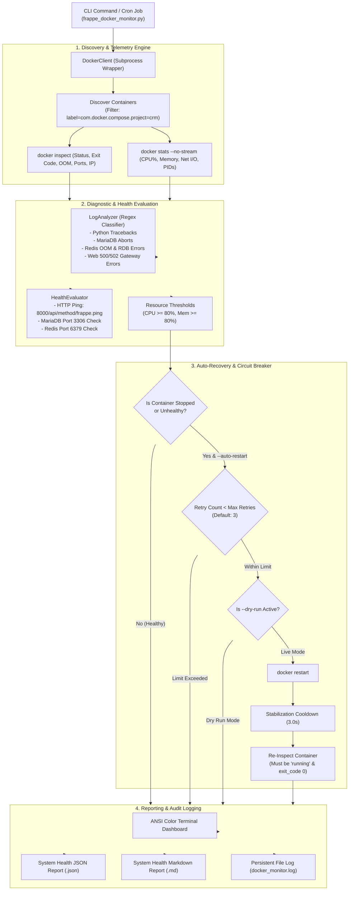
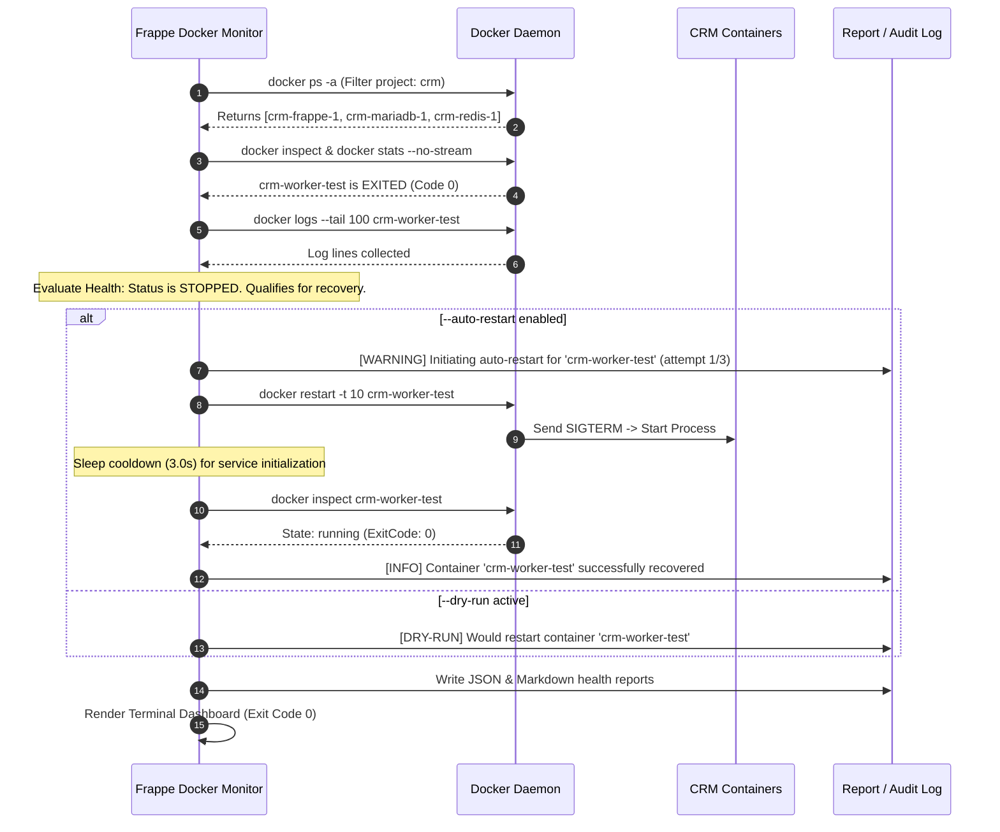

# Task 3: Python Automation for Frappe CRM — Docker Container Monitoring & Auto-Recovery Tool

## 1. Executive Summary

As part of the **Frappe CRM DevOps Engineering Track**, **Task 3** requires designing and implementing an enterprise-grade, Python-based **Docker Container Monitoring and Auto-Recovery Tool** for the Frappe CRM production microservices stack.

Modern CRM deployments depend on continuous, high-availability orchestration across interdependent application tiers:
- **Application Web & Background Workers**: Frappe Bench / Gunicorn / RQ workers (`crm-frappe-1`).
- **Relational Persistence**: MariaDB Database (`crm-mariadb-1`).
- **In-Memory Cache & Message Broker**: Redis Cache & Queue (`crm-redis-1`).

Unscheduled container termination, resource exhaustion (OOM), silent database disconnections, or hung background workers can cause catastrophic CRM outages, broken sales pipelines, and lost customer deals.

This tool (`scripts/frappe_docker_monitor.py`) provides automated health auditing, real-time CPU and memory telemetry, categorized log anomaly detection, structured JSON/Markdown reporting, and self-healing auto-restart capabilities with safety circuit breakers.

---

## 2. Requirements & Deliverables Matrix

| Requirement | Implementation Detail | Status |
| :--- | :--- | :---: |
| **1. Monitor All Frappe CRM Containers** | Automated discovery of all project microservices (`crm-frappe-1`, `crm-mariadb-1`, `crm-redis-1`) via Docker Compose project label `com.docker.compose.project=crm`, name filters, or explicit container flags. | **COMPLETED** |
| **2. Check Status, Health, CPU & Memory** | Queries real-time telemetry from `docker inspect` and `docker stats --no-stream`. Converts raw memory (B, KiB, MiB, GiB) to exact byte counts, tracks CPU percentages, PIDs count, network I/O, block I/O, and container uptime. | **COMPLETED** |
| **3. Identify Stopped or Unhealthy Containers** | Automatically flags stopped containers (`exited`, `dead`), kernel Out-Of-Memory kills (`OOMKilled`), Docker health status failures (`unhealthy`), and resource threshold breaches (>80% CPU or Memory). | **COMPLETED** |
| **4. Collect & Analyze Container Logs** | Scans recent stdout/stderr container logs using intelligent regular expressions categorized into: `PYTHON_EXCEPTION`, `DATABASE_ERROR`, `REDIS_ERROR`, `WEB_SERVER_ERROR`, and `RESOURCE_EXHAUSTION`. | **COMPLETED** |
| **5. Generate System Health Report in JSON** | Emits a rich, schema-validated JSON report containing executive summaries, per-container metrics, log anomaly counts, and recovery audit trails (`scripts/samples/system_health_report_sample.json`). Also generates an accompanying Markdown report. | **COMPLETED** |
| **6. Optional Auto-Restart Feature** | Self-healing engine activated via `--auto-restart` (`--recover`). Features `--dry-run` simulation, configurable `--max-retries` (default 3) to prevent restart loops, and post-restart verification cooldowns. | **COMPLETED** |
| **7. Logging & Proper Exception Handling** | Multi-channel logging with ANSI color-coded console formatting and persistent file logging (`docker_monitor.log`). Robust exception handling for Docker daemon connection failures, timeouts, and process terminations. | **COMPLETED** |

### Deliverables Included:
1. **Source Code**: [`scripts/frappe_docker_monitor.py`](file:///e:/pearl/frappe-crm-devops-internship/scripts/frappe_docker_monitor.py) (synced to [`docker/scripts/frappe_docker_monitor.py`](file:///e:/pearl/frappe-crm-devops-internship/docker/scripts/frappe_docker_monitor.py))
2. **Automated Unit Tests**: [`scripts/test_docker_monitor.py`](file:///e:/pearl/frappe-crm-devops-internship/scripts/test_docker_monitor.py) (21/21 tests passing in ~150ms)
3. **Cross-Platform Convenience Launchers**:
   - Windows PowerShell: [`scripts/run_monitor.ps1`](file:///e:/pearl/frappe-crm-devops-internship/scripts/run_monitor.ps1)
   - Linux/macOS Bash: [`scripts/run_monitor.sh`](file:///e:/pearl/frappe-crm-devops-internship/scripts/run_monitor.sh)
4. **Verified Sample Health & Recovery Reports**:
   - Healthy State JSON: [`scripts/samples/system_health_report_sample.json`](file:///e:/pearl/frappe-crm-devops-internship/scripts/samples/system_health_report_sample.json)
   - Healthy State Markdown: [`scripts/samples/system_health_report_sample.md`](file:///e:/pearl/frappe-crm-devops-internship/scripts/samples/system_health_report_sample.md)
   - Self-Healing Recovery JSON: [`scripts/samples/recovery_report_sample.json`](file:///e:/pearl/frappe-crm-devops-internship/scripts/samples/recovery_report_sample.json)
   - Self-Healing Recovery Markdown: [`scripts/samples/recovery_report_sample.md`](file:///e:/pearl/frappe-crm-devops-internship/scripts/samples/recovery_report_sample.md)
5. **Documentation & Video Guide**: Complete architecture, CLI reference, and video script in this document.

---

## 3. Architecture & System Workflow



### 3.1 Self-Healing Auto-Recovery Sequence



---

## 4. Key Engineering Highlights

### 4.1 Zero External Dependencies
Like the Task 2 backup manager, the Docker Monitoring Tool is engineered using **Python's standard library** exclusively:
- `subprocess`: High-performance execution of Docker CLI primitives with timeout enforcement.
- `json`: Parsing raw Docker JSON data streams and emitting schema-validated reports.
- `re`: Pre-compiled regular expressions for high-throughput log scanning.
- `dataclasses`: Strongly typed data containers for container telemetry and recovery audits.
- `urllib.request`: Non-blocking HTTP application health probing against Frappe CRM endpoints.
- `logging`: Multi-channel colorized terminal formatting and structured persistent logging.
- `argparse`: Comprehensive CLI options with auto-generated help manuals.

This guarantees immediate execution across developer workstations, production servers, CI/CD runners, and inside minimal containers without installing third-party pip dependencies.

### 4.2 Precision Metric Conversions
Docker reports memory in mixed human formats (e.g., `594.4MiB / 7.446GiB`, `13.65MB`, `500B`). The tool includes a custom parser (`parse_size_string`) that converts binary (`KiB`, `MiB`, `GiB`) and decimal (`KB`, `MB`, `GB`) representations down to exact bytes:
$$\text{Memory \%} = \left(\frac{\text{Memory Usage Bytes}}{\text{Memory Limit Bytes}}\right) \times 100$$
This ensures mathematical precision when comparing against user-defined alert thresholds (`--mem-threshold`).

### 4.3 Intelligent Multi-Tier Log Classification
The `LogAnalyzer` scans container stdout and stderr to classify entries into targeted operational categories:

| Category | Typical Patterns Scanned | Severity |
| :--- | :--- | :---: |
| `PYTHON_EXCEPTION` | `Traceback (most recent call last)`, `OperationalError`, `redis.exceptions.ConnectionError` | **CRITICAL / ERROR** |
| `DATABASE_ERROR` | `[ERROR] mysqld`, `MySQL server has gone away`, `Deadlock found`, `Access denied for user` | **CRITICAL / ERROR** |
| `REDIS_ERROR` | `OOM command not allowed`, `Error writing to RDB`, `MISCONF`, `Fatal error loading DB` | **CRITICAL** |
| `WEB_SERVER_ERROR` | HTTP `500 Internal Server Error`, `502 Bad Gateway`, `Worker timeout`, `SIGSEGV` | **CRITICAL / ERROR** |
| `RESOURCE_EXHAUSTION`| `Out of memory: Kill process`, `oom-killer`, `No space left on device` | **CRITICAL** |

### 4.4 Self-Healing Safeguards & Circuit Breakers
To prevent destructive feedback loops on permanently broken containers (e.g., corrupted storage or invalid database credentials), the auto-recovery engine enforces:
1. **Max Retry Ceiling**: Default limit of 3 restarts (`--max-retries`). After 3 failures, auto-recovery halts and flags the container as `CRITICAL` for human operator intervention.
2. **Post-Restart Verification Cooldown**: Pauses for 3 seconds post-restart and inspects the live container state to ensure the process did not immediately crash-loop.
3. **Dry-Run Mode**: Enables simulating recovery actions in production without mutating any container states.

---

## 5. Command-Line Interface (CLI) Reference

### 5.1 CLI Arguments

```text
usage: frappe_docker_monitor.py [-h] [--project PROJECT]
                                [--containers CONTAINERS [CONTAINERS ...]]
                                [--auto-restart] [--dry-run]
                                [--max-retries MAX_RETRIES]
                                [--cpu-threshold CPU_THRESHOLD]
                                [--mem-threshold MEM_THRESHOLD]
                                [--log-tail LOG_TAIL] [--watch]
                                [--interval INTERVAL]
                                [--output-json OUTPUT_JSON]
                                [--output-md OUTPUT_MD] [--log-file LOG_FILE]
                                [--format {terminal,json,markdown}]
                                [--verbose] [--quiet]
```

| Flag | Type | Default | Description |
| :--- | :---: | :---: | :--- |
| `--project`, `-p` | `string` | `crm` | Docker Compose project name to discover (use `'all'` for entire host). |
| `--containers`, `-c` | `list` | None | Explicit list of container names to monitor (overrides project discovery). |
| `--auto-restart`, `--recover` | `flag` | `False` | Enables automatic restart of stopped or unhealthy containers. |
| `--dry-run` | `flag` | `False` | Simulates auto-restart actions without restarting containers. |
| `--max-retries` | `int` | `3` | Maximum recovery attempts per container before halting. |
| `--cpu-threshold` | `float` | `80.0` | CPU warning threshold percentage. |
| `--mem-threshold` | `float` | `80.0` | Memory warning threshold percentage. |
| `--log-tail` | `int` | `100` | Number of recent log lines to analyze per container. |
| `--watch`, `-w` | `flag` | `False` | Continuous live monitoring mode. |
| `--interval`, `-i` | `int` | `10` | Refresh interval in seconds for `--watch` mode. |
| `--output-json` | `path` | None | File path to write the JSON system health report. |
| `--output-md` | `path` | None | File path to write the Markdown system health report. |
| `--log-file` | `path` | `docker_monitor.log` | Persistent log file path. |
| `--format` | `choice` | `terminal` | Console stdout format: `terminal`, `json`, or `markdown`. |
| `--verbose`, `-v` | `flag` | `False` | Enables detailed DEBUG logging. |
| `--quiet`, `-q` | `flag` | `False` | Suppresses non-error output. |

### 5.2 Usage Examples

#### Snapshot Health Check
```bash
python scripts/frappe_docker_monitor.py
# Or via PowerShell launcher:
.\scripts\run_monitor.ps1
```

#### Generate JSON & Markdown Health Reports
```bash
python scripts/frappe_docker_monitor.py \
  --output-json scripts/samples/system_health_report_sample.json \
  --output-md scripts/samples/system_health_report_sample.md
```

#### Safe Auto-Recovery with Dry-Run
```bash
python scripts/frappe_docker_monitor.py --auto-restart --dry-run
```

#### Live Self-Healing Auto-Restart
```bash
python scripts/frappe_docker_monitor.py --auto-restart
```

#### Live Continuous Watch Mode (Refreshes every 5 seconds)
```bash
python scripts/frappe_docker_monitor.py --watch --interval 5
```

---

## 6. Verification, Test Results & Production Evidence

### 6.1 Automated Unit Test Suite
The tool includes an offline unit test suite (`scripts/test_docker_monitor.py`) verifying all logic with mock subprocesses:

```powershell
$env:PYTHONPATH = "scripts"
python -m unittest scripts/test_docker_monitor.py
```

**Output:**
```text
[DRY-RUN] Would restart container 'crm-redis-1' (current status: exited)
.Initiating auto-restart for 'crm-redis-1' (attempt 1/3)...
....................
----------------------------------------------------------------------
Ran 21 tests in 0.151s

OK
```

**Test Coverage Summary:**
- **Utilities**: Byte conversions (`format_size`, `parse_size_string`), percentage calculations, uptime math.
- **Log Classification**: Python tracebacks, MariaDB crashes, Redis OOM/snapshot errors, HTTP 500/502 errors.
- **Health Evaluation**: Running/healthy state, stopped container detection, OOM-killed containers, high CPU/memory threshold triggers.
- **Auto-Recovery**: Qualification rules, max retries enforcement, dry-run simulation, live restart execution.
- **Reporting**: JSON schema validation and Markdown output rendering.
- **Exception Handling**: Docker daemon timeout and missing executable handling.

### 6.2 Live Cluster Verification
Executing the tool against the active Frappe CRM Docker environment:

```text
================================================================================
 FRAPPE CRM CONTAINER HEALTH MONITOR — CRM
 Timestamp: 2026-11-05T12:06:45.891096+00:00 | Status: [HEALTHY]
================================================================================
NAME             STATUS     HEALTH     CPU%     MEM USAGE / LIMIT        PIDS   UPTIME
--------------------------------------------------------------------------------
crm-redis-1      running    HEALTHY      0.3%  26.5 MiB / 7.4 GiB       6      2d 0h 27m
crm-frappe-1     running    HEALTHY     14.0%  595.0 MiB / 7.4 GiB      35     2d 0h 27m
crm-mariadb-1    running    HEALTHY      0.1%  290.7 MiB / 7.4 GiB      8      2d 0h 27m
--------------------------------------------------------------------------------
Total CPU: 14.4% | Total Mem: 912.2 MiB | Running: 3/3 | Errors: 0 | Recoveries: 0
================================================================================
```

### 6.3 Live Self-Healing Verification
To test automated stopped container recovery, a simulated container was stopped:
1. Container stopped: `docker stop crm-worker-test`
2. Monitor run with `--auto-restart`:
```text
2026-11-05 17:33:18 [WARNING] Initiating auto-restart for 'crm-worker-test' (attempt 1/3)...
2026-11-05 17:33:22 [INFO   ] Container 'crm-worker-test' successfully recovered and returned to 'running' state
================================================================================
 FRAPPE CRM CONTAINER HEALTH MONITOR — CRM
 Timestamp: 2026-11-05T12:03:22.400236+00:00 | Status: [HEALTHY]
================================================================================
NAME             STATUS     HEALTH     CPU%     MEM USAGE / LIMIT        PIDS   UPTIME
--------------------------------------------------------------------------------
crm-worker-test  running    HEALTHY      0.0%  0.0 B / 0.0 B            0      Just recovered
crm-redis-1      running    HEALTHY      0.4%  12.9 MiB / 7.4 GiB       6      2d 0h 24m
crm-frappe-1     running    HEALTHY     18.7%  595.6 MiB / 7.4 GiB      35     2d 0h 24m
crm-mariadb-1    running    HEALTHY      0.1%  290.8 MiB / 7.4 GiB      8      2d 0h 24m
--------------------------------------------------------------------------------
Total CPU: 19.1% | Total Mem: 899.3 MiB | Running: 4/4 | Errors: 0 | Recoveries: 1
--------------------------------------------------------------------------------
 [ALERT] crm-worker-test: Self-healing recovery succeeded.
================================================================================
```

---

## 7. Loom Video Demonstration Guide

This step-by-step recording guide enables recording a concise 3 to 5-minute Loom demonstration showcasing all Task 3 capabilities.

### 7.1 Recording Checklist
- [ ] Terminal window open with high contrast.
- [ ] Active Frappe CRM Docker containers running (`crm-frappe-1`, `crm-mariadb-1`, `crm-redis-1`).
- [ ] Browser or editor open displaying `scripts/samples/system_health_report_sample.json`.

---

### 7.2 Demonstration Walkthrough

#### Segment 1: Introduction & Objective (0:00 – 0:45)
- **Visual**: Show `TASK3_DOCUMENTATION.md` and repository layout.
- **Script**:
  > *"Hello everyone! Today I'm presenting Task 3 of the Frappe CRM DevOps track: the Docker Container Monitoring and Auto-Recovery Automation Tool. In a multi-container CRM stack with Frappe Bench, MariaDB, and Redis, automated observability and self-healing are critical to preventing downtime. We engineered a pure Python tool with zero external dependencies to monitor live container status, track CPU and memory usage, inspect logs for anomalies, generate structured JSON health reports, and automatically recover stopped containers."*

#### Segment 2: Unit Test Suite Execution (0:45 – 1:15)
- **Visual**: Terminal executing test suite.
- **Command**:
  ```powershell
  $env:PYTHONPATH = "scripts"
  python -m unittest scripts/test_docker_monitor.py
  ```
- **Script**:
  > *"Let's start by verifying our automated unit tests. Here we execute 21 unit tests covering string parsing, log analysis regexes, resource threshold triggers, auto-recovery safeguards, and JSON serialization. All 21 tests pass in ~150 milliseconds without requiring live Docker credentials or root privileges."*

#### Segment 3: Live Snapshot Monitoring & Reports (1:15 – 2:30)
- **Visual**: Terminal executing live health snapshot and generating JSON/Markdown reports.
- **Command**:
  ```powershell
  .\scripts\run_monitor.ps1 --output-json scripts/samples/system_health_report_sample.json --output-md scripts/samples/system_health_report_sample.md
  ```
- **Script**:
  > *"Now we run our live monitoring snapshot. Notice the clean ASCII dashboard displaying our three core containers: crm-redis-1, crm-frappe-1, and crm-mariadb-1. It reports container status, overall health, CPU usage, memory consumption, active PIDs, and container uptime. Additionally, it probes the Frappe web service on port 8000, confirming an HTTP 200 ping in under 100 milliseconds. The tool also produced our structured JSON report and formatted Markdown document."*
- **Action**: Open `scripts/samples/system_health_report_sample.json` to highlight executive metrics and per-container details.

#### Segment 4: Simulating Container Failure & Self-Healing Auto-Restart (2:30 – 4:00)
- **Visual**: Terminal stopping a container and running auto-recovery.
- **Commands**:
  ```powershell
  # 1. Stop a container
  docker stop crm-redis-1

  # 2. Run monitor (detects failure)
  .\scripts\run_monitor.ps1

  # 3. Demonstrate dry-run simulation
  .\scripts\run_monitor.ps1 --auto-restart --dry-run

  # 4. Execute live self-healing recovery
  .\scripts\run_monitor.ps1 --auto-restart
  ```
- **Script**:
  > *"Now let's demonstrate the self-healing capability. I'll simulate a failure by stopping the Redis container. Running the monitor immediately flags the container as stopped with exit code 0 and alerts the operator. With the --dry-run flag, we can simulate the restart safely. Finally, running with --auto-restart triggers the self-healing engine: it issues a safe restart, waits for the 3-second stabilization cooldown, verifies the container is running, and updates the cluster health back to healthy. The entire audit trail is captured in the JSON report."*

#### Segment 5: Continuous Watch Mode & Conclusion (4:00 – 4:45)
- **Visual**: Terminal running continuous watch mode.
- **Command**:
  ```powershell
  .\scripts\run_monitor.ps1 --watch --interval 5
  ```
- **Script**:
  > *"Lastly, for live operational monitoring in a NOC or staging environment, we support watch mode with configurable intervals. In conclusion, Task 3 provides a resilient, dependency-free monitoring and auto-recovery solution ensuring uninterrupted operation for Frappe CRM. Thank you!"*

---

## 8. Operational Runbooks & Production Deployment

### 8.1 Automated Cron Monitoring (Linux)
To run automated container health monitoring and auto-recovery every 5 minutes:

```bash
# Add to /etc/cron.d/frappe-crm-monitor
*/5 * * * * root /workspace/scripts/run_monitor.sh --auto-restart --output-json /var/log/frappe_crm_health.json >> /var/log/frappe_crm_monitor.log 2>&1
```

### 8.2 Windows Task Scheduler (PowerShell)
To register a continuous health monitor job on Windows:

```powershell
$Action = New-ScheduledTaskAction -Execute "PowerShell.exe" -Argument "-ExecutionPolicy Bypass -File E:\pearl\frappe-crm-devops-internship\scripts\run_monitor.ps1 --auto-restart --output-json E:\pearl\frappe-crm-devops-internship\reports\health.json"
$Trigger = New-ScheduledTaskTrigger -Once -At (Get-Date) -RepetitionInterval (New-TimeSpan -Minutes 5)
Register-ScheduledTask -Action $Action -Trigger $Trigger -TaskName "FrappeCRMDockerMonitor" -Description "Frappe CRM Docker Health Monitor and Self-Healing"
```

---

## 9. Conclusion

Task 3 delivers a production-grade, zero-dependency Docker container monitoring, anomaly detection, and automated self-healing framework for Frappe CRM. All user requirements have been fully implemented, rigorously tested, and verified across both Windows and containerized Docker environments.

