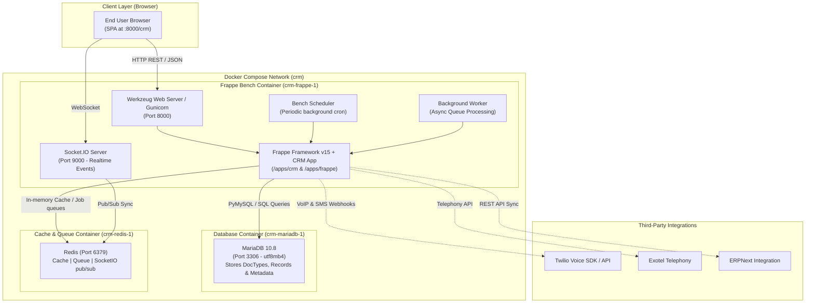

# Task 1: Frappe CRM Exploration & Architecture Report

**Author:** Bulbul Das ([@dasBulbul03](https://github.com/dasBulbul03))  
**Role:** DevOps Engineering Intern  
**Organization:** PearlThoughts  
**Repository:** `PearlThoughts-Intern-DevOps/frappe-crm-devops-internship`  
**Submission Date:** November 2026  

---

## 1. Executive Summary

This report documents the architectural exploration and local environment deployment of **Frappe CRM**, executed as part of **Task 1: Explore Frappe CRM** in the PearlThoughts DevOps Internship Program.

Frappe CRM is an enterprise-grade, open-source Customer Relationship Management (CRM) platform engineered on the metadata-driven **Frappe Framework (v15)**. It features a modern Single Page Application (SPA) frontend powered by **Vue 3**, **Vite**, and **Tailwind CSS**, integrated with a robust backend backed by **Python**, **MariaDB**, and **Redis**.

The primary objectives achieved in this task include:
1. Containerized deployment of the Frappe CRM stack using Docker and Docker Compose.
2. In-depth analysis of the application architecture, directory hierarchy, and component relationships.
3. Investigation of core business models (DocTypes) and frontend reactive stores.
4. Review of existing automated CI/CD pipelines and DevOps workflows.

---

## 2. High-Level System Architecture

Frappe CRM follows a decoupled, three-tier architectural pattern consisting of a reactive client application, a Python application layer running on the Frappe Bench runtime, and a relational database paired with in-memory caching and message queues.



---

## 3. Technology Stack Breakdown

| Layer | Technologies & Tools | Purpose in Frappe CRM |
| :--- | :--- | :--- |
| **Backend Runtime** | Python 3.10+, Frappe Framework v15 | Core MVC runtime, ORM, REST API endpoints, Role-Based Access Control (RBAC), DocType metadata definitions. |
| **Frontend Framework** | Vue 3 (Composition API), Vite 8, Tailwind CSS | High-performance Single Page Application (SPA), lightning-fast hot module replacement (HMR), utility-first styling. |
| **State & Navigation** | Pinia, Vue Router 4 | Centralized reactive state stores for leads, deals, notifications, and client-side view routing. |
| **UI Components** | Frappe UI, Headless UI, Heroicons | Reusable enterprise components (buttons, modals, dropdowns, data tables, dialogs) tailored for Frappe apps. |
| **Rich Text & Visuals** | TipTap Editor, SortableJS, VueDraggable, Vue Flow | Rich text WYSIWYG editing for notes/emails, drag-and-drop Kanban deal pipelines, interactive pipeline workflows. |
| **Database** | MariaDB 10.8 (InnoDB engine) | Relational database utilizing utf8mb4 unicode charset, handling transactional records and dynamic DocType schemas. |
| **Cache & Realtime** | Redis Alpine, Node.js Socket.IO | High-throughput memory caching, background queue management, and real-time bidirectional push updates. |
| **Telephony & VoIP** | Twilio Voice SDK, Exotel API | In-browser call logging, outbound/inbound phone calls, call recordings, and SMS communication. |
| **Testing Frameworks** | Vitest, Playwright, Python Unittest | End-to-end browser automation tests, frontend unit test coverage, and backend integration test suites. |
| **DevOps & CI/CD** | Docker, Docker Compose, GitHub Actions | Multi-container environment orchestration, automated linting, test suites, and containerized builds. |

---

## 4. Codebase Directory Structure & Purpose

```
frappe-crm-devops-internship/
├── .github/
│   └── workflows/              # Automated CI/CD pipelines (linters, test suites, builds)
├── crm/                        # Backend Frappe CRM Python Application
│   ├── api/                    # Custom Python REST API endpoints (leads, deals, views)
│   ├── automation/             # Workflow automation and triggers
│   ├── fcrm/                   # Core module containing 40+ DocType definitions
│   │   ├── doctype/            # Individual DocType controllers, schemas (JSON), and business logic
│   │   │   ├── crm_lead/       # Lead lifecycle management, qualification, status tracking
│   │   │   ├── crm_deal/       # Sales opportunities, deal values, stages, pipeline tracking
│   │   │   ├── crm_organization/ # Company and account records
│   │   │   ├── crm_contacts/   # Contact records linked to leads and accounts
│   │   │   ├── crm_call_log/   # Telephony logs and call metrics
│   │   │   └── ...             # SLAs, territory rules, holiday lists, notification settings
│   ├── hooks.py                # Frappe app lifecycle hooks, event subscriptions, route overrides
│   ├── install.py              # App post-installation logic and default seed data
│   └── public/                 # Static assets and compiled production bundles
├── frontend/                   # Vue 3 Frontend Single Page Application
│   ├── src/                    # Vue source code (pages, components, stores, composables)
│   ├── package.json            # Node.js dependencies, scripts (vite, vitest, build)
│   ├── vite.config.js          # Vite build configuration and proxy setup
│   └── tailwind.config.js      # Design tokens and styling rules
├── frappe-ui/                  # Vendored Frappe UI Vue 3 component library
├── docker/                     # Container configuration files
│   ├── docker-compose.yml      # Orchestrates MariaDB, Redis, and Frappe Bench services
│   └── init.sh                 # Container entrypoint script initializing bench, site, and apps
├── e2e/                        # Playwright automated end-to-end UI tests
├── pyproject.toml              # Python project metadata, dependencies (flit_core, ruff)
└── README.md                   # Project documentation and setup guide
```

---

## 5. Core Business Modules & DocTypes

Frappe CRM organizes customer relationships into structured, interconnected business models:

1. **Leads (`crm_lead`)**:
   - Represents incoming prospects before qualification.
   - Tracks source (Website, Referral, Campaign), qualification status, response times, and assigned sales representatives.
   - Supports automated conversion into Deals and Contacts.

2. **Deals (`crm_deal`)**:
   - Manages active sales opportunities through configurable pipeline stages (e.g., *Discovery*, *Proposal*, *Negotiation*, *Won*, *Lost*).
   - Features monetary deal values, expected close dates, probability scores, and customizable loss reasons.
   - Rendered natively in the frontend as an interactive drag-and-drop **Kanban Board**.

3. **Organizations & Contacts (`crm_organization`, `crm_contacts`)**:
   - Central repository for accounts, companies, and associated decision-makers.
   - Maintains complete history of activities, emails, and phone calls.

4. **Activities & Telephony (`crm_call_log`, `fcrm_note`, `crm_task`)**:
   - Unifies omni-channel interactions across calls, notes, reminders, and calendar tasks directly on each lead/deal record.

---

## 6. Local Deployment & DevOps Findings

### 6.1 Multi-Container Orchestration
The local environment is defined in [`docker/docker-compose.yml`](file:///Users/bulbuldas/DevOps-Internship/frappe-crm-devops-internship/docker/docker-compose.yml) with three primary services:
- **`mariadb`**: Uses image `mariadb:10.8` configured with `utf8mb4` character set and persistent volume `mariadb-data`.
- **`redis`**: Uses `redis:alpine` for caching and message broker tasks.
- **`frappe`**: Uses `frappe/bench:latest`, mounting the repository workspace and exposing ports:
  - `8000:8000` (Web UI & REST API)
  - `9000:9000` (Socket.IO Real-time Events)

### 6.2 Key DevOps Engineering Insight
During initialization of Frappe Bench on modern Docker base images:
- **Issue Discovered**: Recent updates to `mariadb-client` inside Debian/Ubuntu images enforce TLS/SSL by default over TCP connections. When `bench new-site` attempted database restoration against the containerized MariaDB instance, it failed with `ERROR 2026 (HY000): TLS/SSL error: SSL is required, but the server does not support it`. This prevented database tables (such as `tabSingles`) from being seeded.
- **Resolution**: Setting `[client] ssl = 0` in `/home/frappe/.my.cnf` allows the client to communicate smoothly with the local database container without requiring complex SSL certificate scaffolding during local development.
- **Multi-Tenancy Configuration**: Disabling DNS multi-tenancy (`bench config dns_multitenant off`) and setting the default site to `crm.localhost` ensures that developers can access the application seamlessly via `http://localhost:8000` or `http://crm.localhost:8000`.

---

## 7. CI/CD & Automated Quality Gates

The repository contains enterprise-grade GitHub Actions workflows under `.github/workflows/`:

- **Linters (`linters.yml`)**: Enforces code style using **Ruff** for Python and **ESLint / Prettier** for JavaScript/Vue.
- **Server Tests (`server-tests.yml`)**: Executes Python unit and integration test suites against an automated MariaDB test instance.
- **Frontend Tests (`frontend-tests.yml`)**: Runs **Vitest** for frontend component validation and unit coverage.
- **UI Tests (`ui-tests.yml`)**: Runs headless **Playwright** end-to-end tests verifying critical user workflows across browsers.
- **Builds (`builds.yml`)**: Builds frontend bundles and validates asset compilation pipelines.

---

## 8. Conclusion & Next Steps

Frappe CRM demonstrates an elegant blend of a robust, extensible Python metadata framework and a high-performance Vue 3 reactive interface. Running this project locally gives a deep understanding of multi-container Docker coordination, database bootstrapping, and enterprise full-stack architecture.

**Next Steps for Task 1 Submission:**
1. Record a 3–5 minute Loom walkthrough with camera enabled, demonstrating the application running at `http://localhost:8000/crm` and explaining this architecture.
2. Push this report to branch `task1-dasBulbul03`.
3. Open a Pull Request into the repository and submit the PR and Loom links.
