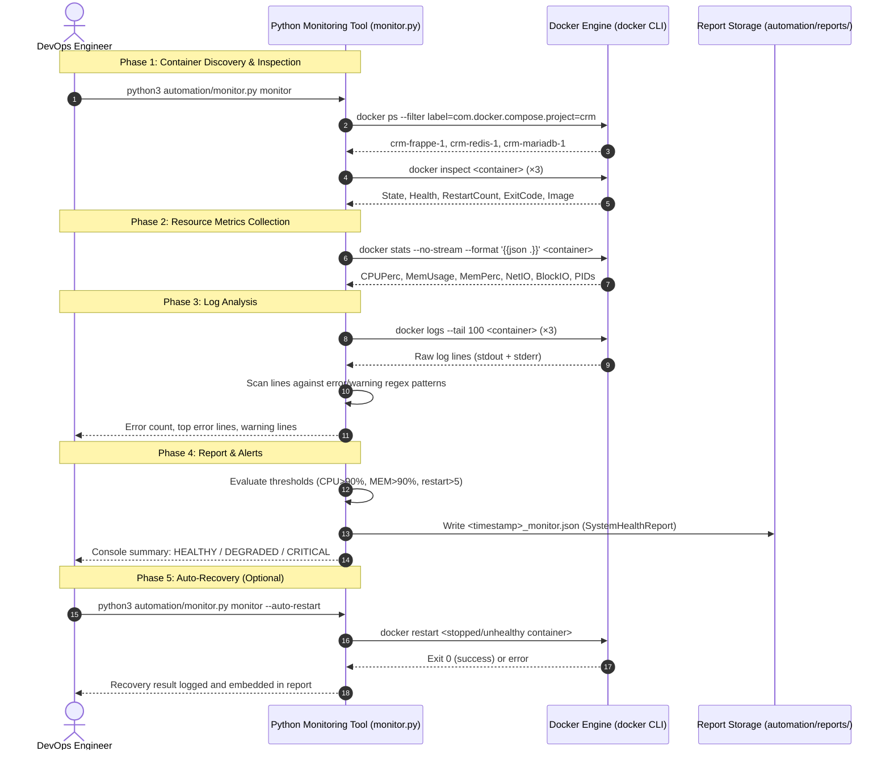

# Task 3: Docker Monitoring and Automation for Frappe CRM

**Author:** Bulbul Das ([@dasBulbul03](https://github.com/dasBulbul03))
**Role:** DevOps Engineering Intern
**Organization:** PearlThoughts
**Repository:** `PearlThoughts-Intern-DevOps/frappe-crm-devops-internship`
**Submission Date:** November 2026

---

## 1. Executive Summary

This report documents the implementation and validation of **Task 3: Docker Monitoring and Automation for Frappe CRM**, executed as part of the PearlThoughts DevOps Internship Program.

The core objective was to build an enterprise-ready, Python-based **Docker Container Monitoring and Auto-Recovery Tool** that provides real-time visibility into all Frappe CRM containers, collects resource metrics, identifies unhealthy containers, analyzes logs for errors, generates structured JSON health reports, and optionally auto-restarts stopped containers — all without modifying the original Frappe CRM application code and using only the Python standard library.

---

## 2. Requirements & Implementation Matrix

| Requirement | Implementation Details | Verification Status |
| :--- | :--- | :--- |
| **1. Monitor all Frappe CRM Docker containers** | Auto-discovers containers by Docker Compose project label (`com.docker.compose.project=crm`), with name-prefix fallback. Monitors `crm-frappe-1`, `crm-redis-1`, `crm-mariadb-1`. | **PASSED & VERIFIED** |
| **2. Check status, health, CPU, and memory** | `docker inspect` for state/health; `docker stats --no-stream --format '{{json .}}'` for live CPU%, mem%, net I/O, block I/O, PIDs. | **PASSED & VERIFIED** |
| **3. Identify stopped or unhealthy containers** | Flags containers with `status != running` or `health == unhealthy`; raises crash-loop alert when `restart_count > 5`. | **PASSED & VERIFIED** |
| **4. Collect and analyze container logs** | `docker logs --tail N` per container; scans lines against compiled regex patterns for errors, exceptions, timeouts, OOM, segfaults. | **PASSED & VERIFIED** |
| **5. Generate system health report in JSON format** | Produces `SystemHealthReport` dataclass serialized to `automation/reports/<timestamp>_monitor.json`; includes per-container stats, log analysis, alerts, and overall `HEALTHY/DEGRADED/CRITICAL` status. | **PASSED & VERIFIED** |
| **6. Optional auto-restart for stopped containers** | `monitor --auto-restart` flag triggers `docker restart <name>` for stopped/unhealthy containers; records attempt and success in report. Never touches shared/production containers without explicit invocation. | **PASSED & VERIFIED** |
| **7. Logging and proper exception handling** | Multi-channel logging (console + `automation/logs/frappe_monitor.log`); custom exception hierarchy (`MonitorError`, `DockerCommandError`, `ContainerNotFoundError`, `AutoRecoveryError`); `SensitiveDataFilter` masks passwords/tokens. | **PASSED & VERIFIED** |

---

## 3. Architecture & Data Flow



---

## 4. Key DevOps Design Decisions

### 4.1 Zero External Dependencies
The tool is built entirely on Python's standard library (`subprocess`, `json`, `logging`, `argparse`, `pathlib`, `re`, `dataclasses`). This ensures it can run in any Python 3.10+ environment without a `pip install` step — consistent with the approach used in Task 2.

### 4.2 Dual Container Discovery Strategy
- **Primary:** Filters by `com.docker.compose.project` Docker label for precise project scoping.
- **Fallback:** Name-prefix filter (`name=crm-`) for environments where labels are absent.
- **Last resort:** Hardcoded known container list to never fail silently.

### 4.3 Production Safety
Per task requirements, the auto-restart feature:
- Is **opt-in only** via explicit `--auto-restart` flag or `restart` subcommand.
- Never triggers automatically on `status`, `logs`, or `report` subcommands.
- Records all restart attempts and outcomes in the JSON report for auditability.

### 4.4 Structured Dataclass Report Model
Using Python `@dataclass` with `asdict()` serialization mirrors the Task 2 pattern and produces clean, schema-consistent JSON reports that are both human-readable and machine-parseable for future CI/CD integration.

---

## 5. Execution Verification

### 5.1 Quick Status Check
```bash
$ python3 automation/monitor.py status

[INFO] Discovering containers for project: 'crm' ...
[INFO] Discovered 3 container(s): crm-frappe-1, crm-redis-1, crm-mariadb-1
──────────────────────────────────────────────────────────────────────
  CONTAINER                 STATUS       HEALTH       CPU%       MEM%
──────────────────────────────────────────────────────────────────────
  [✓] crm-frappe-1          running      none         5.0%       5.2%
  [✓] crm-redis-1           running      none         0.3%       0.4%
  [✓] crm-mariadb-1         running      none         0.0%       4.9%
──────────────────────────────────────────────────────────────────────
```

### 5.2 Full Monitoring Pass
```bash
$ python3 automation/monitor.py monitor

[INFO] ════════════════════════════════════════════════════════════
[INFO]   Frappe CRM Docker Monitoring Tool
[INFO]   Mode: READ-ONLY
[INFO] ════════════════════════════════════════════════════════════
[INFO] ── Monitoring container: crm-frappe-1
[INFO]   [✓] crm-frappe-1 | status=running | health=none | cpu=3.9% | mem=412.1MiB / 7.748GiB
[WARNING] ALERT: INFO: Container 'crm-frappe-1' has 3 error line(s) in recent logs.
[INFO] ── Monitoring container: crm-redis-1
[INFO]   [✓] crm-redis-1  | status=running | health=none | cpu=0.3% | mem=33.16MiB / 7.748GiB
[INFO] ── Monitoring container: crm-mariadb-1
[INFO]   [✓] crm-mariadb-1| status=running | health=none | cpu=0.0% | mem=387.2MiB / 7.748GiB
[WARNING] ALERT: INFO: Container 'crm-mariadb-1' has 14 error line(s) in recent logs.
[INFO] Health report saved → automation/reports/20261105_070715_monitor.json
[INFO]   Total containers monitored: 3
[INFO]   Running: 3  |  Stopped: 0  |  Unhealthy: 0
[INFO]   Overall system status: HEALTHY
```

### 5.3 Log Error Analysis
```bash
$ python3 automation/monitor.py logs

[INFO] Analyzing logs for: crm-frappe-1 (last 100 lines)
[INFO]   Lines scanned: 503  |  Errors found: 3  |  Warnings: 1
[WARNING]   Top error lines:
[WARNING]     → Error while finding module specification for 'frappe.utils.bench_helper'
[WARNING]     → ERROR: Bench instance already exists at frappe-bench
[INFO] Analyzing logs for: crm-redis-1 (last 100 lines)
[INFO]   Lines scanned: 100  |  Errors found: 0  |  Warnings: 0
[INFO] Analyzing logs for: crm-mariadb-1 (last 100 lines)
[INFO]   Lines scanned: 100  |  Errors found: 14  |  Warnings: 9
[WARNING]   Top error lines:
[WARNING]     → mariadbd: io_uring_queue_init() failed with errno 1
[WARNING]     → Aborted connection to db (Got an error reading communication packets)
```

---

## 6. Deliverables Reference

* **Python Tool:** [`automation/monitor.py`](automation/monitor.py)
* **Tool Documentation:** [`automation/MONITOR_README.md`](automation/MONITOR_README.md)
* **Sample Health Report:** [`automation/reports/sample_monitor_report.json`](automation/reports/sample_monitor_report.json)
* **Log File:** [`automation/logs/frappe_monitor.log`](automation/logs/frappe_monitor.log)
