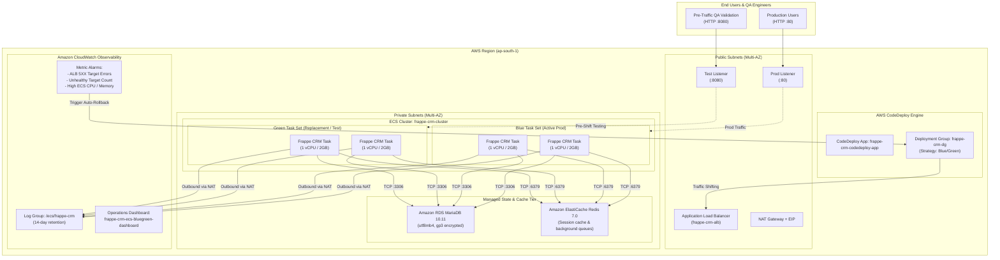
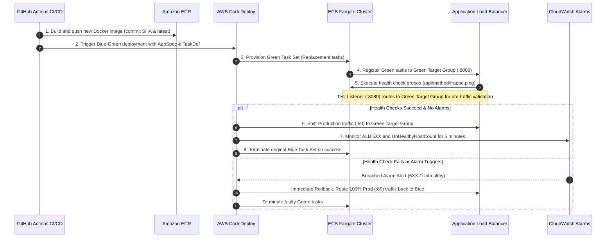

# Task 14: Deploy Frappe CRM on AWS ECS Fargate with Blue-Green Deployment Strategy

**Repository:** `PearlThoughts-Intern-DevOps/frappe-crm-devops-internship`  
**Candidate:** Gourob Das (`gourobdas0103`)  
**Branch:** `task-gourobdas0103`  
**Target Branch for PR:** `origin/main`  
**AWS Selected Region:** `ap-south-1` (Mumbai)  

---

## 1. Executive Summary

This project delivers a complete, production-grade, highly available deployment of the **Frappe CRM** application on **AWS ECS Fargate** using a zero-downtime **Blue-Green Deployment strategy** orchestrated by **AWS CodeDeploy** and **Application Load Balancer (ALB)**, fully codified with **Terraform**, automated via **GitHub Actions CI/CD**, protected by **automated health checks and rollback mechanisms**, and continuously monitored via **Amazon CloudWatch**.

### Summary of Deliverables Against Requirements:

| # | Requirement | Implementation Component | Status |
|---|---|---|---|
| **1** | **Dockerize the Frappe CRM application** | Production multi-stage `docker/Dockerfile`, runtime entrypoint `docker/entrypoint.sh`, local validation compose `docker/docker-compose.ecs-test.yml` | **Completed** |
| **2** | **Push images to AWS ECR** | Private ECR repository (`terraform/ecr.tf`) with AES-256 encryption, image scan-on-push, automated pruning lifecycle policy, and push script `scripts/push_to_ecr.sh` | **Completed** |
| **3** | **Provision infrastructure using Terraform** | Modular Terraform suite in `terraform/` (VPC across 2 AZs, NAT, Security Groups, RDS MariaDB 10.11, ElastiCache Redis 7.0, IAM, ECS, ALB, CodeDeploy, CloudWatch) | **Completed** |
| **4** | **Deploy using ECS Fargate** | ECS Cluster with Container Insights, Fargate Task Definition (1 vCPU, 2 GB RAM, `awsvpc`), and ECS Service with `CODE_DEPLOY` controller (`terraform/ecs.tf`) | **Completed** |
| **5** | **Configure Blue-Green deployment with ALB** | ALB with Blue & Green IP target groups, Prod Listener (:80), Test Listener (:8080), and CodeDeploy deployment group (`terraform/alb.tf`, `terraform/codedeploy.tf`) | **Completed** |
| **6** | **Set up CI/CD using GitHub Actions** | End-to-end automated workflow `.github/workflows/deploy-ecs-bluegreen.yml` covering linting, ECR build/push, Task Definition rendering, and CodeDeploy rollout | **Completed** |
| **7** | **Implement health checks and automatic rollback** | `/api/method/frappe.ping` health check probe on target groups, CodeDeploy auto-rollback on alarm/failure, and simulation script `scripts/simulate_rollback.sh` | **Completed** |
| **8** | **Configure monitoring using CloudWatch** | CloudWatch log group `/ecs/frappe-crm`, 4 metric alarms (CPU, Memory, 5XX, Unhealthy hosts), and operations dashboard (`terraform/cloudwatch.tf`) | **Completed** |

---

## 2. High-Level Architecture

### Infrastructure & Traffic Flow Architecture



---

## 3. Blue-Green Deployment & Traffic Shifting Sequence



---

## 4. Key Project Components

### 4.1. Dockerization (`docker/`)
- **`docker/Dockerfile`**: Production multi-stage Dockerfile based on `frappe/bench:latest`. Installs runtime binaries, pre-packages Frappe v15 and Frappe CRM, installs Python dependencies, builds production Vite frontend assets, and exposes port 8000.
- **`docker/entrypoint.sh`**: Robust startup script that performs DB connectivity checks, handles table detection, automatically initializes sites or applies `bench migrate`, traps `SIGTERM`/`SIGINT` for graceful task draining, and launches `bench start`.
- **`docker/appspec.yaml`**: AWS CodeDeploy specification file routing traffic to container `frappe-crm` on port 8000.
- **`docker/task-definition.json`**: Initial ECS Task Definition template configured with CloudWatch logging and healthcheck parameters.

### 4.2. Terraform Infrastructure (`terraform/`)
- **`vpc.tf`**: Multi-AZ VPC (`10.0.0.0/16`) with 2 public subnets, 2 private subnets, Internet Gateway, and NAT Gateway.
- **`security.tf`**: Strict least-privilege security groups separating ALB (80, 8080), ECS Tasks (8000 from ALB only), RDS (3306 from ECS tasks only), and Redis (6379 from ECS tasks only).
- **`alb.tf`**: Application Load Balancer with Blue and Green target groups, production listener (80), and test validation listener (8080).
- **`ecs.tf`**: ECS Cluster with Container Insights and ECS Service configured with `deployment_controller { type = "CODE_DEPLOY" }`.
- **`codedeploy.tf`**: CodeDeploy Application & Deployment Group with automated rollback configured on failure and alarm breach.
- **`rds.tf` & `redis.tf`**: Managed database tier (MariaDB 10.11 with `utf8mb4` and ElastiCache Redis 7.0).
- **`cloudwatch.tf`**: Metric alarms for 5XX errors, unhealthy hosts, and high resource utilization + CloudWatch operational dashboard.

### 4.3. GitHub Actions CI/CD (`.github/workflows/deploy-ecs-bluegreen.yml`)
- Automated workflow triggering on push or manual `workflow_dispatch`.
- Steps:
  1. Terraform format and AppSpec linting.
  2. Docker build with Buildx and push to Amazon ECR.
  3. Dynamic task definition rendering with the new image URI.
  4. Blue-Green zero-downtime rollout via AWS CodeDeploy.

### 4.4. Helper & Simulation Scripts (`scripts/`)
- **`scripts/push_to_ecr.sh`**: Authenticates, builds, and pushes Frappe CRM images to ECR.
- **`scripts/verify_deployment.sh`**: Checks ECS service status, target group health, ALB HTTP ping, and CloudWatch logs.
- **`scripts/simulate_rollback.sh`**: Triggers simulated alarm state to verify CodeDeploy automatic rollback capabilities.

---

## 5. Deployment & Execution Guide

### Step 1: Provision Infrastructure via Terraform
```bash
cd terraform
terraform init
terraform plan
terraform apply -auto-approve
```

### Step 2: Push Container Image to ECR
```bash
bash scripts/push_to_ecr.sh
```

### Step 3: Trigger Blue-Green Deployment
Navigate to **GitHub Actions** > **Deploy Frappe CRM to AWS ECS Fargate (Blue-Green)** > **Run workflow**.

### Step 4: Verify Deployment and Test Rollback
```bash
# Verify health and active tasks
bash scripts/verify_deployment.sh

# Verify automatic rollback simulation
bash scripts/simulate_rollback.sh
```
