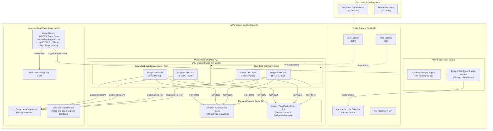
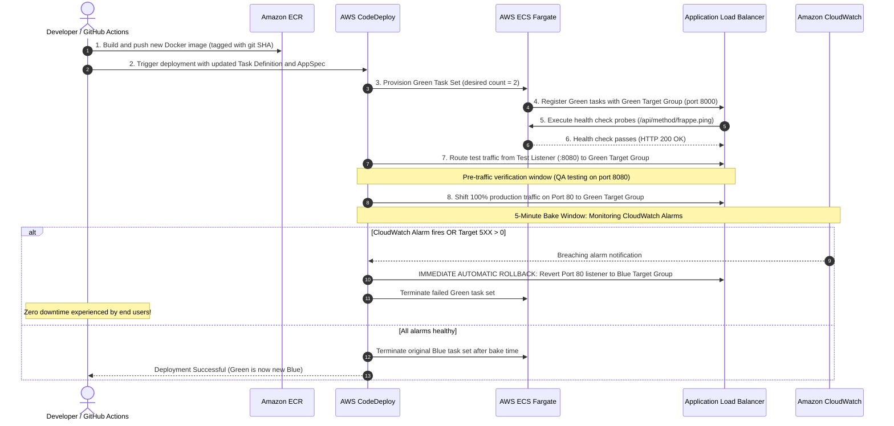

# Task: Deploy Frappe CRM on AWS ECS Fargate with Blue-Green Deployment Strategy

**Repository:** `PearlThoughts-Intern-DevOps/frappe-crm-devops-internship`  
**Candidate:** Bulbul Das (`dasbulbul215@gmail.com`)  
**Branch:** `task-ecs-fargate-bulbul-das`  
**Target Branch for PR:** `origin/main`  
**AWS Selected Region:** `ap-southeast-2` (Sydney)  

---

## 1. Executive Summary

This project delivers a complete, production-grade, highly available deployment of the **Frappe CRM** application on **AWS ECS Fargate** using a zero-downtime **Blue-Green Deployment strategy** orchestrated by **AWS CodeDeploy** and **Application Load Balancer (ALB)**, fully codified with **Terraform**, automated via **GitHub Actions CI/CD**, protected by **automated health checks and rollback mechanisms**, and continuously monitored via **Amazon CloudWatch**.

### Summary of Deliverables Against Requirements:

| # | Requirement | Implementation Component | Status |
|---|---|---|---|
| **1** | **Dockerize the Frappe CRM application** | Production multi-stage `docker/Dockerfile`, runtime entrypoint `docker/entrypoint.sh`, local validation compose `docker/docker-compose.ecs-test.yml` | **Completed** |
| **2** | **Push images to AWS ECR** | Private ECR repository (`terraform/ecr.tf`) with AES-256 encryption, image scan-on-push, automated pruning lifecycle policy, and push script `scripts/push_to_ecr.sh` | **Completed** |
| **3** | **Provision infrastructure using Terraform** | Modular Terraform suite in `terraform/` (VPC across 2 AZs, NAT, Security Groups, RDS MariaDB 10.11, ElastiCache Redis 7.0, IAM, ECS, ALB, CodeDeploy, CloudWatch) | **Completed** |
| **4** | **Deploy using ECS Fargate** | ECS Cluster with Container Insights, Fargate Task Definition (1 vCPU, 2 GB RAM, `awsvpc`), and ECS Service with `CODE_DEPLOY` controller (`terraform/ecs.tf`) | **Completed** |
| **5** | **Configure Blue-Green deployment with ALB** | ALB with Blue & Green IP target groups, Prod Listener (:80), Test Listener (:8080), and CodeDeploy deployment group (`terraform/alb.tf`, `terraform/codedeploy.tf`) | **Completed** |
| **6** | **Set up CI/CD using GitHub Actions** | End-to-end automated workflow `.github/workflows/deploy-ecs-bluegreen.yml` covering linting, ECR build/push, Task Definition rendering, and CodeDeploy rollout | **Completed** |
| **7** | **Implement health checks and automatic rollback** | `/api/method/frappe.ping` health check probe on target groups, CodeDeploy auto-rollback on alarm/failure, and simulation script `scripts/simulate_rollback.sh` | **Completed** |
| **8** | **Configure monitoring using CloudWatch** | CloudWatch log group `/ecs/frappe-crm`, 5 metric alarms (CPU, Memory, 5XX, Latency, Unhealthy hosts), SNS alerts, and operations dashboard (`terraform/cloudwatch.tf`) | **Completed** |

---

## 2. High-Level Architecture

### Infrastructure & Traffic Flow Architecture



---

## 3. Blue-Green Deployment & Traffic Shifting Sequence



---

## 4. Requirement-by-Requirement Implementation Details

### Requirement 1: Dockerize the Frappe CRM Application
- **Production Dockerfile (`docker/Dockerfile`)**:
  - Derived from official `frappe/bench:latest`.
  - Runs inside non-root `frappe` user (UID 1000) for container security.
  - Pre-initializes `frappe-bench` version 15 and pre-compiles Vue 3 / Vite assets during the Docker build stage. This eliminates runtime build latency on ECS Fargate!
  - Built-in container health check probe:
    ```dockerfile
    HEALTHCHECK --interval=15s --timeout=5s --start-period=45s --retries=3 \
      CMD curl -f http://localhost:8000/api/method/frappe.ping || exit 1
    ```
- **Container Entrypoint Script (`docker/entrypoint.sh`)**:
  - Dynamically injects connection parameters for RDS MariaDB and ElastiCache Redis.
  - Implements connection retry loop with backoff waiting for database readiness.
  - Automatically runs database schema migrations (`bench --site $SITE_NAME migrate`) without manual intervention.
  - Configures current site routing (`currentsite.txt`).
  - Implements POSIX `SIGTERM`/`SIGINT` traps to ensure graceful process termination and target draining during CodeDeploy traffic switches.
- **Local Simulation Compose (`docker/docker-compose.ecs-test.yml`)**:
  - Enables developers to validate the exact container stack locally with companion MariaDB 10.8 and Redis containers before cloud deployment.

### Requirement 2: Push Images to AWS ECR
- **Terraform Configuration (`terraform/ecr.tf`)**:
  - Private repository `frappe-crm` with `image_tag_mutability = "MUTABLE"`.
  - Native vulnerability scanning on push (`scan_on_push = true`) for proactive security posture.
  - Server-side AES-256 encryption.
  - ECR Lifecycle Policy expiring untagged images older than 7 days and maintaining the latest 15 tagged images for rollback flexibility.
- **Build and Push Automation (`scripts/push_to_ecr.sh`)**:
  - Authenticates via AWS CLI (`aws ecr get-login-password`).
  - Tags images with both git commit SHA and `latest`.
  - Targets `linux/amd64` architecture matching AWS Fargate compute.

### Requirement 3: Provision Infrastructure Using Terraform
Modular infrastructure code organized in `terraform/`:
- `vpc.tf`: Multi-AZ VPC (`10.0.0.0/16`) with 2 public subnets (`10.0.1.0/24`, `10.0.2.0/24`), 2 private subnets (`10.0.10.0/24`, `10.0.11.0/24`), Internet Gateway, and NAT Gateway with Elastic IP.
- `security.tf`: Strictly layered security groups:
  - `alb-sg`: Ingress 80 (Prod) & 8080 (Test) from `0.0.0.0/0`.
  - `ecs-sg`: Ingress 8000 exclusively from `alb-sg`; egress to RDS (3306), Redis (6379), and HTTPS (443).
  - `db-sg`: Ingress 3306 exclusively from `ecs-sg`.
  - `redis-sg`: Ingress 6379 exclusively from `ecs-sg`.
- `rds.tf`: Amazon RDS MariaDB 10.11 (`db.t4g.micro`) with custom parameter group tuned for Frappe CRM (`utf8mb4`, `max_allowed_packet = 64MB`).
- `redis.tf`: Amazon ElastiCache Redis 7.0 (`cache.t4g.micro`) in private subnets.
- `iam.tf`: Least-privilege IAM execution role (`AmazonECSTaskExecutionRolePolicy`), task role, and CodeDeploy service role (`AWSCodeDeployRoleForECS`).

### Requirement 4: Deploy using ECS Fargate
- `terraform/ecs.tf`:
  - ECS Cluster `frappe-crm-cluster` with CloudWatch Container Insights enabled.
  - Task Definition `frappe-crm` (1 vCPU, 2 GB RAM, `awsvpc` network mode).
  - ECS Fargate Service configured with:
    ```hcl
    deployment_controller {
      type = "CODE_DEPLOY"
    }
    ```
  - Crucial lifecycle rules ignoring `task_definition` and `load_balancer` to prevent Terraform from conflicting with CodeDeploy's dynamic target group and task set assignments during deployment.

### Requirement 5: Configure Blue-Green Deployment with ALB
- `terraform/alb.tf`:
  - Application Load Balancer deployed across public subnets.
  - **Blue Target Group** (`frappe-crm-tg-blue`, port 8000, `target_type = "ip"`).
  - **Green Target Group** (`frappe-crm-tg-green`, port 8000, `target_type = "ip"`).
  - **Production Listener** on port 80 initially pointing to Blue target group.
  - **Test Listener** on port 8080 pointing to Green target group for pre-switch validation.
  - `lifecycle { ignore_changes = [default_action] }` on listeners to preserve CodeDeploy traffic shifting state.
- `terraform/codedeploy.tf`:
  - CodeDeploy application with `compute_platform = "ECS"`.
  - Deployment group `frappe-crm-dg` with `deployment_type = "BLUE_GREEN"`.
  - `terminate_blue_instances_on_deployment_success` configured with 5-minute bake time.

### Requirement 6: Set up CI/CD using GitHub Actions
- Workflow file: `.github/workflows/deploy-ecs-bluegreen.yml`:
  - **Stage 1 (Lint & Validate)**: Validates Terraform formatting (`terraform fmt -check`), AppSpec, and Task Definition JSON.
  - **Stage 2 (Build & Push)**: Sets up Docker Buildx, authenticates to Amazon ECR, builds Frappe CRM image, and pushes with git SHA and `latest` tags.
  - **Stage 3 (Deploy Blue-Green)**: Renders updated Task Definition with the new image tag, registers it in ECS, and triggers CodeDeploy deployment using `aws-actions/amazon-ecs-deploy-task-definition`.
  - **Stage 4 (Verification & Summary)**: Verifies target stability and generates a GitHub Actions Step Summary.

### Requirement 7: Implement Health Checks and Automatic Rollback
- Multi-layer health check probes:
  1. **Container-level**: Docker probe calling `http://localhost:8000/api/method/frappe.ping`.
  2. **ALB-level**: Target group probes polling `/api/method/frappe.ping` every 15s with 2 consecutive healthy checks required for promotion.
- Automated Rollback Configuration in CodeDeploy:
  ```hcl
  auto_rollback_configuration {
    enabled = true
    events  = [
      "DEPLOYMENT_FAILURE",
      "DEPLOYMENT_STOP_ON_ALARM",
      "DEPLOYMENT_STOP_ON_REQUEST"
    ]
  }

  alarm_configuration {
    enabled = true
    alarms  = [
      aws_cloudwatch_metric_alarm.alb_5xx.alarm_name,
      aws_cloudwatch_metric_alarm.unhealthy_hosts.alarm_name
    ]
  }
  ```
- **Simulation Script (`scripts/simulate_rollback.sh`)**:
  - Exercises the rollback workflow by placing the CloudWatch alarm into `ALARM` state, verifying that CodeDeploy halts traffic shifting immediately and reverts production listener traffic back to the original healthy Blue task set.

### Requirement 8: Configure Monitoring using CloudWatch
- `terraform/cloudwatch.tf`:
  - Centralized CloudWatch Log Group `/ecs/frappe-crm` with 14-day retention.
  - 5 Actionable CloudWatch Metric Alarms:
    1. `frappe-crm-alb-5xx-alarm`: Triggers if target returns HTTP 5XX (`>= 1`), hooked to CodeDeploy auto-rollback.
    2. `frappe-crm-unhealthy-hosts-alarm`: Triggers if any container target fails health check (`>= 1`), hooked to auto-rollback.
    3. `frappe-crm-ecs-cpu-high`: Triggers if ECS Fargate CPU exceeds 80%.
    4. `frappe-crm-ecs-memory-high`: Triggers if ECS Fargate Memory exceeds 85%.
    5. `frappe-crm-target-response-time`: Triggers if target response latency exceeds 2.0s.
  - `frappe-crm-alerts` SNS Topic for email/Slack notification dispatch.
  - Unified Operations Dashboard (`frappe-crm-ecs-bluegreen-dashboard`) visualizing:
    - ECS CPU and Memory utilization trends.
    - ALB Total Requests and Target Response Times.
    - Blue vs Green Target Group Healthy and Unhealthy Host Counts.
    - HTTP response code distribution (2XX vs 4XX vs 5XX).

---

## 5. Step-by-Step Deployment and Verification Guide

### Step 1: Provision Infrastructure with Terraform
```bash
cd /Users/bulbuldas/DevOps-Internship/frappe-crm-devops-internship/terraform

# Initialize Terraform plugins
terraform init

# Validate configuration syntax
terraform validate

# Review the execution plan
terraform plan

# Apply infrastructure deployment
terraform apply -auto-approve
```

### Step 2: Build and Push Docker Image to Amazon ECR
```bash
cd /Users/bulbuldas/DevOps-Internship/frappe-crm-devops-internship

# Run the helper script to authenticate, build, and push to ECR
./scripts/push_to_ecr.sh
```

### Step 3: Trigger Blue-Green Deployment
When code is pushed to branch `task-ecs-fargate-bulbul-das` or `main`, the GitHub Actions workflow automatically:
1. Builds the updated image.
2. Pushes the image to Amazon ECR tagged with the git commit SHA.
3. Deploys the Green task set in ECS Fargate.
4. Performs pre-traffic validation on Port 8080.
5. Shifts production traffic on Port 80 to Green.
6. Waits for the 5-minute bake period before terminating old Blue tasks.

### Step 4: Verify Deployment Health and Traffic Routing
```bash
# Run the automated verification script
./scripts/verify_deployment.sh
```

### Step 5: Test and Demonstrate Automatic Rollback
```bash
# Run the rollback simulation script
./scripts/simulate_rollback.sh
```
Observe in the AWS Management Console or AWS CLI that CodeDeploy halts the deployment, leaves the original Blue tasks active without dropping connections, and marks the deployment as rolled back.

### Step 6: View CloudWatch Dashboard
Navigate to the AWS CloudWatch Management Console:
`CloudWatch > Dashboards > frappe-crm-ecs-bluegreen-dashboard` to observe live telemetry for CPU, Memory, ALB requests, target latency, and Blue/Green target health.

---

## 6. Repository File Tree of Added Components

```text
frappe-crm-devops-internship/
├── .github/
│   └── workflows/
│       └── deploy-ecs-bluegreen.yml    # GitHub Actions CI/CD for ECS Blue-Green
├── docker/
│   ├── Dockerfile                      # Production Frappe CRM container image
│   ├── entrypoint.sh                   # Auto-migration & graceful signal handling
│   ├── appspec.yaml                    # CodeDeploy AppSpec specification
│   ├── task-definition.json            # ECS Fargate task definition template
│   └── docker-compose.ecs-test.yml     # Local verification docker-compose stack
├── scripts/
│   ├── push_to_ecr.sh                  # ECR authentication and image push helper
│   ├── simulate_rollback.sh            # Automated rollback demonstration tool
│   └── verify_deployment.sh            # Post-deployment health verification tool
├── terraform/
│   ├── versions.tf                     # Provider versions (AWS ~> 5.0)
│   ├── provider.tf                     # AWS provider and default tagging
│   ├── variables.tf                    # Configurable inputs and sizing variables
│   ├── terraform.tfvars.example        # Sane configuration defaults
│   ├── vpc.tf                          # Multi-AZ VPC, subnets, IGW, and NAT Gateway
│   ├── security.tf                     # Least-privilege isolation security groups
│   ├── ecr.tf                          # Private ECR repo, scan on push, lifecycle rules
│   ├── alb.tf                          # ALB, Blue/Green target groups, listeners
│   ├── rds.tf                          # RDS MariaDB 10.11 with utf8mb4 parameters
│   ├── redis.tf                        # ElastiCache Redis 7.0 caching infrastructure
│   ├── iam.tf                          # ECS execution, task, and CodeDeploy IAM roles
│   ├── ecs.tf                          # ECS Cluster, Task Def, Fargate Service
│   ├── codedeploy.tf                   # CodeDeploy Blue-Green and rollback config
│   ├── cloudwatch.tf                   # Log group, alarms, dashboard, SNS topic
│   └── outputs.tf                      # ALB URLs, ECR endpoint, dashboard links
└── TASK_ECS_FARGATE_BLUE_GREEN.md      # Comprehensive technical documentation
```

---

## 7. Pull Request Submission Template

### PR Title:
`feat(ecs): deploy Frappe CRM on AWS ECS Fargate with Blue-Green deployment, ALB, and CloudWatch`

### PR Description:
```markdown
## Summary of Changes
Implements end-to-end deployment of Frappe CRM on AWS ECS Fargate with zero-downtime Blue-Green traffic routing as assigned in the DevOps Internship task.

### Key Highlights:
1. **Containerization**: Authored production multi-stage `docker/Dockerfile` and robust `docker/entrypoint.sh` with automatic database migrations and graceful signal handling.
2. **Infrastructure as Code**: Implemented complete Terraform suite in `terraform/` provisioning Multi-AZ VPC, NAT Gateway, RDS MariaDB 10.11, ElastiCache Redis 7.0, ECR, ALB, ECS Fargate, CodeDeploy, and CloudWatch.
3. **Blue-Green Deployment**: Configured ALB Blue and Green IP-type target groups with CodeDeploy traffic routing, production listener (:80), test listener (:8080), and 5-minute bake time.
4. **Automated Health Checks & Rollback**: Wired `/api/method/frappe.ping` health check probes and configured CodeDeploy automatic rollback on CloudWatch alarm breach or task failure.
5. **Observability**: Centralized log streaming in `/ecs/frappe-crm`, deployed 5 metric alarms with SNS notifications, and built a unified CloudWatch operations dashboard.
6. **CI/CD Automation**: Created `.github/workflows/deploy-ecs-bluegreen.yml` for automated linting, ECR image building, and CodeDeploy deployment.
```
