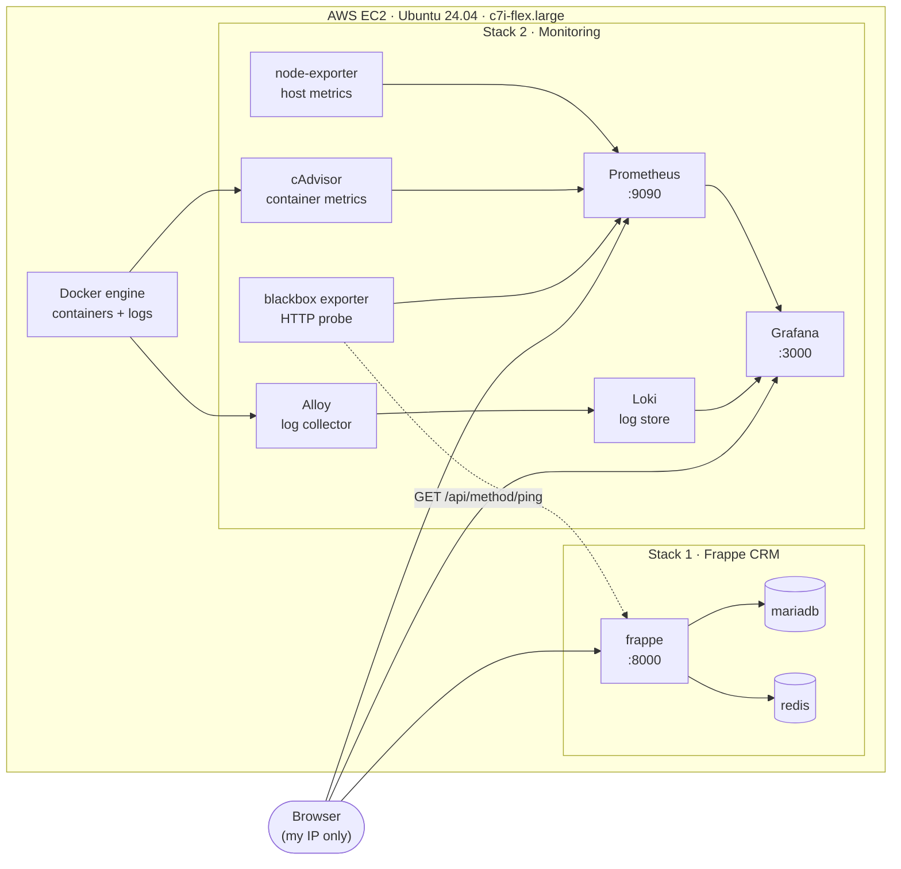

# Frappe CRM on AWS EC2 with Prometheus, Grafana and Loki

Frappe CRM deployed on a single AWS EC2 instance (Ubuntu 24.04 LTS) with Docker Compose, monitored with Prometheus (metrics), Loki (logs) and Grafana (dashboards).

**Stack:** AWS EC2 · Docker · Docker Compose · Prometheus · Grafana · Loki · Grafana Alloy · node-exporter · cAdvisor · blackbox exporter

## Application

It was deployed with the project's Docker setup (`docker-compose.yml` and `init.sh`), which runs Frappe, MariaDB and Redis.

## Architecture

**Data flow**

- **Metrics:** node-exporter (host), cAdvisor (containers) and blackbox exporter (Frappe uptime) are scraped by Prometheus every 15 seconds. Grafana queries Prometheus.
- **Logs:** Alloy reads logs of all Docker containers and pushes them to Loki, labelled by container name. Grafana queries Loki in Explore.
- **Uptime check:** blackbox sends an HTTP request to Frappe's `/api/method/ping` and reports success or failure as a metric.

## Components

| Component | Image / version | Purpose |
|---|---|---|
| Frappe CRM | `frappe/bench` | The application (with MariaDB and Redis) |
| Prometheus | `prom/prometheus:v2.55.1` | Metrics collection and storage |
| node-exporter | `prom/node-exporter:v1.8.2` | Host CPU, memory, disk, network |
| cAdvisor | `gcr.io/cadvisor/cadvisor:v0.49.1` | Per-container resource usage |
| blackbox exporter | `prom/blackbox-exporter:v0.25.0` | HTTP probe for Frappe |
| Loki | `grafana/loki:3.3.2` | Log storage (7-day retention) |
| Alloy | `grafana/alloy:v1.5.1` | Ships Docker container logs to Loki |
| Grafana | `grafana/grafana:11.4.0` | Dashboards and log exploration |

## Environment

- AWS EC2 `c7i-flex.large`, Ubuntu Server 24.04 LTS, 30 GiB gp3
- Security group inbound (source: my IP only): 22, 8000, 9090, 3000
- Docker and Docker Compose from Ubuntu packages (`docker.io`, `docker-compose-v2`)

## Setup summary

1. Created the security group and launched the EC2 instance in the AWS Console.
2. Installed Git, Docker and Docker Compose.
3. Started Frappe CRM from the project's `docker` folder with `docker compose up -d`.
4. Created the monitoring stack in a separate folder (`monitoring/`) with its own `docker-compose.yml` and config files (in this repo).
5. Added Prometheus and Loki as data sources in Grafana and imported dashboards: Node Exporter Full (1860), cAdvisor (14282), Blackbox exporter (7587).
