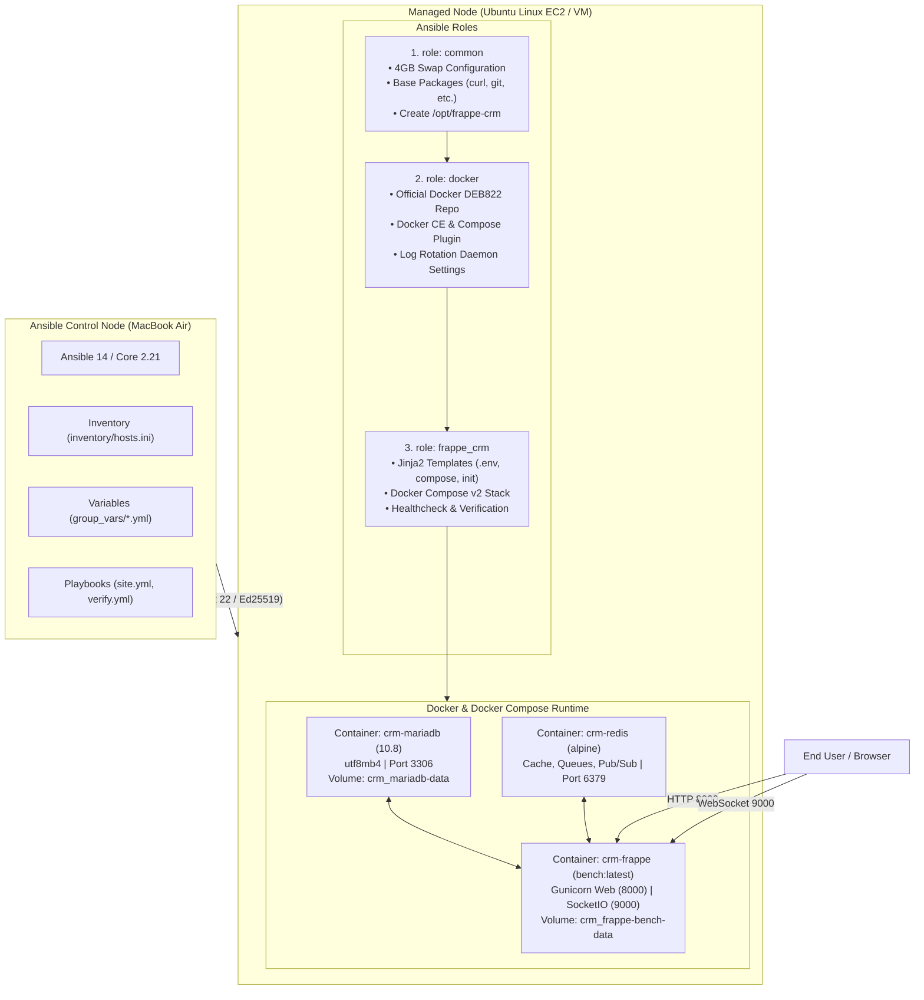

# Ansible Automation for Frappe CRM

An enterprise-grade, modular, and strictly idempotent Ansible automation solution designed to provision an Ubuntu Linux server and deploy Frappe CRM using Docker and Docker Compose.

---

## 1. Project Overview

This project provides an automated Infrastructure-as-Code (IaC) configuration and application lifecycle management layer for Frappe CRM. Using an Ansible control node (macOS), it orchestrates the configuration of an Ubuntu Linux managed node (AWS EC2 / VM), installs Docker Engine and Docker Compose, prepares persistent storage and environment configurations, and deploys Frappe CRM with automated health checks.

### Key Highlights
- **Strict Idempotency:** Successive playbook runs produce `changed=0 failed=0`.
- **Zero Hardcoded Secrets:** Credentials templated using variables and ready for Ansible Vault encryption.
- **Production-Ready Memory Management:** Automated 4GB swap space configuration ensures memory stability on cost-effective cloud instances (e.g., `t3.micro`).
- **Separation of Concerns:** Clean Ansible Role architecture (`common`, `docker`, `frappe_crm`).
- **Comprehensive Verification:** Dedicated healthcheck and assertion playbook (`verify.yml`).

---

## 2. Architecture Diagram



---

## 3. Directory Structure

```text
ansible/
├── ansible.cfg                          # Connection parameters, pipelining, callback config
├── inventory/
│   ├── hosts.ini                        # Active inventory pointing to managed host
│   ├── hosts.ini.example                # Example template for team members
│   └── group_vars/
│       ├── all.yml                      # Global paths and deployment settings
│       ├── frappe_servers.yml           # Application variables, ports, image versions
│       └── vault.yml.example            # Template for Ansible Vault credentials
├── roles/
│   ├── common/                          # System prerequisites, swap space, permissions
│   │   └── tasks/main.yml
│   ├── docker/                          # Docker CE & Docker Compose installation
│   │   ├── tasks/main.yml
│   │   └── handlers/main.yml
│   └── frappe_crm/                      # Configuration templating, service start, health checks
│       ├── defaults/main.yml
│       ├── tasks/main.yml
│       ├── handlers/main.yml
│       └── templates/
│           ├── docker-compose.yml.j2    # Dynamic Docker Compose specification
│           ├── .env.j2                  # Environment variables file
│           └── init.sh.j2               # Idempotent bench initialization script
├── playbooks/
│   ├── site.yml                         # Main orchestration playbook
│   └── verify.yml                       # Health checks and status assertions
└── README.md                            # Comprehensive documentation
```

---

## 4. Role Responsibilities

### A. `roles/common`
1. **Memory & Swap Management:** Checks for `/swapfile`. If missing, allocates, formats (`mkswap`), enables (`swapon`), mounts permanently in `/etc/fstab`, and sets `vm.swappiness = 10`. This eliminates Out-Of-Memory (OOM) kernel panics on 1GB RAM instances.
2. **System Dependencies:** Updates APT cache and installs `curl`, `ca-certificates`, `gnupg`, `lsb-release`, `git`, `python3-pip`, and `python3-docker`.
3. **Directory Provisioning:** Creates `/opt/frappe-crm` with restricted permissions (`0755`) owned by the deploy user.

### B. `roles/docker`
1. **Official Repository:** Adds the official Docker GPG key and configures the modern DEB822 repository format (`/etc/apt/sources.list.d/docker.sources`).
2. **Package Installation:** Installs `docker-ce`, `docker-ce-cli`, `containerd.io`, and `docker-compose-plugin`.
3. **Production Daemon Configuration:** Deploys `/etc/docker/daemon.json` with log rotation limits (`max-size: 20m`, `max-file: 3`) to prevent disk exhaustion.
4. **Service Management:** Enables and starts `docker` and `containerd` via systemd.

### C. `roles/frappe_crm`
1. **Jinja2 Configuration Templating:**
   - `.env.j2` &rarr; `/opt/frappe-crm/.env` (`mode: 0600` for security).
   - `docker-compose.yml.j2` &rarr; `/opt/frappe-crm/docker-compose.yml`.
   - `init.sh.j2` &rarr; `/opt/frappe-crm/init.sh` (`mode: 0755`).
2. **Idempotent Bench Initialization:**
   - Detects if the site config exists at `/home/frappe/frappe-bench/sites/crm.localhost/site_config.json`.
   - If present, skips bench initialization and starts the services immediately.
   - If absent, initializes with `bench init --ignore-exist`, clones the CRM app, installs `crm`, and sets default site.
3. **Docker Compose v2 Management:** Launches the multi-container stack via `community.docker.docker_compose_v2`.
4. **Health Check Waiter:** Polls `http://127.0.0.1:8000/api/method/ping` until `{"message":"pong"}` is returned with HTTP 200 OK.

---

## 5. Prerequisites & Local Setup

### On macOS (Control Node)
1. **Install Ansible:**
   ```bash
   brew install ansible
   ```
2. **Verify Installation:**
   ```bash
   ansible --version
   ```
3. **Verify Docker Collection:**
   ```bash
   ansible-galaxy collection list community.docker
   ```

### SSH Key Setup
Store your private key securely on your local Mac:
```bash
chmod 400 ~/.ssh/frappe-ansible-key.pem
```

---

## 6. Execution Guide

From within the `ansible/` directory:

### Step 1: Verify Host Connectivity
```bash
ansible all -m ping
```
*Expected Output:*
```yaml
frappe-node-1 | SUCCESS => {
    "changed": false,
    "ping": "pong"
}
```

### Step 2: Validate Playbook Syntax
```bash
ansible-playbook playbooks/site.yml --syntax-check
ansible-playbook playbooks/verify.yml --syntax-check
```

### Step 3: Execute Full Deployment
```bash
ansible-playbook playbooks/site.yml
```
*Expected Output:*
```text
PLAY RECAP *********************************************************************
frappe-node-1              : ok=27   changed=9    unreachable=0    failed=0    skipped=1
```

### Step 4: Run Verification Playbook
```bash
ansible-playbook playbooks/verify.yml
```
*Expected Output:*
```text
TASK [Display Final Verification Summary] **************************************
ok: [frappe-node-1] => {
    "msg": [
        "==========================================================",
        "           FRAPPE CRM VERIFICATION PASSED                 ",
        "==========================================================",
        "Host: frappe-node-1 (3.107.114.49)",
        "Docker Service: ACTIVE",
        "Containers: MariaDB, Redis, Frappe (RUNNING)",
        "Web URL: http://3.107.114.49:8000/login",
        "API Health: http://3.107.114.49:8000/api/method/ping",
        "Status: ALL ASSERTIONS SUCCEEDED",
        "=========================================================="
    ]
}
```

### Step 5: Test Idempotency (Second Execution)
Run `site.yml` a second time:
```bash
ansible-playbook playbooks/site.yml
```
*Expected Output:*
```text
PLAY RECAP *********************************************************************
frappe-node-1              : ok=23   changed=0    unreachable=0    failed=0    skipped=4
```
> Notice **`changed=0 failed=0`**. No unnecessary changes or reboots occur!

---

## 7. Accessing the Frappe CRM Application

Once the deployment completes:

1. **Web Interface:** Open your web browser and navigate to:
   ```text
   http://YOUR_SERVER_PUBLIC_IP:8000/login
   ```
   - **Username:** `Administrator`
   - **Password:** `admin` (or the password configured in `frappe_servers.yml`)

2. **API Health Ping:**
   ```bash
   curl -s http://YOUR_SERVER_PUBLIC_IP:8000/api/method/ping
   ```
   *Response:*
   ```json
   {"message":"pong"}
   ```

---

## 8. Security & Secret Management

- **Ansible Vault Integration:** Sensitive passwords can be encrypted using Ansible Vault:
  ```bash
  ansible-vault create inventory/group_vars/vault.yml
  ```
  Run the playbook with vault password prompt:
  ```bash
  ansible-playbook playbooks/site.yml --ask-vault-pass
  ```
- **Git Protection:** Real vault files (`vault.yml`) and `.retry` files are explicitly excluded via `.gitignore`.
- **Target Node Permissions:** The `.env` file containing database passwords is chmod `0600` so only the owner can read it.

---

## 9. Troubleshooting & FAQ

| Issue | Cause | Solution |
| :--- | :--- | :--- |
| **`Connection timed out` on SSH** | EC2 Security Group missing port 22 IPv4 ingress | Add inbound rule for port 22 from your public IP (`x.x.x.x/32`). |
| **`Out of Memory / Freeze` during bench init** | 1GB RAM instances run out of memory compiling Python wheels | The `common` role automatically provisions 4GB swap space at `/swapfile`. |
| **`mysqld is alive` but healthcheck failed** | `healthcheck.sh` connects without password by default | Use `mysqladmin ping -u root -p$MYSQL_ROOT_PASSWORD` in `docker-compose.yml`. |
| **`Bench instance already exists`** | Named volume mounted before `bench init` | `init.sh` uses `--ignore-exist` and guards each step to ensure idempotency. |

---

## 10. Meeting Demonstration Script (3-5 Minutes)

1. **Show Inventory & Connectivity:**
   ```bash
   ansible all -m ping
   ```
   *"Here we see Ansible connected to our remote Ubuntu EC2 node over SSH using our secure SSH key."*

2. **Show Idempotency:**
   ```bash
   ansible-playbook playbooks/site.yml
   ```
   *"Notice that re-running our main playbook reports `changed=0 failed=0`. Every role is strictly idempotent."*

3. **Show Verification Assertions:**
   ```bash
   ansible-playbook playbooks/verify.yml
   ```
   *"Our verification playbook validates systemd services, container status across MariaDB, Redis, and Frappe, and tests the live HTTP ping and login endpoints."*

4. **Show Live Web Browser Access:**
   - Navigate to `http://YOUR_SERVER_PUBLIC_IP:8000/login`.
   - Log in with `Administrator` / `admin`.
   - Show the Frappe CRM dashboard live.
