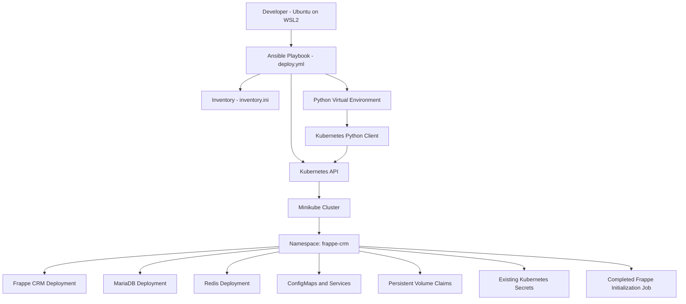

# Task 7 - Ansible Automation for Frappe CRM

## 1. Project Overview

In this task, I used Ansible to automate the management of my existing Frappe CRM application deployed on Kubernetes using Minikube.

The objective was to manage and verify Kubernetes resources through an Ansible playbook instead of manually executing every deployment operation.

I implemented the automation in my Ubuntu WSL environment and tested it against the existing Kubernetes cluster.

The main focus was to automate the existing deployment while preserving application data, Secrets and persistent storage.

## 2. Tools and Technologies

| Tool | Purpose |
|---|---|
| Ubuntu on WSL2 | Working environment |
| Ansible Core 2.20.1 | Automation |
| Python 3.14.4 | Ansible module dependencies |
| Python virtual environment | Isolated Python packages |
| Minikube | Local Kubernetes cluster |
| Kubernetes | Container orchestration |
| kubectl | Cluster management and verification |
| kubernetes.core | Ansible Kubernetes collection |
| Kubernetes Python client 37.0.2 | Kubernetes API interaction |

## 3. Project Structure and File Types

The following files were used for the Ansible implementation.

```text
frappe-crm-task6-clean-pr/
│
├── ansible/
│   ├── README.md
│   ├── deploy.yml
│   ├── inventory.ini
│   └── ansible.cfg
│
├── kubernetes/
│   ├── namespace.yaml
│   ├── configmap.yaml
│   ├── nginx-configmap.yaml
│   ├── sites-pvc.yaml
│   ├── mariadb.yaml
│   ├── redis.yaml
│   ├── deployment.yaml
│   ├── service.yaml
│   ├── frappe-init-job.yaml
│   └── secret.example.yaml.sample
│
└── .venv/
```

### File extensions and their purpose

| File type | Example | Purpose |
|---|---|---|
| `.yml` | `deploy.yml` | Ansible playbook containing automation tasks |
| `.ini` | `inventory.ini` | Defines the Ansible management host |
| `.cfg` | `ansible.cfg` | Ansible configuration settings |
| `.md` | `README.md` | Project documentation |
| `.yaml` | `deployment.yaml` | Kubernetes resource definitions |
| `.sample` | `secret.example.yaml.sample` | Example Secret manifest template |

The `.venv/` directory contains the isolated Python environment and installed dependencies. It should not be committed to Git.

### Main Ansible files

**deploy.yml**

Contains 16 automation tasks for checking cluster connectivity, validating existing Secrets and the completed initialization Job, managing Kubernetes resources and verifying the Frappe CRM Deployment.

**inventory.ini**

Defines localhost as the Ansible management host. The Python interpreter is configured separately in deploy.yml.

**ansible.cfg**

Contains Ansible execution settings. Because the project is on a Windows-mounted WSL directory, I used a trusted external configuration file under `~/.config/ansible/` instead.

**README.md**

Documents the implementation, configuration, execution steps and troubleshooting.

## 4. Architecture

The following diagram shows how Ansible communicates with the existing Kubernetes cluster.



### Architecture explanation

1. I execute the Ansible playbook from Ubuntu on WSL2.
2. Ansible uses the inventory to connect to localhost.
3. The Python virtual environment provides the Kubernetes Python client.
4. Ansible communicates with the Kubernetes API using the existing kubeconfig.
5. The Kubernetes API manages resources inside the `frappe-crm` namespace.
6. Ansible verifies existing Secrets and the completed initialization Job.
7. The existing application, database, Redis and persistent storage are preserved.

## 5. Environment Setup

First, I activated the Python virtual environment:

```bash
source .venv/bin/activate
```

Installed the Kubernetes Python client:

```bash
pip install kubernetes
```

Installed the Kubernetes Ansible collection:

```bash
ansible-galaxy collection install kubernetes.core
```

Verified the installation:

```bash
ansible --version
kubectl get nodes
```

Expected result:

- Ansible version information is displayed.
- Minikube node is in `Ready` status.

## 6. Ansible Configuration

### Inventory configuration

The `inventory.ini` file defines localhost as the Ansible management host.

```ini
[local]
localhost ansible_connection=local
```

The playbook sets ansible_python_interpreter using a path relative to the playbook directory.

### Active Ansible configuration

I initially created a project-level `ansible.cfg`.

However, Ansible ignored the configuration because the project was located in a world-writable Windows-mounted WSL directory.

To resolve this, I created an external configuration file:

```bash
mkdir -p ~/.config/ansible
```

I then configured Ansible to use it:

```bash
export ANSIBLE_CONFIG="$HOME/.config/ansible/frappe-crm.cfg"
```

Verified the active configuration:

```bash
ansible --version
```

The active configuration was loaded from the user's external Ansible configuration file. Its path is specific to the local environment and is not committed to Git.

## 7. Playbook Implementation

The main automation file is `ansible/deploy.yml`.

The playbook contains 18 tasks covering:

1. Kubernetes cluster connectivity.
2. Kubernetes node availability.
3. CRM namespace.
4. Application ConfigMap.
5. Nginx ConfigMap.
6. Database Secret verification.
7. Administrator Secret verification.
8. Required Secret validation.
9. Frappe sites storage.
10. MariaDB resources.
11. Redis resources.
12. Existing Frappe initialization Job verification.
13. Initialization Job existence validation.
14. Frappe CRM Deployment.
15. Frappe CRM Service.
16. Deployment verification.
17. Deployment availability assertion.

The playbook uses:

- `kubernetes.core.k8s` to manage Kubernetes resources.
- `kubernetes.core.k8s_info` to inspect existing resources.
- `ansible.builtin.assert` to validate conditions.
- Variables and registered results to reuse task information.

## 8. Validation and Execution

### A. Syntax check

```bash
ansible-playbook ansible/deploy.yml --syntax-check
```

Purpose: Validates playbook syntax without changing Kubernetes resources.

Expected output:

```text
playbook: ansible/deploy.yml
```

### B. Check mode

```bash
ansible-playbook ansible/deploy.yml --check --diff
```

Purpose: Previews supported changes before actual execution.

Result from my execution:

```text
ok=18 changed=0 failed=0
```

Note: Check mode does not fully simulate every Kubernetes operation.

### C. Compare Kubernetes manifests

Before actual execution, I compared the local manifests with the existing cluster:

```bash
kubectl diff \
-f kubernetes/namespace.yaml \
-f kubernetes/configmap.yaml \
-f kubernetes/nginx-configmap.yaml \
-f kubernetes/sites-pvc.yaml \
-f kubernetes/mariadb.yaml \
-f kubernetes/redis.yaml \
-f kubernetes/deployment.yaml \
-f kubernetes/service.yaml
```

Result: No differences were reported.

The completed initialization Job and Secret template were intentionally excluded.

### D. Execute the playbook

```bash
ansible-playbook ansible/deploy.yml
```

Successful execution:

```text
PLAY RECAP
localhost : ok=18 changed=0 unreachable=0 failed=0
```

Explanation:

- `ok=18`: All tasks completed successfully.
- `changed=0`: No resources needed modification.
- `unreachable=0`: Kubernetes was accessible.
- `failed=0`: No task failed.

## 9. Issues Faced and Resolutions

During implementation, I encountered the following issues.

### Issue 1: Ansible configuration ignored

**Problem:** Ansible ignored the project-level `ansible.cfg` because the project directory was world-writable.

**Resolution:** Created a trusted configuration under `~/.config/ansible/` and used the `ANSIBLE_CONFIG` environment variable.

### Issue 2: Kubernetes Python dependency

**Problem:** The Kubernetes Ansible modules required the Python Kubernetes client.

**Resolution:** Created a Python virtual environment, installed the Kubernetes package and configured the Python interpreter in the playbook.

### Issue 3: Reserved variable warning

**Problem:** Ansible warned that `namespace` was a reserved variable name.

**Resolution:** Renamed the variable to `k8s_namespace` and updated its references.

### Issue 4: Jinja2 template syntax error

**Problem:** An extra space was introduced in the variable reference:

```yaml
"{{ k8s_ namespace }}"
```

**Resolution:** Corrected it to:

```yaml
"{{ k8s_namespace }}"
```

After the correction, the syntax check passed without warnings.

### Issue 5: Ansible collection deprecation warnings

**Problem:** Deprecation warnings appeared for older utility imports used by the installed collection.

**Resolution:** Verified that these were warnings rather than execution failures. The playbook completed successfully.

## 10. Deployment Verification

After executing Ansible, I checked the existing Kubernetes resources:

```bash
kubectl get pods,deployments,services,pvc -n frappe-crm
```

Final observed status:

| Component | Result |
|---|---|
| Frappe CRM pods | 2/2 Running |
| MariaDB pod | 1/1 Running |
| Redis pod | 1/1 Running |
| Initialization Job | Completed |
| Frappe CRM Deployment | 1/1 Available |
| MariaDB Deployment | 1/1 Available |
| Redis Deployment | 1/1 Available |
| frappe-sites PVC | Bound - 5Gi |
| mariadb-data PVC | Bound - 5Gi |

All application pods and deployments remained healthy after execution.

## 11. Safety Considerations

While working with the existing application, I followed these precautions:

- Preserved existing MariaDB and Frappe persistent volume claims.
- Verified Kubernetes Secrets without exposing their values.
- Did not reapply the completed `frappe-site-init` Job.
- Did not delete the existing namespace.
- Did not delete or recreate persistent storage.
- Excluded the Secret template from deployment execution.
- Reviewed the Kubernetes resources before actual execution.
- Kept the Python virtual environment out of Git.

## 12. Final Outcome

Successfully implemented and executed Ansible automation for the existing Frappe CRM Kubernetes deployment.

All 18 tasks completed successfully with zero failures and zero resource changes.

The Frappe CRM application, MariaDB, Redis, Kubernetes services and persistent storage remained healthy.

Through this task, I gained practical experience with Ansible playbooks, inventories, Python dependencies, Kubernetes modules, assertions, check mode, troubleshooting and idempotent automation.
