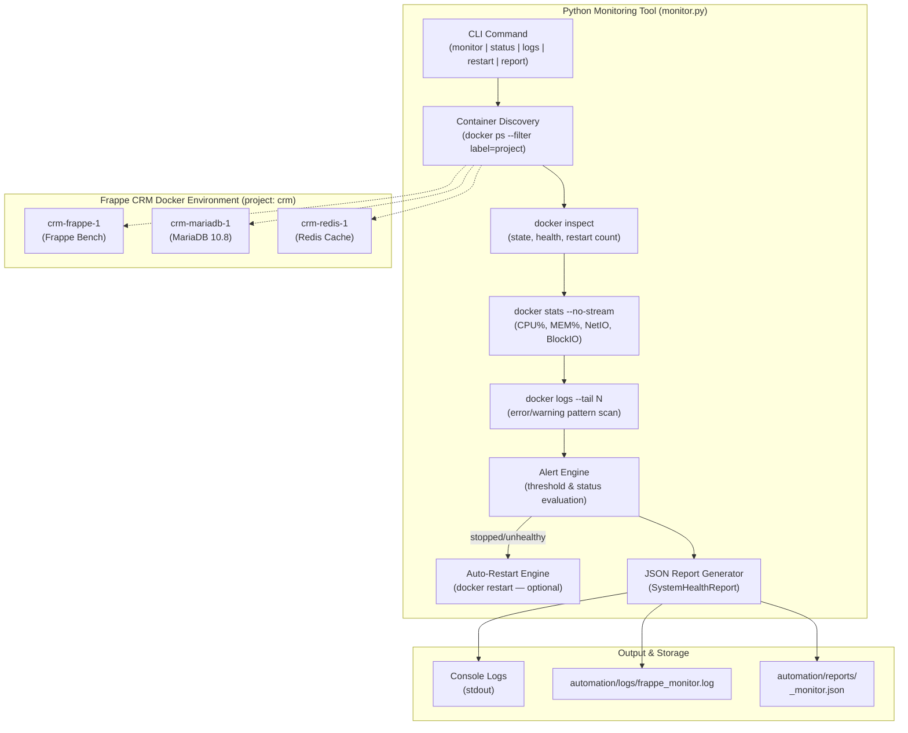

# Frappe CRM Docker Container Monitoring & Auto-Recovery Tool

An enterprise-grade, Python-based monitoring solution for **Frappe CRM**. This tool monitors all containers in real-time, collects CPU/memory metrics, analyzes logs for errors, generates structured JSON health reports, and optionally auto-restarts stopped or unhealthy containers — all with zero external dependencies.

---

## Architecture & Workflow



---

## Core Features

1. **Real-Time Container Monitoring:**
   - Discovers all containers in the Frappe CRM Docker Compose project automatically.
   - Collects `status`, `health_status`, `is_running`, `restart_count`, and `exit_code` from `docker inspect`.

2. **Resource Usage Collection (CPU & Memory):**
   - Streams live CPU%, memory usage (MiB), memory%, net I/O, block I/O, and PID count from `docker stats --no-stream`.
   - Issues threshold alerts when CPU > 90% or memory > 90%.

3. **Stopped & Unhealthy Container Detection:**
   - Marks containers as degraded when status ≠ `running` or health ≠ `healthy`.
   - Flags crash-loop candidates (restart count > 5).

4. **Log Collection & Error Analysis:**
   - Fetches the latest N lines from each container log via `docker logs --tail`.
   - Scans for error, exception, traceback, critical, fatal, timeout, OOM, and segfault patterns.
   - Reports top error/warning lines in the JSON health report.

5. **JSON Health Report Generation:**
   - Produces a structured `SystemHealthReport` with per-container details.
   - Overall status: `HEALTHY` / `DEGRADED` / `CRITICAL`.
   - Saved to `automation/reports/<timestamp>_monitor.json`.

6. **Auto-Restart Feature (Optional):**
   - Triggered with `--auto-restart` flag on the `monitor` subcommand, or via the `restart` subcommand.
   - Calls `docker restart <container>` and records success/failure in the report.
   - **Important:** Per task requirements, do NOT use this against shared/production containers without authorization.

7. **DevOps-Grade Logging & Security:**
   - Dual-stream output: formatted console + persistent log file.
   - `SensitiveDataFilter` automatically masks passwords, tokens, and secrets in all log output.

---

## Prerequisites

- **Python:** 3.10 or higher.
- **Dependencies:** Pure standard library — `subprocess`, `json`, `logging`, `argparse`, `pathlib`, `re`, `dataclasses`. No `pip install` required.
- **Docker:** Docker daemon running with Frappe CRM containers up (`crm-frappe-1`, `crm-redis-1`, `crm-mariadb-1`).

---

## CLI Usage & Commands

```bash
python3 automation/monitor.py [GLOBAL OPTIONS] {monitor,status,logs,restart,report} [COMMAND OPTIONS]
```

### 1. Full Monitoring Pass (Read-Only)
Discovers all containers, collects stats, analyzes logs, generates alerts, saves report:
```bash
python3 automation/monitor.py monitor
```

### 2. Full Monitoring Pass with Auto-Restart
Same as above, but also restarts any stopped or unhealthy container:
```bash
python3 automation/monitor.py monitor --auto-restart
```

### 3. Quick Status Table
Prints a concise status/stats table for all containers:
```bash
python3 automation/monitor.py status
```

### 4. Log Error Analysis
Analyze logs for all containers:
```bash
python3 automation/monitor.py logs
```
Analyze logs for a specific container:
```bash
python3 automation/monitor.py logs --container crm-frappe-1
```

### 5. Manual Restart
Restart all stopped/unhealthy containers:
```bash
python3 automation/monitor.py restart
```
Restart a specific container:
```bash
python3 automation/monitor.py restart --container crm-redis-1
```

### 6. Generate JSON Health Report
Save the full structured health report:
```bash
python3 automation/monitor.py report
```
Also print to stdout:
```bash
python3 automation/monitor.py report --print-json
```

---

## Command Reference

| Flag | Description | Default |
| :--- | :--- | :--- |
| `--project` | Docker Compose project name | `crm` |
| `--log-file` | Path to persistent log file | `automation/logs/frappe_monitor.log` |
| `--report-dir` | Directory for JSON reports | `automation/reports` |
| `--log-lines` | Log lines per container to analyze | `100` |
| `--verbose`, `-v` | Enable debug-level logging | `False` |
| `monitor --auto-restart` | Auto-restart stopped/unhealthy containers | `False` |
| `monitor --print-json` | Print JSON report to stdout | `False` |
| `monitor --no-report` | Suppress saving JSON report | `False` |
| `logs --container` | Analyze a specific container's logs | all containers |
| `restart --container` | Restart a specific container | all stopped/unhealthy |
| `report --print-json` | Print report to stdout in addition to saving | `False` |

---

## Sample Output

### `status` command
```
2026-11-05T12:36:33 [INFO] Discovering containers for project: 'crm' ...
2026-11-05T12:36:33 [INFO] Discovered 3 container(s): crm-frappe-1, crm-redis-1, crm-mariadb-1
──────────────────────────────────────────────────────────────────────
  CONTAINER                 STATUS       HEALTH       CPU%       MEM%
──────────────────────────────────────────────────────────────────────
  [✓] crm-frappe-1          running      none         5.0%       5.2%
  [✓] crm-redis-1           running      none         0.3%       0.4%
  [✓] crm-mariadb-1         running      none         0.0%       4.9%
──────────────────────────────────────────────────────────────────────
```

### `monitor` command
```
2026-11-05T12:37:15 [INFO] ── Monitoring container: crm-frappe-1
2026-11-05T12:37:16 [INFO]   [✓] crm-frappe-1 | status=running | health=none | cpu=3.9% | mem=412.1MiB / 7.748GiB
2026-11-05T12:37:16 [WARNING] ALERT: INFO: Container 'crm-frappe-1' has 3 error line(s) in recent logs.
...
  Total containers monitored: 3
  Running: 3  |  Stopped: 0  |  Unhealthy: 0
  Overall system status: HEALTHY
```

---

## Sample Reports

Pre-generated sample reports are located in `automation/reports/`:
- [`sample_monitor_report.json`](reports/sample_monitor_report.json): Full health report with per-container stats, log analysis, and alerts.

---

## Author & Project Info

- **Author:** Bulbul Das ([@dasBulbul03](https://github.com/dasBulbul03))
- **Role:** DevOps Engineering Intern
- **Organization:** PearlThoughts
- **Task:** Task 3 – Docker Monitoring and Automation for Frappe CRM
