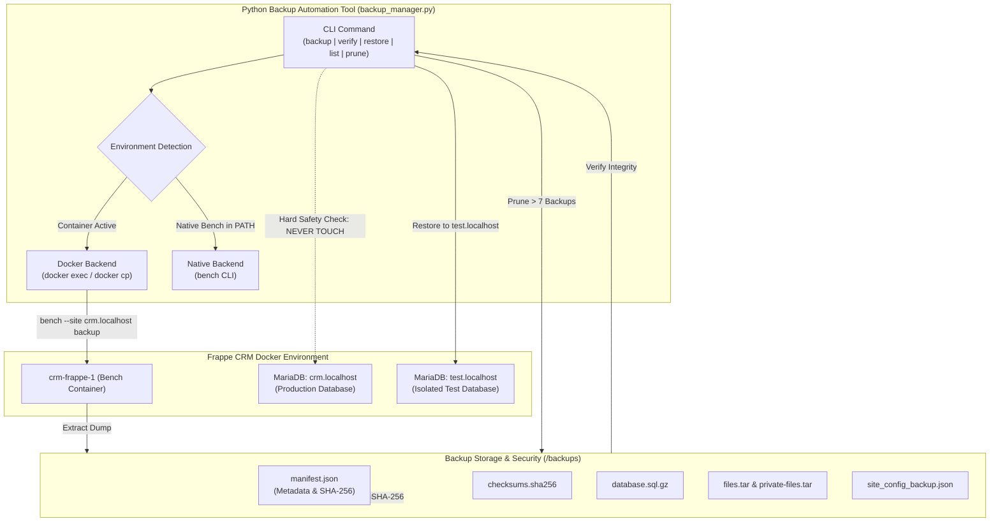

# Frappe CRM Backup & Restore Automation Tool

An enterprise-grade, Python-based automation solution designed for **Frappe CRM**. This tool automates database and file backups via Frappe Bench, validates archive integrity cryptographically using **SHA-256**, enforces a strict **7-backup retention policy**, and safely restores snapshots into an **isolated test environment** without affecting production data.

---

## Architecture & Workflow



---

## Core Features

1. **Automated Multi-Asset Backups:**
   - Full MariaDB SQL database dump (`.sql.gz`).
   - Public assets and attachments archive (`-files.tar`).
   - Private attachments archive (`-private-files.tar`).
   - Site configuration metadata (`-site_config_backup.json`).

2. **Cryptographic Integrity & Verification:**
   - Computes stream-chunked **SHA-256** checksums for all files.
   - Generates standard `checksums.sha256` and structured `manifest.json`.
   - Validates GZIP stream readability and TAR archive member integrity.

3. **Automated Retention Policy (Latest 7 Backups):**
   - Automatically maintains exactly the newest 7 backups.
   - Chronologically identifies and cleans expired local snapshots.
   - Reclaims disk space and logs every deletion.

4. **Safe Restoration into Isolated Test Environment:**
   - Strict safety assertion: Refuses any restore command targeting production (`crm.localhost`).
   - Performs pre-restoration SHA-256 and structural verification before applying any data.
   - Automatically resolves cross-version MariaDB dump incompatibilities (e.g., stripping `NOTE_VERBOSITY` headers).
   - Validates post-restoration health by querying record counts on `tabDocType` and clearing test caches.

5. **Dual Mode Execution (Host & Container):**
   - **Docker Mode:** Executes bench commands via `docker exec` and retrieves files using `docker cp`.
   - **Native Mode:** Executes native bench commands if running directly on a Linux VM or inside the container.
   - **Auto Mode:** Automatically discovers the running environment.

6. **DevOps Grade Logging & Security:**
   - Dual-stream output: formatted console output + persistent log file (`automation/logs/frappe_backup.log`).
   - Automatic credential masking: Passwords and sensitive parameters are masked with `***` in all logs.

---

## Prerequisites

- **Python:** 3.10 or higher.
- **Dependencies:** Built entirely using Python's standard library (`hashlib`, `gzip`, `tarfile`, `subprocess`, `argparse`, `logging`, `pathlib`, `json`). No external package installations are mandatory.
- **Docker:** Docker daemon running with `crm-frappe-1` container up (or native Frappe Bench installed).

---

## CLI Usage & Commands

The tool is invoked via `automation/backup_manager.py`:

```bash
python3 automation/backup_manager.py [GLOBAL OPTIONS] {backup,verify,restore,list,prune} [COMMAND OPTIONS]
```

### 1. Create a Full Backup
Executes a full backup of `crm.localhost`, transfers artifacts to `./backups/`, calculates SHA-256 checksums, writes `manifest.json`, and applies the 7-backup retention policy:
```bash
python3 automation/backup_manager.py backup
```

### 2. Verify Backup Integrity (SHA-256 & Archives)
Verifies the cryptographic checksums and structural format of the latest backup:
```bash
python3 automation/backup_manager.py verify
```
To verify a specific backup by ID:
```bash
python3 automation/backup_manager.py verify --backup-id 20261104_160131_crm_localhost
```

### 3. List All Stored Backups
Displays an overview of all retained backups with timestamps, total size, and site names:
```bash
python3 automation/backup_manager.py list
```

### 4. Restore to an Isolated Test Environment
Safely restores the latest verified backup into the separate test site `test.localhost`:
```bash
python3 automation/backup_manager.py restore --target-site test.localhost
```
> **Safety Guard:** Attempting to run `restore --target-site crm.localhost` will immediately abort with a `[CRITICAL SAFETY VIOLATION]` error to protect production data.

### 5. Manually Enforce Retention Policy
Prunes older backups to enforce a custom or default retention count:
```bash
python3 automation/backup_manager.py prune --retention-limit 7
```

---

## Command Reference

| Flag | Description | Default |
| :--- | :--- | :--- |
| `--source-site` | The production Frappe CRM site name | `crm.localhost` |
| `--target-site` | The test environment site name for restore | `test.localhost` |
| `--backup-dir` | Local directory storing backup archives | `./backups` |
| `--retention-limit` | Maximum number of newest backups to retain | `7` |
| `--mode` | Execution mode (`auto`, `docker`, `native`) | `auto` |
| `--container` | Docker container name for bench service | `crm-frappe-1` |
| `--log-file` | Path to persistent log file | `automation/logs/frappe_backup.log` |
| `--verbose`, `-v` | Enable debug logs | `False` |

---

## Sample Reports

Pre-generated sample reports are located in `automation/reports/`:
- [`sample_backup_report.json`](reports/sample_backup_report.json): Full backup metadata with SHA-256 hashes and file metrics.
- [`sample_verification_report.json`](reports/sample_verification_report.json): Validation results for checksum matches and archive format integrity.
- [`sample_restore_report.json`](reports/sample_restore_report.json): Test environment restore confirmation, safety assertion, and DocType verification.

---

## Author & Project Info

- **Author:** Bulbul Das ([@dasBulbul03](https://github.com/dasBulbul03))
- **Role:** DevOps Engineering Intern
- **Organization:** PearlThoughts
- **Task:** Task 2 – Python Automation for Frappe CRM
