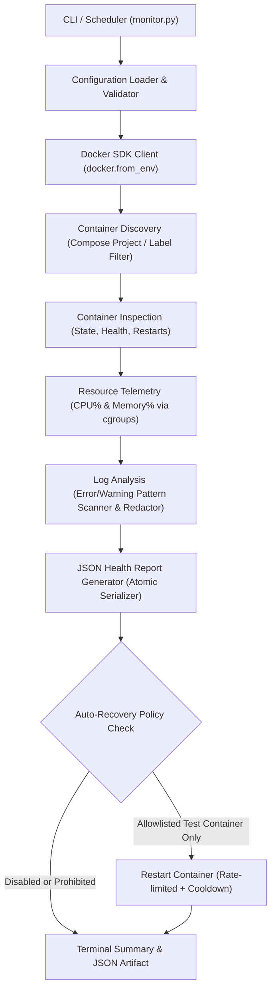

# Frappe CRM Docker Container Monitoring & Auto-Recovery Tool

Enterprise-grade Python automation tool for monitoring Frappe CRM Docker containers, collecting CPU and memory telemetry, analyzing runtime logs, generating timestamped JSON health reports, and executing policy-governed auto-recovery on isolated test environments.

---

## 1. Project Overview

As part of Task 3 of the DevOps / SRE internship, this tool provides local and production-minded visibility into Frappe CRM container infrastructure. It discovers containers dynamically via Docker Compose metadata or explicit lists, tracks container health and resource utilization, and detects failures while enforcing strict isolation safeguards to prevent accidental intervention on production workloads.

---

## 2. Architecture & Workflow

The architecture follows a modular, fail-closed SRE design:



---

## 3. Prerequisites

- **Operating System:** Windows 11 (WSL2), Linux, or macOS.
- **Python:** Python 3.10+ (tested on Python 3.12).
- **Docker Engine / Desktop:** Docker 24+ with Compose v2 enabled and local Docker socket/named pipe accessible.

---

## 4. Python Setup & Installation

Clone the repository and install dependencies in your virtual environment:

```powershell
# Create and activate virtual environment (optional)
python -m venv .venv
.venv\Scripts\Activate.ps1

# Install required Docker SDK for Python
pip install -r docker_monitor/requirements.txt
```

---

## 5. Configuration Reference

The tool can be executed with command-line flags or a custom JSON configuration file:

```json
{
  "compose_project": "crm",
  "container_names": [],
  "report_dir": "reports",
  "log_tail_lines": 100,
  "cpu_warning_threshold_percent": 80.0,
  "memory_warning_threshold_percent": 85.0,
  "restart_warning_threshold": 3,
  "auto_recovery_enabled": false,
  "allowed_recovery_containers": [
    "crm-monitor-test-service"
  ],
  "max_recovery_attempts": 3,
  "recovery_cooldown_seconds": 60
}
```

### Configuration Parameters:

| Parameter | Type | Default | Description |
| :--- | :--- | :--- | :--- |
| `compose_project` | string | `"crm"` | Docker Compose project name to filter (`com.docker.compose.project`). |
| `container_names` | list | `[]` | Optional explicit list of container names to monitor. |
| `report_dir` | string | `"reports"` | Destination directory for timestamped JSON health reports. |
| `log_tail_lines` | int | `100` | Number of recent log lines to inspect per container. |
| `cpu_warning_threshold_percent` | float | `80.0` | Threshold to flag high CPU usage in issues list. |
| `memory_warning_threshold_percent` | float | `85.0` | Threshold to flag high memory usage in issues list. |
| `restart_warning_threshold` | int | `3` | Restart count threshold to trigger stability warnings. |
| `auto_recovery_enabled` | bool | `false` | Enable/disable automatic restart of failed containers. |
| `allowed_recovery_containers` | list | `["crm-monitor-test-service"]` | Strict allowlist of containers permitted for auto-recovery. |
| `max_recovery_attempts` | int | `3` | Maximum restart attempts permitted within the cooldown window. |
| `recovery_cooldown_seconds` | int | `60` | Cooldown period (in seconds) between restart actions on the same container. |

---

## 6. CLI Usage & Commands

### 1. Monitor Containers & Display Terminal Summary
```powershell
python docker_monitor/monitor.py monitor
```

### 2. Monitor & Generate Timestamped JSON Report
```powershell
python docker_monitor/monitor.py monitor --report
```

### 3. Output Raw JSON to stdout (for Piping / jq)
```powershell
python docker_monitor/monitor.py monitor --json
```

### 4. Monitor with Custom Configuration File
```powershell
python docker_monitor/monitor.py monitor --config docker_monitor/config.example.json --report
```

### 5. Monitor Specific Compose Project
```powershell
python docker_monitor/monitor.py monitor --compose-project crm-monitor-test
```

### 6. Run with Auto-Recovery (Allowlisted Test Containers Only)
```powershell
python docker_monitor/monitor.py monitor --compose-project crm-monitor-test --auto-recovery --report
```

---

## 7. Monitoring Features & Telemetry Calculations

### A. Container Status & Health
- **Status Categories:** `running`, `exited`, `paused`, `restarting`, `unknown`.
- **Healthcheck Reporting:** Correctly reports Docker health checks (`healthy`, `unhealthy`, `starting`). If a container does not have a configured Docker health check (e.g. standard Redis or MariaDB without `healthcheck`), it reports `not_configured` instead of marking it unhealthy.
- **Exit Code & Restarts:** Captures process exit codes and cumulative restart counters.

### B. CPU Utilization Calculation
Calculated from container statistics deltas using the official Docker daemon algorithm:
$$\text{CPU \%} = \left( \frac{\text{total\_usage}_t - \text{total\_usage}_{t-1}}{\text{system\_usage}_t - \text{system\_usage}_{t-1}} \right) \times \text{online\_cpus} \times 100.0$$
- Includes division-by-zero protection.
- Handled gracefully with `null` metrics if the container is stopped.

### C. Memory Utilization Calculation
Calculated from cgroups memory statistics accounting for cache and inactive files:
$$\text{Used Memory} = \text{usage} - \text{cache}$$
$$\text{Memory \%} = \left( \frac{\text{Used Memory}}{\text{limit}} \right) \times 100.0$$
- Supports both cgroups v1 (`total_inactive_file` / `cache`) and cgroups v2 (`inactive_file`).
- Handled gracefully with `null` metrics when limits are unconstrained or container is stopped.

### D. Log Analysis & Secret Masking
- Scans recent logs for error indicators: `ERROR`, `CRITICAL`, `FATAL`, `Traceback`, `Exception`, `connection refused`, `out of memory`.
- Scans for warnings: `WARNING`, `WARN`.
- **Secret Redaction:** Automatically masks passwords, API keys, and connection credentials matching sensitive token patterns (`password=******`, `token=******`).
- Safe sampling: Caps error samples to 3 unique lines per container to avoid report bloating.
- Non-punitive: Log keywords do not falsely flag a healthy running container as unhealthy.

---

## 8. JSON Health Report Format

Sample generated health report (`reports/docker_health_report_YYYYMMDD_HHMMSS.json`):

```json
{
  "report_version": "1.0",
  "generated_at": "2026-11-05T07:17:43.816547+00:00",
  "overall_status": "healthy",
  "monitoring_summary": {
    "total_containers": 1,
    "running": 1,
    "stopped": 0,
    "unhealthy": 0,
    "unknown": 0
  },
  "containers": [
    {
      "name": "crm-monitor-test-service",
      "id": "ee1b941700c6",
      "image": "redis:alpine",
      "status": "running",
      "health_status": "healthy",
      "cpu_percent": 3.04,
      "memory_usage_bytes": 1024000,
      "memory_limit_bytes": 3145728000,
      "memory_percent": 0.33,
      "restart_count": 0,
      "exit_code": 0,
      "created_at": "2026-11-05T07:17:15.000000Z",
      "started_at": "2026-11-05T07:17:16.000000Z",
      "log_analysis": {
        "error_count": 0,
        "warning_count": 0,
        "sample_errors": []
      },
      "issues": []
    }
  ],
  "auto_recovery": {
    "enabled": false,
    "actions_taken": []
  },
  "monitoring_errors": []
}
```

---

## 9. Auto-Recovery Safety Design & Policy Governance

To satisfy strict SRE production safeguards, auto-recovery operates with multiple fail-closed gates:

1. **Disabled by Default:** Auto-recovery is strictly opt-in (`auto_recovery_enabled: false`).
2. **Explicit Allowlist Required:** Only containers explicitly listed in `allowed_recovery_containers` can be restarted.
3. **Hard Prohibition on Original CRM Containers:** Hardcoded safety blocks instantly reject any attempt to auto-recover `crm-frappe-1`, `crm-mariadb-1`, `crm-redis-1`, or any container under compose project `crm`. Attempting to do so triggers an immediate exit code `4` (`EXIT_SAFETY_VIOLATION`).
4. **Retry & Rate Limiting:** Enforces `max_recovery_attempts` (default: 3) to prevent endless restart loops on crash-looping services.
5. **Cooldown Windows:** Imposes `recovery_cooldown_seconds` (default: 60s) between successive restarts of the same container.
6. **Non-Destructive Actions:** Auto-recovery issues non-destructive `restart` or `start` commands; it **never** removes or recreates containers or volumes.

---

## 10. Testing Strategy & Execution

### Running Unit Tests (100% Mocked, No Docker Required)

Execute the comprehensive 24-test suite:

```powershell
python -m unittest discover -s docker_monitor/tests -p "test_*.py" -v
```

### Running Isolated Integration Tests

1. Start the dedicated test Compose project:
```powershell
docker compose -f docker/docker-compose.monitor-test.yml up -d
```

2. Run monitoring verification:
```powershell
python docker_monitor/monitor.py monitor --compose-project crm-monitor-test --report
```

3. Test stopped detection (auto-recovery disabled):
```powershell
docker stop crm-monitor-test-service
python docker_monitor/monitor.py monitor --compose-project crm-monitor-test --report
```

4. Test auto-recovery restart on allowlisted test container:
```powershell
python docker_monitor/monitor.py monitor --compose-project crm-monitor-test --auto-recovery --report
```

5. Tear down isolated test resources:
```powershell
docker compose -f docker/docker-compose.monitor-test.yml down
```

---

## 11. Exit Codes Reference

| Exit Code | Constant | Meaning |
| :---: | :--- | :--- |
| `0` | `EXIT_HEALTHY` | All monitored containers are running and healthy. |
| `1` | `EXIT_DEGRADED` | One or more containers are stopped, unhealthy, or have issues. |
| `2` | `EXIT_INVALID_CONFIG` | Invalid CLI arguments or configuration file parse failure. |
| `3` | `EXIT_DOCKER_ERROR` | Docker daemon connection failure or API error. |
| `4` | `EXIT_SAFETY_VIOLATION` | Auto-recovery policy violation (attempted recovery on prohibited container). |

---

## 12. Security Considerations

- **Secret Masking:** Logs and reports are sanitized before writing to disk.
- **Path Traversal Protection:** Input paths and report output paths are resolved and validated within authorized boundaries.
- **No Direct Credential Storage:** Docker client leverages standard environment sockets/named pipes without embedding passwords.
- **Git Protection:** Runtime reports (`reports/*.json`), temp files, and logs are automatically excluded from version control via `.gitignore`.
