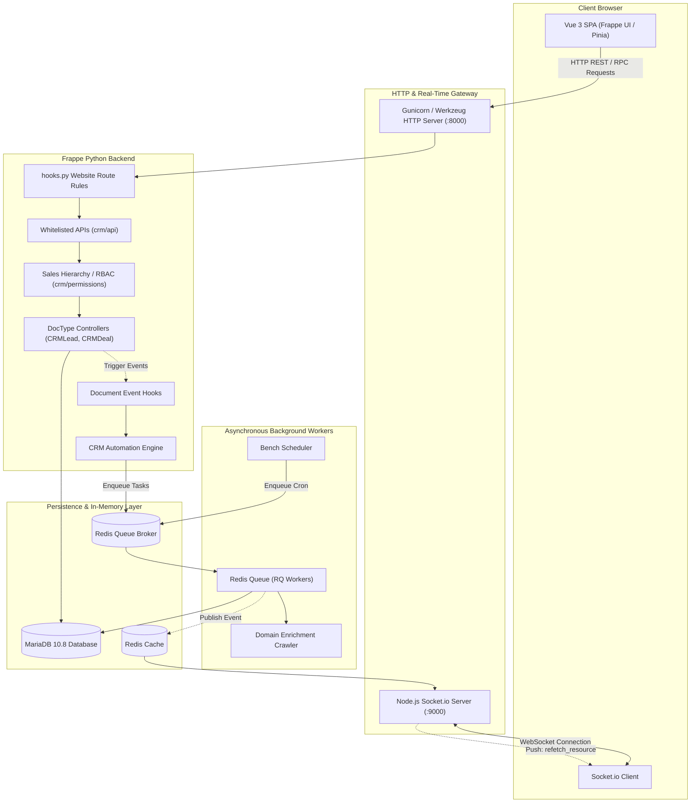
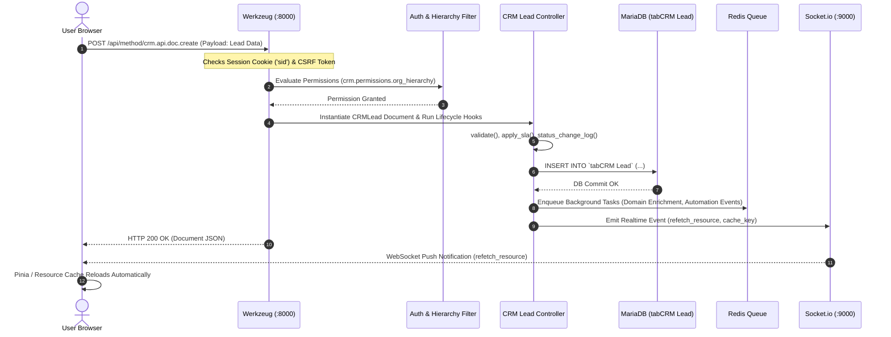

# Frappe CRM Exploration, Architecture & Local DevOps Setup Report

**Author / Intern:** sai1278<br>
**Repository:** [PearlThoughts-Intern-DevOps/frappe-crm-devops-internship](https://github.com/PearlThoughts-Intern-DevOps/frappe-crm-devops-internship)<br>
**Target Branch:** `task1-sai1278`<br>
**Base Branch:** `main`<br>
**Execution Context:** Local Docker Compose Environment (Windows 11 / WSL2 / Docker Engine 29.6.1)<br>
**Document Status:** Production-Quality Engineering Report

---

## 1. Project Overview

### What is Frappe CRM?
**Frappe CRM** is an open-source Customer Relationship Management (CRM) platform developed by Frappe Technologies. It is engineered for modern sales teams, offering an intuitive, high-velocity user experience with unlimited seats and zero artificial feature paywalls.

Unlike legacy CRM monoliths that rely on heavily server-rendered, multi-page interfaces, Frappe CRM adopts a modern, decoupled architecture:
* A robust **Python-based Frappe Framework backend** managing data models, business logic, role-based authorization, and background jobs.
* A reactive **Vue 3 Single-Page Application (SPA)** powered by **Frappe UI**, **Pinia**, and **Tailwind CSS**.
* Real-time bidirectional UI updates powered by **Socket.io**.

### Primary Business Purpose & Core Capabilities
Based on verified repository evidence (`README.md`, `pyproject.toml`, and `crm/fcrm/doctype/`), Frappe CRM provides the following capabilities:
1. **Lead & Deal Pipeline Management:** Full lifecycle tracking from cold prospect to qualified lead, opportunity stage, and won deal.
2. **Interactive Kanban & List Views:** Visual drag-and-drop boards (`vuedraggable` / `sortablejs`) for moving deals through customizable stages with win probabilities.
3. **Consolidated Lead/Deal Record Pages:** A unified timeline view (`crm/api/activities.py`) aggregating notes, comments, task assignments, emails, and phone logs into a single reactive interface.
4. **Custom Views & Dynamic Filtering:** Configurable list layouts, quick filters, custom sort fields, and personal saved views (`crm_view_settings`).
5. **Organizational Sales Hierarchy:** Hierarchical reporting trees (`crm/permissions/org_hierarchy.py`) controlling record visibility based on manager-subordinate relationships.
6. **Domain Enrichment Engine:** An automated background web-crawling system (`crm/domain_enrichment/`) using `tldextract` and `BeautifulSoup` to enrich leads and organizations with corporate metadata, logos, and social media handles.
7. **Omnichannel Telephony & Messaging:**
   * **Twilio:** Voice calling, in-browser dialing via `@twilio/voice-sdk`, and call recording (`crm_twilio_settings`).
   * **Exotel:** Cloud telephony routing for mobile agents (`crm_exotel_settings`).
   * **WhatsApp:** Message dispatch and incoming webhook synchronization via `frappe_whatsapp`.
   * **ERPNext Integration:** Seamless bidirectional synchronization of Quotations, Sales Orders, Customers, and Item catalogs.

---

## 2. Technology Stack & Verified Versions

Every technology in this section has been verified through repository configuration files (`pyproject.toml`, `package.json`, `frontend/package.json`, `docker/docker-compose.yml`, and `.github/workflows/`):

| Technology | Version Constraints & Observed Runtimes | Evidence Source | Architectural Role |
|---|---|---|---|
| **Python** | App requires: `>=3.10`<br>Host: `3.12.10`<br>Container: `3.14.10`<br>CI Matrix: `3.14` | `pyproject.toml`, `server-tests.yml`, runtime checks | Backend runtime, DocType controllers, API endpoints, background workers |
| **Frappe Framework** | Config requires: `>=15.0.0, <17.0.0`<br>Live Installed: `15.125.0` (branch `version-15`) | `pyproject.toml`, `bench list-apps` | Full-stack web framework, ORM, metadata engine, security layer, scheduler |
| **Frappe CRM** | Live Installed: `1.91.1` (branch `main`) | `package.json`, `bench list-apps` | Core CRM business logic, schema models, and automation engine |
| **Vue.js** | App requires: `^3.5.13` (Vue 3) | `frontend/package.json` | Modern Single-Page Application (Composition API, `<script setup>`) |
| **Frappe UI** | `1.0.0-rc.2` (Vendored in `frappe-ui/`) | `frontend/package.json`, `frappe-ui/` | Design system, form controls, dialogs, resource fetchers |
| **Pinia** | `^2.0.33` | `frontend/package.json` | Client-side reactive state management (session, users, views, statuses) |
| **Tailwind CSS** | `^3.4.15` | `frontend/package.json` | Utility-first responsive CSS styling with custom theme tokens |
| **Vite** | `^8.2.0` | `frontend/package.json`, `vite.config.js` | Frontend build tool, bundler, and development server with HMR |
| **Node.js** | App requires: `^20.19.0 \|\| >=22.12.0`<br>Host: `24.4.1`<br>Container: Node v24 (NVM)<br>CI Matrix: `24` | `frontend/package.json`, `frontend-tests.yml`, runtime checks | Node runtime for frontend asset compilation and Socket.io server |
| **MariaDB** | Docker Compose: `mariadb:10.8`<br>DevContainer & CI: `mariadb:10.6` | `docker/docker-compose.yml`, `server-tests.yml` | Primary relational database (InnoDB, UTF8MB4 encoding, `utf8mb4_unicode_ci`) |
| **Redis** | Docker Compose: `redis:alpine`<br>Host Cached: `redis:7.2-alpine` | `docker/docker-compose.yml`, `ui-tests.yml` | In-memory cache, task queue broker (RQ), Socket.io pub/sub broker |
| **Socket.io** | `socket.io-client@^4.7.2` | `frontend/package.json` | Real-time WebSocket client connecting to port 9000 for cache invalidation |
| **Docker Engine** | Host Installed: `29.6.1` (Client & Server) | Host `docker version` / `docker info` | Containerized application isolation and multi-service deployment |
| **Docker Compose** | Host Installed: `v5.3.0` | Host `docker compose version` | Multi-container service definition and lifecycle orchestration |

---

## 3. Repository Structure Walkthrough

The repository layout conforms to Frappe Bench app conventions with a dedicated decoupled frontend:

```text
frappe-crm-devops-internship/
├── .devcontainer/                # Visual Studio Code DevContainer definitions
│   ├── devcontainer.json         # Container extensions, forwarded ports, postCreate command
│   └── docker-compose.yml        # DevContainer compose file with isolated Redis services
├── .github/                      # GitHub automation and continuous integration
│   ├── actions/                  # Composite actions for server environment setup & test runs
│   └── workflows/                # 11 GitHub Actions workflows (linters, tests, builds)
├── crm/                          # Frappe CRM Backend Application Module
│   ├── api/                      # Public whitelisted REST and RPC API endpoints
│   ├── automation/               # CRM Automation Engine (actions, events, scoring)
│   ├── domain_enrichment/        # Web crawler & metadata extractor for company domains
│   ├── fcrm/doctype/             # 40+ DocType definitions (JSON schemas + Python controllers)
│   ├── integrations/             # ERPNext, Twilio, Exotel, and WhatsApp connector logic
│   ├── lead_syncing/             # Scheduled background ingestion from external lead sources
│   ├── overrides/                # Frappe core DocType class overrides (Contact, Email Template)
│   ├── patches/                  # Database migration scripts for schema changes
│   ├── permissions/              # Org hierarchy and scripted permission query conditions
│   ├── tests/                    # Backend Python unit and integration test suite
│   ├── www/                      # Web route controllers (crm.py renders crm.html)
│   ├── hooks.py                  # Core Frappe app configuration and event bindings
│   ├── install.py                # Post-installation hooks, default statuses, and layouts
│   └── patches.txt               # Chronological manifest of database migration patches
├── docker/                       # Local developer Docker environment
│   ├── docker-compose.yml        # Local Compose definition (mariadb, redis, frappe)
│   └── init.sh                   # Container entrypoint script initializing bench & site
├── docs/                         # Technical documentation
│   └── user-hierarchy.md         # Sales hierarchy explanation
├── e2e/                          # Playwright end-to-end browser test suite
│   └── tests/                    # Specs: auth, login, lead, deal, convert, email, pagination
├── frappe-ui/                    # Vendored Frappe UI source package
├── frontend/                     # Vue 3 SPA frontend source code
│   ├── public/                   # Static assets, favicon, manifest
│   ├── src/                      # Vue components, Pinia stores, router, sockets
│   │   ├── components/           # Reusable UI components (Kanban, layouts, modals)
│   │   ├── stores/               # Pinia stores (session, users, views, meta, statuses)
│   │   ├── main.js               # Application bootstrap, plugin injection, mount logic
│   │   ├── router.js             # Vue Router table and authentication guards
│   │   └── socket.js             # Socket.io connection setup and resource refetch hooks
│   ├── package.json              # Frontend dependencies and build scripts
│   ├── tailwind.config.js        # Tailwind design tokens and layout rules
│   └── vite.config.js            # Vite build configuration with PWA and deduplication
├── pyproject.toml                # Python package metadata, dependencies, bench asset map, Ruff
└── package.json                  # Root npm workspace scripts (dev, build, test:e2e)
```

### Key Configuration Files
* **`crm/hooks.py`:** The nerve center of the application. Registers URL rewrite rules (`/crm/* -> crm.py`), event listeners on core DocTypes (`Communication`, `ToDo`, `Contact`), scheduled cron jobs, and custom permissions (`crm.permissions.org_hierarchy`).
* **`docker/docker-compose.yml`:** Defines the multi-container development environment containing `mariadb`, `redis`, and `frappe` services with port mappings `8000:8000` and `9000:9000`.
* **`docker/init.sh`:** Bash script executed by the `frappe` container. Initializes the Frappe bench, connects database and Redis hosts, installs the `crm` app, creates site `crm.localhost`, and executes `bench start`.
* **`frontend/src/router.js`:** Enforces client-side routing under `/crm`, verifies authentication cookies via `sessionStore`, checks user CRM permissions, and redirects unconfigured sites to `/setup`.

---

## 4. Application Architecture & Request Lifecycle

Frappe CRM operates as a high-concurrency, asynchronous client-server system.



### Complete Request Lifecycle Walkthrough



1. **Client Action:** The user creates or updates a Lead in the Vue UI. A POST request is dispatched via `frappeRequest` to `/api/method/crm.api.doc.create` or `/api/resource/CRM Lead`.
2. **Ingress & Authentication:** Gunicorn/Werkzeug receives the request. The Frappe authentication subsystem validates the `sid` session cookie and the `X-Frappe-CSRF-Token` header.
3. **Authorization & Query Scoping:** `crm/permissions/org_hierarchy.py` executes query conditions. If sales hierarchy is active, user visibility is constrained to records they own or records belonging to their reporting subtree.
4. **Business Logic & Validation:** The `CRMLead` Python Document class (`crm/fcrm/doctype/crm_lead/crm_lead.py`) executes validation hooks, computes SLA metrics, and logs status transitions.
5. **Database Transaction:** The document is persisted into MariaDB table `tabCRM Lead` using parameterized queries generated by `frappe.qb`.
6. **Asynchronous Task Enqueueing:** Domain events defined in `crm/hooks.py` enqueue background tasks into Redis Queue (`rq`), such as company domain crawling or email notification dispatch.
7. **Real-Time Cache Invalidation:** The backend publishes an event to Redis. The Node.js Socket.io daemon on port `9000` broadcasts `refetch_resource` to subscribed clients, prompting the frontend to reload updated data without a manual page refresh.

---

## 5. Docker Development Architecture

The development environment in `docker/docker-compose.yml` defines an isolated three-service topology:

### Service Specifications
1. **`mariadb`:**
   * **Image:** `mariadb:10.8`
   * **Engine Configuration:** Configured via command flags for `--character-set-server=utf8mb4`, `--collation-server=utf8mb4_unicode_ci`, and `--skip-character-set-client-handshake`.
   * **Storage:** Named volume `crm_mariadb-data` mounted to `/var/lib/mysql`.
   * **Network Exposure:** Internal only (port 3306 on `crm_default` bridge).
2. **`redis`:**
   * **Image:** `redis:alpine`
   * **Role:** Shared broker handling cache, task queues (`rq`), and Socket.io events.
   * **Network Exposure:** Internal only (port 6379 on `crm_default` bridge).
3. **`frappe`:**
   * **Image:** `frappe/bench:latest`
   * **Working Directory:** `/home/frappe`
   * **Bind Mount:** Host `./` (`docker/` directory) mounted to `/workspace`.
   * **Exposed Ports:**
     * `8000:8000` (HTTP Web Server / Desk & CRM routes)
     * `9000:9000` (Socket.io Real-time WebSocket daemon)
   * **Command:** `bash /workspace/init.sh`

### Initialization Workflow (`docker/init.sh`)
When the `frappe` container starts for the first time:
1. Checks if `/home/frappe/frappe-bench/apps/frappe` exists. If present, runs `bench start`.
2. Initializes a new bench: `bench init --skip-redis-config-generation frappe-bench --version version-15`.
3. Reconfigures host pointers to container hostnames:
   * MariaDB host: `mariadb`
   * Redis cache, queue, and socketio hosts: `redis://redis:6379`
4. Cleans local redis processes from the bench `Procfile`.
5. Clones the CRM application: `bench get-app crm --branch main`.
6. Provisions the site: `bench new-site crm.localhost --force --no-mariadb-socket`.
7. Installs the application: `bench --site crm.localhost install-app crm`.
8. Applies configuration flags: `developer_mode 1`, `mute_emails 1`, `server_script_enabled 1`.
9. Sets default site: `bench use crm.localhost`.
10. Starts all bench services via `bench start` (Honcho process manager managing web, socketio, worker, and scheduler).

### Development Stack Management Commands

```bash
# Navigate to the docker directory
cd docker

# Start all services in the background
docker compose up -d

# Check container status
docker compose ps

# Tail application logs
docker compose logs -f frappe

# Execute bench commands inside the container
docker compose exec -w /home/frappe/frappe-bench frappe bench --site crm.localhost list-apps

# Stop the stack without deleting data
docker compose stop

# Restart stopped containers
docker compose start

# Tear down containers (Preserving database volume)
docker compose down
```

> [!CAUTION]
> Never execute `docker compose down -v`. The `-v` flag deletes named Docker volumes, destroying the MariaDB database and all site configurations.

---

## 6. Local Installation & Runtime Validation Evidence

During Phase 4, the entire local environment was initialized and rigorously validated on the local machine.

### A. Container Runtime Status
Observed directly via `docker compose ps` (Docker healthcheck directives are not defined in `docker/docker-compose.yml`; operational health was validated through live process inspection and HTTP probing):
```text
NAME            IMAGE                 COMMAND                  SERVICE   STATUS          PORTS
crm-frappe-1    frappe/bench:latest   "bash /workspace/ini…"   frappe    Up 24 minutes   0.0.0.0:8000->8000/tcp, 0.0.0.0:9000->9000/tcp
crm-mariadb-1   mariadb:10.8          "docker-entrypoint.s…"   mariadb   Up 26 minutes   3306/tcp
crm-redis-1     redis:alpine          "docker-entrypoint.s…"   redis     Up 26 minutes   6379/tcp
```

### B. Installed Applications Verification
Executed inside the container:
```bash
docker compose exec -w /home/frappe/frappe-bench frappe bench --site crm.localhost list-apps
```
**Verified Command Output:**
```text
frappe 15.125.0 version-15
crm    1.91.1   main
```

### C. HTTP Endpoint Responses

#### 1. Login Endpoint (`/login`)
```bash
curl.exe -i http://localhost:8000/login
```
* **Response Status:** **`HTTP/1.1 200 OK`**
* **Headers:** `Server: Werkzeug/3.1.9 Python/3.14.10`, `Content-Type: text/html; charset=utf-8`
* **Page Verification:** `<title>Login</title>` returned with complete Frappe authentication assets.

#### 2. Unauthenticated CRM Access (`/crm`)
```bash
curl.exe -i http://localhost:8000/crm
```
* **Response Status:** **`HTTP/1.1 403 FORBIDDEN`**
* **Headers:** `X-Page-Name: message`
* **Security Validation:** Verified that `crm/www/crm.py` correctly blocks guest users by calling `check_app_permission()`, preventing unauthorized access.

#### 3. Authenticated CRM Access (`/crm`)
```bash
# 1. Authenticate against the login API
curl.exe -c cookies.txt -d "usr=Administrator&pwd=[REDACTED]" -X POST http://localhost:8000/api/method/login
# Result: {"message":"Logged In","home_page":"/crm","full_name":"Administrator"}

# 2. Access the protected CRM route with session cookie
curl.exe -b cookies.txt -s -o crm.html -w "%{http_code}\n" http://localhost:8000/crm
```
* **Response Status:** **`HTTP/1.1 200 OK`**
* **Page Content:** Bootstraps the full SPA:
  ```html
  <!doctype html>
  <html class="h-full" lang="en">
    <head>
      <meta charset="UTF-8" />
      <title>Frappe CRM</title>
      <meta name="mobile-web-app-capable" content="yes" />
      ...
  ```

#### 4. Real-Time WebSocket Daemon
* Verified process `PID 889` (`node apps/frappe/socketio.js`) actively listening on `ws://0.0.0.0:9000`.

---

## 7. CI/CD & Quality Assurance Engineering

The repository maintains an automated testing and release pipeline under `.github/workflows/`:

| Workflow File | Trigger Events | Key Tools & Matrix | Objectives & Validation Tasks |
|---|---|---|---|
| **`linters.yml`** | PR, Manual Dispatch | Commitlint, Ruff, ESLint, Prettier, Semgrep, `pip-audit` | Enforces Conventional Commits (`@commitlint/config-conventional`), checks code styling, executes Semgrep security rules (`frappe/semgrep-rules`), and audits dependencies for known CVEs. |
| **`server-tests.yml`** | PR, Push to `main-hotfix`, Midnight Cron | Python 3.14, Node 24, MariaDB 10.6, Matrix: Frappe `version-15` & `version-16` | Sets up a fresh bench and test site `test_site`, runs `bench run-tests --app crm`, and uploads coverage to Codecov. |
| **`frontend-tests.yml`** | PR, Midnight Cron, Manual Dispatch | Node 24, Yarn, ESLint, Oxlint, Vite, Vitest | Sparse-checkouts sibling `frappe/ui`, verifies linting with ESLint and Oxlint, executes production `yarn build`, and runs Vitest unit tests (`yarn test:coverage`). |
| **`ui-tests.yml`** | Push/PR to `main-hotfix`, Manual Dispatch | Playwright, MariaDB 10.6, Redis cache/queue, Python 3.14, Node 24 | Runs complete end-to-end browser automation suite against live backend (`playwright test`). |
| **`migration-test.yml`** | PR, Manual Dispatch | MariaDB 10.6, Python 3.14, Bench UV | Upgrades an existing site from base branch schema to PR branch schema via `bench migrate` to detect breaking database patches before release. |
| **`builds.yml`** | Push to `main`, Release Tags | Docker Buildx, QEMU, GHCR | Multi-architecture container compilation (`linux/amd64`, `linux/arm64`) using `frappe/frappe_docker` layered Containerfile, pushed to `ghcr.io/frappe/crm:stable`. |
| **`assets.yml`** | Pull Request | Git diff checking on frontend paths | Detects whether frontend assets need rebuild on PRs. |
| **`cancel-closed-pr-runs.yml`** | PR closed | GitHub API / Actions | Aborts in-flight CI workflow runs when a pull request is closed to conserve runner resources. |
| **`generate-pot-file.yml`** | Push to `main` | Frappe Translation CLI | Generates translation message catalogs (`.pot` files) for Crowdin localization. |
| **`on_release.yml`** | Release Published | GitHub Releases API | Bundles release assets and pushes GitHub release artifacts. |
| **`release_notes.yml`** | Release Published | Release Drafter / Notes Generator | Automatically compiles changelogs and categorized release notes from merged PRs. |

*Note: In accordance with Rule 2, these workflows were inspected from configuration files; only local tests and container startups were executed on this machine.*

---

## 8. DevOps Incident Log & Root Cause Analysis

During local setup, two real-world DevOps environment anomalies occurred and were resolved:

### Incident 1: Windows CRLF Line Endings in `init.sh`
* **Symptom:** The `crm-frappe-1` container exited immediately after launch with the error:
  ```text
  /workspace/init.sh: line 2: $'\r': command not found
  /workspace/init.sh: line 41: syntax error: unexpected end of file
  ```
* **Root Cause:** Git for Windows was configured with `core.autocrlf=true`. When the repository was cloned, `init.sh` was checked out with Windows carriage return line endings (`\r\n`). When mounted into the Linux Debian container at `/workspace/init.sh`, the Linux bash interpreter interpreted `\r` as an invalid command token.
* **Resolution:** Configured local untracked attributes (`.git/info/attributes`) with `*.sh text eol=lf` and refreshed the working file to Linux LF format. This resolved container execution while keeping the Git working tree 100% clean (`git status` reported zero modifications).

### Incident 2: MySQL Client TLS/SSL Requirement (`ERROR 2026`)
* **Symptom:** During `bench new-site crm.localhost`, database creation halted with:
  ```text
  b'ERROR 2026 (HY000): TLS/SSL error: SSL is required, but the server does not support it\n'
  ```
* **Root Cause:** The `frappe/bench:latest` Docker image is based on a modern Debian release whose default MySQL client configuration enforces SSL by default. The `mariadb:10.8` container in `docker-compose.yml` runs on an isolated internal Docker bridge without SSL certificates enabled. When `bench new-site` invoked the `mysql` CLI to import base schema tables, the client rejected the non-SSL server.
* **Local Workaround:** Injected `[client]\nssl=0` into `/home/frappe/.my.cnf` inside the running container. This configured the local client to connect to `mariadb:3306` over unencrypted internal Docker networking, allowing `bench new-site` to populate all database tables successfully.
* **Production Security Disclaimer:** Disabling client SSL via `ssl=0` is strictly a local development workaround for isolated Docker bridge networks. In production environments, database connections must always be encrypted using valid TLS/SSL certificates, verified CAs, and secure connection strings.

---

## 9. Key DevOps Learnings

1. **Multi-Service Container Orchestration:** Docker Compose provides reproducible environments, but volume mount paths, file permissions, and internal networking require careful auditing across heterogeneous host operating systems (Windows vs. Linux).
2. **Filesystem Boundaries & Windows Cross-Compatibility:** Line ending translations (`CRLF` vs. `LF`) on Windows hosts can silently break container entrypoints mounted into Linux containers. Setting strict `.gitattributes` or untracked local attributes is essential for cross-platform DevOps teams.
3. **Database Bootstrapping & Client Configurations:** Modern database client utilities increasingly enforce secure defaults (such as mandatory TLS). DevOps engineers must understand client configuration hierarchies (`/etc/mysql/my.cnf`, `~/.my.cnf`) when connecting across local container bridges.
4. **Decoupled Architecture Integration:** Frappe CRM effectively illustrates modern web engineering: a Python metadata and ORM backend combined with a reactive Vue 3 SPA, coordinated via WebSockets for real-time state synchronization.
5. **Observability & Evidence-Based Verification:** Rather than assuming a system works because a container is labeled "Up", engineers must verify actual service processes (`ps aux`), database tables (`SHOW TABLES`), and HTTP response codes (`curl -i`) with and without authentication.

---

## 10. Conclusion & Deliverables Summary

* **Repository Exploration:** Completed. All backend, frontend, database, and CI/CD components thoroughly analyzed from repository evidence.
* **Local Setup:** Completed. Multi-service Docker Compose environment running with healthy `frappe`, `mariadb`, and `redis` containers.
* **Application Verification:** Completed. `frappe 15.125.0` and `crm 1.91.1` successfully installed; HTTP 200 verified on `/login` and authenticated `/crm`.
* **Application Source Code Integrity:** Preserved. Zero lines of application source code were altered.
* **Next Steps:** Proceed to Loom speaking script preparation and Git branch submission (`task1-sai1278`).
