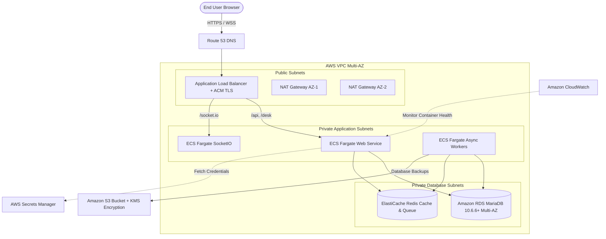
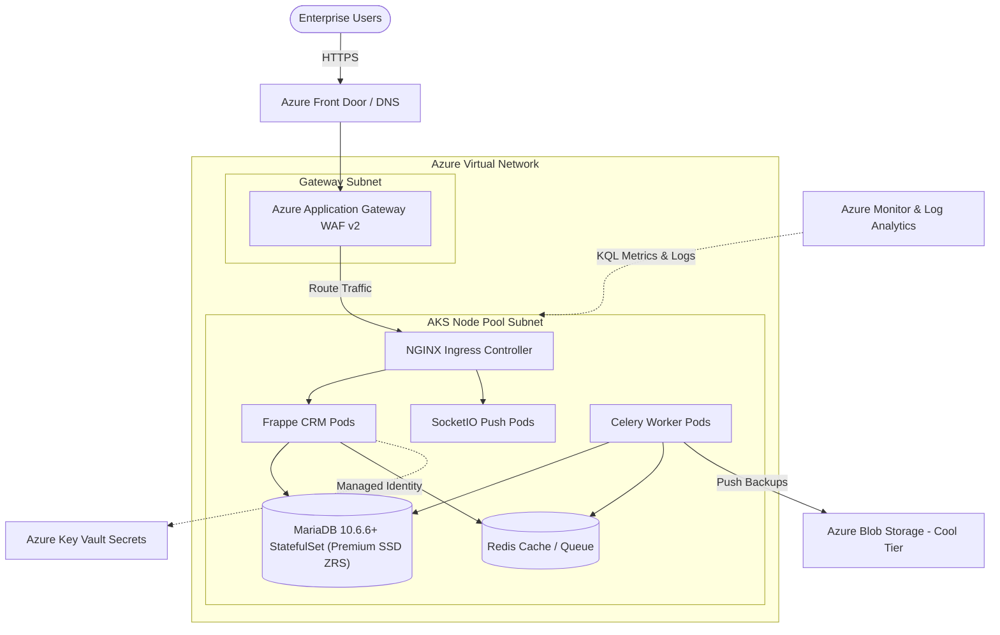
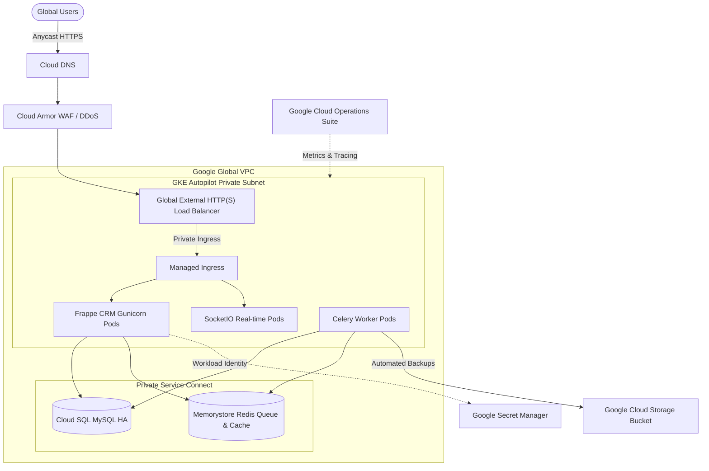
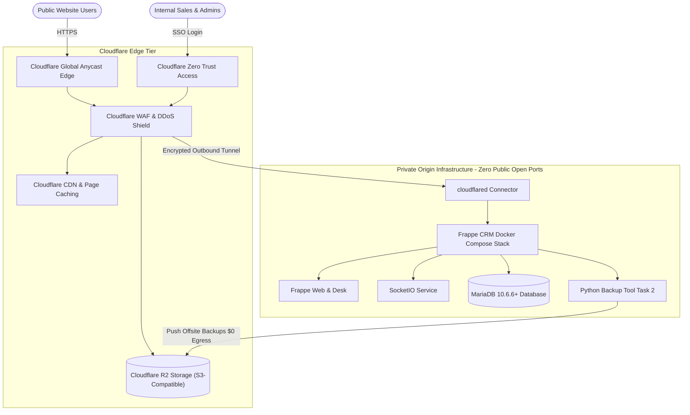
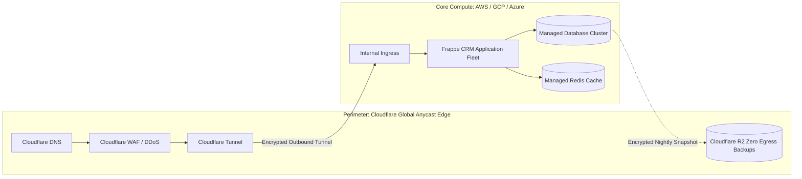

# Task 4 — Cloud Platform Exploration: AWS, Azure, GCP, and Cloudflare

**Author:** `sai1278`
**Role:** Senior DevOps / SRE Engineer
**Workload Context:** Enterprise Web Applications, Containerized Microservices, and Frappe CRM Infrastructure
**Document Status:** Complete, Fact-Checked & Architecturally Validated

---

## Table of Contents

1. [Introduction to Cloud Computing in Modern DevOps](#1-introduction-to-cloud-computing-in-modern-devops)
   - [Core Cloud Service Models](#core-cloud-service-models)
   - [Cloud Deployment Models](#cloud-deployment-models)
   - [Core Value Drivers for Site Reliability and DevOps](#core-value-drivers-for-site-reliability-and-devops)
   - [The Shared Responsibility Model](#the-shared-responsibility-model)
2. [Amazon Web Services (AWS)](#2-amazon-web-services-aws)
   - [Global Infrastructure](#aws-global-infrastructure)
   - [Compute Services](#aws-compute-services)
   - [Storage Services](#aws-storage-services)
   - [Database Services](#aws-database-services)
   - [Networking Services](#aws-networking-services)
   - [Security, Identity, and Compliance](#aws-security-identity-and-compliance)
   - [Monitoring and Observability](#aws-monitoring-and-observability)
   - [DevOps, CI/CD, and Automation](#aws-devops-cicd-and-automation)
   - [Real-World DevOps Architecture: High-Availability Frappe CRM on AWS](#real-world-devops-architecture-high-availability-frappe-crm-on-aws)
3. [Microsoft Azure](#3-microsoft-azure)
   - [Global Infrastructure](#azure-global-infrastructure)
   - [Compute Services](#azure-compute-services)
   - [Storage Services](#azure-storage-services)
   - [Database Services & MariaDB Retirement Context](#azure-database-services)
   - [Networking Services](#azure-networking-services)
   - [Security, Identity, and Governance](#azure-security-identity-and-governance)
   - [Monitoring and Observability](#azure-monitoring-and-observability)
   - [DevOps, CI/CD, and Automation](#azure-devops-cicd-and-automation)
   - [Real-World DevOps Architecture: Enterprise Frappe CRM on Azure](#real-world-devops-architecture-enterprise-frappe-crm-on-azure)
4. [Google Cloud Platform (GCP)](#4-google-cloud-platform-gcp)
   - [Global Infrastructure](#gcp-global-infrastructure)
   - [Compute Services & Cloud Run Functions](#gcp-compute-services)
   - [Storage Services](#gcp-storage-services)
   - [Database Services](#gcp-database-services)
   - [Networking Services](#gcp-networking-services)
   - [Security, Identity, and Access Management](#gcp-security-identity-and-access-management)
   - [Monitoring and Observability (Google Cloud Operations Suite)](#gcp-monitoring-and-observability)
   - [DevOps, CI/CD, and Infrastructure as Code](#gcp-devops-cicd-and-infrastructure-as-code)
   - [Real-World DevOps Architecture: Cloud-Native Frappe CRM on GCP](#real-world-devops-architecture-cloud-native-frappe-crm-on-gcp)
5. [Cloudflare](#5-cloudflare)
   - [Architectural Paradigm: The Global Edge Network](#cloudflare-architectural-paradigm)
   - [Edge Compute Services](#cloudflare-edge-compute-services)
   - [Edge Storage, Caching, and Acceleration](#cloudflare-edge-storage-caching-and-acceleration)
   - [Networking and Traffic Management](#cloudflare-networking-and-traffic-management)
   - [Edge Security, DDoS Mitigation, and WAF](#cloudflare-edge-security-ddos-mitigation-and-waf)
   - [Zero Trust and Secure Access (Cloudflare One)](#cloudflare-zero-trust-and-secure-access)
   - [DevOps, CI/CD, and Developer Tooling](#cloudflare-devops-cicd-and-developer-tooling)
   - [Real-World DevOps Architecture: Edge-Secured Zero-Trust Frappe CRM](#real-world-devops-architecture-edge-secured-zero-trust-frappe-crm)
6. [Comprehensive Cross-Platform Comparison Matrix](#6-comprehensive-cross-platform-comparison-matrix)
7. [DevOps Engineering Architecture Blueprint & Multi-Cloud Strategy](#7-devops-engineering-architecture-blueprint--multi-cloud-strategy)
   - [Single-Cloud vs. Multi-Cloud vs. Cloud-Edge Hybrid](#single-cloud-vs-multi-cloud-vs-cloud-edge-hybrid)
   - [Infrastructure as Code (IaC) Standardization](#infrastructure-as-code-iac-standardization)
   - [Unified CI/CD Pipeline Flow](#unified-cicd-pipeline-flow)
8. [Cloud Security, Governance, and SRE Best Practices](#8-cloud-security-governance-and-sre-best-practices)
   - [Principle of Least Privilege (PoLP) and Ephemeral Credentials](#principle-of-least-privilege-polp-and-ephemeral-credentials)
   - [Defense-in-Depth Architecture](#defense-in-depth-architecture)
   - [Secrets Management Lifecycle](#secrets-management-lifecycle)
   - [The Four Golden Signals in Cloud SRE](#the-four-golden-signals-in-cloud-sre)
   - [Disaster Recovery and Immutable Backup Strategies](#disaster-recovery-and-immutable-backup-strategies)
   - [Cloud Financial Operations (FinOps)](#cloud-financial-operations-finops)
9. [Official Documentation and Learning Resources](#9-official-documentation-and-learning-resources)
10. [Conclusion and Key Takeaways for DevOps Engineers](#10-conclusion-and-key-takeaways-for-devops-engineers)

---

## 1. Introduction to Cloud Computing in Modern DevOps

Cloud computing delivers on-demand computing services—including compute capacity, persistent storage, managed databases, global networking, artificial intelligence, and operational tooling—over the internet under a metered, utility-billing model. For DevOps and Site Reliability Engineering (SRE) teams, cloud computing fundamentally shifts infrastructure from physical, slow-to-provision hardware into software-defined, API-driven building blocks that can be versioned, tested, and provisioned programmatically.

```
+-----------------------------------------------------------------------------------+
|                           Cloud Computing Evolution                               |
+-----------------------------------------------------------------------------------+
|  Traditional On-Premises   |  Virtualization & IaaS   |  Cloud-Native & Serverless|
|  - Physical racking/wiring |  - Virtual Machines      |  - Containers (Docker/K8s)|
|  - Multi-week procurement  |  - Automated provisioning|  - Sub-second autoscaling |
|  - Capital Expense (CapEx) |  - Operational Exp(OpEx) |  - Managed Services/PaaS  |
|  - Manual recovery drills  |  - Auto-scaling groups   |  - Declarative GitOps     |
+-----------------------------------------------------------------------------------+
```

### Core Cloud Service Models

1. **Infrastructure as a Service (IaaS)**:
   - *Definition*: Delivers fundamental compute instances, virtual network topologies, block storage, and hypervisor management. The consumer retains administrative control over operating systems, software packages, patch baselines, and application configuration.
   - *Examples*: Amazon EC2, Azure Virtual Machines, Google Compute Engine.
   - *DevOps Use Case*: Lifting and shifting existing enterprise workloads, running custom kernel modules, or managing stateful database clusters that require specialized host tuning.

2. **Platform as a Service (PaaS)**:
   - *Definition*: Delivers an abstracted execution runtime environment where the cloud vendor manages OS maintenance, kernel patches, container runtimes, hardware health, and network ingress. The engineering team only provides application code, runtime variables, and schema definitions.
   - *Examples*: AWS Elastic Beanstalk, Azure App Service, Google Cloud Run.
   - *DevOps Use Case*: Rapid application delivery, internal tools, and microservice APIs without operational OS management overhead.

3. **Software as a Service (SaaS)**:
   - *Definition*: Fully managed applications delivered and operated by a third party, consumed directly by end users via web browsers or REST APIs.
   - *Examples*: Google Workspace, Microsoft 365, GitHub, Datadog.
   - *DevOps Use Case*: Outsourcing commodity tools (collaboration, version control, ticketing, identity) to focus engineering effort on core platform differentiators.

4. **Function as a Service (FaaS) / Serverless**:
   - *Definition*: Event-driven compute where code executes in ephemeral micro-runtimes that spin up in response to triggers (HTTP requests, message queue payloads, database mutations) and scale down to zero when idle.
   - *Examples*: AWS Lambda, Azure Functions, Google Cloud Run functions, Cloudflare Workers.
   - *DevOps Use Case*: Asynchronous webhooks, image processing pipelines, scheduled database maintenance, real-time log ingestion, and edge transformations.

5. **Containers as a Service (CaaS) / Managed Kubernetes**:
   - *Definition*: Managed control planes that orchestrate container lifecycles, service discovery, ingress routing, health checks, and horizontal scaling without requiring engineers to manually provision or patch the Kubernetes API control plane.
   - *Examples*: Amazon EKS, Azure Kubernetes Service (AKS), Google Kubernetes Engine (GKE).
   - *DevOps Use Case*: Production Frappe CRM deployments, microservice architectures, and standardized multi-tenant development environments.

### Cloud Deployment Models

- **Public Cloud**: Multi-tenant infrastructure owned and operated by major providers (AWS, Azure, GCP). Resources are logically segregated using hypervisors, software-defined networking, and cryptographically verified identity boundaries.
- **Private Cloud**: Dedicated infrastructure provisioned for single-organization usage, either on-premises (OpenStack, VMware Cloud Foundation) or hosted privately in colocation facilities.
- **Hybrid Cloud**: Interconnected architecture uniting on-premises data centers with public cloud environments through high-speed, private dedicated links (e.g., [AWS Direct Connect](https://docs.aws.amazon.com/directconnect/), [Azure ExpressRoute](https://learn.microsoft.com/en-us/azure/expressroute/), [Google Cloud Interconnect](https://cloud.google.com/network-connectivity/docs/interconnect)).
- **Multi-Cloud**: Strategic distribution of workloads across multiple independent public cloud vendors (e.g., GCP for data analytics/GKE, AWS for core transaction systems, and Cloudflare at the edge for DDoS/WAF). Prevents vendor lock-in, optimizes localized costs, and enhances resilience.

### Core Value Drivers for Site Reliability and DevOps

- **Elasticity and Dynamic Autoscaling**: The ability to scale compute and memory allocations horizontally (adding nodes/replicas) or vertically (resizing instances) based on CPU, memory, request volume, or custom queue metrics.
- **High Availability (HA)**: Architecting systems with redundant components distributed across physically isolated failure domains (Availability Zones) to eliminate single points of failure (SPOFs).
- **Fault Tolerance and Self-Healing**: Utilizing declarative orchestration (Kubernetes, AWS Auto Scaling, Docker restart policies) where unhealthy instances are automatically terminated and replaced without human intervention.
- **Disaster Recovery (DR)**: Establishing programmatic replication across geographically separate regions to achieve defined Recovery Time Objectives (RTO—maximum acceptable downtime) and Recovery Point Objectives (RPO—maximum acceptable data loss).
- **Programmable Infrastructure**: Exposing all cloud capabilities through standardized REST APIs, CLIs, and SDKs, enabling complete automation via Infrastructure as Code (Terraform, OpenTofu, Bicep, Pulumi, CloudFormation).

### The Shared Responsibility Model

Security and operational resilience in the cloud are a collaborative partnership between the cloud service provider (CSP) and the customer. The boundary changes dramatically across service tiers:

```
+-----------------------------------------------------------------------------------+
|                          The Shared Responsibility Model                          |
+-----------------------------------------------------------------------------------+
| Responsibility Domain       |      IaaS      |      PaaS      |      FaaS/SaaS    |
+-----------------------------+----------------+----------------+-------------------+
| Customer Data & Access      |    Customer    |    Customer    |     Customer      |
| Application Code & Logic    |    Customer    |    Customer    |     Customer      |
| Identity & Access Mgmt      |    Customer    |    Customer    |  Customer/Vendor  |
| Operating System & Patching |    Customer    |     Vendor     |      Vendor       |
| Network Traffic Rules (WAF) | Customer/Vendor| Customer/Vendor|      Vendor       |
| Virtualization & Hypervisor |     Vendor     |     Vendor     |      Vendor       |
| Physical Hardware & Facility|     Vendor     |     Vendor     |      Vendor       |
+-----------------------------------------------------------------------------------+
```

- **Security *OF* the Cloud (Provider Responsibility)**: Physical data center security, redundant power/cooling, fiber conduits, host hardware maintenance, hypervisor patching, and global network routing infrastructure.
- **Security *IN* the Cloud (Customer Responsibility)**: Customer data encryption (at rest and in transit), IAM credentials, firewall configurations, security group definitions, OS updates (for IaaS), container vulnerability patching, and application code security.

---

## 2. Amazon Web Services (AWS)

Amazon Web Services (AWS) is the pioneer and largest global cloud computing provider, launched commercially in 2006. It provides the broadest catalog of cloud services with deep enterprise ecosystem maturity.

```
+-----------------------------------------------------------------------------------+
|                                 AWS Architecture                                  |
|                                                                                   |
|      +---------------------------------------------------------------------+      |
|      |                        AWS Global Edge Network                      |      |
|      |               Route 53 (DNS) | CloudFront (CDN) | AWS WAF           |      |
|      +---------------------------------------------------------------------+      |
|                                         |                                         |
|      +----------------------------------v----------------------------------+      |
|      |                     Virtual Private Cloud (VPC)                     |      |
|      |  +---------------------------------------------------------------+  |      |
|      |  | Public Subnets (Multi-AZ): Application Load Balancer (ALB)    |  |      |
|      |  +-------------------------------+-------------------------------+  |      |
|      |                                  |                                  |      |
|      |  +-------------------------------v-------------------------------+  |      |
|      |  | Private App Subnets (Multi-AZ): ECS Fargate / EKS Pods        |  |      |
|      |  | (Frappe CRM Web, SocketIO, Redis, Background Workers)         |  |      |
|      |  +-------------------------------+-------------------------------+  |      |
|      |                                  |                                  |      |
|      |  +-------------------------------v-------------------------------+  |      |
|      |  | Isolated DB Subnets (Multi-AZ): Amazon Aurora / RDS MariaDB   |  |      |
|      |  +---------------------------------------------------------------+  |      |
|      +---------------------------------------------------------------------+      |
|                                         |                                         |
|      +----------------------------------v----------------------------------+      |
|      |         Shared Services: S3 (Backups), KMS, Secrets Manager         |      |
|      +---------------------------------------------------------------------+      |
+-----------------------------------------------------------------------------------+
```

### AWS Global Infrastructure

- **Regions**: Geographically isolated physical locations worldwide (e.g., `us-east-1` in N. Virginia, `ap-south-1` in Mumbai, `eu-central-1` in Frankfurt). Each Region operates completely independently. Reference: [AWS Global Infrastructure](https://aws.amazon.com/about-aws/global-infrastructure/).
- **Availability Zones (AZs)**: One or more discrete data centers within a Region, each equipped with redundant power, networking, and cooling, connected through low-latency, high-bandwidth private fiber. A standard Region contains 3 or more AZs.
- **Edge Locations & Local Zones**: Distributed Points of Presence (PoPs) connected to the AWS global network backbone, delivering low-latency content distribution and edge compute via CloudFront and Route 53.

### AWS Compute Services

1. **Amazon EC2 (Elastic Compute Cloud)**:
   - *Description*: Resizable, virtual compute instances across diverse hardware families (General Purpose `m6i`, Compute Optimized `c7g` Graviton, Memory Optimized `r6i`).
   - *Use Case*: Running legacy monolithic applications, direct database installations, or specialized workloads requiring full root/kernel access.
2. **AWS Lambda**:
   - *Description*: Serverless event-driven execution runtime supporting Python, Node.js, Go, Java, and custom container images. Scales automatically based on incoming event volume. Reference: [AWS Lambda Documentation](https://docs.aws.amazon.com/lambda/).
   - *Use Case*: Microservice backends, S3 object event processing (e.g., automated report generation or thumbnailing), and automated CloudWatch alert remediation.
3. **Amazon ECS (Elastic Container Service) with AWS Fargate**:
   - *Description*: Highly scalable container orchestration engine. When paired with **AWS Fargate**, it provides a serverless container execution model where engineers specify CPU and memory allocations without managing underlying EC2 worker instances.
   - *Use Case*: Deploying containerized Frappe CRM applications, background worker queues, and Redis cache sidecars with minimal management overhead.
4. **Amazon EKS (Elastic Kubernetes Service)**:
   - *Description*: Certified Kubernetes-conformant managed service delivering automated control plane provisioning across multiple AZs, automated upgrades, and integration with AWS IAM and VPC CNI. Reference: [Amazon EKS Documentation](https://docs.aws.amazon.com/eks/).
   - *Use Case*: Large-scale microservice platforms, multi-tenant container fleets, and enterprise workloads using standardized Helm charts and GitOps tooling (ArgoCD).

### AWS Storage Services

1. **Amazon S3 (Simple Storage Service)**:
   - *Description*: Highly durable (designed for 99.999999999% - 11 9s durability) object storage offering virtually unlimited scalability and multi-tier lifecycle policies:
     - *S3 Standard*: Frequent access, low latency.
     - *S3 Intelligent-Tiering*: Automatic cost savings based on shifting data access patterns.
     - *S3 Glacier Flexible / Deep Archive*: Long-term compliance archiving at ultra-low cost.
   - *Use Case*: Centralized storage for Frappe CRM database backups, user-uploaded private document attachments, and static asset distribution. Reference: [Amazon S3 Documentation](https://docs.aws.amazon.com/s3/).
2. **Amazon EBS (Elastic Block Store)**:
   - *Description*: Persistent, high-performance block storage volumes attached to EC2 instances. Supports point-in-time crash-consistent snapshots stored natively in S3.
     - *General Purpose SSD (`gp3`)*: Baseline 3,000 IOPS and 125 MB/s with independently scalable throughput.
     - *Provisioned IOPS SSD (`io2` Block Express)*: Mission-critical database IOPS up to 256,000.
   - *Use Case*: Root operating system volumes and low-latency storage for transactional database engines.
3. **Amazon EFS (Elastic File System)**:
   - *Description*: Serverless, fully elastic network file system (NFSv4) that can be concurrently mounted across thousands of EC2 instances, ECS tasks, or EKS pods.
   - *Use Case*: Shared Frappe `sites/` directory storing shared multi-tenant configurations and public/private file attachments across container replicas.

### AWS Database Services

1. **Amazon RDS (Relational Database Service)**:
   - *Description*: Fully managed relational database engine supporting MariaDB, MySQL, PostgreSQL, Oracle, and Microsoft SQL Server. Provides automated daily backups, point-in-time recovery (PITR), minor version patching, and Multi-AZ synchronous standby replication. Reference: [Amazon RDS Documentation](https://docs.aws.amazon.com/rds/).
   - *Use Case*: The primary relational datastore for Frappe CRM running on managed MariaDB 10.6.6+ (official Frappe v15 minimum prerequisite).
2. **Amazon Aurora**:
   - *Description*: Cloud-native, high-performance relational database engine compatible with MySQL and PostgreSQL. Decouples compute from storage, replicating data 6 ways across 3 AZs with automated storage growth up to 128 TiB.
   - *Use Case*: High-throughput enterprise CRM backends requiring fast failover and read-replica autoscaling.
3. **Amazon DynamoDB**:
   - *Description*: Fully managed NoSQL key-value and document database delivering consistent single-digit millisecond latency at any scale with built-in encryption at rest, ACID transactions, and Global Tables for multi-region replication.
   - *Use Case*: Session state storage, user authentication tokens, audit logging, and high-frequency real-time telemetry.

### AWS Networking Services

1. **Amazon VPC (Virtual Private Cloud)**:
   - *Description*: Logically isolated software-defined virtual network dedicated to an AWS account. Allows complete control over IP address ranges (CIDR), subnets, route tables, and network gateways. Reference: [Amazon VPC Documentation](https://docs.aws.amazon.com/vpc/).
2. **Subnets and Gateways**:
   - *Public Subnets*: Route outbound traffic directly to an **Internet Gateway (IGW)** for publicly reachable resources (e.g., Application Load Balancers).
   - *Private Subnets*: Isolated from direct inbound internet traffic. Routed outbound through a managed **NAT Gateway** located in a public subnet to allow outbound updates while preserving security.
3. **Elastic Load Balancing (ELB)**:
   - *Application Load Balancer (ALB)*: Layer 7 load balancer supporting HTTP/HTTPS routing, WebSocket protocol translation (essential for Frappe SocketIO), host/path-based routing, and TLS termination with AWS Certificate Manager (ACM).
   - *Network Load Balancer (NLB)*: Layer 4 ultra-high performance load balancer handling millions of requests per second with ultra-low latency.
4. **AWS Transit Gateway**:
   - *Description*: Network transit hub that connects multiple VPCs, on-premises networks, and remote branch offices through a unified, centralized routing interface.

### AWS Security, Identity, and Compliance

1. **AWS Identity and Access Management (IAM)**:
   - *Description*: Fine-grained access management for users, groups, roles, and programmatic services. Enforces the Principle of Least Privilege (PoLP) through JSON policy documents. Reference: [AWS IAM Documentation](https://docs.aws.amazon.com/iam/).
   - *DevOps Best Practice*: Using **IAM Roles for Service Accounts (IRSA)** or **ECS Task Roles** instead of embedding permanent access keys in code or environment variables.
2. **AWS Key Management Service (KMS)**:
   - *Description*: Managed service that creates, controls, and audits hardware security module (HSM)-backed cryptographic keys used to encrypt EBS volumes, S3 buckets, RDS databases, and Secrets Manager entries.
3. **AWS Secrets Manager & SSM Parameter Store**:
   - *Description*: Secure, centralized storage for database credentials, API tokens, and TLS keys with automated secret rotation and fine-grained IAM policy enforcement.
4. **AWS WAF & Shield**:
   - *AWS WAF*: Web Application Firewall protecting web applications from common web exploits (SQL injection, Cross-Site Scripting, HTTP flood) at the CloudFront, ALB, or API Gateway layer.
   - *AWS Shield Standard / Advanced*: Comprehensive Distributed Denial of Service (DDoS) protection at Layers 3, 4, and 7.

### AWS Monitoring and Observability

1. **Amazon CloudWatch**:
   - *Metrics*: Collects hypervisor, compute, and custom application metrics (CPU, RAM, disk I/O, network bandwidth).
   - *Logs*: Ingests and stores container logs, application logs, and system logs with structured searching and metric filter alerting.
   - *Alarms*: Triggers automated scaling actions or SNS notifications when thresholds are breached. Reference: [Amazon CloudWatch Documentation](https://docs.aws.amazon.com/cloudwatch/).
2. **AWS CloudTrail**:
   - *Description*: Comprehensive governance and auditing tool that logs every API call made across an AWS account, recording the caller identity, timestamp, source IP, and requested parameters.
3. **AWS X-Ray**:
   - *Description*: Distributed request tracing system that analyzes and visualizes microservice communication graphs to pinpoint latency bottlenecks.

### AWS DevOps, CI/CD, and Automation

1. **AWS CodePipeline, CodeBuild, and CodeDeploy**:
   - Suite of managed continuous integration and continuous delivery tools that model, compile, test, containerize, and deploy software releases. *(Note: Git repositories are typically hosted on GitHub or GitLab and integrated with CodePipeline via webhooks).*
2. **Infrastructure as Code (AWS CloudFormation & AWS CDK)**:
   - *CloudFormation*: Declarative JSON/YAML templating service that manages AWS resources as version-controlled stacks.
   - *AWS Cloud Development Kit (CDK)*: Open-source software development framework to define cloud infrastructure using familiar programming languages (TypeScript, Python).
3. **AWS Systems Manager (SSM)**:
   - *Session Manager*: Enables secure shell access to EC2 instances without opening inbound port 22 or managing bastion hosts.

### Real-World DevOps Architecture: High-Availability Frappe CRM on AWS

To deploy Frappe CRM on AWS with production-grade reliability:

1. **Network**: A single VPC across two AZs (`ap-south-1a`, `ap-south-1b`). Two public subnets house the Application Load Balancer and NAT Gateways. Two private app subnets house the container workloads. Two private data subnets house the database.
2. **Compute**: Amazon ECS with AWS Fargate running three container task families:
   - *Web Service*: Gunicorn WSGI container serving the Frappe CRM web application.
   - *SocketIO Service*: Node.js container handling real-time push events and chat.
   - *Worker Service*: Celery background workers processing async tasks (emails, reports, syncs).
3. **Data**: Amazon RDS for MariaDB 10.6.6+ (Frappe v15 requirement) configured with Multi-AZ synchronous standby replication. Amazon ElastiCache for Redis (Cache & Queue).
4. **Storage & Backups**: S3 Standard bucket storing hourly database dumps generated by `backup_tool.py` and uploaded via S3 API with SSE-KMS encryption.



---

## 3. Microsoft Azure

Microsoft Azure is the enterprise-focused cloud platform launched by Microsoft in 2010. It features deep integration with existing Windows Server, Active Directory, Office 365, and enterprise IT ecosystems.

```
+-----------------------------------------------------------------------------------+
|                                Azure Architecture                                 |
|                                                                                   |
|      +---------------------------------------------------------------------+      |
|      |                        Azure Global Edge Network                    |      |
|      |         Azure Front Door (Global Anycast CDN / WAF / Routing)       |      |
|      +---------------------------------------------------------------------+      |
|                                         |                                         |
|      +----------------------------------v----------------------------------+      |
|      |                     Azure Virtual Network (VNet)                    |      |
|      |  +---------------------------------------------------------------+  |      |
|      |  | Gateway Subnet: Azure Application Gateway (WAF v2)            |  |      |
|      |  +-------------------------------+-------------------------------+  |      |
|      |                                  |                                  |      |
|      |  +-------------------------------v-------------------------------+  |      |
|      |  | App Subnet: Azure Kubernetes Service (AKS) Nodes              |  |      |
|      |  | (Frappe CRM Web, SocketIO, Redis, Async Background Workers)   |  |      |
|      |  +-------------------------------+-------------------------------+  |      |
|      |                                  |                                  |      |
|      |  +-------------------------------v-------------------------------+  |      |
|      |  | Database Tier: Self-Managed MariaDB 10.6.6+ StatefulSet (AKS)|  |      |
|      |  | or Azure Database for MySQL Flexible Server (Configured)     |  |      |
|      |  +---------------------------------------------------------------+  |      |
|      +---------------------------------------------------------------------+      |
|                                         |                                         |
|      +----------------------------------v----------------------------------+      |
|      | Shared Services: Azure Blob Storage, Key Vault, Entra ID (Auth)     |      |
|      +---------------------------------------------------------------------+      |
+-----------------------------------------------------------------------------------+
```

### Azure Global Infrastructure

- **Geographies & Regions**: Azure organizes data centers into Geographies (e.g., United States, Europe, Asia Pacific) to preserve data residency and compliance boundaries. Regions are collections of data centers connected within a low-latency network perimeter (e.g., `East US`, `Central India`, `West Europe`). Reference: [Azure Geographies and Regions](https://azure.microsoft.com/en-us/explore/global-infrastructure/geographies/).
- **Availability Zones**: Physically separated data center locations within a region featuring independent power, cooling, and networking.
- **Region Pairs**: Each Azure region is paired with another region within the same geography (e.g., `East US` paired with `West US`) for coordinated platform updates and disaster recovery prioritization.

### Azure Compute Services

1. **Azure Virtual Machines**:
   - *Description*: IaaS compute instances offering broad CPU/GPU architectures (B-series burstable, D-series general purpose, E-series memory-optimized, and N-series GPU-accelerated). Reference: [Azure Virtual Machines Documentation](https://learn.microsoft.com/en-us/azure/virtual-machines/).
   - *Use Case*: Enterprise custom applications, legacy Windows workloads, and dedicated self-hosted database engines.
2. **Azure App Service**:
   - *Description*: Fully managed PaaS platform for deploying and scaling web applications, REST APIs, and background processes without managing operating system patches or server infrastructure.
   - *Use Case*: Rapidly hosting full-stack applications with native Git-based continuous deployment.
3. **Azure Functions**:
   - *Description*: Serverless event-driven compute engine supporting Consumption (scale-to-zero) and Premium plans (virtual network integration, pre-warmed instances to minimize cold starts). Reference: [Azure Functions Documentation](https://learn.microsoft.com/en-us/azure/azure-functions/).
   - *Use Case*: Running scheduled data validation jobs, automated alerting webhooks, and event-based queue consumption.
4. **Azure Container Instances (ACI)**:
   - *Description*: Serverless container execution offering a fast way to run a Docker container in the cloud without configuring or managing a virtual machine or Kubernetes cluster.
   - *Use Case*: Fast automated CI/CD test runners, batch data migration scripts, and ephemeral recovery tasks.
5. **Azure Kubernetes Service (AKS)**:
   - *Description*: Highly scalable, managed Kubernetes service featuring integrated node auto-repair, cluster autoscaling, automated upgrades, and native integration with Microsoft Entra ID. Reference: [Azure Kubernetes Service Documentation](https://learn.microsoft.com/en-us/azure/aks/).
   - *Use Case*: Production Frappe CRM container clusters, microservice routing, and enterprise container orchestration.

### Azure Storage Services

1. **Azure Blob Storage**:
   - *Description*: Massively scalable object storage for unstructured data. Offers structured access tiers:
     - *Hot Tier*: Actively accessed data.
     - *Cool Tier*: Infrequently accessed data stored for at least 30 days.
     - *Cold Tier*: Rarely accessed data stored for at least 90 days.
     - *Archive Tier*: Long-term offline compliance archiving stored for at least 180 days.
   - *Redundancy Options*: Locally Redundant Storage (LRS - 3 copies in 1 data center), Zone-Redundant Storage (ZRS - 3 copies across 3 AZs), and Geo-Redundant Storage (GRS - replicated to a paired region). Reference: [Azure Blob Storage Documentation](https://learn.microsoft.com/en-us/azure/storage/blobs/).
   - *Use Case*: Storing Frappe CRM database backups, user documents, media files, and long-term diagnostic logs.
2. **Azure Managed Disks**:
   - *Description*: High-durability block storage volumes attached to Azure VMs and AKS nodes:
     - *Standard HDD/SSD*: Cost-effective storage for non-critical workloads, dev/test environments, and backup staging.
     - *Premium SSD (v1)*: High-performance SSD supporting **Zone-Redundant Storage (ZRS)** in supported regions, enabling persistent volumes to detach and reattach across different availability zones if a pod is rescheduled in a multi-zone AKS cluster.
     - *Premium SSD v2*: Advanced next-generation SSD offering sub-millisecond disk latency with independently configurable IOPS and throughput. **Importantly, Premium SSD v2 is only available as Locally Redundant Storage (LRS)**; it is strictly bound to a single availability zone and cannot dynamically reattach across zones.
     - *Ultra Disk*: Extreme I/O performance (up to 160,000 IOPS and 4,000 MB/s) with sub-millisecond latency for top-tier database workloads (also restricted to LRS).
   - *Reference*: [Azure Managed Disks Types](https://learn.microsoft.com/en-us/azure/virtual-machines/disks-types)
   - *Use Case*: Root operating system disks, transactional database volumes, and persistent storage for Kubernetes StatefulSets.
3. **Azure Files**:
   - *Description*: Fully managed cloud file shares accessible via standard Server Message Block (SMB) and Network File System (NFS) protocols.
   - *Use Case*: Shared cross-pod persistent storage volumes (`PersistentVolumeClaims`) in AKS clusters.

### Azure Database Services

> [!IMPORTANT]
> **Retirement Notice — Azure Database for MariaDB:**
> Microsoft officially retired **Azure Database for MariaDB on September 19, 2025**. It has reached end-of-life and is no longer available as a managed Azure service. See official guidance: [Azure Database for MariaDB Retirement Overview](https://learn.microsoft.com/en-us/azure/mariadb/overview).

Current managed relational database offerings on Azure include:

1. **Azure Database for MySQL (Flexible Server)**:
   - *Description*: Fully managed relational database service delivering granular server configuration control, customizable maintenance windows, zone-redundant high availability, and automated point-in-time recovery. Reference: [Azure Database for MySQL Flexible Server](https://learn.microsoft.com/en-us/azure/mysql/flexible-server/).
   - *Use Case*: Web applications and MySQL-compatible workloads.
2. **Azure Database for PostgreSQL (Flexible Server)**:
   - *Description*: Fully managed PostgreSQL service supporting community extensions, automated high availability, and built-in connection pooling via PgBouncer.
   - *Use Case*: Modern microservices, geospatial systems (PostGIS), and general relational data stores.
3. **Azure SQL Database**:
   - *Description*: Fully managed relational database engine based on Microsoft SQL Server, featuring built-in AI-powered performance tuning and Hyperscale storage autoscaling up to 100 TB.
   - *Use Case*: Enterprise ERP backends, financial databases, and Microsoft-centric software suites.
4. **Azure Cosmos DB**:
   - *Description*: Globally distributed, multi-model NoSQL and relational database service offering single-digit millisecond response times, 99.999% SLA availability, and multi-region active-active writes. Reference: [Azure Cosmos DB Documentation](https://learn.microsoft.com/en-us/azure/cosmos-db/).
   - *Use Case*: High-speed catalog data, user profile management, real-time IoT ingestion, and global shopping carts.

#### Architectural Considerations for Frappe CRM on Azure

Official Frappe Framework documentation explicitly defines **MariaDB 10.6.6+** as the required minimum database version for **Frappe v15** (distinguishing it from Frappe v14 which supported MariaDB 10.3+). Reference: [Frappe v15 Installation Prerequisites](https://frappeframework.com/docs/v15/user/en/installation#prerequisites).

Following the retirement of Azure Database for MariaDB, DevOps engineers designing for Azure must evaluate two primary architectural options:

1. **Architectural Option 1: Self-Managed MariaDB on AKS or IaaS VMs (Supported Engine Baseline)**:
   - Using a MariaDB version that meets Frappe v15's documented prerequisites (such as a self-managed MariaDB 10.6.6+ StatefulSet inside AKS) provides a database-engine baseline aligned with Frappe's supported configuration. It does not guarantee application-level compatibility by itself. Validate database collation, SQL modes, custom applications, DocTypes, queries, migrations, and production workloads before deployment.
   - *Operational Trade-offs & Responsibilities*: This option shifts full database management responsibility to the internal DevOps/SRE team. The team must engineer and maintain:
     - *Storage Redundancy Selection*: Utilizing **Premium SSD (v1) with Zone-Redundant Storage (ZRS)** allows AKS to automatically reattach persistent storage if the database pod is rescheduled to a node in a different availability zone. In contrast, **Premium SSD v2 uses Locally Redundant Storage (LRS)**, meaning storage is strictly pinned to a single availability zone; deploying Premium SSD v2 requires single-zone node pinning or active application-level multi-zone replication (e.g., MariaDB Galera Cluster).
     - *High Availability & Automated Failover*: Configuring cross-zone replication topologies and health-probe-driven failover.
     - *Backup & Snapshot Lifecycle*: Implementing scheduled backup jobs (e.g., streaming `backup_tool.py` exports to Azure Blob Storage) and conducting regular disaster recovery restore drills.
     - *Lifecycle Management*: Manual execution of minor database engine upgrades, security patch baselines, and parameter tuning.
2. **Architectural Option 2: Azure Database for MySQL Flexible Server (Managed Operational Baseline)**:
   - Provides fully managed operational advantages: automated daily snapshots, point-in-time recovery (PITR), managed patching, and zone-redundant automated failover.
   - *Compatibility Constraints*: Because MySQL 8.0 is not an automatic 1:1 drop-in replacement for MariaDB 10.6.6+, DevOps engineers must configure custom server parameters (`character_set_server = utf8mb4`, `collation_server = utf8mb4_unicode_ci`, `innodb_file_per_table = ON`, custom `sql_mode`) and conduct comprehensive regression testing across all Frappe CRM DocTypes and custom queries prior to production deployment.

### Azure Networking Services

1. **Azure Virtual Network (VNet)**:
   - *Description*: Fundamental building block for private networks in Azure. Enables Azure resources to securely communicate with each other, the internet, and on-premises networks. Reference: [Azure Virtual Network Documentation](https://learn.microsoft.com/en-us/azure/virtual-network/).
2. **Network Security Groups (NSGs)**:
   - *Description*: Stateful packet-filtering firewall rules operating at the subnet and network interface (NIC) layer, controlling inbound and outbound IP, port, and protocol traffic.
3. **Azure Application Gateway**:
   - *Description*: Dedicated Layer 7 web traffic load balancer providing SSL/TLS offloading, cookie-based session affinity, URL-based routing, and an integrated **Web Application Firewall (WAF v2)** protecting against OWASP Top 10 vulnerabilities.
4. **Azure Virtual WAN & ExpressRoute**:
   - *ExpressRoute*: Dedicated, private fiber connection linking customer data centers directly to Azure, completely bypassing the public internet for enterprise security and throughput.

### Azure Security, Identity, and Governance

1. **Microsoft Entra ID (formerly Azure Active Directory)**:
   - *Description*: Enterprise cloud identity and access management service delivering single sign-on (SSO), multi-factor authentication (MFA), Conditional Access policies, and Role-Based Access Control (RBAC). Reference: [Microsoft Entra ID Documentation](https://learn.microsoft.com/en-us/entra/).
   - *Managed Identities*: Provides Azure resources (e.g., AKS pods, VMs) with an automatically managed identity in Entra ID, completely eliminating hardcoded credentials in application configuration files.
2. **Azure Key Vault**:
   - *Description*: Centralized cloud service for securely storing, rotating, and controlling access to cryptographic keys, secrets (database passwords, API tokens), and TLS certificates. Reference: [Azure Key Vault Documentation](https://learn.microsoft.com/en-us/azure/key-vault/).
3. **Microsoft Defender for Cloud**:
   - *Description*: Comprehensive Cloud Security Posture Management (CSPM) and Cloud Workload Protection Platform (CWPP) that evaluates resource configurations against compliance frameworks (CIS, ISO 27001, SOC 2).

### Azure Monitoring and Observability

1. **Azure Monitor**:
   - Comprehensive telemetry suite collecting metrics and diagnostic telemetry across every layer of the Azure environment.
2. **Application Insights**:
   - Application Performance Monitoring (APM) service that automatically detects performance anomalies, captures unhandled exceptions, and maps live distributed service dependency graphs.
3. **Log Analytics Workspaces**:
   - Centralized data repository where diagnostic logs are indexed, queryable via the powerful **Kusto Query Language (KQL)**, and configured with automated alert thresholds. Reference: [Azure Monitor Logs Overview](https://learn.microsoft.com/en-us/azure/azure-monitor/logs/data-platform-logs).

### Azure DevOps, CI/CD, and Automation

1. **Azure DevOps (Pipelines, Repos, Artifacts)**:
   - Enterprise-grade CI/CD and project tracking suite supporting multi-stage YAML pipelines, hosted Linux/Windows/macOS build runners, and native Kubernetes deployment targets.
2. **Azure Bicep & Azure Resource Manager (ARM)**:
   - *Bicep*: Modern domain-specific language (DSL) that uses declarative syntax to define and deploy Azure infrastructure with clean readability and zero state-management complexity. Reference: [Azure Bicep Documentation](https://learn.microsoft.com/en-us/azure/azure-resource-manager/bicep/).
3. **GitHub Actions for Azure**:
   - First-class workflow actions providing seamless OIDC authentication and direct deployment targets to AKS, Web Apps, and Storage.

### Real-World DevOps Architecture: Enterprise Frappe CRM on Azure

To deploy Frappe CRM on Microsoft Azure with enterprise security and operational resilience:

1. **Network Topology**: Azure Virtual Network (VNet) spanning multiple Availability Zones. An isolated Gateway Subnet hosts Azure Application Gateway (WAF v2), a private AKS Node Pool Subnet hosts container runtimes, and private endpoints secure backend data access.
2. **Compute Fleet**: Azure Kubernetes Service (AKS) running containerized Frappe CRM Web pods, real-time SocketIO push pods, and asynchronous Celery background workers across multiple availability zones.
3. **Database Architecture & Operational Responsibilities**:
   - *Option 1 (Self-Managed MariaDB StatefulSet - Depicted Below)*: A dedicated MariaDB 10.6.6+ StatefulSet running on AKS provides a database-engine baseline aligned with Frappe v15's documented prerequisites, though application-level compatibility, collation, and custom queries must still be validated before deployment. Storage is backed by **Azure Premium SSD (v1) with Zone-Redundant Storage (ZRS)**, which allows the persistent disk to detach and reattach if the pod is rescheduled across different availability zones during a node failure. *(Note: If selecting **Premium SSD v2** for granular IOPS performance, it is strictly **Locally Redundant Storage (LRS)**; the database pod must be pinned to a single availability zone, or use application-level replication across zones).* The DevOps team is responsible for managing replication, failover, upgrades, and recovery drills.
   - *Option 2 (Managed Operational Alternative)*: Azure Database for MySQL (Flexible Server) with zone-redundant high availability, offloading OS/DB maintenance to Azure while requiring custom character set and SQL mode configuration for Frappe compatibility.
4. **Storage & Backups**: Azure Blob Storage (Cool Tier) receiving automated database dumps via `backup_tool.py` for cost-effective disaster recovery.
5. **Identity & Security**: Microsoft Entra ID Managed Identities providing passwordless authentication from AKS to Azure Key Vault and Blob Storage, with Application Gateway WAF v2 terminating TLS.



---

## 4. Google Cloud Platform (GCP)

Google Cloud Platform (GCP) is the public cloud platform built upon the hyper-scale infrastructure that powers Google Search, YouTube, and Gmail. It is recognized for its networking performance, container leadership (origin of Kubernetes), and big data/AI analytics capabilities.

```
+-----------------------------------------------------------------------------------+
|                                  GCP Architecture                                 |
|                                                                                   |
|      +---------------------------------------------------------------------+      |
|      |                     Google Global Anycast Network                   |      |
|      |    Cloud DNS | Cloud Armor (WAF/DDoS) | Global External HTTPS LB    |      |
|      +---------------------------------------------------------------------+      |
|                                         |                                         |
|      +----------------------------------v----------------------------------+      |
|      |                       Google Global VPC Network                     |      |
|      |  +---------------------------------------------------------------+  |      |
|      |  | Regional Subnet (e.g., us-central1):                          |  |      |
|      |  | GKE Autopilot Cluster (Private Nodes)                         |  |      |
|      |  | - Frappe CRM Web Deployments                                  |  |      |
|      |  | - Real-time SocketIO Push Pods                                |  |      |
|      |  | - Celery Background Task Workers                              |  |      |
|      |  +-------------------------------+-------------------------------+  |      |
|      |                                  |                                  |      |
|      |  +-------------------------------v-------------------------------+  |      |
|      |  | Private Service Connect: Cloud SQL for MySQL                  |  |      |
|      |  | (Automated HA Failover, Automated Storage Resizing)           |  |      |
|      |  +---------------------------------------------------------------+  |      |
|      +---------------------------------------------------------------------+      |
|                                         |                                         |
|      +----------------------------------v----------------------------------+      |
|      | Shared Services: Cloud Storage (Backups), Secret Manager, IAM       |      |
|      +---------------------------------------------------------------------+      |
+-----------------------------------------------------------------------------------+
```

### GCP Global Infrastructure

- **Global VPC Network**: Unlike AWS and Azure where virtual networks are bound to a single region, Google Cloud's Virtual Private Cloud (VPC) is **global by default**. A single VPC spans every region across the planet without requiring inter-region peering. Reference: [Google Cloud VPC Overview](https://cloud.google.com/vpc/docs/overview).
- **Regions & Zones**: Regions contain 3 or more independent zones interconnected through Google's ultra-low-latency private software-defined fiber network (Andromeda).
- **Premium Tier vs. Standard Tier Networking**: By default, GCP routes traffic over Google's privately owned global fiber backbone (Premium Tier), entering the Google network at the Point of Presence closest to the end user.

### GCP Compute Services

1. **Google Compute Engine (GCE)**:
   - *Description*: High-performance virtual machine instances featuring custom machine configurations (selecting exact CPU and RAM ratios), live migration (VMs remain running during host hardware maintenance without rebooting), and Spot instances with significant cost savings. Reference: [Compute Engine Documentation](https://cloud.google.com/compute/docs).
   - *Use Case*: Enterprise software hosting, custom database clusters, and legacy applications.
2. **Google Cloud Run**:
   - *Description*: Fully managed, developer-centric serverless platform that runs stateless HTTP containers. Scales automatically from zero up to thousands of instances based on traffic, billed strictly for resources consumed during active request processing. Reference: [Cloud Run Documentation](https://cloud.google.com/run/docs).
   - *Use Case*: Running containerized microservices, Frappe REST API endpoints, webhook receivers, and stateless web frontends.
3. **Google Cloud Run functions (formerly Cloud Functions)**:
   - *Description*: Lightweight, event-driven serverless functions unified natively under the Cloud Run infrastructure. Automatically executes code in response to Cloud Storage uploads, Pub/Sub events, and HTTP triggers with full container runtime portability. Reference: [Cloud Run Functions Overview](https://cloud.google.com/run/docs/overview/functions).
   - *Use Case*: Event processing pipelines, automated database backup validation webhooks, and log analysis alerts.
4. **Google Kubernetes Engine (GKE)**:
   - *Description*: The industry's premier managed Kubernetes platform. Offered in two modes:
     - *GKE Standard*: Full administrative access to underlying worker node pools.
     - *GKE Autopilot*: Fully managed, Google-hardened Kubernetes where Google automates node provisioning, scaling, bin-packing, OS patching, and security baselines, charging only for requested pod resources. Reference: [GKE Documentation](https://cloud.google.com/kubernetes-engine/docs).
   - *Use Case*: Production Frappe CRM container deployments, multi-tenant SaaS architectures, and automated GitOps pipelines.

### GCP Storage Services

1. **Google Cloud Storage (GCS)**:
   - *Description*: Unified object storage offering high durability (designed for 99.999999999% - 11 9s durability) across four automatic storage classes:
     - *Standard*: High-performance live data storage.
     - *Nearline*: Accessed less than once a month (30-day minimum).
     - *Coldline*: Accessed less than once a quarter (90-day minimum).
     - *Archive*: Long-term cold data storage (365-day minimum).
   - *Use Case*: Storing immutable Frappe CRM database backups, user documents, static web assets, and data lakes. Reference: [Cloud Storage Documentation](https://cloud.google.com/storage/docs).
2. **Persistent Disk & Hyperdisk**:
   - *Description*: High-reliability network-attached block storage for GCE and GKE. Supports non-disruptive capacity expansion:
     - *Standard Persistent Disk (`pd-standard`)*: Bulk throughput.
     - *Balanced Persistent Disk (`pd-balanced`)*: Cost-effective general SSD performance.
     - *SSD Persistent Disk (`pd-ssd`)*: High IOPS database workloads.
     - *Hyperdisk*: Next-generation dynamic performance scaling (IOPS and throughput configured separately).
   - *Use Case*: Root volumes and primary database state storage.
3. **Google Cloud Filestore**:
   - *Description*: Fully managed Network Attached Storage (NAS) providing shared NFSv3 file access to GCE instances and GKE pods.
   - *Use Case*: Shared file system storage across multi-replica Frappe CRM installations.

### GCP Database Services

1. **Cloud SQL**:
   - *Description*: Fully managed relational database service for MySQL, PostgreSQL, and SQL Server. Provides automated backups, point-in-time recovery, automatic disk capacity resizing, and high-availability synchronous replication with automatic sub-minute failover. Reference: [Cloud SQL Documentation](https://cloud.google.com/sql/docs).
   - *Use Case*: The primary managed relational database engine for Frappe CRM running on Cloud SQL for MySQL (configured with Frappe-compatible parameters).
2. **Cloud Spanner**:
   - *Description*: Fully managed, horizontally scalable relational database that uniquely combines global ACID transactional consistency with non-blocking horizontal scaling across regions and continents. Reference: [Cloud Spanner Documentation](https://cloud.google.com/spanner/docs).
   - *Use Case*: Global financial applications, mission-critical inventory ledgers, and large-scale transactional platforms.
3. **Cloud Bigtable**:
   - *Description*: Enterprise-grade, sparsely populated NoSQL wide-column database delivering low single-digit millisecond latency for massive analytical and operational workloads.
   - *Use Case*: High-throughput time-series logging, IoT sensor data, and financial market tickers.
4. **Cloud Firestore**:
   - *Description*: Serverless NoSQL document database featuring real-time offline data synchronization, ACID transactions, and automatic scaling.
   - *Use Case*: Mobile backends, user preference state, and live notification data.

### GCP Networking Services

1. **Global Virtual Private Cloud (VPC)**:
   - *Description*: Software-defined network that connects resources across all Google Cloud regions worldwide without crossing the public internet or requiring complex VPN tunnels.
2. **Google Cloud Load Balancing**:
   - *Global External HTTP(S) Load Balancer*: Proxy-based Anycast load balancer using a single global IPv4/IPv6 address. Terminates client connections at the closest Google edge PoP and routes traffic over Google's private fiber network to the closest healthy backend instance. Reference: [Cloud Load Balancing Documentation](https://cloud.google.com/load-balancing/docs).
   - *Internal Load Balancer*: Software-defined Layer 4 and Layer 7 load balancers operating entirely within private VPC networks with zero latency degradation.
3. **Cloud NAT & Cloud Router**:
   - *Cloud NAT*: Enterprise-grade, highly available managed NAT service providing outbound internet connectivity for private instances without external public IP addresses.
4. **Private Service Connect (PSC)**:
   - *Description*: Enables private, direct consumption of managed GCP services (like Cloud SQL) from private VPC subnets using internal IP endpoints without passing through public internet IPs.

### GCP Security, Identity, and Access Management

1. **Cloud Identity and Access Management (Cloud IAM)**:
   - *Description*: Granular authorization platform establishing *who* (identity) can do *what* (permission role) on *which* resource. Reference: [Cloud IAM Documentation](https://cloud.google.com/iam/docs).
   - *Workload Identity*: The gold standard for GKE security, mapping Kubernetes service accounts directly to Google Cloud IAM service accounts to eliminate stored service account key files.
2. **Cloud Key Management Service (Cloud KMS)**:
   - *Description*: Centralized cloud service for managing symmetric and asymmetric encryption keys, including Customer-Managed Encryption Keys (CMEK) and Cloud Hardware Security Modules (Cloud HSM).
3. **Google Secret Manager**:
   - *Description*: Secure, centralized storage for API keys, passwords, and certificates, featuring automatic versioning and Cloud IAM integration.
4. **Google Cloud Armor**:
   - *Description*: Enterprise DDoS mitigation and Web Application Firewall service integrated directly into Google's Global HTTP(S) Load Balancers, defending against OWASP Top 10 exploits and malicious bot traffic. Reference: [Google Cloud Armor Documentation](https://cloud.google.com/armor/docs).

### GCP Monitoring and Observability

1. **Google Cloud Operations Suite (formerly Stackdriver)**:
   - *Cloud Monitoring*: Collects metrics, uptime checks, and dashboards across GCP infrastructure, Kubernetes pods, and custom OpenTelemetry instrumentation. Reference: [Cloud Monitoring Documentation](https://cloud.google.com/monitoring/docs).
   - *Cloud Logging*: Centralized real-time log ingestion and query platform with automated log routing sinks to BigQuery or Cloud Storage for compliance analysis.
   - *Cloud Trace & Cloud Profiler*: Continuous distributed request tracing and in-production CPU/memory profiling with near-zero runtime overhead.

### GCP DevOps, CI/CD, and Infrastructure as Code

1. **Cloud Build**:
   - Serverless continuous integration and delivery platform that executes builds across high-performance virtual machines with native Docker container caching and artifact deployment.
2. **Artifact Registry**:
   - Secure, universal package management service for storing OCI container images, Helm charts, and language dependencies (Python wheels, npm packages).
3. **Cloud Deploy**:
   - Opinionated continuous delivery service that automates progressive multi-stage releases (Dev -> Staging -> Prod) to GKE and Cloud Run with automated canary and blue/green rollbacks.

### Real-World DevOps Architecture: Cloud-Native Frappe CRM on GCP

To deploy Frappe CRM on Google Cloud Platform leveraging Google's global networking and container platforms:

1. **Network Topology**: A Google Cloud Global VPC with regional private subnets. External traffic enters Google's global fiber backbone via Anycast Cloud DNS, passes through Cloud Armor (WAF/DDoS), and is routed by the Global External HTTP(S) Load Balancer directly to healthy GKE pods.
2. **Compute Fleet**: Google Kubernetes Engine (GKE Autopilot) running containerized Frappe CRM Gunicorn pods, SocketIO push services, and Celery asynchronous background workers with automated pod bin-packing, node scaling, and OS security hardening.
3. **Database Architecture**: Cloud SQL for MySQL configured with Multi-Zone High Availability (automatic synchronous failover) and Frappe-compatible parameters (`character_set_server = utf8mb4`, `collation_server = utf8mb4_unicode_ci`), or a self-managed MariaDB 10.6.6+ StatefulSet on GKE backed by Regional Persistent Disk (replicated across two zones). Connected privately to GKE via Private Service Connect (PSC).
4. **Cache & Queues**: Google Cloud Memorystore for Redis providing low-latency in-memory caching and Celery task queues.
5. **Storage & Backups**: Cloud Storage (GCS) Standard bucket storing automated daily database dumps with Object Versioning and Lifecycle Rules transitioning older archives to Coldline/Archive tiers.
6. **Identity & Security**: GKE Workload Identity binding Kubernetes service accounts directly to Google Cloud IAM service accounts, eliminating stored service account keys and fetching database credentials dynamically from Google Secret Manager.



---

## 5. Cloudflare

Cloudflare represents a fundamentally distinct architectural model compared to traditional hyper-scale public clouds (AWS, Azure, GCP). Rather than providing raw virtual machines and regional VPCs, Cloudflare operates a **Global Edge Anycast Network** spanning over 330 cities across 120+ countries with over 320 Tbps of network capacity. Every server in Cloudflare's fleet runs the entire software stack, acting simultaneously as a reverse proxy, CDN, firewall, DNS authority, and serverless compute node.

```
+-----------------------------------------------------------------------------------+
|                        Cloudflare Architecture & Edge Layer                       |
|                                                                                   |
|          +-------------------------------------------------------------+          |
|          |                  Global Anycast DNS Network                 |          |
|          +------------------------------+------------------------------+          |
|                                         |                                         |
|          +------------------------------v------------------------------+          |
|          |                   Cloudflare Edge Security                  |          |
|          |  - Unmetered Layer 3/4/7 DDoS Protection                    |          |
|          |  - Cloudflare Web Application Firewall (WAF)                |          |
|          |  - Bot Management & Managed Challenge                      |          |
|          |  - Strict TLS 1.3 Termination & Origin Certificates         |          |
|          +------------------------------+------------------------------+          |
|                                         |                                         |
|          +------------------------------v------------------------------+          |
|          |                   Edge Compute & Storage                    |          |
|          |  - Cloudflare Workers (V8 Isolate Execution Model)          |          |
|          |  - Cloudflare R2 (Zero Egress Bandwidth Object Storage)     |          |
|          |  - Cloudflare D1 (Serverless Edge SQL)                      |          |
|          +------------------------------+------------------------------+          |
|                                         |                                         |
|          +------------------------------v------------------------------+          |
|          |               Cloudflare Zero Trust (Cloudflare One)        |          |
|          |  - Cloudflare Access (Identity-Aware Proxy / SSO)           |          |
|          |  - Cloudflare Tunnel (cloudflared - Outbound-only traffic)   |          |
|          +------------------------------+------------------------------+          |
|                                         |                                         |
|                                         | (Encrypted Outbound Tunnel)             |
|                                         v                                         |
|      +---------------------------------------------------------------------+      |
|      |               Private Origin Infrastructure (Any Cloud / On-Prem)    |      |
|      |               - Frappe CRM Backend (Docker / Kubernetes)            |      |
|      |               - MariaDB Database                                    |      |
|      |               * Zero Public Inbound Open Ports (No Public IPs)     |      |
|      +---------------------------------------------------------------------+      |
+-----------------------------------------------------------------------------------+
```

### Architectural Paradigm: The Global Edge Network

- **Anycast Routing**: In traditional cloud routing, an IP address is bound to a single physical region. Cloudflare uses BGP Anycast routing, meaning the exact same IP address is advertised simultaneously from hundreds of data centers worldwide. Internet routers automatically send user traffic to the topologically closest Cloudflare edge location. Reference: [Cloudflare Global Network Overview](https://www.cloudflare.com/network/).
- **The Reverse Proxy Architecture**: Cloudflare sits between end users and origin web servers, inspecting, accelerating, and scrubbing all traffic before it ever touches customer infrastructure.
- **V8 Engine Isolates vs. Virtual Machines**: Cloudflare Workers use lightweight V8 isolates to execute JavaScript within Cloudflare's distributed runtime. This execution model avoids the conventional per-request virtual-machine or container provisioning model. Actual startup and request latency depend on workload, runtime conditions, and network factors; no universal fixed startup latency is guaranteed.

### Cloudflare Edge Compute Services

1. **Cloudflare Workers**:
   - *Description*: Serverless compute platform running JavaScript, TypeScript, Rust, and WebAssembly directly at the edge across 330+ locations simultaneously. Reference: [Cloudflare Workers Documentation](https://developers.cloudflare.com/workers/).
   - *Use Case*: Edge routing, header manipulation, dynamic API response transformation, user authentication validation, and localized content delivery.
2. **Cloudflare Pages**:
   - *Description*: Jamstack and full-stack frontend hosting platform with native Git integration, automated build pipelines, and global CDN delivery.
   - *Use Case*: Deploying Vue.js / React frontends for Frappe CRM or corporate landing pages with instant worldwide propagation.
3. **Cloudflare Queues & Cron Triggers**:
   - *Description*: Serverless message queue service and scheduled execution triggers operating directly at the edge.
   - *Use Case*: Buffering analytics telemetry and scheduling periodic health monitoring pings.

### Cloudflare Edge Storage, Caching, and Acceleration

1. **Cloudflare R2 Object Storage**:
   - *Description*: High-durability, S3-compatible object storage designed specifically with **ZERO DATA EGRESS BANDWIDTH FEES**.
   - *Pricing Model Clarification*: While data transfer out (egress) is completely free ($0.00/GB), R2 is not entirely free. Customers pay for data storage ($0.015 / GB-month after the 10 GB free tier) and API operations (Class A write/list operations at $4.50 / million after 1M free; Class B read operations at $0.36 / million after 10M free). Reference: [Cloudflare R2 Pricing Details](https://developers.cloudflare.com/r2/pricing/).
   - *Use Case*: Primary offsite backup repository for Frappe CRM database snapshots, media attachments, and large software build artifacts without unpredictable egress costs.
2. **Cloudflare D1 (Serverless SQL)**:
   - *Description*: Edge-native serverless relational database built on SQLite, providing regional read replicas and global query capability.
   - *Use Case*: Low-latency metadata caching, session tokens, and configuration catalogs.
3. **Hyperdrive**:
   - *Description*: Cloudflare service that turns existing regional centralized databases (PostgreSQL/MySQL) into globally fast backends by pooling connections and caching database queries across Cloudflare's edge network.
   - *Use Case*: Accelerating database read performance for globally distributed users accessing a centralized database.
4. **Cloudflare CDN & Tiered Caching**:
   - *Description*: Global content delivery network caching static HTML, CSS, JavaScript, and images at the edge, reducing origin load by up to 80–90%.

### Cloudflare Networking and Traffic Management

1. **Cloudflare Authoritative DNS**:
   - *Description*: High-performance authoritative DNS service on the internet, offering automated DNSSEC signing, multi-user access control, and instant global record propagation. Reference: [Cloudflare DNS Overview](https://developers.cloudflare.com/dns/).
2. **Cloudflare Load Balancing**:
   - *Description*: Global and local traffic steering with active health checking, automatic zero-downtime failover, and geographic routing steering users to the best-performing origin server.
3. **Argo Smart Routing**:
   - *Description*: Dynamic routing technology that analyzes real-time internet congestion across Cloudflare's private backbone, routing traffic around packet loss and latency spikes.

### Cloudflare Edge Security, DDoS Mitigation, and WAF

1. **Unmetered DDoS Protection**:
   - *Description*: Automated Layer 3, Layer 4, and Layer 7 Distributed Denial of Service (DDoS) mitigation backed by over 320 Tbps of global network capacity. Cloudflare absorbs and neutralizes large-scale attacks automatically without customer degradation or surge billing. Reference: [Cloudflare DDoS Protection](https://www.cloudflare.com/ddos/).
2. **Cloudflare Web Application Firewall (WAF)**:
   - *Description*: Advanced edge firewall analyzing billions of web requests daily. Features managed OWASP Core rulesets, Cloudflare Zero-Day vulnerability patches, and custom expression rules.
3. **Cloudflare Bot Management**:
   - *Description*: Machine learning-driven behavioral analysis that distinguishes legitimate human traffic from malicious credential-stuffing bots, automated scrapers, and vulnerability scanners.
4. **Cloudflare SSL/TLS**:
   - *Description*: Automated Universal SSL certificates, support for TLS 1.3, strict HSTS enforcement, and free Origin CA certificates to establish end-to-end encrypted tunnels.

### Cloudflare Zero Trust and Secure Access (Cloudflare One)

1. **Cloudflare Access (Identity-Aware Proxy)**:
   - *Description*: Modern Zero Trust alternative to legacy corporate VPNs. Evaluates identity, device posture, and user context before granting access to internal applications. Reference: [Cloudflare Zero Trust Documentation](https://developers.cloudflare.com/cloudflare-one/).
   - *DevOps Use Case*: Securing internal Frappe CRM administrative interfaces (`crm.internal.corp`) behind corporate SSO (Google Workspace, Okta, Microsoft Entra ID) without exposing the login page to the public internet.
2. **Cloudflare Tunnel (`cloudflared`)**:
   - *Description*: Creates an outbound-only encrypted connection between customer servers and the Cloudflare edge network. Reference: [Cloudflare Tunnel Documentation](https://developers.cloudflare.com/cloudflare-one/connections/connect-networks/).
   - *DevOps Game-Changer*: Servers do **not** require public IP addresses or open inbound firewall ports. Attackers cannot port-scan or attack origin IP addresses directly.

### Cloudflare DevOps, CI/CD, and Developer Tooling

1. **Wrangler CLI**:
   - Official command-line interface for developing, testing locally, and deploying Cloudflare Workers, Pages, D1, and R2 storage resources.
2. **Cloudflare Terraform Provider**:
   - Comprehensive Infrastructure as Code provider managing DNS zones, WAF firewall rules, rate limiting, and Zero Trust access policies.

### Real-World DevOps Architecture: Edge-Secured Zero-Trust Frappe CRM



---

## 6. Comprehensive Cross-Platform Comparison Matrix

| Evaluation Dimension | Amazon Web Services (AWS) | Microsoft Azure | Google Cloud Platform (GCP) | Cloudflare |
|---|---|---|---|---|
| **Core Architecture & Foundation** | Regional data centers, modular service breadth, mature global enterprise footprint | Regional pairs, enterprise Microsoft integration, hybrid Windows Server/Active Directory | Global private fiber network, container-first (Kubernetes origin), big data & AI | 330+ city Global Anycast Edge Network, reverse-proxy & serverless V8 isolate model |
| **Virtual Machine Compute (IaaS)** | **Amazon EC2**: Extensive instance types, Graviton ARM processors | **Azure VMs**: Spot, burstable, deep Windows licensing synergy | **Google Compute Engine**: Custom vCPU/RAM ratios, live migration, high network throughput | *Not offered* (Pure serverless and container edge execution) |
| **Serverless Compute** | **AWS Lambda**: Multi-language, event-driven, container image support | **Azure Functions**: Consumption and Premium plans, Visual Studio integration | **Cloud Run functions & Cloud Run**: Fast container-based scaling, Knative standard | **Cloudflare Workers**: V8 isolates, lightweight memory execution, global distributed network |
| **Managed Kubernetes** | **Amazon EKS**: High enterprise adoption, custom add-ons, VPC CNI | **Azure AKS**: Cost-effective free control plane, Entra ID integration | **Google GKE**: Industry standard, GKE Autopilot mode, best-in-class operational tooling | *Not offered* (Edge proxy integration for Kubernetes ingresses) |
| **Object Storage** | **Amazon S3**: 11 9s durability, Glacier Deep Archive, lifecycle automation | **Azure Blob Storage**: Hot, Cool, Cold, Archive tiers, GRS geo-redundancy | **Google Cloud Storage**: Global multi-region buckets, uniform API classes | **Cloudflare R2**: S3-compatible API with **Zero Data Egress Bandwidth Fees** |
| **Managed Relational Databases** | **Amazon RDS & Aurora**: High-performance MySQL/PostgreSQL/MariaDB | **Azure Database for MySQL & PostgreSQL (Flexible Server)**, Azure SQL *(MariaDB retired Sept 2025)* | **Google Cloud SQL & Spanner**: Automated HA failover, global ACID consistency | **Cloudflare D1 & Hyperdrive**: Serverless SQLite at edge, database connection accelerator |
| **Managed NoSQL Databases** | **Amazon DynamoDB**: Single-digit ms latency, Global Tables | **Azure Cosmos DB**: Multi-model, multi-region active-active writes | **Cloud Firestore & Bigtable**: Real-time sync and high-throughput big data | **Workers KV**: High-read low-latency global edge key-value datastore |
| **Global Load Balancing** | **Application Load Balancer (ALB)**: Regional Layer 7, WebSocket support | **Azure Application Gateway**: Regional WAF v2, URL-based routing | **Google Cloud Load Balancing**: Global Anycast single IPv4/IPv6 address | **Cloudflare Load Balancing**: Global DNS/HTTP steering, health checks, geo-routing |
| **Web Security & DDoS** | **AWS WAF & Shield**: Scalable rules, Shield Advanced DDoS protection | **Azure WAF & Defender**: OWASP rulesets, Microsoft Defender integration | **Google Cloud Armor**: ML-based layer 7 defense, DDoS scrubbing | **Cloudflare WAF & DDoS**: Unmetered 320+ Tbps DDoS mitigation, edge challenge bot engine |
| **Identity & Access Management** | **AWS IAM**: Fine-grained JSON policies, STS, Role delegation | **Microsoft Entra ID**: Enterprise directory, SSO, Conditional Access, Managed Identities | **Google Cloud IAM**: Resource hierarchy, Workload Identity Federation | **Cloudflare Access**: Identity-aware proxy, Zero Trust network access (ZTNA) |
| **Private Origin Connectivity** | **AWS Direct Connect / Site-to-Site VPN**: Dedicated private links | **Azure ExpressRoute**: High-speed dedicated enterprise peering | **Cloud Interconnect**: Dedicated direct connections to Google backbone | **Cloudflare Tunnel (`cloudflared`)**: Outbound-only encrypted tunnels, zero open ports |
| **Infrastructure as Code (IaC)** | AWS CloudFormation, AWS CDK, Terraform | Azure Bicep, ARM templates, Terraform | Google Cloud Deployment Manager, Terraform | Cloudflare Terraform Provider, Wrangler CLI |
| **Primary DevOps Advantage** | Unmatched service catalog breadth and global market share | Seamless enterprise hybrid identity and existing Microsoft estate integration | Superior networking backbone speed and industry-leading Kubernetes management | Ultimate edge protection, unmetered DDoS mitigation, and $0 egress storage |

---

## 7. DevOps Engineering Architecture Blueprint & Multi-Cloud Strategy

Modern Site Reliability Engineering increasingly avoids rigid single-cloud lock-in by pairing **edge protection layers** with **core cloud workload engines**.

### Single-Cloud vs. Multi-Cloud vs. Cloud-Edge Hybrid

```
+-----------------------------------------------------------------------------------+
|                        Multi-Cloud Strategy Trade-offs                            |
+-----------------------------------------------------------------------------------+
| Architecture Model     | Key Advantages                  | Operational Challenges |
+------------------------+---------------------------------+------------------------+
| 1. Pure Single-Cloud   | Simplest IAM, zero egress       | Single point of vendor |
|    (e.g., AWS-only)    | between services, unified bills | lock-in, outage risk   |
+------------------------+---------------------------------+------------------------+
| 2. Cloud-Edge Hybrid   | Best-in-class DDoS/WAF,         | Two vendor dashboards, |
|    (Cloudflare + AWS)  | $0 egress backups, 0 open ports | DNS delegation setup   |
+------------------------+---------------------------------+------------------------+
| 3. Full Multi-Cloud    | Maximum resilience, regulatory  | Complex networking,    |
|    (AWS + GCP + Azure) | compliance, optimal pricing     | high data egress costs |
+-----------------------------------------------------------------------------------+
```

### The Recommended Cloud-Edge Production Blueprint

The most robust, cost-effective architecture for web applications (including Frappe CRM) combines **Cloudflare at the Edge** with a **Core Managed Cloud Provider** (e.g., AWS, GCP, or Azure):

1. **Perimeter Layer (Cloudflare)**:
   - Cloudflare Anycast DNS provides authoritative name resolution.
   - Cloudflare WAF and DDoS shields absorb internet-scale attacks at the edge.
   - Cloudflare Access restricts access to internal administration endpoints (`/desk`).
   - Cloudflare Tunnel connects Cloudflare directly to private origin clusters without public IPs.
2. **Compute & Data Layer (Core Cloud - AWS/GCP/Azure)**:
   - Managed Kubernetes (GKE / EKS / AKS) or Container Services (ECS Fargate / Cloud Run) run the application microservices.
   - Managed relational databases (Cloud SQL / RDS / Azure Database) provide automated high-availability replication.
3. **Disaster Recovery Layer (Cross-Cloud)**:
   - Primary database backups are pushed to Cloudflare R2 object storage to eliminate cloud egress costs while maintaining an immutable offsite disaster recovery copy.



### Infrastructure as Code (IaC) Standardization

To maintain consistency across multi-cloud environments, DevOps teams avoid vendor-proprietary templating (CloudFormation, Bicep) in favor of **HashiCorp Terraform** or **OpenTofu**. A single declarative workflow provisions the entire estate:

```hcl
# Example Multi-Cloud Terraform Blueprint

# 1. Cloudflare DNS & Security Layer
resource "cloudflare_record" "crm" {
  zone_id = var.cloudflare_zone_id
  name    = "crm"
  value   = var.origin_alb_hostname
  type    = "CNAME"
  proxied = true
}

# 2. AWS / GCP Workload Infrastructure
resource "aws_ecs_cluster" "frappe_cluster" {
  name = "frappe-crm-production"
}

# 3. Offsite Backup Storage on Cloudflare R2
resource "cloudflare_r2_bucket" "crm_backups" {
  account_id = var.cloudflare_account_id
  name       = "frappe-crm-disaster-recovery-backups"
}
```

---

## 8. Cloud Security, Governance, and SRE Best Practices

### Principle of Least Privilege (PoLP) and Ephemeral Credentials

- **Eliminate Static Long-Lived Access Keys**: Never store `AWS_SECRET_ACCESS_KEY` or service account JSON key files on local developer machines or inside Git repositories.
- **Use OpenID Connect (OIDC)**: In GitHub Actions and CI/CD pipelines, exchange ephemeral JWT tokens for short-lived cloud credentials using AWS IAM Roles, Azure Workload Identities, or Google Workload Identity Federation.
- **Role-Based Access Control (RBAC)**: Grant permissions strictly based on functional job requirements (e.g., Developer, DevOps, Auditor) with mandatory multi-factor authentication (MFA).

### Defense-in-Depth Architecture

Security must be implemented in concentric rings so that a failure at one layer does not compromise the entire estate:

```
+-----------------------------------------------------------------------------------+
|                        Defense-in-Depth Layered Architecture                      |
+-----------------------------------------------------------------------------------+
| Layer 1: Edge Perimeter     | Cloudflare WAF, Unmetered DDoS, Geo-blocking        |
| Layer 2: Network Isolation  | Private VPC subnets, zero public IPs, NSGs/Security |
| Layer 3: Transport Security | TLS 1.3 Strict encryption, HTTPS-only enforcement   |
| Layer 4: Compute & Pod      | Non-root container execution, read-only root filesys|
| Layer 5: Data Protection    | Customer-Managed KMS encryption at rest & in transit|
+-----------------------------------------------------------------------------------+
```

### Secrets Management Lifecycle

- **Centralized Secrets Vaults**: Store all production credentials in AWS Secrets Manager, Azure Key Vault, or Google Secret Manager.
- **Dynamic In-Memory Injection**: Inject secrets into container runtimes as environment variables or mounted ephemeral memory files at startup. Never commit `.env` files to source control.
- **Automated Rotation**: Implement automated rotation lambdas to rotate database passwords every 30–90 days without application downtime.

### The Four Golden Signals in Cloud SRE

Site Reliability Engineers monitor production applications using Google's Four Golden Signals (from the official [Google SRE Book](https://sre.google/sre-book/monitoring-distributed-systems/)):

1. **Latency**: The time it takes to service a request (e.g., tracking 95th and 99th percentile HTTP response times).
2. **Traffic**: A measure of system demand (e.g., HTTP requests per second or concurrent WebSocket connections).
3. **Errors**: The rate of requests that fail (e.g., HTTP 5xx errors or background worker queue task failures).
4. **Saturation**: How full the service is (e.g., CPU utilization, RAM usage, database connection pool exhaustion).

### Disaster Recovery and Immutable Backup Strategies

- **The 3-2-1 Backup Rule**:
  - Maintain at least **3** copies of your data (Primary live DB, local snapshot, offsite archive).
  - Store backups on **2** different storage media types (Block volume snapshots and Object storage).
  - Keep at least **1** copy completely offsite in an independent cloud failure domain (e.g., Cloudflare R2 or an isolated secondary cloud region).
- **Object Lock & Immutability**: Configure WORM (Write Once, Read Many) compliance policies on backup object buckets to guarantee that ransomware or compromised administrator credentials cannot delete backup snapshots.
- **Automated Verification Drills**: Periodically execute automated restore tests (as implemented in Task 2) in ephemeral sandbox containers to confirm that backup archives can be successfully restored within defined RTO and RPO limits.

### Cloud Financial Operations (FinOps)

- **Cost Allocation Tagging**: Enforce mandatory metadata tags on every resource (`Environment=Production`, `Project=FrappeCRM`, `Owner=DevOps`, `CostCenter=1042`).
- **Right-Sizing & Spot Instances**: Continually evaluate CloudWatch / Datadog CPU and memory utilization curves to downsize over-provisioned instances and leverage Spot/Preemptible instances for stateless background workers.
- **Bandwidth Egress Optimization**: Minimize expensive inter-region and public internet egress traffic by co-locating compute and databases within the same region and leveraging zero-egress storage platforms (Cloudflare R2).

---

## 9. Official Documentation and Learning Resources

To deepen technical understanding, consult official first-party documentation and architectural reference centers:

### Amazon Web Services (AWS)
- [AWS Official Documentation](https://docs.aws.amazon.com/)
- [AWS Well-Architected Framework](https://aws.amazon.com/architecture/well-architected/)
- [AWS Architecture Center & Reference Architectures](https://aws.amazon.com/architecture/)
- [AWS Skill Builder Free Learning Platform](https://explore.skillbuilder.aws/)

### Microsoft Azure
- [Microsoft Azure Official Documentation](https://learn.microsoft.com/en-us/azure/)
- [Azure Architecture Center](https://learn.microsoft.com/en-us/azure/architecture/)
- [Microsoft Azure Well-Architected Framework](https://learn.microsoft.com/en-us/azure/well-architected/)
- [Microsoft Learn Training Modules](https://learn.microsoft.com/en-us/training/azure/)
- [Azure Database for MariaDB Retirement Overview](https://learn.microsoft.com/en-us/azure/mariadb/overview)
- [Azure Managed Disks Storage Types (LRS vs. ZRS)](https://learn.microsoft.com/en-us/azure/virtual-machines/disks-types)
- [Frappe Framework v15 Installation Prerequisites](https://frappeframework.com/docs/v15/user/en/installation#prerequisites)

### Google Cloud Platform (GCP)
- [Google Cloud Official Documentation](https://cloud.google.com/docs)
- [Google Cloud Architecture Center](https://cloud.google.com/architecture)
- [Google Cloud Architecture Framework](https://cloud.google.com/architecture/framework)
- [Google SRE Books & Practices](https://sre.google/books/)
- [Google Cloud Run Functions Overview](https://cloud.google.com/run/docs/overview/functions)

### Cloudflare
- [Cloudflare Developer Documentation](https://developers.cloudflare.com/)
- [Cloudflare Learning Center (Networking, DNS, DDoS, WAF, Zero Trust)](https://www.cloudflare.com/learning/)
- [Cloudflare Architecture Center](https://developers.cloudflare.com/reference-architecture/)
- [Cloudflare Global Anycast Network](https://www.cloudflare.com/network/)
- [Cloudflare R2 Pricing Details](https://developers.cloudflare.com/r2/pricing/)
- [Cloudflare Community & GitHub](https://community.cloudflare.com/)

---

## 10. Conclusion and Key Takeaways for DevOps Engineers

Modern cloud engineering is not about selecting a single "winner" among cloud providers. Rather, it requires understanding the architectural strengths, economic trade-offs, and operational realities of each platform to engineer resilient, secure, and cost-effective distributed systems.

### Key Takeaways for DevOps Engineers

1. **AWS** provides unmatched service maturity, vast enterprise documentation, and granular infrastructure control, making it the bedrock of enterprise cloud computing.
2. **Azure** excels in hybrid cloud environments, enterprise Microsoft active directory integration, and streamlined Kubernetes governance through Microsoft Entra ID.
3. **GCP** delivers industry-leading network backbone performance, pioneer-grade managed Kubernetes through GKE Autopilot, and powerful developer-friendly serverless container runtimes through Cloud Run and Cloud Run functions.
4. **Cloudflare** represents the modern edge paradigm—transforming performance and security by moving compute, caching, unmetered DDoS mitigation, and Zero Trust access control directly to the internet's edge while eliminating data egress bandwidth penalties.
5. **Architectural Excellence Lies in Hybrid Integration**: By coupling Cloudflare's edge security and zero-egress storage with core container and database runtimes in AWS, Azure, or GCP, DevOps engineers achieve the optimal balance of security, operational resilience, and cost efficiency.
