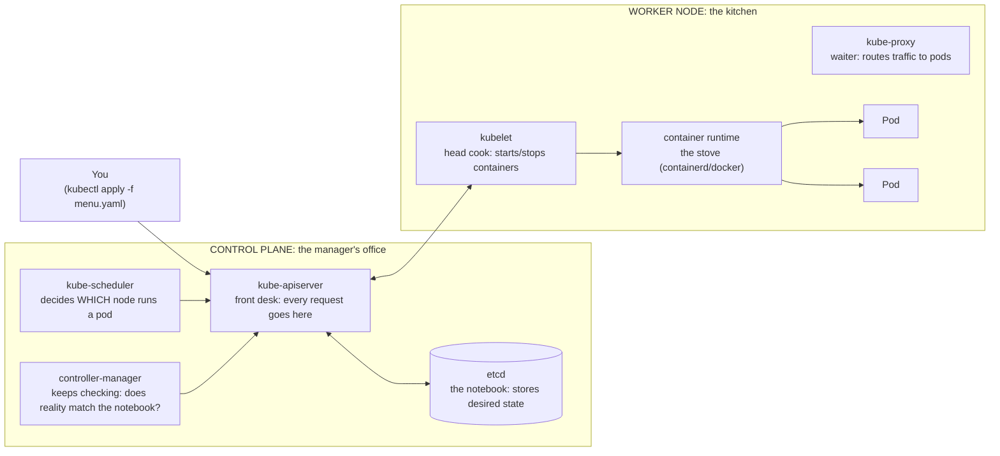
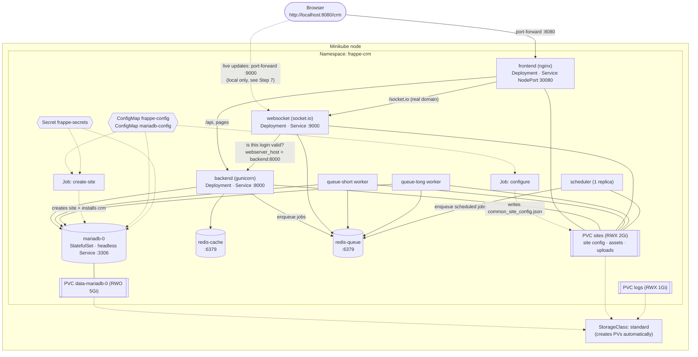

# Frappe CRM on Kubernetes (Minikube)

This folder deploys Frappe CRM to a local Kubernetes cluster. It contains:

| Deliverable | Where |
|---|---|
| Kubernetes YAML manifests | `k8s/*.yaml` (applied in number order, or all at once with `kubectl apply -k k8s`) |
| Architecture diagram | [Architecture](#3-architecture-of-this-deployment) below |
| Deployment instructions | [Deploy it, step by step](#4-deploy-it-step-by-step) below |
| Troubleshooting practice | `k8s/labs/broken-pods.yaml` + [Troubleshooting](#6-troubleshooting-failed-pods) |

Every Frappe pod runs one image, `frappe-crm:v15`, which you **build locally**
(Step 2) with the official `frappe_docker` layered Containerfile, Frappe `version-15`
plus the CRM app listed in `k8s/image/apps.json`.

> **Why not the published `ghcr.io/frappe/crm` image?** At the time of writing, those images
> (`stable`, `v1.90.0`, …) contain **only Frappe, without the CRM app**. `frappe_docker`
> now takes the app list as a build *secret* (`--secret id=apps_json`), but
> `.github/workflows/builds.yml` still passes the old `APPS_JSON_BASE64` build-arg,
> which is silently ignored. Check with:
> `kubectl run t --rm -i --restart=Never --image=ghcr.io/frappe/crm:stable -- ls apps`.

---

## 1. Kubernetes explained like you're 5

### The big picture: a restaurant

> **Docker Compose** (tasks 1–3) is you cooking in your own kitchen. If you drop a pan, *you* have to pick it up.
>
> **Kubernetes** is a restaurant with a manager. You hand the manager a menu card
> that says *"I want 1 database, 2 Redis boxes, 1 web app, 2 workers, always."*
> The manager makes sure that's true **forever**. If a cook faints, the manager
> hires a new one. You never say *"start this container"*. You say *"this is
> what I want"*, and Kubernetes keeps fixing reality until it matches.
> That idea is called **desired state**, and it's the most important idea in Kubernetes.

### Control plane vs. worker nodes



| Part | Kid version | Real job |
|---|---|---|
| **kube-apiserver** | The front desk | The only door into the cluster. `kubectl` talks to it. |
| **etcd** | The notebook | Key-value database holding all desired state. |
| **kube-scheduler** | The seating host | Picks a node with enough CPU/RAM for each new pod. |
| **controller-manager** | The nagging manager | Loops forever: "3 pods wanted, 2 running? Make one more." |
| **kubelet** | The head cook on each node | Gets pod orders from the API server and runs them. |
| **kube-proxy** | The waiter | Makes Service IPs route to the right pods. |

**Minikube** squeezes the manager's office *and* one kitchen into a single node
running inside Docker on your laptop. Run `kubectl get pods -n kube-system` to
see the control plane running as pods.

### The building blocks

| Object | Kid version | In this project |
|---|---|---|
| **Pod** | A lunchbox holding one (or a few) containers. Smallest thing K8s runs. Pods are *disposable*: they die and get replaced with new names and IPs. | Every box in the diagram below |
| **Deployment** | "Always keep N copies of this lunchbox." Handles restarts and rolling updates. | backend, frontend, websocket, workers, scheduler, redis |
| **StatefulSet** | Like a Deployment, but each pod gets a permanent name (`mariadb-0`) and its *own* disk. Made for databases. | mariadb |
| **Job** | A pod that does one chore and then stops. | `configure`, `create-site` |
| **Service** | A phone number that never changes. Pods come and go, but `backend:8000` always reaches whichever backend pods are alive. | mariadb, redis-cache, redis-queue, backend, websocket, frontend |
| **ConfigMap** | A sticky note of settings. | DB/Redis hostnames, MariaDB `.cnf` file |
| **Secret** | A sticky note in an envelope. Only base64-*encoded*, not encrypted. | DB root password, admin password |
| **Namespace** | A room in the house. | `frappe-crm` |

### Storage: PV, PVC and StorageClass

Pods are like whiteboards: when a pod dies, everything written in it is wiped.
Databases need a notebook instead.

> - **PersistentVolume (PV)**: an actual notebook sitting on the shelf (a real piece of disk).
> - **PersistentVolumeClaim (PVC)**: a kid's note saying *"I need a 5 GB notebook, please."*
> - **StorageClass**: the shop that *makes* notebooks on demand when a note arrives.
>
> You almost never create PVs by hand. You write a PVC; the StorageClass sees it
> and creates a PV; Kubernetes **binds** them together. Minikube's StorageClass is
> called `standard` and stores the data under `/tmp/hostpath-provisioner` inside the Minikube node.

**Access modes** decide who can use the notebook at once:

| Mode | Meaning | Used here for |
|---|---|---|
| `ReadWriteOnce` (RWO) | One node can read/write | MariaDB's data |
| `ReadWriteMany` (RWX) | Many nodes can read/write | `sites` + `logs`, shared by every Frappe pod |

On single-node Minikube, RWX "just works". On a real multi-node cluster you would need
an RWX-capable StorageClass (NFS, AWS EFS, CephFS, Longhorn RWX…).

---

## 2. How Frappe's pieces map to Kubernetes

In Docker Compose (`docker/docker-compose.yml`), one `frappe` container ran
`bench start`, which started *everything* inside one box. In Kubernetes we split
it so each part can be restarted, scaled and monitored on its own. Every Frappe pod
runs the **same image** with a **different command**:

| Frappe process | K8s object | Command | Port |
|---|---|---|---|
| MariaDB | StatefulSet + headless Service | `mariadb` (official image) | 3306 |
| Redis cache | Deployment + Service | `redis-server` | 6379 |
| Redis queue / socketio | Deployment + Service | `redis-server` | 6379 |
| One-time config | Job `configure` | `bench set-config -g …` | — |
| One-time site creation | Job `create-site` | `bench new-site … --install-app crm` | — |
| Web app (Python) | Deployment `backend` + Service | gunicorn (image default) | 8000 |
| Realtime | Deployment `websocket` + Service | `node apps/frappe/socketio.js` | 9000 |
| Background jobs | Deployments `queue-short`, `queue-long` | `bench worker --queue …` | — |
| Cron-like jobs | Deployment `scheduler` (exactly 1) | `bench schedule` | — |
| Front door | Deployment `frontend` + NodePort Service | `nginx-entrypoint.sh` | 8080 → 30080 |

---

## 3. Architecture of this deployment



**Order of startup:** storage & config → MariaDB + Redis → `configure` Job →
`create-site` Job → app pods. The backend's **readiness probe** pings
`/api/method/ping`, so it only shows `1/1 READY` once the site actually works.

---

## 4. Deploy it, step by step

> All commands are for **PowerShell** on Windows, run from the repository root.

### Step 0: Install the tools (one time)

```powershell
winget install Kubernetes.minikube     # the toy cluster
# kubectl ships with Docker Desktop already; check:
kubectl version --client
```

Open **Docker Desktop** and wait until it says *Engine running*. In Docker Desktop →
Settings → Resources, give it at least **4 CPUs / 8 GB RAM**.

### Step 1: Start the cluster

```powershell
minikube start --driver=docker --cpus=4 --memory=6144 --disk-size=30g
kubectl config use-context minikube
kubectl get nodes                  # one node, STATUS Ready
kubectl get pods -n kube-system    # the control plane, running as pods
kubectl get storageclass           # "standard (default)"
```

### Step 2: Build the CRM image and load it into Minikube

An **image** is a frozen box with Python, Frappe, CRM and nginx already installed.
Every Frappe pod is started from this same box.

```powershell
# 1. Get the official Frappe image recipe (put it NEXT TO this repo, not inside it)
git clone --depth 1 https://github.com/frappe/frappe_docker ..\frappe_docker

# 2. Build: Frappe version-15 + the apps listed in k8s/image/apps.json (10–20 min)
docker build `
  --secret id=apps_json,src=k8s/image/apps.json `
  --build-arg FRAPPE_BRANCH=version-15 `
  --tag frappe-crm:v15 `
  --file ..\frappe_docker\images\layered\Containerfile `
  ..\frappe_docker

# 3. Sanity check: must list BOTH frappe and crm
docker run --rm --entrypoint ls frappe-crm:v15 apps

# 4. Copy the image from Docker Desktop into the Minikube node (a few minutes)
minikube image load frappe-crm:v15
minikube image ls | Select-String frappe-crm
```

The manifests use `imagePullPolicy: Never`, which means "use the copy that's already on the node,
never download". If you forget `minikube image load`, pods show `ErrImageNeverPull`.

### Step 3: Create the room, settings and disks

```powershell
kubectl apply -f k8s/00-namespace.yaml -f k8s/01-configmap.yaml -f k8s/02-secret.yaml -f k8s/03-storage.yaml
kubectl get pvc -n frappe-crm      # STATUS Bound
kubectl get pv                     # PVs the StorageClass created for you
kubectl describe secret frappe-secrets -n frappe-crm   # shows keys, hides values
```

> Tip: save typing with `kubectl config set-context --current --namespace=frappe-crm`.
> Then you can drop `-n frappe-crm` from every command.

### Step 4: Start the database and Redis

```powershell
kubectl apply -f k8s/10-mariadb.yaml -f k8s/11-redis.yaml
kubectl get pods -n frappe-crm -w       # watch until all 3 are 1/1 Running (Ctrl+C to stop)
kubectl get pvc -n frappe-crm           # new PVC data-mariadb-0 from the StatefulSet
```

### Step 5: Run the setup chores (Jobs)

```powershell
kubectl apply -f k8s/20-configure-job.yaml
kubectl wait --for=condition=complete job/configure -n frappe-crm --timeout=300s
kubectl logs job/configure -n frappe-crm               # prints common_site_config.json

kubectl apply -f k8s/21-create-site-job.yaml
kubectl logs job/create-site -n frappe-crm -f          # follow live; takes 2–5 minutes
kubectl wait --for=condition=complete job/create-site -n frappe-crm --timeout=900s
```

### Step 6: Start the application

```powershell
kubectl apply -f k8s/30-backend.yaml -f k8s/31-websocket.yaml -f k8s/32-workers.yaml -f k8s/33-scheduler.yaml -f k8s/34-frontend.yaml
kubectl get pods -n frappe-crm -w
```

Everything should end up `Running` (and the two Jobs `Completed`).

> **Shortcut:** once you understand the steps, `kubectl apply -k k8s` applies everything at once.
> The Jobs wait for their dependencies, and the backend is not marked Ready until the site exists.

### Step 7: Open it in the browser

You need **two** port-forwards, each in its own terminal. Leave both open.

```powershell
kubectl port-forward svc/frontend 8080:8080 -n frappe-crm     # terminal 1: the website
kubectl port-forward svc/websocket 9000:9000 -n frappe-crm    # terminal 2: live updates
```

Open **http://localhost:8080/login** and log in as `Administrator` / `admin`. You land on `/crm`.

- Opening `/crm` while logged out shows **"Not Permitted"** (HTTP 403). That's CRM's own rule
  for guests (`crm/www/crm.py`), not a deployment error.
- **Why port 9000 too?** When the page URL contains a port (`:8080`), CRM's browser code
  (`frontend/src/socket.js`) connects to socket.io **directly on port 9000** instead of through
  nginx. On a real domain without a port, it uses nginx's `/socket.io` route and this second
  forward isn't needed.
(Alternative: `minikube service frontend -n frappe-crm --url` opens a tunnel to NodePort 30080.)

---

## 5. Verify health and service communication

```powershell
# 1. Pod health: every pod Running, READY 1/1, low RESTARTS
kubectl get pods -n frappe-crm -o wide

# 2. Services have endpoints (= at least one Ready pod behind each phone number)
kubectl get svc,endpoints -n frappe-crm

# 3. Service-to-service DNS + HTTP from a throwaway pod inside the cluster
kubectl run curl -n frappe-crm --rm -it --restart=Never --image=curlimages/curl -- `
  curl -s -H "Host: crm.localhost" http://backend:8000/api/method/ping
#   -> {"message":"pong"}

kubectl run curl -n frappe-crm --rm -it --restart=Never --image=curlimages/curl -- `
  curl -s -o /dev/null -w "%{http_code}\n" http://frontend:8080/login
#   -> 200   (/crm gives 403 to logged-out users by design)

# 4. Backend can reach MariaDB and Redis; workers + scheduler are alive
kubectl exec -n frappe-crm deploy/backend -- bench --site crm.localhost doctor
kubectl exec -n frappe-crm deploy/backend -- bench --site crm.localhost mariadb -e "select count(*) from tabUser;"
kubectl exec -n frappe-crm deploy/redis-queue -- redis-cli ping

# 5. Resource usage (needs the metrics addon)
minikube addons enable metrics-server
kubectl top pods -n frappe-crm
```

**Self-healing demo:** delete a pod and watch the Deployment replace it.

```powershell
kubectl delete pod -n frappe-crm -l app=backend
kubectl get pods -n frappe-crm -w        # a new backend pod appears with a new name
```

**Persistence demo:** create a Lead in the UI, then `kubectl delete pod mariadb-0 -n frappe-crm`.
When `mariadb-0` comes back (same name, same disk), the Lead is still there.

**Scaling demo:** `kubectl scale deploy/queue-short --replicas=3 -n frappe-crm`

**Realtime check:** with both port-forwards running, open browser DevTools → Network → filter
`socket.io`. You should see requests to `localhost:9000/socket.io/…` succeed (one upgrades to
WebSocket, status 101) and no red socket.io errors in the Console.

---

## 6. Troubleshooting failed pods

### The detective's toolkit

| Command | What it tells you |
|---|---|
| `kubectl get pods -n frappe-crm` | **STATUS** and **RESTARTS**: the first clue |
| `kubectl describe pod <pod> -n frappe-crm` | The **Events** section at the bottom explains *why* (pull errors, probe failures, scheduling) |
| `kubectl logs <pod> -n frappe-crm` | What the app printed |
| `kubectl logs <pod> -n frappe-crm --previous` | Logs of the *crashed* previous container (vital for CrashLoopBackOff) |
| `kubectl logs <pod> -c <container>` | Logs of one container, e.g. an init container `-c copy-assets` |
| `kubectl logs -f deploy/backend -n frappe-crm` | Follow logs live |
| `kubectl logs -n frappe-crm -l app.kubernetes.io/part-of=frappe-crm --prefix --tail=20` | Last lines of **every** pod at once |
| `kubectl get events -n frappe-crm --sort-by=.lastTimestamp` | Cluster-wide timeline of what happened |
| `kubectl exec -it deploy/backend -n frappe-crm -- bash` | Go inside a running container |
| `kubectl exec deploy/backend -n frappe-crm -- tail -50 logs/frappe.log` | Frappe's own log file on the `logs` PVC |

### What the status means

| STATUS | Kid version | Usual cause here | Fix |
|---|---|---|---|
| `Pending` | No seat for this lunchbox | PVC not `Bound`, or not enough CPU/RAM | `describe pod` → Events. `minikube start --memory=…` with more RAM |
| `ImagePullBackOff` / `ErrImagePull` | Can't find the toy in the shop | Typo in image/tag, no internet | Check `image:`. Run `minikube image pull …` |
| `CrashLoopBackOff` | Starts, falls over, tries again (waiting longer each time) | Bad command, can't reach DB, wrong password | `logs --previous` |
| `Running` but `0/1` READY | Awake but not answering the door | Readiness probe failing (site not created yet) | `describe pod` → probe failure. Check `create-site` Job |
| `Init:0/2` / `Init:Error` | Stuck getting dressed | Init container failed | `logs <pod> -c fix-permissions` / `-c copy-assets` |
| `OOMKilled` (in describe) | Ate too much, got sent home | Exceeded memory `limit` | Raise `resources.limits.memory` |
| Job `Failed` / `BackoffLimitExceeded` | Chore failed 4 times | See its logs | Fix, then `kubectl delete job <name>` and re-apply (Jobs can't be edited) |

### Frappe-specific gotchas

| Symptom | Cause | Fix |
|---|---|---|
| Workers/scheduler crash with `./apps.txt Not Found` | `configure` Job hasn't succeeded yet | `kubectl logs job/configure`. Pods recover by themselves once it completes |
| Page loads with no CSS/JS (404 on `/assets/...`) | Image entrypoint skipped, so `sites/assets` link was never made | Use `args:` not `command:` for Frappe containers (see below) |
| nginx: `/etc/nginx/conf.d/frappe.conf: Permission denied` | Pod runs with the wrong group. Image files belong to group `0` | `securityContext: { runAsUser: 1000, runAsGroup: 0 }` |
| `ErrImageNeverPull` | Image not loaded into Minikube | `minikube image load frappe-crm:v15` |
| `bench new-site … --install-app crm` → *App crm not found* | Image built without CRM | `docker run --rm --entrypoint ls frappe-crm:v15 apps`, then rebuild with `--secret id=apps_json,…` |
| `create-site` hangs on `wait-for-it mariadb:3306` | MariaDB not Ready | `kubectl logs mariadb-0` |
| `Access denied for user 'root'` | Secret changed after MariaDB first started (the password is only set on an *empty* disk) | Delete PVC `data-mariadb-0` (wipes the DB!) or use the old password |
| `create-site` says "Site already exists" | You re-ran it. The script then migrates instead | Expected |
| `404 Not Found` from backend | Wrong Host header / site name | Frontend sets `FRAPPE_SITE_NAME_HEADER=crm.localhost` |
| `/crm` shows **Not Permitted** (403) | Not logged in. CRM refuses guests | Open `/login` first |
| Live updates never arrive. Browser console shows socket.io errors for `localhost:9000` | Nothing forwards port 9000 | `kubectl port-forward svc/websocket 9000:9000 -n frappe-crm` |
| socket.io: `Unauthorized: AggregateError` / `ECONNREFUSED` | websocket checks logins at the *browser's* address (`localhost:8080`), which doesn't exist inside the pod | `webserver_host`/`webserver_port` in `common_site_config.json` (the configure Job sets them), then `kubectl rollout restart deploy/websocket -n frappe-crm` |
| `bench doctor` says *Scheduler disabled* / *inactive* | New sites start with the scheduler off, so the scheduler pod idles | `kubectl exec -n frappe-crm deploy/backend -- bench --site crm.localhost enable-scheduler` (fresh installs: the create-site Job now does this) |
| Two of every scheduled job runs | More than one scheduler | Keep `scheduler` at `replicas: 1` |
| After changing the image tag, UI is broken | Database schema older than the new code | Re-run `create-site` (it runs `bench migrate`). Assets relink automatically on pod start |

### `command:` vs `args:`: the trap that bit this deployment

| Docker / Compose | Kubernetes | What it replaces |
|---|---|---|
| `ENTRYPOINT` / `entrypoint:` | `command:` | The program that always runs first |
| `CMD` / `command:` | `args:` | The arguments handed to that program |

The Frappe image's ENTRYPOINT (`/usr/local/bin/entrypoint.sh`) symlinks the image's built
assets into `sites/assets` and then runs whatever `args` it was given. Writing
`command: ["bench", "schedule"]` in Kubernetes **replaces** that script, so the link
is never made. Writing `args: ["bench", "schedule"]` keeps it. Check what an image's
entrypoint is with `docker inspect frappe-crm:v15 --format '{{.Config.Entrypoint}} {{.Config.Cmd}}'`.

### Practice lab: break things on purpose

```powershell
kubectl apply -f k8s/labs/broken-pods.yaml
kubectl get pods -n frappe-crm -l lab=broken -w
```

Diagnose each pod yourself before reading the answers.

<details><summary>Answers</summary>

| Pod | What you'll see | How you find out |
|---|---|---|
| `lab-typo-image` | `ErrImagePull` → `ImagePullBackOff` | `describe pod` → Events: *manifest for redis:this-tag-does-not-exist not found* |
| `lab-crashing` | `Error` → `CrashLoopBackOff`, RESTARTS climbing | `logs lab-crashing --previous` → *FATAL wrong password*. `describe` → *Last State: Terminated, Exit Code: 1* |
| `lab-too-hungry` | `Pending` forever | `describe pod` → Events: *0/1 nodes are available: 1 Insufficient memory* |

Clean up: `kubectl delete -f k8s/labs/broken-pods.yaml`
</details>

---

## 7. Day-2 operations

```powershell
# Upgrade: rebuild with a new tag (e.g. frappe-crm:v15-2), minikube image load it,
# edit newTag in k8s/kustomization.yaml, then:
kubectl delete job configure create-site -n frappe-crm
kubectl apply -k k8s                      # re-copies assets, then migrates the site
kubectl rollout status deploy/backend -n frappe-crm

# Roll back a bad Deployment change
kubectl rollout undo deploy/backend -n frappe-crm

# Backup the database
kubectl exec -n frappe-crm deploy/backend -- bench --site crm.localhost backup --with-files

# Visual dashboard
minikube dashboard

# Pause / resume / delete everything
minikube stop
minikube start
kubectl delete namespace frappe-crm     # deletes app AND data (PVCs)
minikube delete                         # deletes the whole cluster
```

## 8. Going beyond Minikube (not done here)

- **Secrets**: use Sealed Secrets / External Secrets / a cloud secret manager instead of a committed `02-secret.yaml`.
- **Database**: a managed DB (AWS RDS) or a MariaDB operator, with backups.
- **Storage**: an RWX StorageClass (EFS/NFS) for `sites`, because pods will land on different nodes.
- **Ingress + TLS**: replace NodePort with an Ingress controller and cert-manager.
- **Autoscaling**: HorizontalPodAutoscaler on `backend` and the workers.
- **Packaging**: the official [frappe/helm](https://github.com/frappe/helm) chart does all of this, templated.
