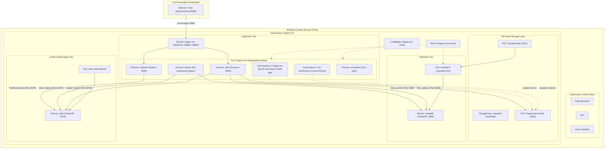

# Task: Kubernetes Deployment of Frappe CRM

> **Author:** Bulbul Das (dasBulbul03)  
> **Task:** Kubernetes Deployment of Frappe CRM using Minikube  
> **Branch:** `task-bulbul-das`  
> **Status:** Successfully Deployed & Running  

---

## Table of Contents

1. [Task Overview & Objectives](#1-task-overview--objectives)
2. [Kubernetes Core Architecture Concepts](#2-kubernetes-core-architecture-concepts)
3. [Frappe CRM Architecture & Services Mapping](#3-frappe-crm-architecture--services-mapping)
4. [Kubernetes Manifests Breakdown](#4-kubernetes-manifests-breakdown)
5. [Architecture Diagram](#5-architecture-diagram)
6. [Prerequisites & Environment Setup](#6-prerequisites--environment-setup)
7. [Step-by-Step Deployment Instructions](#7-step-by-step-deployment-instructions)
8. [Verification & Health Checks](#8-verification--health-checks)
9. [Accessing the Application](#9-accessing-the-application)
10. [Viewing Pod Logs](#10-viewing-pod-logs)
11. [Troubleshooting & Debugging Guide](#11-troubleshooting--debugging-guide)
12. [Meeting Demonstration Guide (Script for Presentation)](#12-meeting-demonstration-guide-script-for-presentation)
13. [Cleanup Commands](#13-cleanup-commands)

---

## 1. Task Overview & Objectives

The goal of this task is to containerize and deploy the Frappe CRM full-stack application inside a local Kubernetes environment using **Minikube** without requiring paid cloud infrastructure.

### Objectives Completed:
* [x] **Understand Kubernetes Architecture:** Control Plane (API server, scheduler, controller-manager, etcd) and Worker Nodes (kubelet, kube-proxy, container runtime).
* [x] **Kubernetes Core Resources:** Namespace, Pods, Deployments, StatefulSets, Services, ConfigMaps, and Secrets.
* [x] **Storage Management:** PersistentVolumes (PV), PersistentVolumeClaims (PVC), and dynamic StorageClasses (`standard` hostPath).
* [x] **Frappe CRM Workload Orchestration:** Multi-service coordination between Web (Gunicorn), Realtime WebSocket (Node.js SocketIO), Background Workers, Task Scheduler, Database (MariaDB), and In-Memory Cache/Broker (Redis).
* [x] **Manifest Authoring:** Modular, reusable YAML manifests with health checks and resource limits.
* [x] **Local Minikube Deployment:** Fully automated setup running live.
* [x] **Verification & Observability:** Service discovery, inter-pod communication, and log diagnostics.

---

## 2. Kubernetes Core Architecture Concepts

### A. Control Plane vs. Worker Nodes
* **Control Plane (Master Node):**
  * `kube-apiserver`: The central REST API gateway and control point for all administrative tasks.
  * `etcd`: Distributed, consistent key-value store holding the complete cluster state.
  * `kube-scheduler`: Assigns newly created Pods to available nodes based on resource constraints.
  * `kube-controller-manager`: Manages lifecycle controllers (Node Controller, Replication Controller, Endpoints Controller).
* **Worker Node (Compute):**
  * `kubelet`: Node agent ensuring containers described in PodSpecs are running and healthy.
  * `kube-proxy`: Maintains network rules on nodes allowing network communication to Pods from inside or outside the cluster.
  * `Container Runtime (containerd)`: Responsible for downloading images and running container instances.

### B. Workload & Config Resources
* **Namespace (`frappe-crm`):** Provides virtual isolation for all project resources.
* **ConfigMap (`frappe-crm-config`):** Decouples environment-specific configuration (hostnames, ports, site settings) from container images.
* **Secret (`frappe-crm-secrets`):** Safely injects sensitive credentials (database passwords, admin password) via base64 encoding without committing them to version control.
* **StatefulSet (`mariadb`):** Used for stateful databases that require stable persistent storage and fixed network identities.
* **Deployment (`frappe`, `redis`):** Manages stateless declarative pod replicas, self-healing restarts, and zero-downtime rolling updates.
* **Service:**
  * `ClusterIP`: Exposes the database and cache on an internal cluster-only virtual IP.
  * `NodePort`: Exposes the web and WebSocket service on static ports accessible from outside the cluster.
* **StorageClass & PVC:**
  * `StorageClass`: Dynamically provisions storage volumes on demand. In Minikube, the `standard` StorageClass automatically provisions local host volumes.
  * `PersistentVolumeClaim (PVC)`: A user request for storage (e.g., 10Gi for MariaDB, 20Gi for Frappe site assets) that binds to a PersistentVolume (PV).

---

## 3. Frappe CRM Architecture & Services Mapping

Frappe CRM requires multiple coordinated processes:

| Component | Technology | K8s Resource | Port | Storage / Role |
|---|---|---|---|---|
| **Database** | MariaDB 10.6 | `StatefulSet` | 3306 (Internal) | `mariadb-data` PVC (10Gi) |
| **Cache & Queue** | Redis Alpine | `Deployment` | 6379 (Internal) | In-memory cache, background job queues, and WebSocket pub/sub |
| **Storage Permissions** | InitContainer (`fix-permissions`) | Part of Frappe Pod | - | Fixes Linux directory permissions on the persistent volume |
| **Site Provisioner** | InitContainer (`frappe-init`) | Part of Frappe Pod | - | Initializes bench, clones CRM app, and runs `bench new-site` |
| **Web Server** | Gunicorn / Python WSGI | `Deployment` (Main) | 8000 | Serves Frappe REST API & frontend static bundle |
| **WebSocket** | Node.js SocketIO | `Deployment` (Main) | 9000 | Real-time push updates & user notifications |
| **Background Workers** | Python RQ Worker | `Deployment` (Main) | - | Executes asynchronous background tasks |
| **Task Scheduler** | Frappe Scheduler | `Deployment` (Main) | - | Periodic cron-style background jobs |

---

## 4. Kubernetes Manifests Breakdown

The `kubernetes/` directory contains structured, numbered manifests designed to be deployed sequentially:

```text
kubernetes/
├── 00-namespace.yaml          # Creates dedicated 'frappe-crm' namespace
├── 01-configmap.yaml          # Defines connection URLs, site name, and initialization script
├── 02-secret.yaml.example     # Template for MariaDB and Frappe admin credentials
├── 03-mariadb-pvc.yaml        # Requests 10Gi persistent storage for MariaDB
├── 04-mariadb-statefulset.yaml# MariaDB database engine with UTF8MB4 config & health checks
├── 05-mariadb-service.yaml    # Internal ClusterIP service for MariaDB (port 3306)
├── 06-redis-deployment.yaml   # Redis deployment with liveness/readiness probes
├── 07-redis-service.yaml      # Internal ClusterIP service for Redis (port 6379)
├── 08-frappe-pvc.yaml         # Requests 20Gi persistent storage for Frappe sites and bench code
├── 09-frappe-deployment.yaml  # Multi-stage Frappe pod with permission & setup init containers
├── 10-frappe-service.yaml     # NodePort service exposing ports 30800 (HTTP) & 30900 (WebSocket)
└── README.md                  # Comprehensive task documentation
```

---

## 5. Architecture Diagram



---

## 6. Prerequisites & Environment Setup

Ensure the following tools are installed on your machine:
* **Docker Desktop:** Container engine running and healthy.
* **Minikube:** Version v1.32 or higher.
* **kubectl:** Kubernetes command-line interface.

Verify prerequisites:
```bash
docker --version
minikube version
kubectl version --client
```

---

## 7. Step-by-Step Deployment Instructions

### Step 1: Start Minikube Cluster
Launch Minikube allocating sufficient resources (4 vCPUs and 6GB RAM are ideal for Frappe):
```bash
minikube start --driver=docker --cpus=4 --memory=6144 --disk-size=40g
```
Verify cluster is active:
```bash
minikube status
kubectl get nodes
```

### Step 2: Prepare the Secret File
Copy the secret template to create the actual secret file (never committed to Git):
```bash
cd kubernetes/
cp 02-secret.yaml.example 02-secret.yaml
```
*(The repository `.gitignore` ensures `02-secret.yaml` remains untracked).*

### Step 3: Deploy Core Infrastructure & Storage
Apply the namespace, configuration, secrets, and storage claims:
```bash
kubectl apply -f 00-namespace.yaml
kubectl apply -f 01-configmap.yaml
kubectl apply -f 02-secret.yaml
kubectl apply -f 03-mariadb-pvc.yaml
kubectl apply -f 08-frappe-pvc.yaml
```
Verify both PVCs are bound:
```bash
kubectl get pvc -n frappe-crm
```

### Step 4: Deploy MariaDB & Redis
Deploy the database and in-memory cache:
```bash
kubectl apply -f 04-mariadb-statefulset.yaml
kubectl apply -f 05-mariadb-service.yaml
kubectl apply -f 06-redis-deployment.yaml
kubectl apply -f 07-redis-service.yaml
```
Wait for both to be fully ready:
```bash
kubectl rollout status statefulset/mariadb -n frappe-crm --timeout=120s
kubectl rollout status deployment/redis -n frappe-crm --timeout=60s
```

### Step 5: Deploy Frappe CRM Application
Deploy the application deployment and NodePort service:
```bash
kubectl apply -f 09-frappe-deployment.yaml
kubectl apply -f 10-frappe-service.yaml
```

Monitor initialization:
```bash
kubectl get pods -n frappe-crm -w
```

---

## 8. Verification & Health Checks

Verify that all workloads, services, and storage claims are running properly:

```bash
# 1. Check all resources in the namespace
kubectl get all,pvc -n frappe-crm

# 2. Check persistent volume claims
kubectl get pvc -n frappe-crm

# 3. Check endpoint resolution
kubectl get endpoints -n frappe-crm

# 4. Test API response directly inside the cluster
kubectl exec -it deployment/frappe -n frappe-crm -c frappe -- curl -s http://127.0.0.1:8000/api/method/ping
# Expected output: {"message":"pong"}
```

---

## 9. Accessing the Application

### Option A: Port-Forwarding (Recommended for Demo)
To access the CRM application directly on `localhost`:
```bash
kubectl port-forward service/frappe-crm 8000:8000 9000:9000 -n frappe-crm
```
* **Web UI URL:** [http://localhost:8000](http://localhost:8000)
* **Login Page:** [http://localhost:8000/login](http://localhost:8000/login)
* **Default Username:** `Administrator`
* **Default Password:** `admin` (or the password defined in `02-secret.yaml`)

### Option B: Minikube Service URL
```bash
minikube service frappe-crm -n frappe-crm --url
```

---

## 9.1 Network Port Architecture & Docker Desktop Port Mappings Explained

When viewing Minikube in Docker Desktop, you may observe container port bindings such as `65435:32443` and `65436:5000`. These do **not** route to Frappe CRM. Here is the architectural distinction:

```
[Mac Host Browser] 
    │
    ├── http://localhost:8000 ──────> [kubectl port-forward tunnel] ──────> [K8s Service: frappe-crm:8000] ──> [Pod containerPort: 8000]
    │
    ├── http://localhost:65435 ─────> [Docker Engine] ──> [Minikube Container: 32443] (Auxiliary NodePort / Inactive)
    │
    └── http://localhost:65436 ─────> [Docker Engine] ──> [Minikube Container: 5000]  (In-Cluster Registry / Inactive)
```

| Layer | Port | What it is | Why it works / fails |
|---|---|---|---|
| **Host Loopback** | `8000` | `kubectl port-forward` | **WORKS:** Encapsulates traffic directly into the Kubernetes API control plane tunnel to Pod `10.244.0.22:8000`. |
| **Kubernetes Service** | `8000` (ClusterIP) | Virtual Cluster IP (`10.99.73.33`) | Routes internal cluster traffic to healthy Frappe pods. |
| **Kubernetes NodePort** | `30800` | NodePort on Minikube IP (`192.168.49.2`) | Accessible inside Minikube's Docker network; not routable directly from macOS host without port-forward. |
| **Docker Host Binding** | `65436 -> 5000` | Statically exposed by `kicbase` | **DOES NOT OPEN APP:** Reserved for Minikube's internal container registry add-on (`minikube addons enable registry`). No process listens on it when registry is disabled. |
| **Docker Host Binding** | `65435 -> 32443` | Statically exposed by `kicbase` | **DOES NOT OPEN APP:** Reserved for TLS auxiliary services / Dashboard. When disabled, connections are refused. |

---

## 9.2 Resuming After Mac Restart (Zero Data Loss)

All database and application states are stored in PersistentVolumes (`mariadb-data` and `frappe-bench-data`). After shutting down or restarting your Mac:

1. **Start Docker Desktop** from Applications.
2. **Start Minikube:**
   ```bash
   minikube start
   ```
   *(Minikube reconnects to existing persistent volumes automatically. Pods will resume in seconds without re-running initialization).*
3. **Verify all Pods are Running:**
   ```bash
   kubectl get pods -n frappe-crm
   ```
4. **Re-establish Port-Forward:**
   ```bash
   kubectl port-forward service/frappe-crm 8000:8000 9000:9000 -n frappe-crm
   ```
5. **Open Browser:** Navigate to `http://localhost:8000/login`. All your data, leads, and deals will be preserved.

---

## 9.3 Launching the Kubernetes Dashboard

Minikube includes the official web-based Kubernetes Dashboard for visual cluster monitoring:

```bash
minikube dashboard
```
This automatically enables the dashboard add-on, starts a proxy, and opens the dashboard in your default browser showing CPU/Memory graphs, Pod status, and events.

---

## 10. Viewing Pod Logs

During debugging or demonstration, inspect the logs of each container:

```bash
# View MariaDB logs
kubectl logs statefulset/mariadb -n frappe-crm

# View Redis logs
kubectl logs deployment/redis -n frappe-crm

# View Frappe initialization container logs (setup & migration)
kubectl logs deployment/frappe -n frappe-crm -c frappe-init

# View Frappe main runtime logs (Gunicorn, SocketIO, Workers, Scheduler)
kubectl logs deployment/frappe -n frappe-crm -c frappe

# Follow main logs in real time
kubectl logs -f deployment/frappe -n frappe-crm -c frappe
```

---

## 11. Troubleshooting & Debugging Guide

| Issue / Error | Root Cause | Practical Resolution |
|---|---|---|
| `Pending` Pods | Insufficient CPU/Memory allocated to Minikube. | Run `kubectl describe pod <name> -n frappe-crm` to verify. Restart Minikube with at least `--cpus=4 --memory=6144`. |
| `CrashLoopBackOff` on MariaDB | Missing environment variables or corrupted data directory. | Check `kubectl logs statefulset/mariadb -n frappe-crm`. Confirm `MYSQL_ROOT_PASSWORD` is injected properly from the secret. |
| `Permission denied: 'frappe-bench/apps'` | Local volume mount owned by root instead of non-root `frappe` user (UID 1000). | Resolved by the `fix-permissions` initContainer which runs `chown -R frappe:frappe` before initialization. |
| `TLS/SSL error: SSL is required` | MariaDB client in Frappe bench defaults to SSL while MariaDB server has SSL disabled. | Resolved by configuring `~/.my.cnf` with `[client] ssl=0` in the ConfigMap init script. |
| `Table 'tabSingles' doesn't exist` | Web server started before database migration was executed. | The `frappe-init` container guarantees `bench new-site` and `install-app` finish before the main container starts. |
| `ImagePullBackOff` | Network failure during image download. | Pre-load images into Minikube using `minikube image load <image-name>`. |

---

## 12. Meeting Demonstration Guide (Script for Presentation)

Follow this structure during your live presentation or Loom recording:

### 1. Introduction (30 seconds)
> *"Hello everyone. Today I'm demonstrating the Kubernetes deployment of Frappe CRM on a local Minikube cluster. This deployment demonstrates container orchestration, stateful database persistence, decoupling configuration via ConfigMaps and Secrets, and running a multi-process architecture consisting of the web tier, background workers, scheduler, and real-time WebSocket service."*

### 2. Architecture Overview (45 seconds)
Show the Mermaid diagram in this README:
> *"Our architecture consists of three main tiers:
> 1. Database Tier: MariaDB running as a StatefulSet backed by a 10Gi PersistentVolumeClaim.
> 2. Caching Tier: Redis Deployment acting as in-memory cache, background job queue, and WebSocket pub/sub broker.
> 3. Application Tier: Frappe CRM running as a unified Deployment with an InitContainer handling database migration and site initialization."*

### 3. Live Cluster Verification (45 seconds)
Switch to the terminal and execute:
```bash
kubectl get all,pvc -n frappe-crm
```
Point out:
* All pods are in `Running` status with `1/1 Ready`.
* Both Persistent Volume Claims (`mariadb-data` and `frappe-bench-data`) are `Bound`.
* The `frappe-crm` Service is exposed on NodePort `30800`.

### 4. Application Demonstration (1 minute)
1. Open the browser at `http://localhost:8000/login`.
2. Log in using `Administrator` / `admin`.
3. Navigate to **Leads**, **Deals**, or the **CRM Dashboard** to demonstrate that queries to MariaDB and background workers are operating seamlessly.

### 5. Inspecting Logs & Health Checks (30 seconds)
Run:
```bash
kubectl logs deployment/frappe -n frappe-crm -c frappe | tail -n 15
```
Show the processes active under bench:
* `web.1`: Gunicorn serving HTTP on port 8000.
* `socketio.1`: WebSocket listening on port 9000.
* `worker.1`: RQ worker processing background tasks.
* `schedule.1`: Task scheduler managing periodic jobs.

---

## 13. Cleanup Commands

To remove the deployment and free system resources:

```bash
# 1. Delete all resources in the namespace
kubectl delete namespace frappe-crm

# 2. Stop Minikube cluster (preserves data)
minikube stop

# 3. Delete Minikube cluster completely (frees disk space)
minikube delete
```
