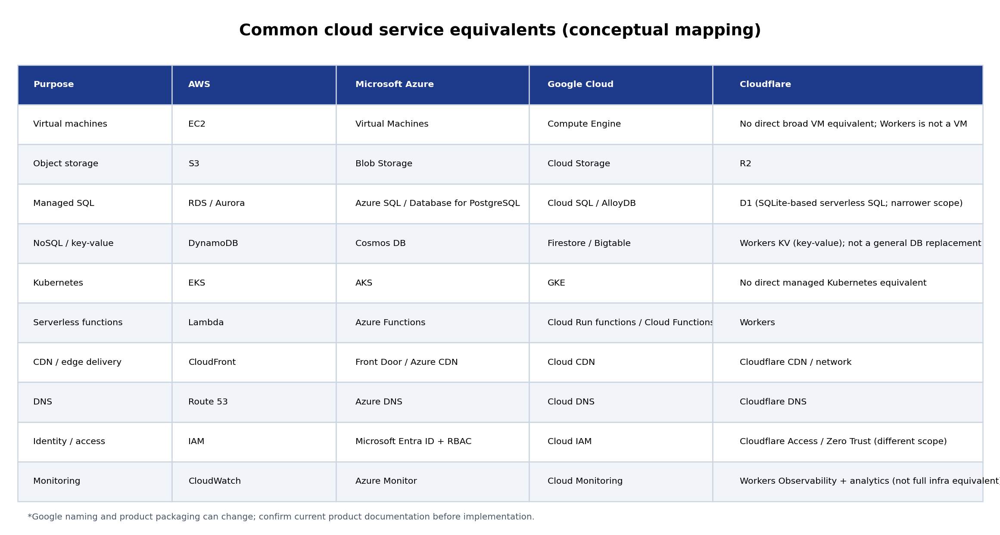

# Cloud Platform Exploration -- Task 4

**Comparison of AWS, Microsoft Azure, Google Cloud Platform (GCP), and
Cloudflare**

> **Purpose:** Understand the common cloud concepts, compare equivalent
> services, identify how the platforms differ, and decide which platform
> is easiest for beginners.

## Table of contents

-   [1. Executive summary](#1-executive-summary)
-   [2. What is a cloud platform?](#2-what-is-a-cloud-platform)
-   [3. Platform profiles](#3-platform-profiles)
    -   [3.1 AWS](#31-amazon-web-services-aws)
    -   [3.2 Microsoft Azure](#32-microsoft-azure)
    -   [3.3 Google Cloud](#33-google-cloud-platform-gcp)
    -   [3.4 Cloudflare](#34-cloudflare)
-   [4. What is common across all
    platforms?](#4-what-is-common-across-all-platforms)
-   [5. Service equivalents and
    differences](#5-service-equivalents-and-differences)
-   [6. Beginner-friendliness
    comparison](#6-beginner-friendliness-comparison)
-   [7. Which platform should a beginner learn
    first?](#7-which-platform-should-a-beginner-learn-first)
-   [8. Suggested hands-on project](#8-suggested-hands-on-project)
-   [9. Security and cost checklist](#9-security-and-cost-checklist)
-   [10. Official documentation and learning
    resources](#10-official-documentation-and-learning-resources)
-   [11. Final conclusion](#11-final-conclusion)
-   [Appendix: diagrams and
    terminology](#appendix-diagrams-and-terminology)

## 1. Executive summary

AWS, Microsoft Azure, and Google Cloud are full-scale public cloud
platforms. They provide broad infrastructure and managed services for
virtual machines, networking, storage, databases, containers, identity,
security, analytics, and AI.

Cloudflare is different. It is best understood as a global connectivity,
security, and developer platform with a strong edge/serverless
application offering. It overlaps with hyperscalers in selected areas,
but it is not a like-for-like replacement for every virtual machine,
Kubernetes, enterprise database, or data-warehouse service.

### Quick recommendation

-   **AWS:** Strong broad foundation for general cloud infrastructure
    and DevOps.
-   **Azure:** Natural fit for organizations using Microsoft
    technologies such as Windows Server, Microsoft Entra ID, Microsoft
    365, and .NET.
-   **Google Cloud:** Particularly attractive for analytics, data
    engineering, BigQuery, and Kubernetes.
-   **Cloudflare:** Often the quickest route for deploying a small
    website, API, or edge application.

For a beginner, learn the shared cloud concepts first, then focus on one
primary provider. Avoid trying to master all four consoles at the same
time.

## 2. What is a cloud platform?

A cloud platform provides computing resources and managed capabilities
over the internet. Instead of purchasing and maintaining all physical
hardware, an organization provisions resources on demand and pays
according to the selected service, capacity, region, and usage.

  -----------------------------------------------------------------------
  Cloud model             Meaning                 Examples
  ----------------------- ----------------------- -----------------------
  IaaS -- Infrastructure  You manage the          Amazon EC2, Azure
  as a Service            operating system and    Virtual Machines,
                          application; the        Google Compute Engine
                          provider manages the
                          physical
                          infrastructure.

  PaaS -- Platform as a   The provider manages    Azure App Service,
  Service                 more of the             Google App Engine
                          runtime/platform,
                          allowing you to focus
                          on the application and
                          data.

  Serverless / FaaS       Run code or workflows   AWS Lambda, Azure
                          without directly        Functions, Cloudflare
                          managing servers.       Workers
                          Scaling and billing
                          follow the service's
                          rules.

  SaaS -- Software as a   Use a complete hosted   Microsoft 365,
  Service                 application.            Salesforce
  -----------------------------------------------------------------------

Cloud does not mean security, backups, access control, or cost
management become automatic. Providers secure the underlying cloud
infrastructure, while customers remain responsible for many
configuration, identity, data, and application controls. This is known
as the **shared responsibility model**.

## 3. Platform profiles

### 3.1 Amazon Web Services (AWS)

AWS is a broad cloud platform with a very large service catalogue. It is
suitable for general infrastructure, web applications, enterprise
workloads, containers, analytics, AI/ML, backup, and disaster recovery.

  -----------------------------------------------------------------------
  Area                    Important AWS services  Purpose
  ----------------------- ----------------------- -----------------------
  Compute                 EC2, Lambda, ECS, EKS,  Virtual servers,
                          Elastic Beanstalk       functions, containers,
                                                  Kubernetes, and managed
                                                  application deployment

  Storage                 S3, EBS, EFS, S3        Object storage, VM
                          Glacier                 disks, shared file
                                                  storage, and archival

  Databases               RDS, Aurora, DynamoDB,  Managed SQL,
                          ElastiCache             high-performance
                                                  relational, NoSQL, and
                                                  caching

  Networking              VPC, Route 53,          Private networks, DNS,
                          CloudFront, Elastic     CDN, load balancing,
                          Load Balancing, API     and API entry points
                          Gateway

  Security                IAM, KMS, Secrets       Permissions, encryption
                          Manager, WAF, Shield    keys, secrets, and
                                                  web/DDoS protection

  Operations              CloudWatch, CloudTrail, Metrics/logs, audit
                          AWS Config, Systems     events, configuration
                          Manager                 tracking, and fleet
                                                  operations

  DevOps / IaC            CloudFormation,         Infrastructure as code
                          CodeBuild,              and build/deploy
                          CodePipeline; Terraform automation
                          is also widely used
  -----------------------------------------------------------------------

**Strengths** - Extensive service breadth and architecture choices. -
Mature ecosystem and broad third-party support. - Large collection of
training material and practical examples.

**Challenges for beginners** - Many services overlap, which can make
service selection confusing. - IAM policies, VPC networking, and cost
dimensions take practice.

**Suggested learning order:** IAM basics → regions and Availability
Zones → VPC → EC2 → S3 → RDS → CloudWatch → Lambda → containers.

### 3.2 Microsoft Azure

Azure is Microsoft's cloud platform. It is a natural option for
organizations already using Windows Server, Microsoft Entra ID,
Microsoft 365, Active Directory, .NET, SQL Server, and Microsoft
management tools.

  -----------------------------------------------------------------------
  Area                    Important Azure         Purpose
                          services
  ----------------------- ----------------------- -----------------------
  Compute                 Azure Virtual Machines, VMs, managed web
                          App Service, Azure      hosting, functions,
                          Functions, Container    containers, and
                          Apps, AKS               Kubernetes

  Storage                 Blob Storage, Managed   Object, VM disk, shared
                          Disks, Azure Files,     file, and archive
                          Archive Storage         storage

  Databases               Azure SQL Database,     Managed relational and
                          Azure Database for      globally distributed
                          PostgreSQL, Cosmos DB   NoSQL data

  Networking              Virtual Network (VNet), Private networks,
                          Load Balancer,          traffic distribution,
                          Application Gateway,    application routing,
                          Front Door, Azure DNS   edge delivery, and DNS

  Security                Microsoft Entra ID,     Identity, resource
                          Azure RBAC, Key Vault,  permissions,
                          Defender for Cloud, WAF secrets/keys, and
                                                  security posture

  Operations              Azure Monitor, Log      Metrics, logs,
                          Analytics, Application  application telemetry,
                          Insights, Cost          and cost tracking
                          Management

  DevOps / IaC            Azure DevOps, GitHub    Pipelines and
                          Actions, ARM templates, declarative
                          Bicep                   infrastructure
                                                  deployment
  -----------------------------------------------------------------------

**Strengths** - Strong integration with the Microsoft ecosystem. -
Familiar identity concepts for many Windows administrators. - Guided
learning paths and enterprise governance capabilities.

**Challenges for beginners** - The distinction between Microsoft Entra
ID, Azure RBAC, and resource-level permissions can be confusing. - The
portal exposes many configuration choices.

**Suggested learning order:** resource groups → regions → Entra ID/RBAC
→ VNet → VM → Blob Storage → Azure SQL → Monitor → App
Service/Functions.

### 3.3 Google Cloud Platform (GCP)

Google Cloud is strong in data analytics, managed data services,
Kubernetes, and cloud-native application development. Its global network
and BigQuery are important parts of its platform.

  -----------------------------------------------------------------------
  Area                    Important Google Cloud  Purpose
                          services
  ----------------------- ----------------------- -----------------------
  Compute                 Compute Engine, Cloud   VMs, container-based
                          Run, GKE, Cloud Run     apps, Kubernetes, and
                          functions               event-driven functions

  Storage                 Cloud Storage,          Object, block, and
                          Persistent Disk,        managed file storage
                          Filestore

  Databases               Cloud SQL, AlloyDB,     Managed relational,
                          Firestore, Bigtable,    document, wide-column,
                          Spanner                 and globally
                                                  distributed databases

  Networking              VPC, Cloud DNS, Cloud   Networks, DNS, load
                          Load Balancing, Cloud   balancing, content
                          CDN, Cloud Armor        delivery, and web
                                                  protection

  Security                Cloud IAM, Cloud KMS,   Permissions,
                          Secret Manager,         encryption, secrets,
                          Security Command Center and security posture

  Operations              Cloud Monitoring, Cloud Metrics, logs, and
                          Logging, Cloud Audit    audit trails
                          Logs

  Data / DevOps           BigQuery, Dataflow,     Analytics warehouse,
                          Pub/Sub, Cloud Build,   data processing,
                          Artifact Registry       messaging, and CI/build
                                                  services
  -----------------------------------------------------------------------

**Strengths** - BigQuery and analytics ecosystem. - Strong managed
Kubernetes offering through GKE. - Good support for cloud-native
application development.

**Challenges for beginners** - Project/folder/organization hierarchy and
IAM roles take practice. - Service selection still depends on workload,
region, and requirements.

**Suggested learning order:** projects → IAM → VPC → Compute Engine →
Cloud Storage → Cloud SQL → Cloud Run → BigQuery → Cloud Monitoring.

### 3.4 Cloudflare

Cloudflare operates a large global network and provides DNS, CDN, web
application security, DDoS mitigation, Zero Trust, and a developer
platform. Its Workers platform runs application code close to users at
the edge.

  -----------------------------------------------------------------------
  Area                    Important Cloudflare    Purpose
                          services
  ----------------------- ----------------------- -----------------------
  Compute / apps          Workers, Pages, Durable Edge code, web
                          Objects, Workflows      application deployment,
                                                  stateful coordination,
                                                  and workflow
                                                  orchestration

  Storage                 R2, Workers KV, D1      Object storage,
                                                  key-value storage, and
                                                  serverless SQL

  Networking / delivery   DNS, CDN, Cache, Load   DNS hosting, caching,
                          Balancing, Tunnels      traffic distribution,
                                                  and secure connectivity

  Security                WAF, DDoS protection,   Protect public
                          Bot Management,         applications and
                          Turnstile, Zero Trust / control access to
                          Access                  private resources

  Operations              Workers Observability,  Application-level
                          Analytics, logs         visibility and platform
                                                  analytics
  -----------------------------------------------------------------------

**Strengths** - Fast website onboarding and global edge delivery. -
Integrated security and performance services. - Developer-friendly
deployment workflows and useful building blocks for web applications.

**Challenges / limits** - Cloudflare is not a full substitute for
hyperscaler infrastructure. - It does not map one-to-one to
general-purpose VM fleets, managed Kubernetes, or broad enterprise
database/data-warehouse catalogues.

**Suggested learning order:** DNS → Pages/Workers → Git deployment → R2
→ D1 → KV → WAF/Access → logs and usage limits.

> **Important:** Cloudflare Workers is an edge/serverless runtime, not a
> general-purpose VM. R2, D1, and KV also have different semantics and
> capabilities from hyperscaler storage and database products. Check
> current Cloudflare documentation when selecting a new architecture.

## 4. What is common across all platforms?

The product names differ, but the underlying cloud concepts are
reusable. Learning the concept once makes the next provider easier.

  --------------------------------------------------------------------------------------
  Shared       What it does    AWS              Azure       Google Cloud Cloudflare
  concept
  ------------ --------------- ---------------- ----------- ------------ ---------------
  Compute      Executes        EC2, Lambda      Virtual     Compute      Workers
               application                      Machines,   Engine,      (different
               code or                          Functions   Cloud Run    execution
               workloads                                                 model)

  Object       Stores files,   S3               Blob        Cloud        R2
  storage      images, and                      Storage     Storage
               other objects

  Database     Stores          RDS, DynamoDB    Azure SQL,  Cloud SQL,   D1, KV
               application                      Cosmos DB   Firestore    (different data
               records                                                   models)

  Networking   Connects        VPC              VNet        VPC          Cloudflare
               resources and                                             network,
               routes traffic                                            Tunnels,
                                                                         connectivity
                                                                         products

  DNS          Maps domain     Route 53         Azure DNS   Cloud DNS    Cloudflare DNS
               names to
               destinations

  CDN /        Serves content  CloudFront       Front Door  Cloud CDN    Cloudflare CDN
  caching      closer to users                  / Azure CDN

  Identity and Controls who    IAM              Entra ID +  Cloud IAM    Access / Zero
  access       can access                       RBAC                     Trust and API
               resources and                                             tokens
               what they can
               do

  Security     Protects        WAF, Shield, KMS WAF,        Cloud Armor, WAF, DDoS, Zero
               applications,                    Defender,   KMS          Trust
               networks, data,                  Key Vault
               and identities

  Monitoring   Shows health,   CloudWatch       Azure       Cloud        Workers
               logs, metrics,                   Monitor     Monitoring   Observability /
               and failures                                              analytics

  Automation / Creates         CloudFormation   Bicep / ARM Terraform /  Wrangler, APIs,
  IaC          repeatable                                   Config       Terraform
               environments                                 Connector    provider
               and deployments
  --------------------------------------------------------------------------------------

**Key point:** All providers offer ways to compute, store, connect,
secure, and monitor workloads. However, a similar service name or
purpose does not guarantee identical features, APIs, limits, pricing, or
operational behavior.

## 5. Service equivalents and differences

The following table is a conceptual mapping. It is a starting point, not
a guarantee that the products are interchangeable.

  ----------------------------------------------------------------------------
  Purpose        AWS            Microsoft      Google Cloud   Cloudflare
                                Azure
  -------------- -------------- -------------- -------------- ----------------
  Virtual        EC2            Virtual        Compute Engine No direct broad
  machines                      Machines                      VM equivalent

  Object storage S3             Blob Storage   Cloud Storage  R2

  Managed SQL    RDS / Aurora   Azure SQL /    Cloud SQL /    D1 (SQLite-based
                                Azure Database AlloyDB        serverless SQL;
                                for PostgreSQL                narrower scope)

  NoSQL /        DynamoDB       Cosmos DB      Firestore /    Workers KV
  key-value                                    Bigtable       (key-value; not
                                                              a general
                                                              database
                                                              replacement)

  Kubernetes     EKS            AKS            GKE            No direct
                                                              managed
                                                              Kubernetes
                                                              equivalent

  Serverless     Lambda         Azure          Cloud Run      Workers
  functions                     Functions      functions

  CDN / edge     CloudFront     Front Door /   Cloud CDN      Cloudflare CDN /
  delivery                      Azure CDN                     network

  DNS            Route 53       Azure DNS      Cloud DNS      Cloudflare DNS

  Identity /     IAM            Entra ID +     Cloud IAM      Access / Zero
  access                        RBAC                          Trust (different
                                                              scope)

  Monitoring     CloudWatch     Azure Monitor  Cloud          Workers
                                               Monitoring     Observability
                                                              (not full
                                                              infrastructure
                                                              monitoring)
  ----------------------------------------------------------------------------

### 5.1 Important differences to understand

  --------------------------------------------------------------------------
  Topic                   AWS vs Azure vs Google  Cloudflare difference
                          Cloud
  ----------------------- ----------------------- --------------------------
  Virtual machines        EC2, Azure VMs, and     Workers is an
                          Compute Engine provide  isolate-based/serverless
                          configurable VMs, but   runtime, not a
                          images, networking,     general-purpose VM
                          disks, quotas, IAM, and replacement.
                          pricing differ.

  Object storage          S3, Blob, and Cloud     R2 provides S3-compatible
                          Storage all store       APIs; verify compatibility
                          objects; APIs,          and feature differences.
                          lifecycle rules, access
                          policies, and tiers
                          differ.

  SQL databases           RDS/Aurora, Azure SQL,  D1 is a serverless SQL
                          and Cloud SQL/AlloyDB   product designed around
                          differ in engines, high SQLite semantics; it is
                          availability, scaling,  not equivalent to a large
                          backups, and            managed PostgreSQL/MySQL
                          extensions.             service.

  Kubernetes              EKS, AKS, and GKE are   No direct managed
                          managed Kubernetes      Kubernetes equivalent in
                          offerings; node         the same sense.
                          management, networking,
                          upgrades, and
                          integrations differ.

  Identity                AWS IAM, Azure Entra    Cloudflare Access/Zero
                          ID/RBAC, and Google     Trust controls access to
                          Cloud IAM use different applications and networks;
                          policy structures and   it is not a full
                          scopes.                 cloud-resource IAM
                                                  analogue.

  Analytics               AWS offers services     Cloudflare provides edge
                          such as Redshift, Glue, data and developer
                          and Athena; Azure       primitives, not a
                          offers Fabric, Synapse, comparable general
                          and Data Factory;       enterprise data warehouse
                          Google Cloud offers     suite.
                          BigQuery, Dataflow, and
                          related services.
  --------------------------------------------------------------------------

### Cloud-neutral application architecture

This architecture can be implemented using different services from each
provider. The logical layers remain similar:

1.  Users access the application over HTTPS.
2.  DNS, CDN, and WAF route, cache, and protect traffic.
3.  The application/API runs on VMs, containers, PaaS, or serverless
    compute.
4.  Object storage stores files and static assets.
5.  A database stores application records.
6.  IAM and monitoring provide access control and operational
    visibility.

### Service-equivalent overview

The diagram highlights shared concepts and shows that Cloudflare's
overlap is more focused on edge delivery, security, and developer
services.

## 6. Beginner-friendliness comparison

There is no universal winner. Ease depends on what you already know and
what you want to build.

  -----------------------------------------------------------------------
  Platform          Beginner          Best starting use Main learning
                    experience                          hurdle
  ----------------- ----------------- ----------------- -----------------
  Cloudflare        Often easiest for Static site,      Understanding
                    a first website   frontend, simple  edge/serverless
                    or small API      API, caching,     limits, bindings,
                    because           DNS, and web      runtime
                    deployment and    security.         constraints, and
                    edge services are                   storage
                    integrated.                         semantics.

  Azure             Often             Microsoft         Identity/RBAC
                    approachable if   enterprise IT,    layers, resource
                    you know Windows, .NET apps,        hierarchy, and
                    Microsoft 365, or Windows VMs, and  portal
                    Active Directory. hybrid            complexity.
                                      environments.

  Google Cloud      A clean           BigQuery, data    IAM hierarchy,
                    experience for    engineering,      networking
                    cloud-native apps containers, and   concepts, and
                    and analytics,    Cloud Run.        choosing among
                    with strong                         managed data
                    guided                              products.
                    documentation.

  AWS               Excellent         General cloud     Large service
                    learning          infrastructure,   catalogue, IAM
                    ecosystem and     DevOps,           policy details,
                    broad practical   architecture, and VPC networking,
                    relevance, but    broad service     and cost
                    the breadth can   learning.         controls.
                    feel
                    overwhelming.
  -----------------------------------------------------------------------

### Task-based recommendation

-   **First simple website:** Cloudflare.
-   **Microsoft-heavy workplace:** Azure.
-   **Data analytics / BigQuery:** Google Cloud.
-   **Broad infrastructure and DevOps foundation:** AWS.

This is a task-based recommendation, not an objective ranking of
platform quality.

## 7. Which platform should a beginner learn first?

A sensible approach is to learn transferable fundamentals and then focus
on one provider rather than attempting four platforms at once.

1.  **Learn cloud fundamentals:** regions, Availability Zones, shared
    responsibility, IaaS/PaaS/serverless, scalability, and consumption
    billing.
2.  **Learn supporting technical skills:** Linux, basic networking (IP,
    DNS, ports, HTTP/HTTPS, subnets, routing), and Git.
3.  **Choose one main provider:** build a small project, configure
    storage, connect a database, set permissions, add monitoring, and
    estimate cost.
4.  **Learn Infrastructure as Code:** after understanding the console
    basics, rebuild the environment using Terraform or the provider's
    native IaC tool.
5.  **Compare a second provider:** use the service mapping table to
    identify equivalent concepts. Learn Cloudflare as an edge layer or
    for a separate Workers-based application.

### Beginner platform decision tree

## 8. Suggested hands-on project

Build a small **image/document gallery** with a web frontend, API,
object storage, database, and basic monitoring. This project exposes the
common cloud layers without requiring a large production system.

  ----------------------------------------------------------------------------------
  Layer          AWS              Azure            Google Cloud     Cloudflare
                 implementation   implementation   implementation   implementation
  -------------- ---------------- ---------------- ---------------- ----------------
  Frontend /     S3 + CloudFront  Static Web Apps  Firebase Hosting Pages or Workers
  delivery       or Amplify       / Storage static or Cloud         assets
                                  website + Front  Storage + Cloud
                                  Door             CDN

  API / compute  Lambda + API     Azure Functions  Cloud Run /      Workers
                 Gateway          / App Service    Cloud Run
                                                   functions

  Object storage S3               Blob Storage     Cloud Storage    R2

  Database       DynamoDB or RDS  Cosmos DB or     Firestore or     D1 or KV (choose
                                  Azure SQL        Cloud SQL        based on data
                                                                    model)

  Identity       IAM / Cognito    Entra ID / app   Identity         Access /
                                  authentication   Platform /       application
                                                   Firebase Auth    authentication
                                                                    pattern

  Monitoring     CloudWatch       Azure Monitor /  Cloud Monitoring Workers
                                  Application      / Logging        Observability
                                  Insights
  ----------------------------------------------------------------------------------

### Suggested implementation phases

1.  Create a repository and document the architecture.
2.  Build and test the frontend locally.
3.  Deploy the frontend to the selected platform.
4.  Add an API and configure environment variables/secrets safely.
5.  Connect object storage and upload/download functionality.
6.  Add a database for metadata.
7.  Configure access permissions and security controls.
8.  Add logs/monitoring and test error scenarios.
9.  Estimate the cost and remove unused resources after testing.
10. Document deployment steps and lessons learned in the repository.

## 9. Security and cost checklist

-   [ ] Use a unique account and enable multi-factor authentication
    (MFA).
-   [ ] Do not use root/global administrator credentials for daily work.
-   [ ] Create least-privilege users, groups, or roles.
-   [ ] Never publish access keys, API tokens, passwords, or private
    keys in GitHub.
-   [ ] Set a budget alert before creating resources. Alerts are
    notifications and may not be hard spending caps.
-   [ ] Check region, instance size, storage class, public IP, data
    transfer/egress, and backup charges.
-   [ ] Delete test VMs, disks, databases, load balancers, IP addresses,
    and other billable resources after practice.
-   [ ] Keep object storage private unless public access is deliberately
    required.
-   [ ] Enable logs and understand retention and ingestion charges.
-   [ ] Check official pricing calculators and current free-tier terms.
    Free offers and quotas change; do not assume every service is free.

## 10. Official documentation and learning resources

### AWS

-   [AWS Getting Started](https://docs.aws.amazon.com/getting-started/)
-   [AWS Cloud Comparisons](https://aws.amazon.com/compare/)
-   [AWS Skill Builder](https://skillbuilder.aws/)

### Microsoft Azure

-   [Azure Fundamentals -- Microsoft
    Learn](https://learn.microsoft.com/en-us/training/paths/microsoft-azure-fundamentals-describe-cloud-concepts/)
-   [Azure Training](https://learn.microsoft.com/en-us/training/azure/)

### Google Cloud

-   [Google Cloud service
    comparison](https://cloud.google.com/docs/get-started/aws-azure-gcp-service-comparison)
-   [Google Cloud Training](https://cloud.google.com/learn/training)

### Cloudflare

-   [Cloudflare Fundamentals -- Get
    started](https://developers.cloudflare.com/fundamentals/get-started/)
-   [Cloudflare Pages
    documentation](https://developers.cloudflare.com/pages/)
-   [Cloudflare Developer
    Platform](https://www.cloudflare.com/developer-platform/)

Always verify current service names, availability, limits, pricing, and
free-tier terms in the official documentation before deploying
resources. Cloud products and documentation can change.

## 11. Final conclusion

AWS, Azure, and Google Cloud solve many of the same infrastructure
problems with different service names, interfaces, policy models,
integrations, and pricing. Cloudflare overlaps strongly in DNS, CDN,
security, and edge application development, but has a narrower
infrastructure scope.

For a beginner, the most effective plan is to learn cloud fundamentals,
select one primary platform based on the target workload, complete one
end-to-end project, and then use service mapping to understand the
others.

**One-line conclusion:** Cloudflare is often simplest for a small web
deployment; Azure is a natural fit for Microsoft environments; Google
Cloud is compelling for analytics and data work; AWS is a strong broad
foundation for general cloud and DevOps.

## Appendix: diagrams and terminology

The editable diagrams are supplied in
[`Cloud_Platform_Comparison_Diagrams.drawio`](Cloud_Platform_Comparison_Diagrams.drawio).
Open the file using [diagrams.net](https://app.diagrams.net/) → **File →
Open From → Device**.

The draw.io file contains three editable pages:

1.  Cloud-neutral application architecture.
2.  Service-equivalent overview.
3.  Beginner platform decision tree.

### Terminology

  -----------------------------------------------------------------------
  Term                                Meaning
  ----------------------------------- -----------------------------------
  Region                              A geographic area where a cloud
                                      provider operates resources.

  Availability Zone                   An isolated location within a
                                      region designed to improve
                                      resilience.

  VPC / VNet                          A logically isolated virtual
                                      network for cloud resources.

  IAM / RBAC                          Identity and Access Management /
                                      Role-Based Access Control.

  CDN                                 Content Delivery Network; caches
                                      content closer to users.

  WAF                                 Web Application Firewall; filters
                                      HTTP(S) requests using security
                                      rules.

  Serverless                          A model where the provider manages
                                      server infrastructure; it does not
                                      mean there are no servers.

  IaC                                 Infrastructure as Code; defining
                                      infrastructure in
                                      version-controlled configuration.

  Egress                              Data transferred out of a cloud
                                      service or provider; charges may
                                      apply.
  -----------------------------------------------------------------------

------------------------------------------------------------------------

**Document:** Task 4 -- Cloud Platform Exploration\
**Prepared:** 9 November 2026
