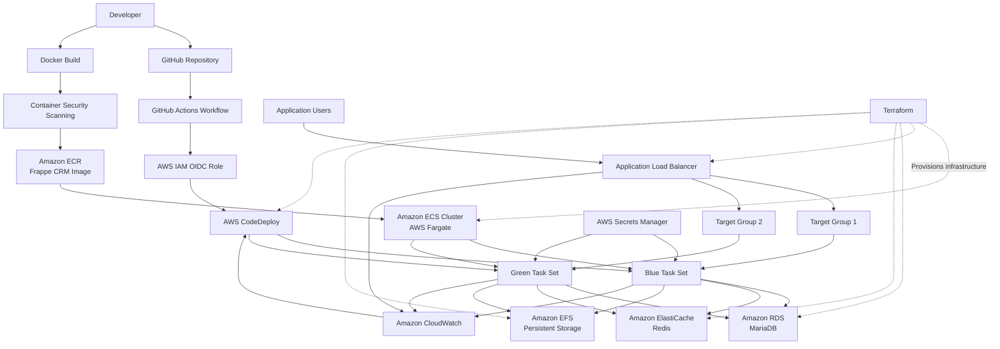

# Task 11 – Frappe CRM on AWS ECS Fargate with Blue-Green Deployment

## 1. Project Overview

This project demonstrates deploying Frappe CRM on **Amazon ECS using AWS Fargate**, with an Application Load Balancer (ALB) and AWS CodeDeploy for Blue-Green deployments.

The infrastructure is provisioned using Terraform. A hardened Docker image is stored in Amazon Elastic Container Registry (ECR). GitHub Actions uses OpenID Connect (OIDC) to authenticate with AWS and initiate deployments without storing long-lived AWS access keys.

### Project Objectives

- Dockerize and harden the Frappe CRM application.
- Store the container image in Amazon ECR.
- Provision AWS infrastructure using Terraform.
- Deploy Frappe CRM using ECS Fargate.
- Configure Blue-Green deployments using AWS CodeDeploy.
- Route application traffic through an Application Load Balancer.
- Implement health checks and deployment rollback.
- Monitor application and deployment health using CloudWatch.
- Automate deployment initiation through GitHub Actions and AWS OIDC.
- Capture deployment and security evidence.

## 2. Architecture Diagram

The following diagram illustrates the AWS infrastructure, application components, and deployment workflow.



### Blue-Green Deployment Workflow

1. A hardened Docker image is built and published to Amazon ECR.
2. GitHub Actions authenticates with AWS using OIDC.
3. The deployment workflow registers a new ECS task definition revision.
4. CodeDeploy creates a new task set alongside the existing task set.
5. The Application Load Balancer routes traffic between the Blue and Green task sets.
6. CloudWatch monitors application and deployment health.
7. After successful validation, the new task set becomes the primary task set.
8. Configured deployment failures can trigger automatic rollback.

**Note:** The Docker image build, security scanning, and ECR publishing are currently separate from the GitHub Actions deployment workflow. The workflow uses an existing ECR image.

## 3. AWS Environment

| Component | Configuration |
|---|---|
| AWS Region | `ap-southeast-2` (Sydney) |
| ECS Cluster | `frappe-crm-task11-dev-cluster` |
| ECS Web Service | `frappe-crm-task11-dev-web` |
| ECS Worker Service | `frappe-crm-task11-dev-worker` |
| ECS Scheduler Service | `frappe-crm-task11-dev-scheduler` |
| ECS WebSocket Service | `frappe-crm-task11-dev-websocket` |
| CodeDeploy Application | `frappe-crm-task11-dev-app` |
| CodeDeploy Deployment Group | `frappe-crm-task11-dev-blue-green` |
| ECR Repository | `frappe-crm` |
| ECR Image Tag | `15-hardened-2-amd64` |
| Terraform Resources Created | 64 |

### Application Endpoint

```text
http://frappe-crm-task11-dev-alb-1351892118.ap-southeast-2.elb.amazonaws.com
```

**Application health-check endpoint:**

```text
/api/method/ping
```

**Expected response:**

```json
{
  "message": "pong"
}
```

## 4. Project Structure

```text
task11-ecs-blue-green/
│
├── README.md
├── appspec.yaml
│
├── docker/
│   ├── apps.json
│   ├── Dockerfile.security
│   └── entrypoint.sh
│
├── docs/
│   └── IMAGE-SECURITY-REPORT.md
│
├── screenshots/
│   ├── 01-frappe-login.png
│   ├── 02-frappe-dashboard.png
│   ├── 03-ecs-cluster.png
│   ├── 04-ecs-services.png
│   ├── 05-ecs-fargate-running-task.png
│   ├── 06-codedeploy-success.png
│   ├── 07-blue-green-traffic.png
│   ├── 08-alb-listener.png
│   ├── 09-alb-healthy-targets.png
│   ├── 10-cloudwatch-alarms.png
│   ├── 11-ecr-image.png
│   └── 12-security-scan.png
│
└── terraform/
    ├── .gitignore
    ├── .terraform.lock.hcl
    ├── codedeploy.tf
    ├── database.tf
    ├── ecs.tf
    ├── ecs_init.tf
    ├── ecs_processes.tf
    ├── ecs_services.tf
    ├── ecs_tasks.tf
    ├── github_oidc.tf
    ├── iam.tf
    ├── load_balancer.tf
    ├── monitoring.tf
    ├── network.tf
    ├── outputs.tf
    ├── redis.tf
    ├── secrets.tf
    ├── security_groups.tf
    ├── storage.tf
    ├── variables.tf
    └── versions.tf
```

**Note:** Terraform state files, `.tfvars` files, execution plans, provider binaries, and local backup files are excluded from Git for security.

## 5. Tools and Technologies

| Category | Technologies |
|---|---|
| Containerization | Docker |
| Container Orchestration | Amazon ECS, AWS Fargate |
| Container Registry | Amazon ECR |
| Deployment Strategy | AWS CodeDeploy, Blue-Green |
| Load Balancing | Application Load Balancer |
| Infrastructure as Code | Terraform |
| Database | Amazon RDS MariaDB |
| Caching | Amazon ElastiCache Redis |
| Persistent Storage | Amazon EFS |
| Secrets Management | AWS Secrets Manager |
| Monitoring | Amazon CloudWatch |
| CI/CD | GitHub Actions |
| Authentication | GitHub OIDC, AWS IAM |
| Security Scanning | Trivy |
| Operating Environment | PowerShell, AWS CloudShell |

## 6. Infrastructure and Deployment

### 6.1 Infrastructure Provisioning

Terraform was used to provision the AWS infrastructure, including:

- VPC, subnets, and networking components.
- Security groups and IAM roles.
- ECS cluster, services, and task definitions.
- Application Load Balancer and target groups.
- RDS MariaDB database.
- ElastiCache Redis.
- EFS persistent storage.
- AWS Secrets Manager.
- CodeDeploy application and deployment group.
- CloudWatch log groups and alarms.
- GitHub OIDC integration.

**Terraform execution result:**

```text
Apply complete! Resources: 64 added, 0 changed, 0 destroyed.
```

### 6.2 Containerization

The Frappe CRM container image was built using:

```text
docker/Dockerfile.security
```

The project also uses:

```text
docker/entrypoint.sh
```

The image was built for Linux AMD64 and published to Amazon ECR.

### 6.3 ECS Fargate Deployment

The application runs through the following ECS Fargate services:

- Web
- Worker
- Scheduler
- WebSocket

The ECS web service uses the `CODE_DEPLOY` deployment controller to support Blue-Green deployments.

### 6.4 Blue-Green Deployment

AWS CodeDeploy manages the Blue and Green task sets.

During deployment:

1. A new task set is created alongside the existing task set.
2. The ALB routes traffic according to the deployment configuration.
3. CloudWatch alarms monitor deployment health.
4. Health checks validate the new task set.
5. The new task set becomes primary after successful deployment.
6. Configured deployment failures can trigger automatic rollback.

### 6.5 CI/CD Automation

The GitHub Actions deployment workflow is located at:

```text
.github/workflows/task11-deploy.yml
```

The workflow uses:

- GitHub Actions manual workflow dispatch.
- AWS IAM OIDC authentication.
- ECS task definition registration.
- CodeDeploy deployment creation.
- Deployment status monitoring.

The workflow deploys an existing image from Amazon ECR. Automated Docker image building and pushing are not currently part of this workflow.

No long-lived AWS access keys are required when OIDC is configured correctly.

## 7. Security Implementation

### 7.1 Container Security

- Used a dedicated hardened Dockerfile.
- Used a dedicated container entrypoint.
- Built an AMD64 Linux image for ECS Fargate.
- Performed container image vulnerability scanning.
- Documented security scan findings.

### 7.2 AWS Security

- Used IAM roles for AWS service access.
- Configured GitHub OIDC instead of embedding AWS access keys in the workflow.
- Stored application secrets in AWS Secrets Manager.
- Used security groups to control network access.
- Used private networking for application dependencies where configured.
- Kept Terraform state and variable files out of Git.

### 7.3 Deployment Safety

- Configured CodeDeploy Blue-Green deployment.
- Configured CloudWatch deployment alarms.
- Enabled automatic rollback for configured deployment failure conditions.
- Used application and ALB health checks to validate deployment health.

### 7.4 ECR Image Security Scan Results

| Severity | Findings |
|---|---:|
| Critical | 0 |
| High | 18 |
| Medium | 31 |
| Low | 7 |
| Undefined | 1 |

The image scan completed successfully. However, vulnerabilities were identified and documented for remediation.

## 10. Conclusion

This project demonstrates the deployment of Frappe CRM on AWS using a containerized architecture built with Docker, Amazon ECS Fargate, and Terraform.

The infrastructure was provisioned using Terraform, with Amazon ECR used to store the hardened application image. ECS Fargate runs the application services, while an Application Load Balancer and AWS CodeDeploy enable Blue-Green deployments and controlled traffic shifting. Health checks and deployment rollback help improve application availability and deployment reliability.

CloudWatch provides application monitoring, logs, and alarms. Security scanning with Trivy was also performed, and the findings are documented in the security report.

Frappe Bench remains an important part of application administration. It can be used inside the appropriate Frappe container for tasks such as database migrations, site maintenance, cache management, and application management. AWS services manage the infrastructure and container lifecycle, while Bench manages the Frappe application.

The project provided practical experience with AWS cloud infrastructure, containerization, Infrastructure as Code, CI/CD deployment workflows, Blue-Green deployment strategies, monitoring, and security.

**Overall, this project demonstrates how a Frappe CRM application can be deployed and operated on AWS using modern DevOps practices.**