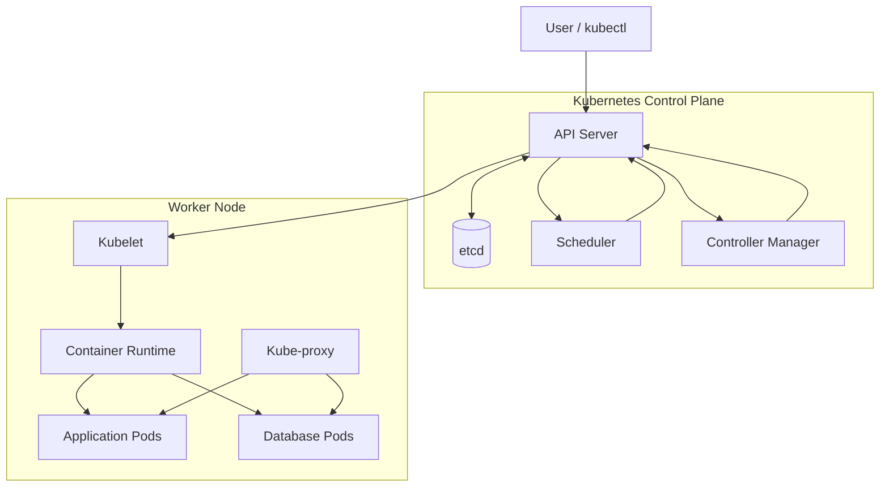
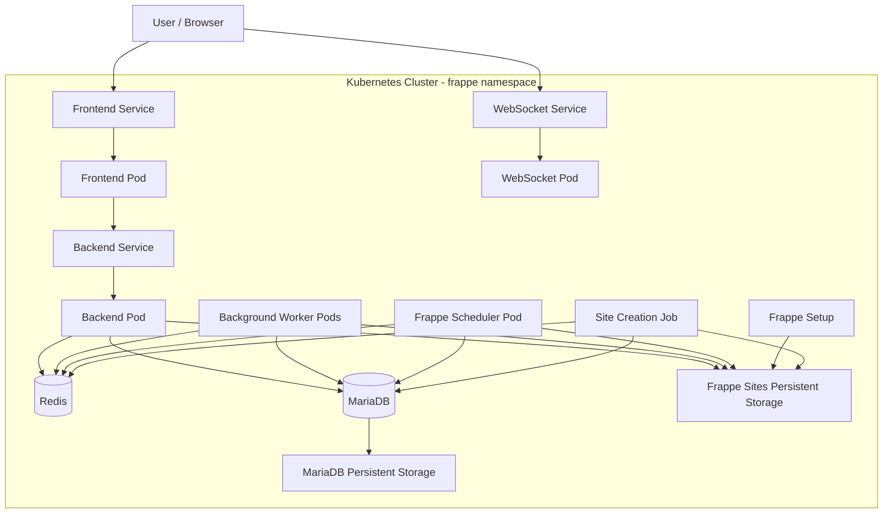
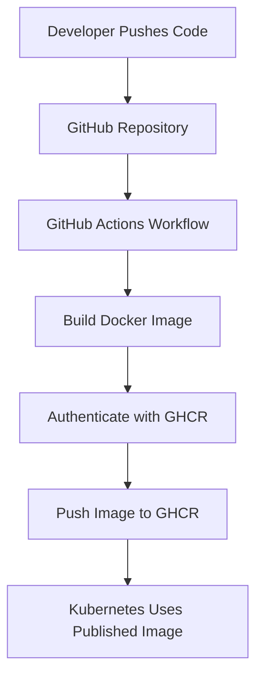

# Frappe CRM Deployment on Kubernetes using Minikube

## 1. Project Overview

This project demonstrates the deployment of **Frappe CRM on Kubernetes** using Minikube and Docker Desktop.

The project covers Frappe environment setup using Frappe Bench, custom Docker image creation, CI/CD automation using GitHub Actions, and Kubernetes-based application deployment.

The deployment consists of the Frappe application, MariaDB, Redis, WebSocket, background workers, scheduler, and persistent storage.

### Project Objectives

- Understand Kubernetes architecture and its core components.
- Set up the Frappe environment using Frappe Bench.
- Build a custom Docker image for Frappe CRM.
- Automate Docker image building and publishing using GitHub Actions.
- Deploy Frappe CRM using Kubernetes YAML manifests.
- Configure Kubernetes Services for application communication.
- Deploy MariaDB and Redis.
- Configure persistent storage using PersistentVolumes and PersistentVolumeClaims.
- Deploy background workers and the Frappe scheduler.
- Verify application components and troubleshoot deployment issues.

---

## 2. Kubernetes Architecture

Kubernetes is an open-source container orchestration platform used to deploy, manage, scale, and monitor containerized applications.

A Kubernetes cluster consists of a Control Plane and Worker Nodes.

### Kubernetes Architecture Diagram



### Main Kubernetes Components

| Component | Responsibility |
|---|---|
| API Server | Entry point for Kubernetes requests. |
| etcd | Stores cluster configuration and state. |
| Scheduler | Assigns new Pods to suitable Worker Nodes. |
| Controller Manager | Maintains the desired state of Kubernetes resources. |
| Kubelet | Ensures containers in assigned Pods are running. |
| Kube-proxy | Handles network communication for Kubernetes Services. |
| Container Runtime | Runs containers on Worker Nodes. |
| Pods | Smallest deployable units in Kubernetes. |

---

## 3. Frappe CRM Deployment Architecture

Frappe CRM is deployed as a multi-component application. Each component performs a specific role.

- **Frontend:** Provides the application user interface.
- **Backend:** Handles application requests using Frappe.
- **WebSocket:** Supports real-time communication.
- **MariaDB:** Stores application data.
- **Redis:** Supports caching and background job queues.
- **Background Workers:** Process asynchronous jobs.
- **Frappe Scheduler:** Executes scheduled background tasks.
- **Persistent Storage:** Retains application and database data.
- **Setup and Site Creation:** Prepare the Frappe environment and create the application site.

### Frappe CRM Kubernetes Architecture Diagram



*This diagram represents the logical application architecture. Actual networking, storage mounts, and resource relationships are defined by the Kubernetes manifests.*

---

## 4. Technology Stack

| Technology | Purpose |
|---|---|
| Frappe CRM | Application |
| Frappe Bench | Frappe environment and site management |
| Docker | Containerization |
| Docker Desktop | Local container runtime |
| Minikube | Local Kubernetes cluster |
| Kubernetes | Container orchestration |
| YAML | Kubernetes resource configuration |
| MariaDB | Relational database |
| Redis | Caching and background job support |
| GitHub Actions | CI/CD automation |
| GitHub Container Registry | Docker image storage |
| kubectl | Kubernetes cluster management |

---

## 5. Project Structure

```text
task6-kubernetes-deployment/
│
├── README.md
├── backend.yaml
├── frontend.yaml
├── websocket.yaml
├── mariadb.yaml
├── redis.yaml
├── workers.yaml
├── frappe-setup.yaml
├── frappe-site-create.yaml
├── frappe-storage.yaml
├── apps.json
│
├── images/
│   └── layered/
│       └── Containerfile
│
└── resources/
    └── core/
        ├── main-entrypoint.sh
        └── start.sh
```

The GitHub Actions workflow is maintained in:

```text
.github/workflows/build-and-push.yml
```

### Important Configuration Files

| File | Responsibility |
|---|---|
| `backend.yaml` | Backend application configuration |
| `frontend.yaml` | Frontend deployment and Service |
| `websocket.yaml` | WebSocket application component |
| `mariadb.yaml` | MariaDB database configuration |
| `redis.yaml` | Redis configuration |
| `workers.yaml` | Background workers and scheduler |
| `frappe-setup.yaml` | Frappe environment setup |
| `frappe-site-create.yaml` | Frappe site creation Job |
| `frappe-storage.yaml` | Persistent storage configuration |
| `apps.json` | Application installation configuration |
| `Containerfile` | Custom Docker image build instructions |
| `main-entrypoint.sh` | Container initialization logic |
| `start.sh` | Application startup script |

---

## 6. Frappe Bench Setup and Commands

Frappe Bench is a command-line tool used to initialize and manage Frappe environments, install applications, create sites, run migrations, and manage application processes.

It provides the foundation for preparing the Frappe application before it runs in Kubernetes.

### 6.1 Initialize a Bench Environment

```bash
bench init frappe-bench
```

Creates a new Bench directory and initializes the Frappe environment.

For a deployment requiring a specific Frappe branch, the branch can be specified:

```bash
bench init --frappe-branch=<branch-name> frappe-bench
```

### 6.2 Navigate to the Bench Directory

```bash
cd frappe-bench
```

### 6.3 Get an Application

```bash
bench get-app <app-name>
```

Downloads an application into the Bench environment.

For example:

```bash
bench get-app crm
```

The application repository and branch must match the deployment configuration.

### 6.4 Create a Frappe Site

```bash
bench new-site <site-name>
```

Creates a Frappe site and configures its database.

### 6.5 Install an Application on a Site

```bash
bench --site <site-name> install-app <app-name>
```

Installs the specified application on the selected site.

### 6.6 List Available Sites

```bash
bench list-sites
```

Displays the sites available in the Bench environment.

### 6.7 Run Database Migrations

```bash
bench --site <site-name> migrate
```

Applies pending database schema and application changes.

### 6.8 Start Bench Processes

```bash
bench start
```

Starts the development processes managed by Bench.

### 6.9 Create a Backup

```bash
bench --site <site-name> backup
```

Creates a backup of the selected site.

### 6.10 Check Installed Versions

```bash
bench version
```

Displays the installed Frappe and application versions.

### 6.11 Bench in This Kubernetes Deployment

The Kubernetes deployment uses containerized setup and site-creation processes.

The project uses:

- `apps.json` to specify the applications required during setup.
- `frappe-setup.yaml` to configure the Frappe environment.
- `frappe-site-create.yaml` to run the site creation process.
- `Containerfile` and startup scripts to build and start the application container.

The exact Bench arguments used by the deployment are defined in the setup configuration and startup scripts.

**Note:** The commands above are common Frappe Bench commands for reference. Commands such as `bench new-site` and `bench install-app` may be executed by the automated setup process rather than manually by the developer. The Kubernetes setup scripts determine the actual deployment commands.

---

## 7. Docker Image Creation

Docker is used to package the Frappe application environment and its required dependencies into a custom container image.

The project uses a Containerfile located at:

```text
images/layered/Containerfile
```

The image includes the application environment and supporting startup configuration.

### Published Docker Image

```text
ghcr.io/shirisha-thakur/frappe-crm-kubernetes:v16
```

The image is published to GitHub Container Registry (GHCR) and referenced by the Kubernetes application resources.

---

## 8. CI/CD Using GitHub Actions

GitHub Actions automates the Docker image build and publishing process.

Workflow location:

```text
.github/workflows/build-and-push.yml
```

### CI/CD Architecture



### Workflow Steps

1. A developer pushes changes to the GitHub repository.
2. GitHub Actions triggers the configured workflow.
3. The workflow builds the custom Docker image.
4. It authenticates with GitHub Container Registry.
5. The image is pushed to GHCR.
6. Kubernetes deployment resources can use the published image.

This automates image building and publishing, reducing the need for manual Docker image management.

---

## 9. Kubernetes Deployment Using Minikube

Minikube provides a local Kubernetes cluster for deploying and testing Frappe CRM. Docker Desktop provides the local container runtime.

The application resources are deployed in the `frappe` namespace.

### Step 1: Start Minikube

```powershell
minikube start --driver=docker
```

Check cluster status:

```powershell
minikube status
```

Check the Kubernetes nodes:

```powershell
kubectl get nodes
```

### Step 2: Verify the Namespace

```powershell
kubectl get namespaces
```

Create the namespace if it does not already exist:

```powershell
kubectl create namespace frappe
```

### Step 3: Deploy Persistent Storage

```powershell
kubectl apply -f frappe-storage.yaml -n frappe
```

Check PersistentVolumes and PersistentVolumeClaims:

```powershell
kubectl get pv
kubectl get pvc -n frappe
```

Persistent storage helps retain application and database data beyond the lifecycle of individual Pods.

### Step 4: Deploy MariaDB and Redis

Deploy MariaDB:

```powershell
kubectl apply -f mariadb.yaml -n frappe
```

Deploy Redis:

```powershell
kubectl apply -f redis.yaml -n frappe
```

Verify the resources:

```powershell
kubectl get pods -n frappe
kubectl get services -n frappe
```

### Step 5: Configure the Frappe Environment

```powershell
kubectl apply -f frappe-setup.yaml -n frappe
```

Check the setup Pod:

```powershell
kubectl get pods -n frappe
```

Inspect its logs:

```powershell
kubectl logs <setup-pod-name> -n frappe
```

### Step 6: Create the Frappe Site

```powershell
kubectl apply -f frappe-site-create.yaml -n frappe
```

Check the Job:

```powershell
kubectl get jobs -n frappe
```

Check its Pods:

```powershell
kubectl get pods -n frappe
```

Inspect the site creation logs:

```powershell
kubectl logs <site-creation-pod-name> -n frappe
```

The site creation process depends on the Frappe setup, database, and Redis components being correctly configured and available.

### Step 7: Deploy Application Components

Deploy the backend:

```powershell
kubectl apply -f backend.yaml -n frappe
```

Deploy the frontend:

```powershell
kubectl apply -f frontend.yaml -n frappe
```

Deploy WebSocket:

```powershell
kubectl apply -f websocket.yaml -n frappe
```

Deploy background workers and scheduler:

```powershell
kubectl apply -f workers.yaml -n frappe
```

### Step 8: Verify the Deployment

Check Pods:

```powershell
kubectl get pods -n frappe
```

Check Services:

```powershell
kubectl get services -n frappe
```

Check Deployments:

```powershell
kubectl get deployments -n frappe
```

Check Jobs:

```powershell
kubectl get jobs -n frappe
```

Check persistent storage:

```powershell
kubectl get pvc -n frappe
```

---

## 10. Accessing Frappe CRM

The frontend is exposed through a Kubernetes NodePort Service.

Configured NodePort:

```text
31584
```

Retrieve the Minikube IP:

```powershell
minikube ip
```

Access the application using:

```text
http://<MINIKUBE-IP>:31584
```

Replace `<MINIKUBE-IP>` with the IP returned by Minikube.

The application should be accessed after the required application, database, Redis, and site-creation components are ready.

---

## 11. Deployment Verification and Troubleshooting

### Check Pod Status

```powershell
kubectl get pods -n frappe
```

### Inspect a Pod

```powershell
kubectl describe pod <pod-name> -n frappe
```

### View Container Logs

```powershell
kubectl logs <pod-name> -n frappe
```

### View Previous Container Logs

```powershell
kubectl logs <pod-name> -n frappe --previous
```

### Check Kubernetes Events

```powershell
kubectl get events -n frappe --sort-by=.metadata.creationTimestamp
```

### Check Services

```powershell
kubectl get services -n frappe
```

### Check PersistentVolumeClaims

```powershell
kubectl get pvc -n frappe
```

### Common Kubernetes Issues

| Issue | Possible Cause |
|---|---|
| ImagePullBackOff | Incorrect image reference or registry authentication issue |
| CrashLoopBackOff | Application startup failure or incorrect configuration |
| Pending Pod | Insufficient resources, scheduling issue, or storage problem |
| Database connection error | MariaDB unavailable or incorrect database configuration |
| Redis connection error | Redis unavailable or incorrect connection configuration |
| Site creation failure | Database, Redis, application setup, or configuration issue |
| PVC Pending | Storage provisioning or binding issue |

Use `kubectl describe`, `kubectl logs`, and `kubectl get events` to investigate issues before modifying deployment resources.

---

## 12. Important Kubernetes Concepts Used

| Kubernetes Resource | Purpose in the Project |
|---|---|
| Namespace | Isolates Frappe CRM resources |
| Pod | Runs application and supporting containers |
| Deployment | Manages application replicas |
| Service | Provides network access and communication |
| Job | Executes one-time tasks such as site creation |
| PersistentVolume | Represents cluster storage |
| PersistentVolumeClaim | Requests persistent storage |
| ConfigMap | Stores non-sensitive configuration when configured |
| Container Image | Packages the application and runtime environment |

---

## 13. Conclusion

This project demonstrates the deployment of a multi-component Frappe CRM application on Kubernetes using Minikube.

It combines Frappe Bench, Docker containerization, GitHub Actions CI/CD, GitHub Container Registry, Kubernetes Deployments, Services, Jobs, persistent storage, MariaDB, Redis, background workers, and application scheduling.

Through this project, practical experience is gained in container orchestration, application deployment, infrastructure configuration, CI/CD automation, and Kubernetes troubleshooting.