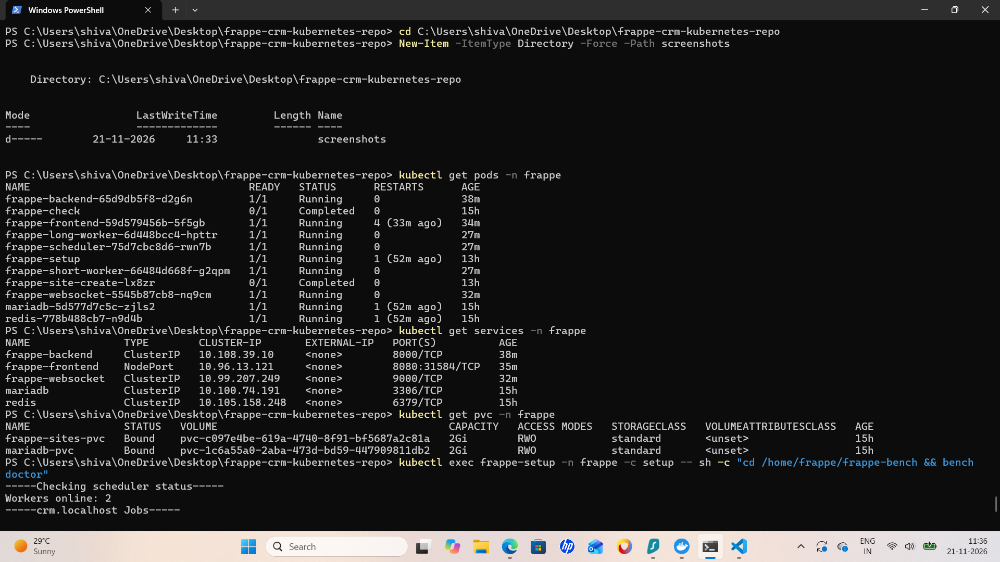
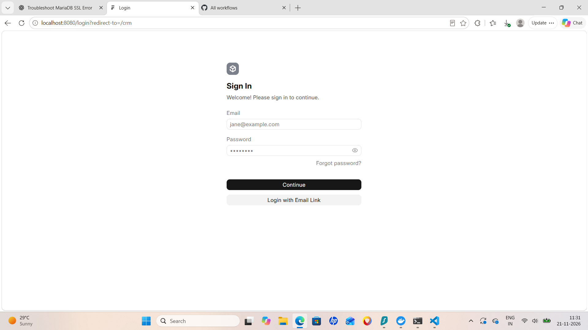
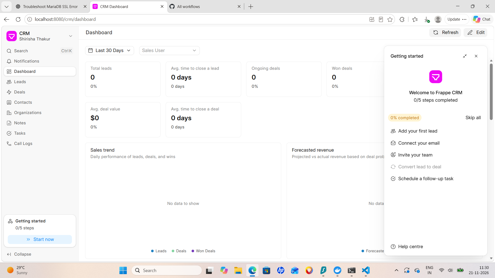
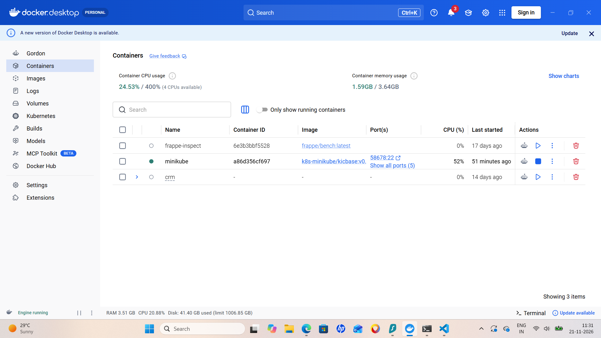

# Frappe CRM Deployment on Kubernetes using Minikube

## 1. Project Overview

This project demonstrates the deployment of **Frappe CRM** on a local Kubernetes cluster using Minikube and Docker Desktop.

The application is deployed using Kubernetes manifests to manage the frontend, backend, database, Redis, WebSocket service, background workers, scheduler, and persistent storage.

The primary objective is to understand Kubernetes orchestration and gain practical experience deploying and managing a multi-component application.

### Project Objectives

- Understand Kubernetes architecture and components.
- Deploy Frappe CRM using Kubernetes YAML manifests.
- Configure application communication through Kubernetes Services.
- Deploy and configure MariaDB and Redis.
- Configure PersistentVolumes and PersistentVolumeClaims.
- Deploy background workers and scheduler.
- Troubleshoot application, database, and networking issues.
- Access and verify the deployed Frappe CRM application.

---

## 2. Technology Stack

| Technology | Purpose |
|---|---|
| Frappe CRM | CRM application |
| Docker | Containerization |
| Docker Desktop | Local container environment |
| Kubernetes | Container orchestration |
| Minikube | Local Kubernetes cluster |
| MariaDB | Relational database |
| Redis | Cache and background job queues |
| Nginx | Frontend and reverse proxy |
| Gunicorn | Python application server |
| YAML | Kubernetes configuration |
| PowerShell | Local command-line environment |

---

## 3. Architecture

The application consists of multiple Kubernetes workloads running inside the `frappe` namespace.

### Application Components

| Component | Responsibility |
|---|---|
| Frontend | Nginx serves the application and routes incoming requests |
| Backend | Runs the Frappe application using Gunicorn |
| WebSocket | Handles real-time communication |
| MariaDB | Stores application data |
| Redis | Provides caching, queue and real-time services |
| Short Worker | Processes short-running background jobs |
| Long Worker | Processes default and long-running background jobs |
| Scheduler | Executes scheduled background tasks |
| Setup Pod | Provides an environment for Bench commands and diagnostics |

### Architecture Flow

```text
                    User Browser
                         |
                         |
                 Frappe Frontend
                     (Nginx)
                         |
             +-----------+-----------+
             |           |           |
             v           v           v
          Backend    WebSocket    Static Assets
          (8000)       (9000)
             |
       +-----+----------------+
       |                      |
       v                      v
    MariaDB                 Redis
    (3306)                  (6379)
                              |
                  +-----------+-----------+
                  |           |           |
                  v           v           v
                Short       Long      Scheduler
                Worker     Worker
```

All these components are deployed within the Kubernetes `frappe` namespace.

---

## 4. Project Structure

```text
frappe-crm-kubernetes-repo/
│
├── .github/
│   └── workflows/
│       └── build-and-push.yml
│
├── images/
│   └── layered/
│       └── Containerfile
│
├── resources/
│   └── core/
│       ├── main-entrypoint.sh
│       └── start.sh
│
├── screenshots/
│   ├── 01-kubernetes-overview.png
│   ├── 02-workers-scheduler.png
│   ├── 03-crm-login.png
│   ├── 04-crm-dashboard.png
│   └── 05-docker-desktop-minikube.png
│
├── apps.json
├── backend.yaml
├── frappe-setup.yaml
├── frappe-site-create.yaml
├── frappe-storage.yaml
├── frontend.yaml
├── mariadb.yaml
├── redis.yaml
├── websocket.yaml
├── workers.yaml
└── README.md
```

### Kubernetes Manifest Description

| File | Description |
|---|---|
| `frappe-storage.yaml` | Persistent storage configuration |
| `mariadb.yaml` | MariaDB Deployment and Service |
| `redis.yaml` | Redis Deployment and Service |
| `frappe-setup.yaml` | Frappe setup environment |
| `frappe-site-create.yaml` | Site creation Job |
| `backend.yaml` | Frappe backend Deployment and Service |
| `frontend.yaml` | Nginx frontend Deployment and NodePort Service |
| `websocket.yaml` | WebSocket Deployment and Service |
| `workers.yaml` | Short worker, long worker and scheduler Deployments |
| `apps.json` | Frappe application configuration |

---

## 5. Prerequisites

The following tools are required:

1. Windows 11
2. Docker Desktop
3. Minikube
4. kubectl
5. Git
6. Visual Studio Code

### Verify Installations

Check Docker:

```powershell
docker --version
docker ps
```

Check Minikube:

```powershell
minikube version
```

Check kubectl:

```powershell
kubectl version --client
```

Check Git:

```powershell
git --version
```

---

## 6. Start the Local Kubernetes Environment

Start Docker Desktop first and ensure its container engine is running.

Start Minikube using Docker as the driver:

```powershell
minikube start --driver=docker
```

Check Minikube status:

```powershell
minikube status
```

Check Kubernetes nodes:

```powershell
kubectl get nodes
```

Check the Kubernetes cluster information:

```powershell
kubectl cluster-info
```

---

## 7. Kubernetes Namespace

The project resources are deployed in the `frappe` namespace.

Check the namespace:

```powershell
kubectl get namespaces
```

Set the current namespace for convenience:

```powershell
kubectl config set-context --current --namespace=frappe
```

Alternatively, use `-n frappe` with individual commands.

---

## 8. Deploying Kubernetes Resources

The deployment uses individual Kubernetes YAML manifests.

Apply the storage configuration:

```powershell
kubectl apply -f frappe-storage.yaml -n frappe
```

Apply MariaDB:

```powershell
kubectl apply -f mariadb.yaml -n frappe
```

Apply Redis:

```powershell
kubectl apply -f redis.yaml -n frappe
```

Apply the Frappe setup environment:

```powershell
kubectl apply -f frappe-setup.yaml -n frappe
```

Apply the site creation Job:

```powershell
kubectl apply -f frappe-site-create.yaml -n frappe
```

Apply the backend:

```powershell
kubectl apply -f backend.yaml -n frappe
```

Apply the WebSocket service:

```powershell
kubectl apply -f websocket.yaml -n frappe
```

Apply the frontend:

```powershell
kubectl apply -f frontend.yaml -n frappe
```

Apply background workers and scheduler:

```powershell
kubectl apply -f workers.yaml -n frappe
```

**Important:** These commands document the deployment process. Do not blindly rerun the site creation Job on an already initialized deployment. Preserve existing database and site data. Check the existing resources before applying changes.

---

## 9. Kubernetes Resource Verification

### 9.1 Check Pods

```powershell
kubectl get pods -n frappe
```

For detailed pod information:

```powershell
kubectl get pods -n frappe -o wide
```

Describe a specific pod:

```powershell
kubectl describe pod <pod-name> -n frappe
```

### 9.2 Check Deployments

```powershell
kubectl get deployments -n frappe
```

### 9.3 Check Services

```powershell
kubectl get services -n frappe
```

### 9.4 Check PersistentVolumeClaims

```powershell
kubectl get pvc -n frappe
```

Check PersistentVolumes:

```powershell
kubectl get pv
```

### 9.5 Check Secrets

```powershell
kubectl get secrets -n frappe
```

This command lists Secret names without displaying their values.

### 9.6 Check All Resources

```powershell
kubectl get all -n frappe
```

---

## 10. Persistent Storage

PersistentVolumeClaims are used to preserve application and database data beyond the lifecycle of individual Pods.

The project uses:

| PVC | Purpose |
|---|---|
| `frappe-sites-pvc` | Stores Frappe site data and files |
| `mariadb-pvc` | Stores MariaDB database data |

Check PVC status:

```powershell
kubectl get pvc -n frappe
```

Expected status:

```text
STATUS: Bound
```

A Bound PVC indicates that the requested persistent storage has been successfully allocated.

**Important:** Do not delete these PVCs when restarting or troubleshooting the application. Deleting them can result in data loss.

---

## 11. Background Workers and Scheduler

Frappe uses background workers to process asynchronous jobs.

The project includes:

- Short worker
- Long worker
- Scheduler

Check worker and scheduler Pods:

```powershell
kubectl get pods -n frappe
```

Check scheduler logs:

```powershell
kubectl logs deployment/frappe-scheduler -n frappe
```

Check short worker logs:

```powershell
kubectl logs deployment/frappe-short-worker -n frappe
```

Check long worker logs:

```powershell
kubectl logs deployment/frappe-long-worker -n frappe
```

### Verify Frappe Scheduler and Workers

Run:

```powershell
kubectl exec frappe-setup -n frappe -c setup -- sh -c "cd /home/frappe/frappe-bench && bench doctor"
```

This command checks scheduler status, worker availability and background job information.

Enable the scheduler if it is disabled:

```powershell
kubectl exec frappe-setup -n frappe -c setup -- sh -c "cd /home/frappe/frappe-bench && bench --site crm.localhost enable-scheduler"
```

---

## 12. Application Access

The frontend is exposed through a Kubernetes NodePort Service.

The configured NodePort is `31584`.

### Option 1: Minikube Service URL

```powershell
minikube service frappe-frontend -n frappe --url
```

### Option 2: Port Forwarding

Run:

```powershell
kubectl port-forward -n frappe service/frappe-frontend 8080:8080
```

Keep the PowerShell terminal running.

Open the application in a browser:

http://localhost:8080

Log in using the Frappe CRM administrator credentials configured during site creation.

---

## 13. Troubleshooting and Debugging

During deployment, several issues can occur.

### 13.1 Check Pod Status

```powershell
kubectl get pods -n frappe
```

For a failing Pod:

```powershell
kubectl describe pod <pod-name> -n frappe
```

### 13.2 Check Application Logs

Backend:

```powershell
kubectl logs deployment/frappe-backend -n frappe
```

Frontend:

```powershell
kubectl logs deployment/frappe-frontend -n frappe
```

WebSocket:

```powershell
kubectl logs deployment/frappe-websocket -n frappe
```

MariaDB:

```powershell
kubectl logs deployment/mariadb -n frappe
```

Redis:

```powershell
kubectl logs deployment/redis -n frappe
```

### 13.3 Check Kubernetes Events

```powershell
kubectl get events -n frappe --sort-by=.metadata.creationTimestamp
```

### 13.4 MariaDB SSL Connection Issue

During deployment, the MariaDB client attempted to establish an SSL connection even though SSL was disabled on the MariaDB server.

This caused database connection and site creation failures.

The issue was resolved by modifying the custom Frappe image's MariaDB client configuration to use:

```text
--skip-ssl
```

The custom image was built and pushed to GitHub Container Registry.

### 13.5 Check Frappe Backend

```powershell
kubectl logs deployment/frappe-backend -n frappe
```

The backend should start Gunicorn and listen on port `8000`.

### 13.6 Check WebSocket

```powershell
kubectl logs deployment/frappe-websocket -n frappe
```

The WebSocket service should listen on port `9000`.

---

## 14. Screenshots

### 14.1 Kubernetes Deployment Overview

Shows Kubernetes Pods, Services and PersistentVolumeClaims.


### 14.2 Background Workers and Scheduler

Shows background worker and scheduler verification.



### 14.3 Frappe CRM Login Page

Shows the deployed application's login page.



### 14.4 Frappe CRM Dashboard

Shows the successfully deployed Frappe CRM dashboard after login.



### 14.5 Docker Desktop and Minikube

Shows the local Docker Desktop and Minikube environment used for the deployment.



---

## 15. Key Learning Outcomes

Through this project, I gained practical experience in:

- Containerizing and deploying a multi-component application.
- Understanding Kubernetes architecture and orchestration.
- Creating and managing Deployments, Pods and Services.
- Configuring service discovery and application networking.
- Managing persistent storage using PVCs.
- Deploying and configuring MariaDB and Redis.
- Managing background workers and scheduled jobs.
- Troubleshooting database connectivity and application startup issues.
- Using Docker Desktop and Minikube for local Kubernetes development.
- Working with Kubernetes YAML manifests and command-line tools.

---

## 16. Conclusion

Successfully deployed Frappe CRM on a local Kubernetes cluster using Minikube and Docker Desktop.

The project demonstrates practical experience with Kubernetes orchestration, containerized application deployment, persistent storage, service networking, background processing and troubleshooting.

This project serves as a hands-on demonstration of container orchestration and application infrastructure management.

---

## Author

GitHub: [Shirisha-Thakur](https://github.com/Shirisha-Thakur)