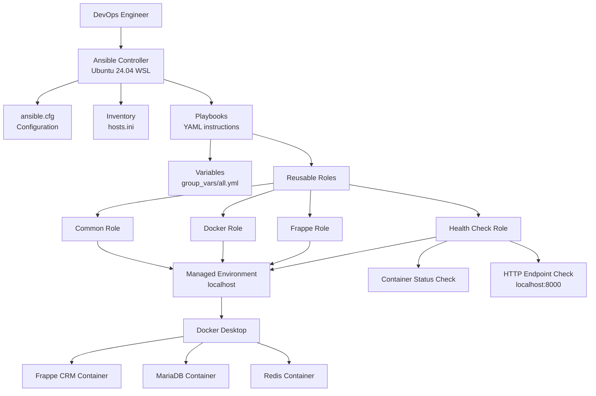

# Ansible Automation for Frappe CRM

## 1. Project Overview

This project demonstrates infrastructure automation and configuration management using Ansible for a Frappe CRM environment.

The objective is to automate system preparation, verify Docker infrastructure, validate the Frappe Docker Compose configuration, and monitor application availability.

The project demonstrates:

- Ansible installation and configuration
- Inventory management
- YAML playbooks
- Variables and configuration management
- Tasks and modules
- Reusable roles
- Handlers
- Idempotency
- Docker verification
- Docker Compose validation
- Container status monitoring
- HTTP endpoint monitoring
- Infrastructure troubleshooting

**Environment:** Ubuntu 24.04 WSL2, Docker Desktop, Windows 11.

## 2. What Is Ansible?

Ansible is an open-source IT automation and configuration management tool.

It helps administrators and DevOps engineers automate repetitive infrastructure tasks, including:

- Installing software packages
- Configuring servers
- Managing services
- Deploying applications
- Managing containers
- Executing commands across multiple servers
- Maintaining consistent infrastructure configurations

Instead of manually configuring every server, Ansible uses instructions written in YAML files called playbooks.

### 2.1 Why Use Ansible?

Without automation, administrators may need to manually install packages, configure services, and verify application status on every server.

Ansible simplifies this process by allowing the same instructions to be executed repeatedly.

Benefits:

| Feature | Explanation |
|---|---|
| Agentless | Managed Linux systems generally do not need an Ansible agent installed |
| YAML-based | Automation instructions are written in readable YAML |
| Idempotent | Repeated execution aims to maintain the desired state without unnecessary changes |
| Reusable | Roles and tasks can be reused across projects |
| Secure | Supports SSH and privilege escalation |
| Scalable | Can manage multiple servers through inventory |

### 2.2 How Ansible Works

Ansible follows a controller-managed architecture.

1. The administrator executes an Ansible command.
2. Ansible reads its configuration file.
3. It loads the inventory to identify managed hosts.
4. It reads the selected playbook.
5. It executes tasks using Ansible modules.
6. It reports whether tasks succeeded, failed, or changed the system.

For this project, Ansible runs locally inside Ubuntu WSL and manages the same WSL environment using a local connection.

## 3. Ansible Architecture

The following diagram illustrates the architecture used in this project.



### Architecture explanation

- **Ansible Controller:** Ubuntu WSL environment where Ansible is installed and executed.
- **Configuration:** Defines the default inventory and role directory.
- **Inventory:** Identifies the managed host.
- **Playbooks:** Define the automation workflow.
- **Variables:** Store reusable configuration values.
- **Roles:** Organize automation into reusable components.
- **Docker Desktop:** Provides the container engine.
- **Health Check:** Inspects container status and tests the Frappe HTTP endpoint.

The diagram represents the intended automation architecture. The Docker containers were stopped during the final test.

## 4. Ansible Core Components and Definitions

### 4.1 Ansible Configuration File

File: `ansible.cfg`

The Ansible configuration file defines default settings used when executing Ansible commands.

Project configuration:

```ini
[defaults]
inventory = ./inventory/hosts.ini
roles_path = ./roles
```

Explanation:

| Setting | Purpose |
|---|---|
| `[defaults]` | Defines default Ansible settings |
| `inventory` | Specifies the default inventory file |
| `roles_path` | Specifies where Ansible searches for roles |

Without these settings, we may need to specify the inventory and role paths manually in commands.

### 4.2 Inventory

An inventory identifies the servers or hosts Ansible manages.

File: `inventory/hosts.ini`

```ini
[frappe_servers]
localhost ansible_connection=local
```

Explanation:

- `frappe_servers` is the inventory group.
- `localhost` identifies the local machine.
- `ansible_connection=local` tells Ansible to execute tasks locally instead of connecting through SSH.

### 4.3 Variables

Variables store reusable values and help avoid hardcoding configuration throughout playbooks.

File: `inventory/group_vars/all.yml`

```yaml
---
frappe_directory: /opt/frappe
frappe_user: "{{ ansible_user_id }}"
frappe_group: "{{ ansible_user_gid }}"
```

Explanation:

- `frappe_directory`: Application directory.
- `frappe_user`: Owner of the application directory.
- `frappe_group`: Group assigned to the directory.

The `group_vars/all.yml` file makes these values available to hosts in the inventory.

### 4.4 Playbooks

A playbook is a YAML file containing one or more plays that define which hosts to manage and which tasks to execute.

Example:

```yaml
---
- name: My First Ansible Playbook
  hosts: frappe_servers
  become: true

  tasks:
    - name: Display server information
      ansible.builtin.debug:
        msg: "Ansible is managing Frappe CRM successfully!"
```

Explanation:

- `name`: Describes the play.
- `hosts`: Specifies the inventory group.
- `become`: Enables privilege escalation.
- `tasks`: Contains the automation instructions.

### 4.5 Tasks

A task is an individual unit of work in Ansible.

Examples include:

- Creating a directory
- Installing a package
- Copying a configuration file
- Checking Docker status
- Validating a configuration file

### 4.6 Modules

Modules are the tools Ansible uses to perform operations.

Modules used in this project include:

| Module | Purpose |
|---|---|
| `debug` | Displays messages and variables |
| `file` | Manages files and directories |
| `copy` | Creates or copies configuration files |
| `apt` | Installs packages and updates the package cache |
| `command` | Executes commands on the managed host |
| `stat` | Checks file information |
| `assert` | Validates conditions |
| `uri` | Performs HTTP requests |

### 4.7 Roles

Roles organize related tasks, variables, handlers, and templates into reusable directory structures.

Instead of writing every task in one large playbook, we divide automation into smaller components.

This project uses four roles:

| Role | Responsibility |
|---|---|
| common | System package preparation |
| docker | Docker installation and connectivity verification |
| frappe | Frappe Compose configuration validation |
| healthcheck | Container status and HTTP checks |

### 4.8 Handlers

Handlers are special tasks that execute when notified by another task.

Example:

```yaml
notify: Configuration updated
```

A handler is useful when a configuration change requires an action, such as restarting a service.

In this project, the handler demonstration uses a debug message to show how notification works.

### 4.9 Idempotency

Idempotency means that repeatedly running an automation task should leave the system in the desired state without making unnecessary changes.

Example:

- First run: Creates `/opt/frappe`.
- Second run: Finds that the directory already exists and leaves it unchanged.

The second execution should report:

```text
changed=0
```

Idempotency is important because it makes automation predictable and safer.

### 4.10 Privilege Escalation

Ansible uses `become: true` to execute tasks with elevated privileges.

This is required for operations such as installing packages or creating directories owned by particular users.

The command-line option:

```bash
--ask-become-pass
```

prompts for the sudo password when privilege escalation is required.

## 5. Technologies and Versions

| Technology | Version |
|---|---|
| Operating System | Windows 11 |
| Linux Environment | Ubuntu 24.04 WSL2 |
| Ansible Core | 2.16.3 |
| Python | 3.12.3 |
| Jinja | 3.1.2 |
| Docker | 29.9.2 |
| Docker Compose | 5.6.1 |
| Container Platform | Docker Desktop |

## 6. Project Directory Structure

```text
task-ansible/
├── ansible.cfg
├── README.md
├── inventory/
│   ├── hosts.ini
│   └── group_vars/
│       └── all.yml
├── playbooks/
│   ├── first-playbook.yml
│   ├── handler-demo.yml
│   ├── common-setup.yml
│   ├── docker-setup.yml
│   └── frappe-setup.yml
└── roles/
    ├── common/
    │   └── tasks/
    │       └── main.yml
    ├── docker/
    │   └── tasks/
    │       └── main.yml
    ├── frappe/
    │   ├── defaults/
    │   │   └── main.yml
    │   └── tasks/
    │       └── main.yml
    └── healthcheck/
        └── tasks/
            └── main.yml
```

## 7. Project Configuration

### 7.1 Frappe Role Variables

File: `roles/frappe/defaults/main.yml`

```yaml
---
frappe_compose_project_dir: /path/to/frappe-crm/docker
frappe_compose_file: docker-compose.yml
frappe_services:
  - frappe
  - mariadb
  - redis
```

These variables identify the existing Frappe Docker Compose project.

### 7.2 Main Playbook

File: `playbooks/frappe-setup.yml`

```yaml
---
- name: Prepare Frappe CRM environment
  hosts: frappe_servers
  become: true

  roles:
    - common
    - docker
    - frappe
    - healthcheck
```

This playbook combines all four roles into one execution workflow.

## 8. Role Implementation and Responsibilities

### 8.1 Common Role

File: `roles/common/tasks/main.yml`

Responsibilities:

- Update the APT package cache.
- Install curl.
- Install wget.
- Install git.
- Install vim.

### 8.2 Docker Role

File: `roles/docker/tasks/main.yml`

Responsibilities:

- Check Docker CLI installation.
- Display Docker version.
- Verify Docker daemon connectivity.
- Display Docker daemon status.

Docker Desktop provides the container engine. A separate Docker Engine was not installed inside WSL.

### 8.3 Frappe Role

File: `roles/frappe/tasks/main.yml`

Responsibilities:

1. Verify the Docker Compose file exists.
2. Assert that the file is present and valid.
3. Validate the Compose configuration.
4. Display the configured services.

The configuration validation uses:

```bash
docker compose -f docker-compose.yml config --quiet
```

### 8.4 Health Check Role

File: `roles/healthcheck/tasks/main.yml`

Responsibilities:

1. Retrieve the current Docker Compose container status.
2. Display the container status.
3. Send an HTTP GET request to `http://localhost:8000`.
4. Report whether the HTTP endpoint is responding.

The health-check role is read-only. It does not start, stop, restart, or delete containers.

## 9. Complete Setup and Execution Commands

The following sections provide the commands used during the project and additional useful verification commands.

### 9.1 Verify the Environment

Check the Python version:

```bash
python3 --version
```

Check Ansible:

```bash
ansible --version
```

Check Docker:

```bash
docker --version
```

Check Docker Compose:

```bash
docker compose version
```

Check Docker daemon connectivity:

```bash
docker info
```

### 9.2 Create the Project

```bash
cd ~
mkdir -p task-ansible
cd task-ansible
```

Create directories:

```bash
mkdir -p inventory/group_vars playbooks roles screenshots
```

Create role directories:

```bash
mkdir -p roles/common/tasks
mkdir -p roles/docker/tasks
mkdir -p roles/frappe/tasks
mkdir -p roles/frappe/defaults
mkdir -p roles/healthcheck/tasks
```

### 9.3 Create and Edit Files

```bash
nano ansible.cfg
nano inventory/hosts.ini
nano inventory/group_vars/all.yml
nano README.md
```

Playbooks:

```bash
nano playbooks/first-playbook.yml
nano playbooks/handler-demo.yml
nano playbooks/common-setup.yml
nano playbooks/docker-setup.yml
nano playbooks/frappe-setup.yml
```

Role files:

```bash
nano roles/common/tasks/main.yml
nano roles/docker/tasks/main.yml
nano roles/frappe/defaults/main.yml
nano roles/frappe/tasks/main.yml
nano roles/healthcheck/tasks/main.yml
```

Nano shortcuts:

- `Ctrl + O`: Save
- `Enter`: Confirm filename
- `Ctrl + X`: Exit

### 9.4 Validate Inventory

Display inventory graph:

```bash
ansible-inventory --graph
```

Display parsed inventory:

```bash
ansible-inventory --list
```

Test local connectivity:

```bash
ansible frappe_servers -m ping
```

The ping module tests Ansible connectivity. It is not an ICMP network ping.

### 9.5 Validate Playbook Syntax

```bash
ANSIBLE_ROLES_PATH=./roles ansible-playbook -i inventory/hosts.ini --syntax-check playbooks/frappe-setup.yml
```

Expected output:

```text
playbook: playbooks/frappe-setup.yml
```

### 9.6 Execute Individual Playbooks

First playbook:

```bash
ANSIBLE_ROLES_PATH=./roles ansible-playbook -i inventory/hosts.ini playbooks/first-playbook.yml --ask-become-pass
```

Handler demonstration:

```bash
ANSIBLE_ROLES_PATH=./roles ansible-playbook -i inventory/hosts.ini playbooks/handler-demo.yml --ask-become-pass
```

Common setup:

```bash
ANSIBLE_ROLES_PATH=./roles ansible-playbook -i inventory/hosts.ini playbooks/common-setup.yml --ask-become-pass
```

Docker setup:

```bash
ANSIBLE_ROLES_PATH=./roles ansible-playbook -i inventory/hosts.ini playbooks/docker-setup.yml
```

Complete Frappe setup:

```bash
ANSIBLE_ROLES_PATH=./roles ansible-playbook -i inventory/hosts.ini playbooks/frappe-setup.yml --ask-become-pass -e "frappe_compose_project_dir=/path/to/your/frappe-crm/docker"
```

The combined playbook is the primary execution command.

### 9.7 Idempotency Testing

Execute the first playbook:

```bash
ANSIBLE_ROLES_PATH=./roles ansible-playbook -i inventory/hosts.ini playbooks/first-playbook.yml --ask-become-pass
```

Execute it again:

```bash
ANSIBLE_ROLES_PATH=./roles ansible-playbook -i inventory/hosts.ini playbooks/first-playbook.yml --ask-become-pass
```

The second run should report zero changes if the desired directory state already exists.

### 9.8 Inspect Project Files

```bash
pwd
ls
ls -R
```

Display a particular file:

```bash
cat ansible.cfg
cat inventory/hosts.ini
cat inventory/group_vars/all.yml
```

## 10. Docker and Frappe Troubleshooting Commands

Navigate to the existing Frappe Compose directory:

```bash
cd /path/to/frappe-crm/docker
```

List configured Compose services:

```bash
docker compose config --services
```

Validate Compose configuration:

```bash
docker compose config --quiet
```

Display all containers, including stopped containers:

```bash
docker compose ps -a
```

Check Docker daemon:

```bash
docker info
```

Inspect containers:

```bash
docker inspect crm-frappe-1
docker inspect crm-mariadb-1
docker inspect crm-redis-1
docker inspect frappe-inspect
```

Inspect MariaDB logs:

```bash
docker logs crm-mariadb-1
```

Inspect Frappe logs:

```bash
docker logs crm-frappe-1
```

These commands were used to investigate the existing environment. They do not themselves start or modify the containers.

## 11. Database Backup Safety

The existing MariaDB backup was preserved during this automation task.

- The backup archive was inspected during troubleshooting.
- The archive was not extracted or restored by the Ansible playbooks.
- No database recovery, volume deletion, or destructive Docker operation was performed.

## 12. HTTP Endpoint Testing

Test the Frappe site hostname:

```bash
curl -I --connect-timeout 5 http://crm-task1.localhost:8000
```

Test localhost:

```bash
curl -I --connect-timeout 5 http://localhost:8000
```

Observed result:

```text
curl: (7) Failed to connect
```

The HTTP endpoint was unavailable because the Frappe application container was stopped.

The Ansible health-check role also tests:

```text
http://localhost:8000
```

The HTTP task is configured with `failed_when: false`, so an unavailable endpoint is reported without failing the complete playbook.

## 13. Execution Results

The combined Ansible playbook executed successfully.

Final observed play recap:

```text
localhost : ok=15 changed=0 unreachable=0 failed=0 skipped=0 ignored=0
```

### Container status during testing

| Container | Observed status |
|---|---|
| crm-frappe-1 | Exited (137) |
| crm-mariadb-1 | Exited (137) |
| crm-redis-1 | Exited (0) |
| frappe-inspect | Exited (137) |

### HTTP health result

```text
Frappe HTTP endpoint is unavailable.
Check whether the application is running.
```

The playbook completed successfully even though the HTTP endpoint was unavailable.

This demonstrates the difference between successful automation execution and application availability.

## 14. Security and Safety Considerations

- Existing MariaDB Docker volumes were preserved.
- The existing database backup was inspected without extraction.
- No database restore was performed.
- No containers were deliberately deleted.
- No existing Frappe application source code was modified.
- No production credentials or secrets were added.
- Health-check tasks are read-only.
- The playbook does not automatically restart stopped services.

## 15. Current Limitations

- The project uses Ansible's local connection rather than remote SSH.
- The Frappe containers were stopped during final testing.
- Actual HTTP application availability was not demonstrated.
- Database recovery was not attempted because the inspected backup did not show the expected application table files.
- The project currently validates configuration and monitors status; it does not perform a complete application deployment.

## 16. Future Improvements

Possible extensions include:

- Remote server management using SSH.
- Automated Frappe deployment.
- Container startup and service management.
- Database backup and restore automation.
- Application readiness checks.
- Monitoring and alerting integration.
- Ansible Vault for sensitive configuration.
- CI/CD integration.

These are possible future enhancements and are not claimed as completed features.

## 17. Conclusion

This project demonstrates practical infrastructure automation using Ansible.

It covers the fundamentals of Ansible architecture, configuration management, inventory, playbooks, variables, tasks, modules, roles, handlers, and idempotency.

It also applies these concepts to a Frappe CRM environment by verifying Docker, validating Compose configuration, monitoring containers, and checking HTTP availability.

The project provides a foundation for extending automation to remote cloud infrastructure and production deployment workflows.
