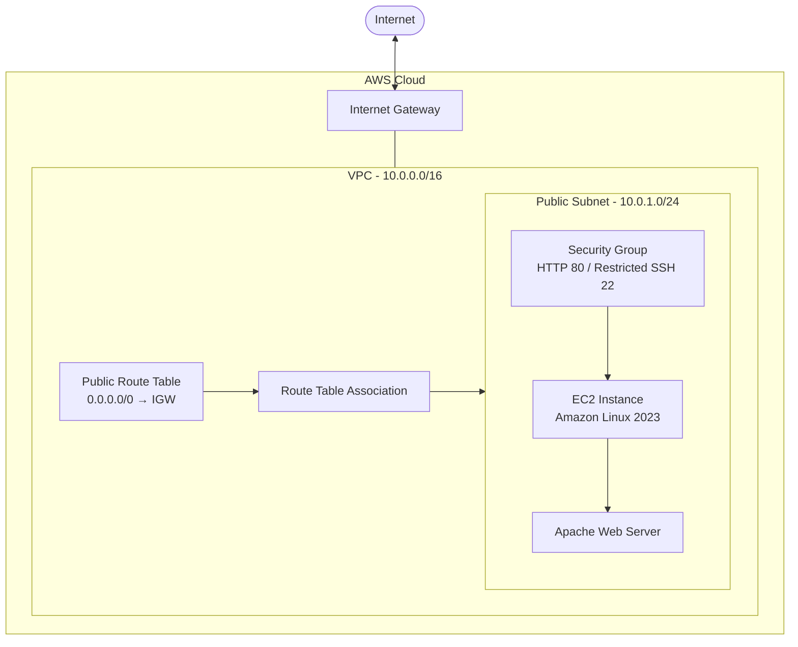

# AWS Secure Web Server Infrastructure using Terraform

## Project Overview

This project defines a secure AWS web server infrastructure using Terraform (Infrastructure as Code).

It uses a VPC, public subnet, Internet Gateway, route table, security group, and EC2 instance to describe a basic internet-facing web server architecture.

**Cloud Provider:** AWS  
**IaC Tool:** Terraform  
**Operating System:** Amazon Linux 2023  
**Web Server:** Apache HTTP Server

## Architecture Diagram



## Terraform Files

| File | Purpose |
|---|---|
| `versions.tf` | Defines Terraform and AWS provider version requirements |
| `provider.tf` | Configures the AWS provider and region |
| `variables.tf` | Defines configurable input variables |
| `main.tf` | Defines AWS infrastructure resources and AMI data source |
| `outputs.tf` | Displays important resource IDs |
| `terraform.tfvars` | Supplies variable values locally; excluded from Git |
| `.gitignore` | Excludes Terraform state, local configuration and temporary files |
| `.terraform.lock.hcl` | Records the selected provider version |

## AWS Resources

| Resource | Terraform resource type | Purpose |
|---|---|---|
| VPC | `aws_vpc` | Creates an isolated AWS network |
| Internet Gateway | `aws_internet_gateway` | Connects the VPC to the internet |
| Route Table | `aws_route_table` | Defines network traffic routes |
| Route Table Association | `aws_route_table_association` | Associates the route table with the subnet |
| Subnet | `aws_subnet` | Creates a public subnet |
| Security Group | `aws_security_group` | Controls inbound and outbound traffic |
| EC2 Instance | `aws_instance` | Hosts the web server |

### Data Source

`aws_ami` retrieves the latest matching Amazon Linux 2023 AMI owned by Amazon.

## Network Configuration

| Setting | Configuration |
|---|---|
| AWS Region | `ap-south-1` |
| VPC CIDR | `10.0.0.0/16` |
| Subnet CIDR | `10.0.1.0/24` |
| Instance Type | `t3.micro` |
| Internet Route | `0.0.0.0/0` → Internet Gateway |
| HTTP | TCP port 80 |
| SSH | TCP port 22 from approved admin IP |

## Terraform Commands

Initialize the Terraform working directory:

```bash
terraform init
```

Format Terraform configuration files:

```bash
terraform fmt -recursive
```

Validate Terraform configuration:

```bash
terraform validate
```

Display Terraform version:

```bash
terraform --version
```

List required providers:

```bash
terraform providers
```

## Security Considerations

- SSH access is restricted to a configured administrator IP.
- HTTP traffic is allowed on port 80.
- AWS credentials are not hardcoded.
- Terraform state and local variable files are excluded from Git.
- The example administrator IP must be replaced with an approved real IP before deployment.

## Project Status

Terraform configuration has been initialized, formatted and validated.

**Deployment status:** Configuration and validation only. No AWS infrastructure has been provisioned as part of this exercise.

## Learning Objectives

- Understand Infrastructure as Code.
- Configure the AWS provider.
- Create and connect AWS networking resources.
- Configure security groups.
- Define an EC2 instance using Terraform.
- Use Terraform variables, outputs and data sources.
- Perform Terraform initialization, formatting and validation.